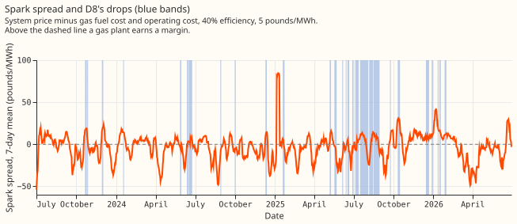

# Experiment 186: are D8's multi-day drops a gas engine following the spark spread?

**Take-home message: the evidence fits a gas engine below D8 that runs when electricity is dear
relative to gas, but does not prove it.** D8 is a substation (Marsh Lane) of National Grid
Electricity Distribution (NGED). Experiment 159 found 28 multi-day stretches since July 2023 in
which D8's metered demand sits below the forecast, which it called drops, with a median shortfall of
2.8 MW. We asked whether a gas-fired generator below D8 explains the drops. NGED suggested an
embedded gas peaker that runs when the spark spread is positive, meaning the electricity system
price exceeds the cost of the gas burned to make it. We built the spread from public data (the
system price from Elexon, the electricity settlement operator, and the daily gas price from National
Gas, the gas transmission operator) and compared the days inside drops with ordinary days matched on
weekday, season, and temperature. We also tested whether the drops are flat on/off blocks, whether
they coincide with Triad half-hours (the three half-hours each winter of highest national demand,
which set transmission charges), and whether the Capacity Market register lists a gas plant next to
D8. The plan predicted two things: drop days have a positive spread at least 20 points more often
than matched days, and at least 20 of the drops are flat blocks. The first holds and the second does
not, so the verdict is `partly supported`. The Triad test does not support the hypothesis either.

**The drops start when the spread rises and end when it falls.** At 40% electrical efficiency, 82%
of drop days have a positive daily spread, against 54% of ordinary days matched on weekday, season,
and temperature. The 95% interval of the difference (+28.4 points) runs from +16.0 to +42.5. Most of
the +28.4-point difference comes from the system price: holding the gas price at its mean still
gives +24.4 points. Experiment 185 found a high system price on the worst days of the best-guess
forecast, so the spread test cannot separate a gas engine from any other load that follows the
system price.

## Results

- **Method.** Public data only (about 23 MB in total; the National Gas data portal item "SAP, hourly
  actual" (SAP is the system average price) for the gas price, and the Elexon system price). Spark
  spread = system price − (gas price in pounds per MWh thermal ÷ electrical efficiency) − 5 pounds
  per MWh operating cost, at 35%, 40% (central), and 45% efficiency. A drop day has at least 75% of
  its half-hours inside a drop. Window: 2023-07-01 to 2026-06-30, 28 drops, 126 drop days, 839
  ordinary days. Matching: same weekday, season within ±30 days, day-mean temperature within 2
  degrees (widened to 4 or 6 if fewer than 3 days match), 1,000 draws, intervals from resampling
  drops.
- **Spread share.** Drop days minus matched ordinary days, in percentage points: +25.8 (+10.3 to
  +42.1) at 35%, +28.4 (+16.0 to +42.5) at 40%, +20.1 (+9.5 to +31.7) at 45%. The same test on the
  evening spread (16:00 to 19:00): +6.0 (−8.8 to +21.2), +10.7 (−0.8 to +22.7), +12.4 (+1.2 to
  +23.5). Price alone (gas held at its mean, 40%): +24.4 (+11.0 to +38.7). The system price in the
  top third of days: +12.0 (−2.2 to +28.3).
- **Prices.** Mean system price on drop days is 91.3 pounds/MWh against 77.9 on matched days (+13.8;
  +6.7 to +21.2). The gas price does not differ (−0.3 pounds/MWh thermal; −2.4 to +1.6).
- **Start and end.** The mean daily spread (40%) rises by +9.8 pounds/MWh (+2.3 to +16.9) between
  the 5 days before and the 5 days from a drop's first day, in the predicted direction for 20 of 28
  drops. It falls by 8.0 (+2.0 to +14.3, in the predicted direction) between the 5 days up to the
  last drop day and the 5 days after it, for 18 of 28 drops.
- **Half-hours inside drops.** After removing each drop's hour-of-day mean, depth is +0.43 MW (+0.32
  to +0.53) deeper in half-hours with a positive spread at 40%, higher in 27 of 28 drops. The
  removal matters because positive-spread half-hours cluster in the evening, when D8's shortfall is
  larger.
- **Shape.** None of the 28 drops is a flat block under the pre-registered cutoff (relative
  interquartile range of the 3-hour median depth under 0.25; median 1.06). The control, a constant
  2.8 MW block injected into 494 ordinary windows of the drops' lengths, has median 0.70 and passes
  the cutoff in 9%. The shape evidence is therefore only that the drops are less flat than injected
  blocks: 3 of 28 drops are below the control median. The median share of variance in a drop
  explained by hour of day is 0.51, and the median ramp at the start is 0.55 of the depth (end:
  0.81).
- **D3, D14, and D5.** None has a drop under D8's definition (24-hour median under −1.5 MW for 2
  days). Runs under each series' own 5th percentile (9, 5, and 4 runs; median depths 0.4 to 0.8 MW)
  have median relative range 0.58 to 0.77 and none passes the cutoff, so these series do not
  contrast with D8 on flatness.
- **Triads.** The nine Triad half-hours of 2023/24 to 2025/26 (list from [Modo
  Energy](https://modoenergy.com/research/en/gb-triads-2025-26-bess-eet-capture-battery-energy-storage-transmission-use-system-charges)
  and [Drax](https://energy.drax.com/insights/triads-up-in-2024-25-spring-update/), which report the
  lists that the National Energy System Operator publishes) are published after the winter ends, so
  a peaker can only run on a forecast of the peak. One of the nine falls inside a D8 drop (the start
  day of one drop), against 10% of winter weekdays in a drop (probability of at least 1 by chance:
  0.62). With nine Triads the test has little power: about 0.9 are expected inside a drop by chance.
  Depth at the Triad half-hour exceeds the same day's median depth for 7 of the 9, but depth at the
  same period on other winter weekdays outside drops is equally high: the Triad excess is +0.2 MW
  (−1.4 to +1.7). Winter weekday depth at 16:00 to 19:00 minus other hours inside drops is −0.2 MW
  (−1.1 to +0.8) over 9 drops, against +1.2 MW on winter weekdays outside drops, a feature of the
  evening shape of the frozen convex weather-to-demand model that produces the residual (experiment
  159).
- **Registers.** The Renewable Energy Planning Database (published by the Department for Energy
  Security and Net Zero, Q2 2026) lists a landfill-gas plant of 1.3 MW within 5 km of D8, and
  gas-fuelled plants (landfill gas, anaerobic digestion) totalling 8.6 MW within 20 km; none is a
  natural-gas peaker. The Capacity Market register (National Energy System Operator, 21 October
  2026) lists a gas plant of 6 MW (reciprocating engines, distribution-connected) at a grid
  reference 0.5 km from D8's coordinates. The unit won a capacity agreement in the 2023-24
  four-year-ahead auction, valid for the delivery years 2023-24 to 2037-38, and the register does
  not mark the agreement terminated. A second unit of 20 MW (reciprocating engines) lies at a grid
  reference 0.5 km from D8 on the other side. The two grid references are 1.0 km apart. The second
  unit was conditionally prequalified in 2022-23 and won no agreement. A reciprocating-engine unit
  of 20 MW also lies 21.6 km away. The register does not show whether the 6 MW plant was built, and
  nothing in it rules out
  combined heat and power. Plant names are withheld here.
- **Daily regression.** The baseline out-of-fold R-squared, from temperature and season terms with
  one month left out, is −0.07. Adding the spark spread raises it by +0.035. Adding the gas price
  alone raises it by +0.038, the system price alone by −0.001, and the system price and gas price
  together by +0.063. Drop days and matched days do not differ in gas price, so the gain from the
  gas price may reflect a time trend (gas prices fell while drops became more frequent in 2025).
  This experiment did not test that explanation.
- **Matching on year (post hoc).** 84 of the 126 drop days fall in 2025. Matching on calendar year
  as well, for the 101 drop days that have a same-year match, gives +31.6 points (+14.4 to +48.9),
  so comparing different years does not explain the difference.

## Whether the spread could become a D8 regressor

- **Candidate hindsight regressor.** A D8 on/off indicator driven by the daily spread (spread above
  zero at 40% efficiency) could enter D8's training as a regressor known only after the day. The
  indicator explains little: the regression gain is +0.034 in out-of-fold R-squared, and 51% of all
  days in the window also have a positive spread.
- **Forecast time.** The indicator cannot be known exactly at forecast time. A spread forecast from
  day-ahead prices (the Elexon day-ahead market index and National Gas's forward price) might serve,
  but the signal is mostly the system price, which a day-ahead forecast does not reproduce.
- **Better data.** The plant's own half-hourly output would settle the hypothesis and give a direct
  regressor.

## Checks

- **Median minus mean forecast, per site.** Not applicable: the experiment scores no forecast.
- **Error of the mean forecast beside each contrast.** Not applicable, for the same reason.
- **Triggers.** Trigger 1 fired: the flat-block control failed, because injected constant blocks
  pass the pre-registered 0.25 cutoff in 9% of windows. The cutoff was too strict for the residual's
  noise, so the 0 of 28 count says only that the drops are less flat than injected blocks. The
  calibrated comparison (3 of 28 drops below the control median) is post hoc. Triggers 2 to 7 of the
  skill's audit list did not fire: no contradiction with experiment 185 (the price signal here is a
  difference between drop days and matched days, not a share of the forecast's daily loss), no
  nested arms, no sister experiment, no leave-one-out flip, and no later design depends on this
  result.
- **Audit.** A fresh Opus audit ran after the code and prose reviews, with its own code (not
  committed; its report is kept privately). It reproduced the +28.4 points (+28.3 in its code) and
  found that the verdict follows the pre-registered rule. It changed or added the following.
    - **Register.** The register paragraph now follows the agreement terms. The first draft read the
      prequalification years and wrongly said the 6 MW obligation ended in September 2024.
    - **Interval.** Drop days shifted by whole weeks (a placebo, with real drops excluded) give a
      spread-share difference with mean 0 and standard deviation 9.5 to 12.5 points. That is 1.5 to
      2 times the spread the cluster bootstrap implies, so the interval above is too narrow. The
      observed +28.4 points still has p of 0.008 or less.
    - **Leave-out checks.** Leaving out any one drop gives +27.3 to +30.6. Leaving out 2025 gives
      +41.3, and 2025 alone gives +21.8.
    - **Wind.** Drop days are 1.26 m/s less windy than matched days, and wind correlates with the
      system price at −0.37. Matching on wind speed as well gives +21.4 to +23.2.
    - **Flat-block control.** Injected blocks that go through the same drop detector are detected
      90% of the time and pass the 0.25 cutoff 8% of the time. The claim that the drops are less
      flat than injected blocks holds, and only 1 of 28 drops is flatter than the median of the
      injected blocks (the earlier count of 3 of 28 used a control that skipped the detector).
    - **Load dependence.** After removing the hour-of-day profile, drops vary more than injected
      blocks (median 1.15 against 0.82 MW). Depth rises with expected demand: +0.61 MW per MW,
      positive in 25 of 28 drops, against +0.16 for the control.
    - **Ordinary days.** Depth is +0.60 MW higher on positive-spread days, so the association is
      continuous and does not need drops.
    - **Other price-following units.** The register lists a 10 MW battery 0.09 km from D8 and a 2.9
      MW demand-side-response unit with an industrial-site component 0.15 km away. A battery cannot
      sustain a multi-day drop, and demand-side response can.
    - **Verdict.** The verdict and the 6 MW engine as a candidate stand.
- **Bad gas values.** The daily gas price has four values far outside the others: 72.8 (2024-07-25),
  63.9 (2026-06-12), 0.51 (2025-11-29), and 0.47 (2026-06-17) pence per kWh, against 1.9 to 5.2 for
  the rest. All four are excluded, and 5 of the 1,090 days in the window have no spread (a missing
  price or an excluded gas value).
- **Hour of day.** The half-hourly contrast is computed after removing each drop's hour-of-day mean.
- **Efficiency.** The spread result holds at all three efficiencies (+25.8, +28.4, +20.1 points).
- **Lab shortcuts.** The residual comes from the frozen convex weather-to-demand model, driven by
  ERA5 (the European Centre for Medium-Range Weather Forecasts reanalysis) temperature, which is not
  available at forecast time. Drops are defined on that residual, so they inherit its errors.

## What the next experiment should answer

Ask NGED whether the 6 MW gas engine registered next to D8 was built, who operates it, and what its
half-hourly output is. Ask separately whether D8's other nearby price-following units
(demand-side response and battery) can explain the multi-day drops. With the plant's half-hourly
output, test whether D8's drops equal the plant's generation. Then test whether the plant's
dispatch follows the spread. Among the public data we checked, we found no test that could separate
a gas engine from other loads that follow the system price.
