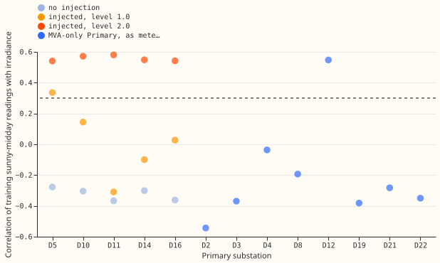
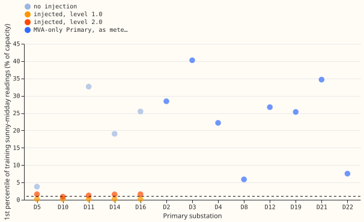

# MVA fold: reverse-flow rule from the correlation with irradiance

**A rule that checks two things on the training sunny-midday meter readings picks the right fit at
every case the registered test scores, but it breaks as soon as the readings include reactive
power.** We asked whether the 8 MVA-only Primaries (the eight substations that report only apparent
power, in MVA) can be told apart from substations with no reverse flow, using the meter readings
and the irradiance alone. The rule picks the fit through the meter (L0, which can see reverse flow)
if the readings rise with irradiance (Pearson correlation above +0.3) or the lowest readings come
close to zero (1st percentile below 1.0 percentage point of capacity). Otherwise the rule picks the
naive fit (N), which reads the magnitude as signed power. With reactive power zero, the rule is
right at D5 (the substation with no reverse flow), at the five injected cases, and at Stickney
(D12). It picks the naive fit at the other seven MVA-only Primaries. With reactive power at power
factor 0.97, the rule fails at moderate injected solar. Verdict: partly supported, because the
registered pass test is met but the test does not cover the realistic reactive setting, and one
threshold was set after seeing experiment 365's numbers.

This follows [experiment 365](../00365-mva-fold-readings-only-reverse-flow-rule/result.md), whose
rule on the lowest readings alone failed at D5 and at Stickney, and which proposed testing how the
readings move with irradiance. No model was refitted: the score of each case is the stored score of
the fit the rule chooses, from
[experiment 358](../00358-mva-fold-known-answer-at-folded-mw-primaries/result.md), which defines the
injection levels and the signed fit (S) used for comparison. The code reuses the way experiment 365
builds the readings. The rule and both thresholds were written into `result.md` before any
statistic was computed. **The threshold of 1.0 on the 1st percentile was chosen after seeing the
numbers of experiment 365** (D5's 1st percentile was 3.79 and the injected cases' were 0.2 to 1.6),
so it is not an out-of-sample test. The correlation threshold of +0.3 comes from the design brief's
measurements.

## Results (reactive power zero, plain direction accuracy on sunny half-hours)

- **D5, no injection: passes.** The statistics are a correlation of -0.28 and a 1st percentile of
  3.79 (2025 cut), so the rule chooses N. Accuracy is 0.980, the same as the signed fit's 0.980. At
  the 2024 cut the chosen accuracy is 0.963 against 0.961. Experiment 365's threshold of 5 chose L0
  here, with accuracy 0.35.
- **Injected cases: pass.** At the 2025 cut the chosen fit is within 0.02 of the signed fit at 5 of
  5 substations at both levels. At the 2024 cut the counts are 4 of 5 at level 1.0 (D11, gap 0.026)
  and 5 of 5 at level 2.0. The rule chooses L0 at all 5 substations in every injected case. At level
  2.0, where 92 to 99% of sunny half-hours have reverse flow, the chosen accuracy equals the signed
  fit's at every substation (0.94 to 0.99).
- **Which test carries which case.** At level 2.0 the correlation exceeds +0.3 at 5 of 5 substations
  at both cuts. At level 1.0 the correlation exceeds +0.3 at 1 of 5 (D5), so the 1st percentile
  below 1.0 chooses L0 at the other four. The correlation alone would miss four of the five level 1.0
  cases.
- **No injection, other substations.** D10 has genuine reverse flow in 14% of sunny half-hours,
  and the rule chooses L0 (1st percentile 0.28) with the same accuracy as the signed fit. D11, D14,
  and D16 have none, and the rule chooses N.
- **Census, not scored.** The rule chooses L0 at Stickney (D12), with correlation +0.55 and 1st
  percentile 26.7, as predicted. It chooses N at D2, D3, D4, D8, D19, D21, and D22, whose
  correlations are -0.54 to -0.04 and whose 1st percentiles are 5.9 to 40.2. Marsh Lane (D8) and
  Langrick (D22) are the closest calls on the 1st percentile (5.9 and 7.6) and stay with N. D12 is
  the only one of the eight with a positive correlation.
- **Power factor 0.97: fails.** With reactive power at power factor 0.97 in the readings, the
  readings stay well above zero (1st percentile 10.7 to 37.6 with no injection, and 11.0 to 17.4 at
  level 1.0). At level 1.0 the rule picks N at 5 of 5 substations at the 2025 cut and 4 of 5 at the
  2024 cut. The mean chosen accuracy is 0.31 (2025 cut) and 0.52 (2024 cut), against the signed
  fit's 0.86 and 0.81. The number of substations within 0.02 is 0 of 5 (2025 cut) and 1 of 5 (2024
  cut) at level 1.0, and 5 of 5 at level 2.0. With no injection, D10 at the 2025 cut is 0.042 below
  the signed fit. This repeats experiment 358's finding for the fit through the meter.

## Checks

- **Triggers.** Trigger 7 of the `ml-experiment` skill may apply, because the planned next steps
  of the MVA sequence depend on this result. No audit was run, because the experiment refits nothing
  and reads two stored result sets, and this session started no sub-agents. The maintainer decides
  whether to order one. Trigger 1 (a failed control) did not fire at reactive power zero, and fired
  at power factor 0.97, where the rule fails at level 1.0 as the earlier experiments did.
- **Median against mean forecast.** Not applicable: no forecasts were made.

## Caveats and what to try next

- **The pass test covers only reactive power zero.** The earlier experiments of the sequence found
  that real readings contain reactive power. If the sequence continues, the next step is a rule that
  still works at power factor 0.97, for example one that corrects each reading for an estimated
  reactive power before computing the statistics.
- The 1.0 threshold was informed by experiment 365, as stated above.
- The injected cases add the same recorded solar-farm output (farm A) to every substation, so the
  five injected cases are not independent evidence of how the rule behaves on other farms.
- The census statistic uses the metered reading at the MVA-only Primaries, so a reading changed by
  generation added to the magnitude (the Marsh Lane change in April 2025) also moves it.
- The census has no ground truth: the claim that D12 has reverse flow and the other seven do not
  comes from [experiment 110][e110] and the design brief, not from a signed measurement.

[e110]: ../00110-differentiable-physics-5-embedded-generation-and-capacity/result.md
