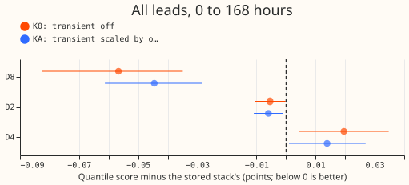

**Plan (committed before any score was read).**

This experiment extends [experiment
364](../00364-d8-stage-blame-and-analogue-recent-power/result.md), which found that the Kalman
filter's short-lived correction (the "transient") adds 0.444 points of quantile score at D8 at
leads of 0 to 24 hours. The experiment asks whether turning the transient off, or scaling it by
how much it has helped that substation recently, removes that loss without hurting other
substations. The Kalman level and transient follow the idea of a Kalman filter on a generalised
additive model's coefficients; see the [Kalman-GAM explainer](../kalman-gam-explainer.md).

The five plan items:

1. **Arms (no refit, scored from the stage columns stored by experiment 364).**
    - Control: stage S4, the stored stack.
    - K0: the transient is removed at leads up to 24 hours. At stage level K0 equals S1 (the plain
      GAM plus the Kalman level) at those leads and S2 elsewhere. At stack level K0 is S4 minus the
      transient (S2 minus S1) and its quantiles move with it. The stack-level form assumes the
      winter night offset and recipe R add the same amounts without the transient (post hoc
      approximation, labelled as such).
    - KA: as K0 at leads up to 24 hours, but the transient is multiplied by a gain g. For each
      forecast run, g is the trailing 90-day mean of (|error of S1| minus |error of S2|) over rows
      with lead up to 24 hours whose valid time is at or before the run's forecast initialisation
      time, divided by the trailing mean absolute size of the transient, clipped to between zero
      and one. Until 672 such rows (14 days of half-hours) exist, g is 1 (the control). The same rule
      applies at every substation. Beyond 24 hours the transient is untouched, because experiment
      364 found it neutral or helpful there.
2. **Row set and sites.** The 96,986 D8 rows of experiment 354 (weekly stage columns), plus D2 and
   D4 (monthly stage columns) as placebos. The six decision Primaries are scored only if stage
   columns for them are stored in the same layout. Otherwise the page says they were not run.
3. **Scores.** Quantile score and Pearson correlation by lead band, each with a month-resampled 95%
   interval, plus day types as numbers: days touched by a detected step, other days, cold winter
   nights, sunny April to June half-hours. Also tail calibration (coverage and pinball loss at
   q01, q05, q95, q99).
4. **Prediction that can fail.** KA recovers at least 0.2 of the 0.444 points at D8 at 0 to 24 hours
   and is within 0.02 of the control at D2 and D4.
5. **Stop rule.** If KA is worse than the control at D2 or D4 by more than 0.05, report K0 only and
   stop.

Caveat on every headline number: interim, one substation, one scored year; it is unproven whether
the generator explains the steps and the gap. The aim is better uncertainty estimation at D8 without
hurting other substations. Schedule: weekly refits at D8 and monthly at D2 and D4, as stored.

## Result

**Take-home message: the Kalman transient costs D8 about 0.4 points at leads under 24 hours and
turning it off recovers that, but it hurts D4, so a rule that decides per substation is needed, and
our first rule is not good enough.** Experiment 364 found that the Kalman filter's short-lived
correction (the "transient") raises D8's quantile score at leads of 0 to 24 hours. We re-scored the
stored forecasts with the transient removed up to 24 hours (arm K0), and with the transient scaled
by a gain computed from each substation's own trailing 90 days of benefit (arm KA). No model was
refitted. The verdict is `partly supported`: the D8 prediction holds and the placebo prediction
fails, so the stop rule applies and KA is not recommended. The six decision Primaries were not
scored, because no stage columns are stored for them in this layout.

**Terms.** D8, D2, and D4 are three Primary substations. D8 is the substation of interest, and D2
and D4 are placebos: substations where the experiment must not make the forecast worse. S1 is the
plain GAM plus the Kalman level, S2 adds the Kalman transient, and S4 is the stored stack, which
adds a winter night offset and recipe R (a subtraction of the recent mean error) after S2. The six
decision Primaries are the six substations that experiment 252 used to judge the stack. A score is
twice the mean pinball loss over 11 quantiles, in points of the substation's effective capacity.

**Caveat.** The result is interim: the headline covers one substation (D8) and one scored year
(2025-07-02 to 2026-06-30, 96,986 rows at D8). It is unproven whether the generator explains the
steps and the gap. The gain rule assumes each row's actual demand is known when the run is issued,
with no publication delay. D8 uses weekly refits, D2 and
D4 use monthly refits, as stored. Lead range 0 to 168 hours, not the full 1-to-10-day horizon.

- **Arms.** Control is the stored stack (stage S4). K0 and KA at stack level shift all 11 quantiles
  of S4 by the removed part of the transient (an approximation: the winter night offset and recipe R
  are not refitted). Arm K0 is reported in full beside KA because K0 is the clearer result at D8;
  the stop rule stops further KA work, not the report. Stage-level versions (`K0_stage`,
  `KA_stage`) apply the same change to S2 and are in `scores.json`. The gain rule and the 14-day
  cold start are in the plan above.
- **Reproduction gate.** The control reproduces the stored stack's per-row score (maximum absolute
  difference 0.0) and the mean 8.338 at D8.
- **Quantile score at 0 to 24 hours, arm minus control (95% interval).**
    - D8: K0 -0.394 (-0.566 to -0.244); KA -0.310 (-0.428 to -0.195). Absolute: control 8.451, K0
      8.058, KA 8.142. Mean KA gain at those leads is 0.048.
    - D2: K0 -0.038 (-0.074 to -0.001); KA -0.041 (-0.076 to -0.007). Absolute: control 1.804.
    - D4: K0 +0.136 (+0.029 to +0.242); KA +0.096 (+0.007 to +0.187). Absolute: control 1.822.
- **All leads, arm minus control.** D8: K0 -0.057 (-0.083 to -0.035), KA -0.045 (-0.061 to -0.028).
  D2: K0 -0.005, KA -0.006. D4: K0 +0.020 (+0.004 to +0.035), KA +0.014 (+0.001 to +0.027); KA is
  within the 0.02 predicted. Both arms change nothing beyond 24 hours by construction.
- **Pearson correlation of the median with the actual demand, 0 to 24 hours, arm minus control.**
  D8: K0 +0.035 (+0.015 to +0.053), KA +0.027 (+0.010 to +0.044). D4: K0 -0.012, KA -0.008.
- **Day types at D8, KA minus control.** Step days -0.044 (-0.063 to -0.026), other days -0.045,
  cold winter nights -0.235 (-0.547 to -0.073, 2,315 rows), sunny April to June -0.023 (-0.051 to
  -0.006). On those two slices KA equals K0 because the gain is 0 there; the winter-night figure
  is a small slice.
- **Prediction.** KA recovers 0.310 of the 0.444 at D8 (predicted at least 0.2): met. KA is better
  than the control at D2: met. KA is worse at D4 by 0.096 at 0 to 24 hours (predicted within 0.02):
  failed, and the stop rule (worse than control by more than 0.05) fires.
- **Tails at D8, 0 to 24 hours (control, K0, KA).** q01 coverage 0.040, 0.037, 0.038 and pinball
  0.842, 0.738, 0.814; q99 coverage 0.965, 0.970, 0.972 and pinball 0.754, 0.700, 0.706. q05 and q95
  pinball also fall (2.326, 2.160, 2.241; 2.196, 2.090, 2.093). Coverage stays inside 0.04 of
  nominal.
- **Checks.** The median minus the mean forecast of S4 is -1.37 points at D8 and 0.0 at D2 and D4;
  the stored mean is the stage-2 mean, before the night offset and recipe R, so the D8 gap is those
  two corrections. The mean absolute error of the mean forecast moves the same way as the quantile
  score for K0 at 0 to 24 hours (D8 -0.558, D2 -0.044, D4 +0.205). No audit trigger fired: no
  control failed, the result agrees with experiment 364, the two error measures agree in sign, and
  no leave-one-out check applies to a single substation. The experiment has not been replicated at
  the six decision Primaries, which keeps the K0 sign at D8 provisional.
- **Why KA falls short at D4.** The gain is the trailing benefit divided by the transient's trailing
  size, which stays small even for a helpful transient, so KA removes most of it at D4 (mean gain
  0.19). A faster or differently normalised rule is untested (post hoc idea, not run).
- **What to try next.** Test a gain rule with a shorter window or a different normalisation, scored
  at D8, D2, D4, and the six decision Primaries together; add stage columns for those Primaries
  first.
- **Code.** `ml-experiments/00367-d8-kalman-transient-off-and-adaptive-short-lead/`
  (`e00367_score.py`, `e00367_charts.py`, `e00367_checks.py`), reading the stage columns stored by
  [experiment 364](../00364-d8-stage-blame-and-analogue-recent-power/result.md).
