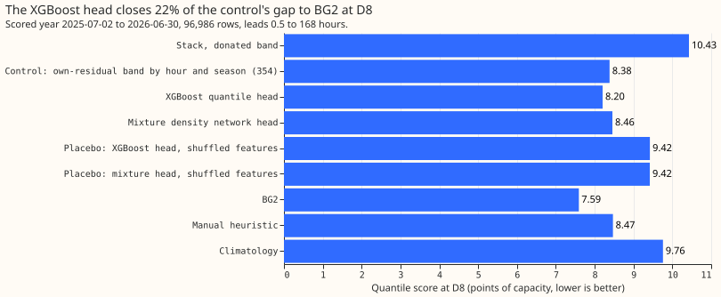
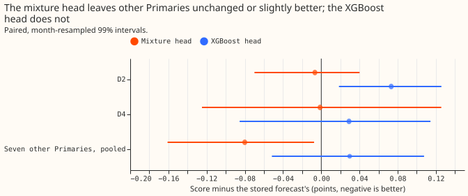
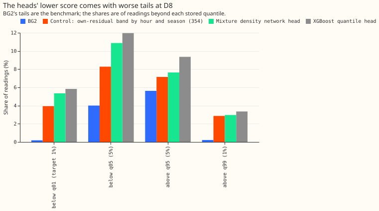

**A band head fitted on all eight Primaries' residuals closes only 22% of the control's gap to BG2
at D8, so the band is not where most of D8's gap lies.**

D8 is a primary substation whose forecast band, in experiment 354, was rebuilt from D8's own past
errors. The rebuilt band cut D8's score but raised D2's by 5.5% and D4's by 6.1% (experiment 354's
arm 2). We fitted one band head on
the stored forecasts' residuals at eight Primaries (D2, D3, D4, D8, D12, D19, D21, D22), refitted
every month on readings that had arrived, and conditioned it on lead, hour, weather, the site, and
the stack's recent residuals. The XGBoost head lowered D8's score by 0.18 points beyond the
control, 22% of the 0.79-point gap to BG2, against a target of 50%. The stop rule (under 25%)
applies, so band work stops. The verdict is `not supported`. The method follows
[experiment 354](../00354-d8-own-residual-bands-and-longer-fit-history/result.md),
[experiment 311](../00311-primary-demand-mixture-density-band-head/result.md) (mixture density
network head), and [experiment 240](../00240-no-xgboost-forecast-sprinkle-part-2/result.md)
(XGBoost quantile offsets), with [Koenker and Bassett (1978)](https://doi.org/10.2307/1913643)'s
quantile loss for the XGBoost head.

**Figure 1: the XGBoost head closes 22% of the control's gap to BG2 at D8.**

**Figure 2: the mixture head leaves the other Primaries unchanged or slightly better.**

**Figure 3: the heads' lower score comes with more readings beyond q01 and q05 at D8.**

## Results

- **Arms.** Control: experiment 354's arm 3 on the stack's fit `b` monthly (D8) and the stored
  donated band (other Primaries). Arm X: XGBoost multi-quantile offsets around the stored median
  (200 trees, depth 5, no column subsampling). Arm M: a three-component Gaussian mixture density
  network (two hidden layers of 64). Placebos: the same heads fitted on features permuted across
  rows. No arm changes the median. Code: `ml-experiments/00368-*/`, importing experiments 252,
  264, and 354.
- **Terms.** D8 and the other Primaries are primary substations. BG2 is the production-style
forecast. The stack is a generalised additive model of demand with a Kalman filter on recent errors.
The control is experiment 354's band built from D8's own residuals by hour block and season. A band
head is a model that predicts the 11 forecast quantiles from the stored median. Scores are in points
of the substation's effective capacity.
- **Rows and fits.** 96,986 rows at D8 (`fold_a_daily_gap_v1`, scored year 2025-07-02 to
  2026-06-30). Fits refit on the first of each month from 2025-08-01 on rows read before that date
  (months of data: 1 to 11), at all leads; rows before the first fit keep the stored band. Monthly
refits, a 300,000-row subsample per fit. Three lab shortcuts apply: the forecasts are stored ones,
readings are assumed to arrive 6 hours late, and the horizon is 0.5 to 168 hours (NGED needs 1 to 10
days).
- **Gate.** The control reproduces 8.382 at D8.
- **Absolute scores at D8, all rows.** Stored 10.428, control 8.382, XGBoost head 8.205, mixture
head 8.456, shuffled-feature placebos 8.466 (XGBoost) and 8.461 (mixture), BG2 7.593, manual
heuristic 8.469, climatology 9.757. Over the seven other Primaries the mean score is 3.174 (stored),
3.159 (control rule), 3.203 (X), and 3.094 (M).
- **Planned contrasts (99% intervals).** C1, X minus control at D8: -0.177 (-0.276 to -0.083), fails
  the -0.41 threshold. C2, X minus stored at D2: +0.073 (+0.019 to +0.126), +3.5%, fails the 3%
  limit. C3, D4: +0.029 (-0.085 to +0.114), +1.3%. C4, pooled over the seven: +0.030 (-0.052 to
+0.108), fails the +0.02 limit. Mixture head: C1 +0.074 (+0.018 to +0.164), C2 -0.007, C3 -0.001, C4
-0.080 (-0.161 to -0.007).
- **Placebo.** Each head is refitted with its training features shuffled among rows of the same
  site and valid month. At D8 the XGBoost placebo scores 8.466 against 8.205 for the real head, so
that placebo passes (the real head is 0.26 better). The mixture placebo scores 8.461 against 8.456,
within the 0.05 limit, so the mixture head's conditioning adds nothing measurable at D8 and its
placebo fails. The stop rule's placebo clause therefore also applies. An earlier placebo that
shuffled rows across sites scored 9.42, because it removed the site and median information; it was
replaced, to match the plan.
- **Tails at D8 (share of readings below q01, below q05, above q95, above q99).** Control 3.9%,
  8.3%, 7.1%, 2.9%; X 5.8%, 12.0%, 9.4%, 3.4%; M 5.3%, 10.9%, 7.6%, 3.0%; BG2 0.2%, 4.0%, 5.6%,
  0.2%. By lead band the X head's score is 8.30, 8.12, 8.19, 8.26 (0 to 24, 24 to 72, 72 to 120, 120
  to 168 hours) against 8.51, 8.29, 8.37, 8.42 for the control. Pinball loss at the four tail
  quantiles and the curtailment-cost metric are not computed here.
- **Caveat.** Interim, one substation, one scored year; it is unproven whether the generator
  explains the steps and the gap.

## Checks

- **Median minus mean forecast, per site.** The stored mean equals the stored median at every
  Primary, so the head cannot shift the mean and the check is uninformative. Median error at D8 is
  1.505 MW for every head and the control's stored median.
- **Mean-forecast error beside each contrast.** Identical across arms (1.505 MW at D8), because no
  arm changes the median.
- **Audit triggers fired.** The trigger for a leave-one-out sign flip: removing D12 turns the
  XGBoost head's pooled change (C4) from +0.030 to -0.009 (the other six leave-one-out values are
  +0.023 to +0.075). The trigger comparing quantile-score and mean-error contrasts cannot fire. The
  verdict rests on the D8 stop rule, which no leave-one-out result changes, so no audit was run.

## What to try next

- Look for the rest of D8's gap in the median forecast, for example the stored median's bias on
  sunny half-hours, because the band cannot move it.
- The mixture head could replace the stored donated band at Primaries without a gas engine; it
  scores 0.08 points better pooled (-0.16 to -0.01), a small gain that needs a replication.
