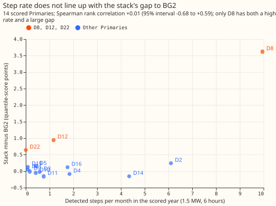
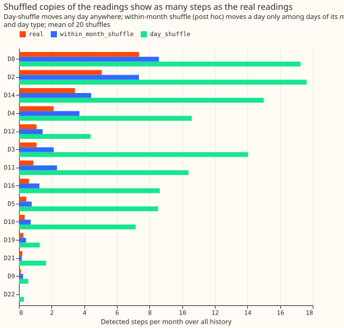

**A simple step counter does not flag the Primaries where the best-guess forecast trails the
production-style forecast (BG2), so the experiment cannot link D8's gap to steps at other sites.**
We counted, at each of 14 Primary substations, how often the demand drops or rises by at least
1.5 MW for at least 6 hours, using the step detector of
[experiment 361](../00361-d8-step-catalogue-detector-injection-and-gam-stack/result.md) unchanged.
We then asked whether sites with more steps are the sites where the best-guess forecast (the
stack, a generalised additive model with a Kalman filter on its effects) scores worse than BG2.
The gap is the stack's mean quantile score minus BG2's, in points of the site's effective capacity;
the quantile score is twice the mean pinball loss over 11 quantiles. They are not: the rank
correlation is +0.007, with a 95% interval of -0.683 to +0.594. A post hoc threshold set as a share
of each site's capacity changes this to
+0.49 to +0.71, so the answer depends on the threshold. Fourteen sites are a weak test. A
placebo check also failed: copies of the
readings with their days shuffled showed as many steps as the real readings. The verdict is
therefore inconclusive.

D8 has the most steps (9.95 per month in the scored year, 2025-07-02 to 2026-06-30) and the largest
gap to BG2 (+3.619 quantile-score points, as in [experiment
252](../00252-gam-stack-at-eight-more-primaries/result.md)). D12 has a gap of +0.947 and ranks 6th
by
step rate. D22 has a gap of +0.639 and no detected steps. Caveat for every number here: the result
is interim, it covers one scored year, and it is unproven whether the generator explains the steps
and the gap at D8, the one substation suspected of a nearby generator.

**Figure 1: step rate and gap do not line up outside D8.**

**Figure 2: shuffled copies of the readings show as many steps as the real readings.**

- **Arms.** No XGBoost, GAM, or neural network is fitted. The detector is experiment 361's
  `detect` at 1.5 MW, 6 hours, run
  once for falls and once for rises over each site's whole history, and a step counts in the scored
  year if it starts between 2025-07-02 and 2026-06-30. Code reused from experiment 361's folder (the
  detector) and experiment 252's folder (the site cache, the BG2 reader, and the scorer).
- **Stack and rows.** The stack is experiment 252 arm A0 at D2, D3, D4, D8, D12, D19, D21, and D22
  (apparent-power sites), and [experiment
  155](../00155-dp-bg-stage2-assembly-night-offset-and-error-correction/result.md) arm C (recipe R
  alone) at D5, D9, D10, D11, D14, and D16 (MW sites), so the two groups use different stack
  versions. The gap is the stack's mean quantile score minus BG2's on the scored year's rows
  outside the hand-filtered load-shift events, leads up to 168 hours, in points of effective
  capacity. The control gate passed: D8's gap reproduces at +3.619.
- **Retraining schedule.** None; stored forecasts are scored. The contrast cannot depend on a
  schedule.

| Site | Gap (points) | Steps in scored year | Steps per month | Rises / falls | Median size (MW) | Rank by rate |
|---|---|---|---|---|---|---|
| D8 | +3.619 | 119 | 9.95 | 72 / 47 | 2.86 | 1 |
| D2 | +0.241 | 73 | 6.10 | 40 / 33 | 2.57 | 2 |
| D14 | -0.155 | 52 | 4.35 | 17 / 35 | 2.08 | 3 |
| D4 | -0.084 | 22 | 1.84 | 22 / 0 | 1.98 | 4 |
| D16 | +0.119 | 21 | 1.76 | 10 / 11 | 1.97 | 5 |
| D12 | +0.947 | 14 | 1.17 | 12 / 2 | 2.46 | 6 |
| D11 | -0.157 | 9 | 0.75 | 7 / 2 | 1.87 | 7 |
| D3 | -0.022 | 7 | 0.59 | 4 / 3 | 1.79 | 8 |
| D5 | +0.147 | 5 | 0.42 | 2 / 3 | 1.84 | 9 |
| D10 | -0.057 | 5 | 0.42 | 3 / 2 | 1.71 | 10 |
| D9 | -0.011 | 2 | 0.17 | 2 / 0 | 2.18 | 11 |
| D19 | +0.131 | 1 | 0.08 | 1 / 0 | 2.36 | 12 |
| D21 | +0.050 | 1 | 0.08 | 0 / 1 | 2.85 | 13 |
| D22 | +0.639 | 0 | 0.00 | 0 / 0 | none | 14 |

- **P1 (rank correlation at least 0.5): fails.** +0.007 over 14 sites (95% interval from resampling
  sites -0.683 to +0.594); -0.242 without D8; +0.228 over the eight apparent-power sites only.
- **P2 (D8, D12, and D22 all in the top five by rate): fails.** D8 is 1st, D12 is 6th, D22 is 14th.
- **P3 (shuffled rate under half the real rate): fails.** Shuffling whole days moves the rate to 2.3
  to 20.2 times the real rate at the 13 sites with steps. The decision rule says no verdict is
  drawn from P1 and P2 when P3 fails, hence `inconclusive`. The shuffle moves summer days next to
  winter days, so a post hoc placebo permutes days only among days of the same month and day type.
  It still gives 0.8 to 2.7 times the real rate (D8 1.17, D12 1.35, D2 1.45, D21 0.84). The
  detector's rate is therefore mostly ordinary demand variation at every site, and no site's rate
  clearly stands out from its shuffled copies.
- **Size and direction.** Median step size is 1.7 to 2.9 MW at every site, and D2 has rises
  and falls in similar numbers (40 and 33), as ordinary demand swings would; D14 is fall-heavy
  (17 rises, 35 falls), and D4 and D12 have almost only rises.
- **Capacity-share threshold (post hoc).** The gap is in points of capacity, so a fixed 1.5 MW
  threshold treats sites of 3.2 to 18.2 MW differently (it is 47% of D22's capacity and 32% of
  D12's). The audit asked for a sweep of 7 thresholds, each a share of the site's effective
  capacity, on the 14 sites. The plan fixed 1.5 MW, so these rows are post hoc.

| Threshold | Spearman | Without D8 | Without D8 and D12 | Rank of D8, D12, D22 |
|---|---|---|---|---|
| 1% | +0.62 | +0.52 | +0.39 | 1, 2, 4 |
| 2% | +0.67 | +0.59 | +0.48 | 1, 2, 4 |
| 3% | +0.71 | +0.64 | +0.55 | 1, 2, 3 |
| 5% | +0.49 | +0.36 | +0.19 | 1, 2, 3 |
| 8% | +0.51 | +0.38 | +0.22 | 1, 2, 5 |
| 10% | +0.56 | +0.45 | +0.30 | 1, 2, 5 |
| 15% | +0.53 | +0.41 | +0.24 | 1, 2, 6 |

- **Reading the sweep.** At 1% to 3% every site has 16 to 33 steps per month, and the within-month
  shuffle gives about 1.0 to 1.3 times the real count at 3%, so those correlations mostly track
  volatility relative to capacity. At 10% the shuffle gives 1.0 to 2.0 times the real count. The
  pre-registered threshold stays 1.5 MW.
- **Not covered.** The detector threshold is in MW, so a site with a larger capacity has more
  chance to cross it; no capacity-share threshold was tried. The scored-year window is 12 months, so
  rates of 0 to 2 steps are single-digit counts. The MVA sites' gaps average over rows that also
  have climatology and manual-heuristic scores (experiment 252's rows), and the MW sites' gaps over
  all rows with a BG2 forecast, so the row filters differ slightly between the two groups. The
  placebos assume the cache is contiguous half-hours from midnight and move data gaps with their
  days. P3 compares the placebo with the real rate over all history, and D22, with no real steps,
  cannot be tested.

## Checks

- **Median minus mean forecast per site:** not applicable, because no forecast was produced here;
  the gaps are read from stored forecasts that earlier experiments already checked.
- **Mean-forecast error beside the quantile-score gap:** not computed, because the gap is only the
  correlate and the experiment makes no forecasting contrast.
- **Triggers fired:** trigger 1 of the `ml-experiment` skill's audit list, a failed placebo. A
  Sonnet audit (the manager chose Sonnet only) re-derived the step counts, gaps, Spearman, and
  placebos from the raw inputs and reproduced them. Mixing experiment 252's and 155's stack arms
  does not move the ranking (all 14 sites with one arm give -0.011 against +0.007), and counting
  steps by overlap with the window gives identical counts. The audit also found that the
  capacity-share threshold changes the correlation, which this page now reports. Leaving out D8
  makes the 1.5 MW correlation negative (-0.242), so it rests on D8 alone.

## What to try next

- Test the cause of D12's and D22's gaps directly (D12's apparent-power reading folds reverse flow,
  per [experiment 252](../00252-gam-stack-at-eight-more-primaries/result.md); the cause of D22's gap
  is unclear),
  because their step rates are low.
- A detector for D8's multi-day drops needs a placebo it passes before it is used across sites.
