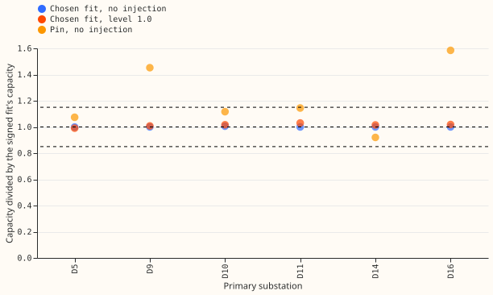
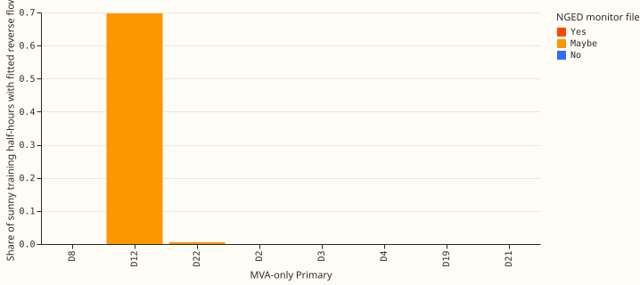

# MVA fold: solar capacity and the eight MVA-only Primaries

**With reactive power zero, the chosen fit recovers the solar capacity at all six signed-MW
Primaries, and the fit through the meter finds reverse flow at Stickney (D12) and nowhere else among
the eight MVA-only Primaries.** We asked whether the rule of
[experiment 366](../00366-mva-fold-irradiance-correlation-reverse-flow-rule/result.md), which
chooses between a fit that reads the meter reading as signed power (N) and a fit through the meter
that can see reverse flow (L0), keeps the fitted solar capacity close to the capacity of a fit to
the signed series (S), and where L0 finds reverse flow at the eight Primaries whose meters report
only apparent power (MVA). The capacity of the chosen fit is within 3.1% of S's at all six signed-MW
Primaries, with and without added solar output. L0 finds reverse flow at D12 and at no other
MVA-only Primary, including Marsh Lane (D8), which NGED marks "Yes". Verdict: partly supported.
The capacity and D12 results hold. The second half of the hypothesis, that L0 finds reverse flow at
the substations NGED marks "Yes" or "Maybe", was refuted, and so was the prediction P3 that L0
would invent reverse flow elsewhere.

Every result holds for reactive power zero only. [Experiment 366](../00366-mva-fold-irradiance-correlation-reverse-flow-rule/result.md)
found that the rule fails at power factor 0.97, and real MVA-only meters have unknown reactive
power. The rule is used as registered and was not tuned. The fits are frozen at the cut on past
weather, as in [experiment 358](../00358-mva-fold-known-answer-at-folded-mw-primaries/result.md),
which also holds the injection levels. The fitted capacity is the last season-year's at the cut;
the 2025-07-01 cut uses no later rows. D9 is new; D5, D10, D11, D14, and D16 reuse experiment 358's
cells, and the pin is experiment 45's `frozen` vintage as read by `pinned_capacity`.

## Results (reactive power zero, scored cut unless stated)

- **P1 holds.** The chosen fit's capacity is within 15% of S's at 6 of 6 Primaries at level 0.0
  (ratios 0.999 to 1.006) and at level 1.0 (0.991 to 1.030). The rule chooses N at D5, D11, D14, D16,
  and D9 and L0 at D10 with no injection, and L0 everywhere at level 1.0. L0's own ratio at D5 with
  no injection is 1.30, the placebo failure of experiment 358.
- **P2 holds, narrowly.** The pin is within 25% of S's capacity at 4 of 6 at level 0.0: D5 1.07, D10
  1.12, D11 1.14, D14 0.92. It is 1.45 at D9 and 1.58 at D16.
- **P3 fails.** L0's fitted reverse-flow share of sunny training half-hours exceeds 50% at 1 of the
  8 MVA-only Primaries at both cuts. At D12 it is 0.70 (scored) and 0.62 (replicate). At D8 and at
  the other six it is at most 0.006. At D22 (NGED "Maybe") L0 and N have nearly the same capacity
  (51.4 and 51.2), and at D8 they are identical, so L0 finds nothing there that N lacks.
- **P4 holds.** At D12 the rule chooses L0 at both cuts, and L0's reading error on sunny half-hours
  is 9.3 points of capacity below N's at the scored cut (16.2 against 25.5) and 10.7 below at the
  replicate cut. At the seven others the chosen arm is N, so its error equals N's by construction.
- **Rule statistics at the census.** D12 has correlation +0.55 and a 1st percentile of 26.7. The
  seven others have correlations of -0.54 to -0.04 and 1st percentiles of 5.9 to 40.2, which
  repeats experiment 366.
- **Starting points disagree.** The six starting points of L0's fit disagree on capacity by 125
  points at D12 and 176 at D4 (11 to 20 at D2, D8, D19, D21; under 0.2 at D3 and D22; scored cut), so a single
  fit's capacity at D4 or D12 is uncertain.

## Checks

- **Triggers.** Trigger 2 fired on P3, which contradicts experiment 365's finding that L0 fits
  reverse flow on 96% to 97% of summer midday half-hours at D5. The explanation offered, not tested separately:
  experiment 365 reported that figure at the signed-MW sites it checked, including D5, where the
  readings dip towards zero, and the eight census
  Primaries have 1st percentiles of 5.9 or more, so no mirror basin sits close to the data. Trigger
  7 fired, because a planned all-16-Primaries experiment depends on this result and it has not been
  replicated. An audit is required before merge: the series brief allows Sonnet only, so a fresh
  Sonnet auditor runs it, as for experiment 358; its findings are triaged in the pull request.
- **Median against mean forecast.** Not applicable: frozen point fits, no quantile forecasts.
- **Mean forecast error beside each contrast.** The contrasts here are the reading errors and the
  capacity ratios above.

## Caveats and what to try next

- No signed truth exists at the census Primaries. The claim that D12 has reverse flow and the others
  have little rests on the NGED monitor file and
  [experiment 110](../00110-differentiable-physics-5-embedded-generation-and-capacity/result.md).
  It is unconfirmed whether the fit cannot see reverse flow at D8 or D22 or whether there is none.
- Frozen fits on past weather: no ensemble forecast, no quantiles, no Kalman filter.
- The all-16-Primaries step should run the full forecast stack and must include the power factor
  0.97 case, where the rule and the fit are known to fail.
