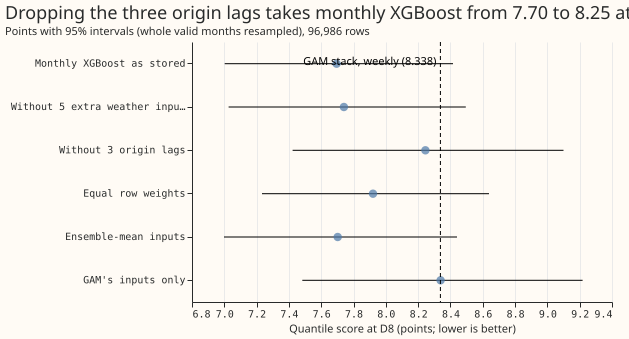
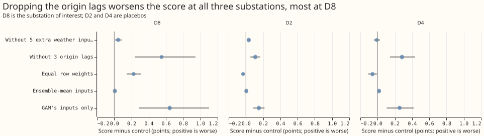
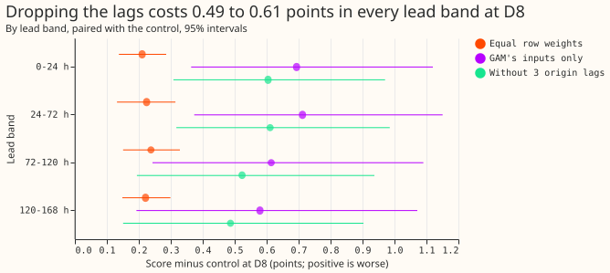

**Take-home message: monthly XGBoost beats the GAM stack at D8 mostly because it uses the power
measured shortly before the forecast starts.** Removing three lagged power values from its inputs
raises its quantile score at D8 by 0.550 points (95% interval +0.237 to +0.944), which is 86% of
the 0.643-point gap between the two forecasts (the interval spans roughly 37% to 147% of the gap).

**What we compared.** D8 is the Primary substation at Marsh Lane, one of the substations that step
33 kV or 66 kV down to 11 kV. The GAM stack is the generalised additive model forecast of Primary
demand research default 1, refitted weekly (experiment 355). "Monthly XGBoost" is the XGBoost
(gradient-boosted decision tree) forecast of one member of BG2, the second best-guess forecast for
Primary substations, refitted once a month (experiments 87 and 360). Scores are the quantile score,
twice the mean pinball loss over 11 quantile levels, in points (percent of the substation's
effective capacity, the largest demand it carries; lower is better). Experiment 360 found that
monthly XGBoost alone scores 7.695 at D8 against 8.338 for the GAM stack, a gap of 0.643 points. We
refitted monthly XGBoost with one group of inputs changed at a time. The three lags are the power
observed at the forecast origin (the time the forecast is made), at the same half-hour one day
earlier, and at the same half-hour one week earlier, each using only telemetry at least 3.5 hours
old. Removing the three lags and the five extra weather inputs together gives 8.339, level with the
GAM stack.

**Prediction.** Written before any score was read: removing at least one input group raises the D8
score by 0.3 points or more, and no group moves the score at D2 or D4 (two other Primary
substations used as placebos) by more than 0.1 points. The first half held. The second half failed:
removing the lags raises the score by 0.283 at D4 (interval +0.143 to +0.435) and by 0.109 at D2
(+0.052 to +0.164, which includes 0.1).

**Caveat.** This is interim, from one substation and one scored year, and it is unproven whether
the generator explains the steps and the gap. The aim is better uncertainty estimation at D8
without hurting other Primaries. The GAM stack's Kalman filter (a recursive correction) also reads
recent power, in a different form (experiment 364), so the GAM stack does not simply lack the lags.

## Arms and scores

| Arm | D8 score | D8 minus control | D2 minus control | D4 minus control |
|---|---|---|---|---|
| Control: monthly XGBoost as stored | 7.695 (7.002 to 8.416) | 0 | 0 | 0 |
| Without five extra weather inputs | 7.741 (7.026 to 8.495) | +0.045 (+0.009 to +0.087) | +0.033 (+0.016 to +0.052) | -0.009 (-0.045 to +0.027) |
| Without three origin lags | 8.245 (7.423 to 9.100) | +0.550 (+0.237 to +0.944) | +0.109 (+0.052 to +0.164) | +0.283 (+0.143 to +0.435) |
| Equal row weights | 7.920 (7.233 to 8.638) | +0.225 (+0.144 to +0.308) | -0.033 (-0.045 to -0.019) | -0.059 (-0.109 to -0.009) |
| Ensemble-mean inputs | 7.702 (6.998 to 8.440) | +0.007 (-0.007 to +0.026) | +0.005 (-0.008 to +0.019) | +0.017 (+0.004 to +0.030) |
| GAM's inputs only | 8.339 (7.483 to 9.218) | +0.644 (+0.288 to +1.101) | +0.150 (+0.086 to +0.216) | +0.255 (+0.106 to +0.419) |

Intervals are 95%, from 20,000 resamples of whole valid months (seed 0). Differences are paired on
the same rows, in points. The control scores 2.238 at D2 and 2.398 at D4. D8 has 96,986 rows; D2 and
D4 have 121,492 rows each (all stored rows to 168 hours).

## Decision and results

- **Verdict: supported.** One group (the origin lags) raises the D8 score by at least 0.3 points
with
  an interval wholly above zero. The stop rule (no group reaches 0.2) did not fire. The placebo half
  of the prediction failed (see above); the verdict rests on the decision rule, which does not
  mention placebos.
- **The arms overlap.** The D8 effects of the lags (+0.550) and the equal weights (+0.225) sum to
  more than the 0.643-point gap, so "86%" is the share for one arm, not a partition of the gap.
- **Gate.** The refitted control scores 7.695 against the stored 7.694 (tolerance 0.05).
- **Absolute D8 scores.** The control scores 7.695, the GAM stack 8.338 (weekly refits, experiment
  355), BG2 7.593 (experiment 360), and the GAM-inputs-only arm 8.339. That arm drops the five extra
  weather inputs (longwave radiation, dew point, surface pressure, precipitation, 10 m wind speed)
  and the three lags, and keeps temperature, shortwave radiation, solar angles, calendar columns,
  and lead hours.
- **Lead bands at D8.** Dropping the lags raises the score by +0.604 (0 to 24 h), +0.611 (24 to 72
  h), +0.523 (72 to 120 h), and +0.487 (120 to 168 h); every interval is above zero. The effect
  shrinks only slightly at D8, but at D4 it falls from +0.539 to +0.147 and at D2 from +0.175 to
  +0.054, so it is a D8 pattern.
- **Median error and bias at D8.** Bias is the median forecast minus the actual demand, so a
positive
  value is over-forecasting. Without the lags, the mean absolute error of the median rises from
  14.02 to 15.13 points of capacity, the bias from +3.43 to +5.87 points, and the correlation with
  the actual demand falls from 0.447 to 0.390. Equal weights also raise the bias, to +5.34.
- **Recency weighting.** Equal weights raise the D8 score by +0.225 and lower the D2 and D4 scores
  (-0.033 and -0.059), so the 0.5-year half-life helps at D8 and hurts at the other two substations.
- **Retraining schedule.** Monthly refits on the whole history with a 0.5-year half-life, 500
rounds,
  eta 0.05, as experiment 87; the contrast could depend on the schedule, which was not varied.
- **Data.** Training rows from the control member of the ECMWF ensemble forecast (ENS) with ERA5
  reanalysis past weather, as experiment 87, and 500 boosting rounds at learning rate 0.05; the
  lags use observed power at least 3.5 hours before the forecast origin.

## Checks

- **Mean forecast.** The stored forecasts hold quantiles only, so there is no mean forecast to
  compare with the median. The mean absolute error of the median moves in the same direction as the
  quantile score for every arm at D8, D2, and D4.
- **Audit triggers.** None of triggers 1 to 6 fired: the control reproduced the stored score, the
  ensemble-mean arm (which should change little) moved D8 by 0.007, inside its interval's 0.017
  half-width, no result contradicts experiment 364 (recent power matters), and the mean absolute
  error of the median agrees in sign with the score for every arm. Trigger 7 (a later experiment's
  design depends on this result and the result is unreplicated) fires, because the proposed GAM
  recent-power term depends on it. A Sonnet audit (the manager's decision; no Opus) re-derived the D8,
  D4, and D2 contrasts from the raw stored forecasts with its own code and reproduced them to within
  0.004, found no lookahead and no missing rows, and found that the refitted control matches the
  stored member at all three substations. It also found that the D8 lag effect is uneven across
  months: leaving out any one month keeps it between +0.391 and +0.606, but it is large in August
  2025 (+2.25) and December 2025 (+1.25) and slightly negative in February 2026 (-0.12). "86% of
  the gap" is a difference of two scores, and does not show that the GAM stack lacks the lags.

## Caveats and what to try next

- **Next candidate.** A GAM term that uses the power measured just before the forecast origin. The
  maintainer decides whether to test it; this experiment did not test which form of the term works.
- **Lags in production.** The lags need telemetry within 3.5 hours of the forecast origin, so they
  are unavailable when telemetry is late, and the degradation rule then applies.
- **Background.** No new data-processing finding, so `data-processing.md` is unchanged.
- **Code.** `ml-experiments/00371-d8-monthly-xgboost-input-group-ablation/` imports experiment 87's
  folder (`e00087_fit_demand.py`, `e00087_common.py`, `e00087_regimes.py`, `e00087_stack.py`) and
  reads experiment 360's stored frames. Printed numbers are in `printed_report.txt` beside the
  scripts.
