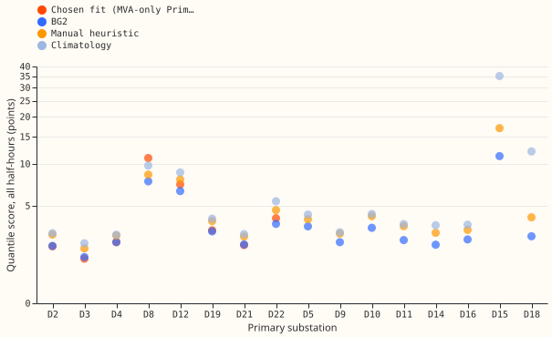
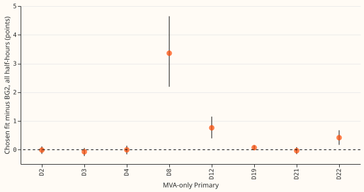

# MVA fold: the rule-chosen fit at all 16 Primaries

**At the Primary substation D12 (Stickney), the fit through the meter scores 0.57 points better
than the naive fit on sunny daylight half-hours, but twelve months of data cannot distinguish that
gain from zero.** A Primary is a substation that steps 33 kV down to 11 kV. Eight Primaries report
apparent power in megavolt-amperes (MVA), which carries no direction of flow, so reverse flow
(power flowing from the substation back into the grid) is hidden. The naive fit treats the meter
reading as signed power. The fit through the meter models the lost sign. We asked whether the fit
that the rule of
[experiment 366](../00366-mva-fold-irradiance-correlation-reverse-flow-rule/result.md) chooses
scores better than the naive fit. The rule picks the fit through the meter when the training
readings rise with irradiance or come close to zero, and it picks the fit through the meter at D12
only. Scores are quantile scores in points of effective capacity (percent of the Primary's
capacity). The scored year is 2025-07-02 to 2026-06-30. We scored the stored forecasts of
[experiment 152](../00152-dp-mva-fold-aware-gam-k-at-mva-only-primaries/result.md) over
2025-07-02 to 2026-06-30, leads 0.5 to 168 hours, beside BG2 (the production-style forecast),
climatology, and the manual heuristic at all 16 Primaries. Verdict: not supported, because the D12
interval includes zero.

**Experiment 372 is close to a repeat of experiment 152.** It applies no stage-2 correction and
makes no claim against the arm A1 of
[experiment 252](../00252-gam-stack-at-eight-more-primaries/result.md). Stage 2 is the correction
step fitted on tuning-period forecasts. Experiment 152 did not store
those forecasts. Applying stage 2 means re-running experiment 152's engine into a new folder.
Every result holds for reactive power zero. The rule fails at power factor 0.97 (experiments 358
and 366).

## Results (quantile score in points of effective capacity; lower is better)

- **P1 fails its interval.** At D12, the fit through the meter minus the naive fit is -0.57 on
  sunny daylight half-hours (-2.42 to +1.31) and -0.30 over all half-hours (-0.76 to +0.18). The
  point estimate is inside the predicted -1.0 to 0.0, and the interval includes zero.
- **P2 holds by construction.** At the seven other Primaries the chosen fit is the naive fit. The
  fit through the meter and the naive fit also score within 0.001 points of each other at D2, D3,
  D4, D19, D21, and D22, and differ only at D8 (-0.21 over all half-hours; interval -0.74 to +0.20) and D12.
- **P3 fails.** The chosen fit scores worse than BG2 over all half-hours at 4 of 8 Primaries: D8
  (+3.36; 2.19 to 4.65), D12 (+0.76; 0.40 to 1.15), D22 (+0.42; 0.17 to 0.68), and D19 (+0.07; -0.01
  to +0.15). It is level with or below BG2 at D2, D3, D4, and D21. Pooled over the eight it is +0.56
  (0.39 to 0.75), or +0.16 without D8.
- **Sunny daylight half-hours.** The chosen fit trails BG2 at all 8 Primaries on the point estimate
  (pooled +0.73; 0.48 to 1.01), by 0.01 to 1.70 points; the gaps at D19 (+0.01), D3 (+0.10), and D4
  (+0.28) have intervals that include zero.
- **Control gate passes.** The rescored BG2 scores match experiment 252's stored values (D12 6.47,
  D2 2.18).
- **D15 and D18.** The stack has never run at either. BG2 scores 11.27 at D15 (0.8 months of usable
  history, 53,525 rows) and 2.74 at D18 (61,463 rows) over all half-hours; climatology scores 35.14
  and 12.09, and the manual heuristic 17.02 and 4.04.
- **Hand-filtered half-hours in the scored year.** D5 2,107; D18 1,317; D15 1,124; D16 947; D3 456;
  D14 352; D12 310; D22 209; D10 117; D4 106; D19 106; none at D2, D8, D9, D11, and D21, which
  have either no event list or no event in the scored year.
- **Six signed-MW Primaries.** No stack scores exist on these rows. BG2 scores are in figure 1.

## Checks

- **Median against mean forecast.** This check does not apply, because only quantiles are scored.
- **Triggers.** Trigger 2 applies to P3, which failed against experiment 252's reading that raw
  fits trail BG2 at most MVA-only Primaries; the raw fits are level with BG2 (within 0.1 points) at
  five of eight, and
  the reason (the lead range and the stage-2 correction) was not tested. No other trigger fired.
  The pooled contrast without D8 stays positive (+0.16), so leaving out D8 does not flip its sign.
- **Tail calibration** (coverage and pinball loss at q01, q05, q95, q99) was not computed here;
  experiment 152 holds it for these fits.

## Caveats and what to try next

- One scored year and twelve month-blocks give wide intervals.
- No stage 2, so no comparison with experiment 252's arm A1 or with research default 3 is possible.
- The rule's choice rests on experiment 366's thresholds, one of which was set after seeing
  experiment 365's numbers.
- Re-running experiment 152's engine into a new folder would give stage-2 tuning forecasts at seven
  Primaries. It needs hours of compute and the maintainer's yes.
