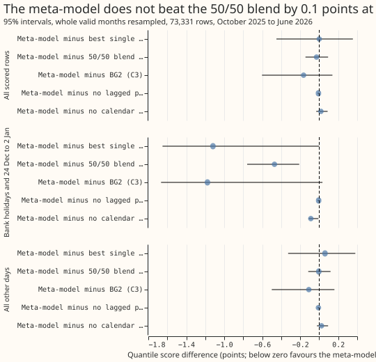
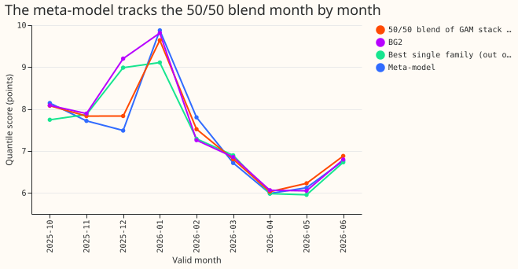
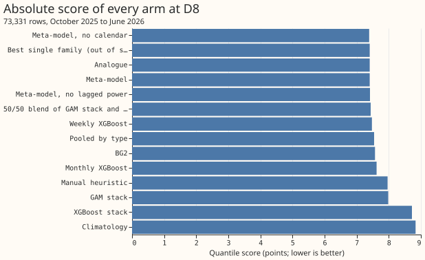

**Take-home message: weighting the stored forecasts by context did not help at D8, and whether it
helps around holidays is unresolved.** We asked whether a second XGBoost model, which we call the
meta-model, could give each of seven stored forecasts a weight that depends on the time, and so beat
the best of them. The seven are BG2's five members (weekly XGBoost, monthly XGBoost, analogue,
pooled by substation type, and an XGBoost stack), the generalised additive model (GAM) stack, and
BG2, the best-guess blend of the five members. The meta-model also saw the lead time, the actual
power at the forecast's origin, the day of week, the hour, the month, a bank-holiday flag, and each
forecast's error over the previous 7 days. We trained it on earlier months and scored it on the
next month, from October 2025 to June 2026, at substation D8 (Marsh Lane).

The meta-model's quantile score was 7.406 (percent of capacity; lower is better). The 50/50 blend
of the GAM stack and BG2 scored 7.434, and the best single forecast, picked each month using only
earlier months, scored 7.405. The meta-model's gain over the blend (0.028) is smaller than the 0.1
the plan required, so the stop rule applies and the experiment was not run at D2, D3, or D4. The
verdict is `not supported`.

**The meta-model weighted seven forecasts that were already stored, and no new forecast was made.**
The members come from [experiment 360](../00360-bg2-member-drop-one-at-d8/result.md) (BG2's drop-one
ablation), the GAM stack from
[experiment 355](../00355-d8-weekly-refit-and-median-band-swap/result.md) (weekly refit), BG2 from
[experiment 87](../00087-bg2-best-guess-assembled-with-drop-one-ablations/result.md), and the 50/50
blend from [experiment 359](../00359-d8-gam-bg2-quantile-blend/result.md) (GAM and BG2 quantile
blend). The score is twice the mean pinball loss over 11 quantile levels, in percent of D8's 10.38
MW capacity. A row is one half-hourly forecast of one valid time.

**These results cover one substation, one scored year, and lead times of 0 to 168 hours.** It is
unproven whether the generator explains the steps and the gap at D8.

**Figure 1: the meta-model is level with the 50/50 blend overall, and lower on holidays.**

**Figure 2: the meta-model tracks the 50/50 blend month by month.**

**Figure 3: the meta-model, the best single forecast, and the 50/50 blend score within 0.03 points
of each other.**

## Results

- **Arms.** Meta-model; meta-model without lagged power; meta-model without calendar context; best
  single family out of sample; 50/50 blend of the GAM stack and BG2; the GAM stack; BG2; each BG2
  member alone; climatology; manual heuristic. Code is in `ml-experiments/00373-*/`
  (`e00373_meta.py`, `e00373_score.py`, `e00373_charts.py`) and reuses the scoring helpers of
  experiments 252, 264, and 354.
- **Rows.** 73,331 half-hourly rows, October 2025 to June 2026 (the first three months only train
  the meta-model), 0 to 168 hours, `fold_a_daily_gap_v1`. Intervals resample whole valid months
  (20,000 resamples, seed 0). The 99% intervals are in `scores.json`.
- **Gate.** The script reproduces the GAM stack (8.338), BG2 (7.593), and each member alone (7.560,
  7.694, 7.472, 7.633, 8.562) on the 96,986 rows before any meta-model is fitted.
- **Absolute scores** (points, scored months): meta-model 7.406; best single family 7.405; 50/50
  blend 7.434; BG2 7.570; GAM stack 7.983; manual heuristic 7.963; climatology 8.836.
- **Contrasts (95%).** C1 meta-model minus best single family 0.000 (-0.451 to +0.354). C2 minus the
  50/50 blend -0.028 (-0.145 to +0.094). C3 minus BG2 -0.165 (-0.602 to +0.139). C4 minus the
  meta-model without lagged power -0.008 (-0.017 to -0.001). C5 minus the meta-model without
  calendar +0.018 (-0.031 to +0.088).
- **Holiday and event days.** On 3,765 rows from bank holidays and 24 December to 2 January, the
  meta-model scores 6.162, against 6.633 for the 50/50 blend (-0.471, -0.759 to -0.211) and 7.282
  for the best single family (-1.119, -1.651 to 0.000). On all other days it scores 7.473, against
  7.477 and 7.412 (-0.004, -0.115 to +0.119; +0.061, -0.327 to +0.380), so non-inferiority holds
  against the blend. Against the best single family the interval is too wide to show it.
- **Tails** (share of readings below q01 and above q99, nominal 0.01; q05 to q95 coverage, nominal
  0.90): meta-model 0.005, 0.013, 0.897; best single family 0.003, 0.001, 0.925; 50/50 blend 0.002,
  0.006, 0.926; BG2 0.001, 0.003, 0.890. Pinball loss at q01 / q05 / q95 / q99: meta-model 0.413 /
  1.597 / 1.810 / 0.508; best single family 0.366 / 1.845 / 1.714 / 0.453; 50/50 blend 0.410 /
  1.702 / 1.732 / 0.444.
- **Serving cost.** Serving the meta-model needs every worker to run for every substation, plus one
  XGBoost fit per refit, for a gain whose interval includes zero.
- **Post hoc.** The holiday and event-day slice is not in the decision rule. It holds 18 dates in
  4 valid months (December 2,141 rows, January 547, April 528, May 549), so its interval is
  dominated by December. The meta-model without calendar inputs scores 6.251 on those days (against
  6.162 with them and 6.633 for the blend), so the gain does not come mainly from calendar features.
  In December the meta-model without calendar inputs scores 7.579 against 7.489 with them, although
  the training data holds no Christmas period. The first run selected BG2 as the best single family
  every month. BG2 is itself a blend, so the final choice excludes it. The choice is among the six
  other forecasts, and the analogue member won every month. The exclusion changed only the
  comparator in C1.

## Checks

- **Median minus the 50/50 blend's median**, mean over rows (points): meta-model +0.02, GAM stack
  -1.07, BG2 +1.07, best single family (analogue) +1.63. The stored member forecasts hold no mean,
  so the median stands in for the mean forecast.
- **Median error beside the score contrasts.** Median absolute error (points): meta-model 13.476,
  best single family 13.418, 50/50 blend 13.631, BG2 13.821. The meta-model is marginally ahead of
  the blend on score (interval includes zero) and on median error, and is level with the best single
  family on score and 0.058 worse on median error, so score and median error point the same way at
  every contrast whose interval excludes zero. The meta-model's median error correlates 0.956 with
  the blend's.
- **Triggers.** Trigger 2 fired: the result contradicts its prediction. The explanation recorded
  here (worker errors are highly correlated, so context has little to select) was not tested by a
  further experiment. No other trigger fired: C5's nested control moves the score by 0.018, inside
  its interval half-width of 0.06; no sister experiment exists to compare interval widths; and no
  later design depends on this result. No audit was run, because the verdict is negative and the
  stop rule ends the work.

## Scope and what to try next

- **Not run.** D2, D3, D4 (stop rule), the six decision Primaries, and the replicate year 2024-25
  (rolling-origin forecasts of every worker are not stored for either).
- **Leads.** Weather regime is not an input: the stored frames hold no forecast weather, and their
  sunny and cold flags are computed from observed weather. A later test with ensemble-driven regime
  flags is the open version of that idea.
- **What the experiment narrows.** A learned weighting showed no gain over a fixed blend on
  ordinary days at D8. The lower holiday-period score is the one open lead, and it needs a longer
  history of worker forecasts to test, because the slice holds only 18 dates.
