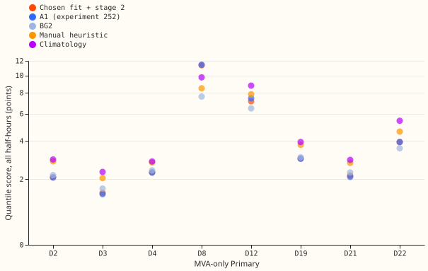
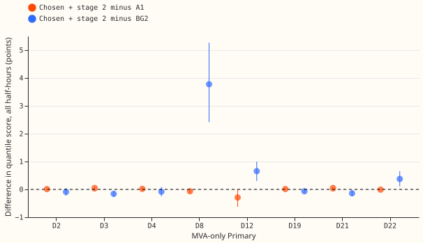

# MVA fold: stage-two corrections at the eight MVA-only Primaries

**The fit that experiment 366's rule chooses, followed by experiment 252's stage-2 corrections,
scores no worse than the stack's arm A1 at the eight Primaries that report only apparent power.**
Over all half-hours, pooled over the eight, the difference is -0.03 points of effective capacity
(95% interval -0.08 to +0.02). The registered threshold was an upper end below +0.10, and the
control gate passed. Verdict: supported.

A Primary is a substation that steps 33 kV down to 11 kV. Eight Primaries report apparent power in
megavolt-amperes (MVA), which has no sign, so reverse flow is hidden. The rule of
[experiment 366](../00366-mva-fold-irradiance-correlation-reverse-flow-rule/result.md) picks the
fit through the meter at D12 and the naive fit, which reads the meter reading as signed power, at
the other seven. Stage 2 is the correction step of
[experiment 252](../00252-gam-stack-at-eight-more-primaries/result.md): a night offset, recipe R,
and a lead-hour spread refitted on tuning-month residuals. A1 is that experiment's stack arm.

**The forecast still trails BG2, the production-style forecast.** Chosen fit with stage 2 minus BG2
is +0.53 (+0.35 to +0.73) over all half-hours. The gap sits at D8 (+3.77), D12 (+0.65), and D22
(+0.37). A1 trails BG2 by +0.56 (+0.39 to +0.75), so stage 2 does not change that.

**Every result holds for reactive power zero (power factor 1).** Experiment 366's rule fails at
power factor 0.97 ([experiment
358](../00358-mva-fold-known-answer-at-folded-mw-primaries/result.md) and 366), and real MVA-only
meters have unknown reactive power. The maintainer decided on 2026-10-28 to keep zero and count experiment 366 as a win. The rule is used as 366 registered it and is not tuned on these
Primaries. For D8, it is unproven whether the generator explains the steps and the gap.

Figure 1 shows the chosen fit and A1 on top of each other at seven of the eight Primaries, because
their scores differ by 0.01 to 0.05 points.

## Method

- **Re-run.** Experiment 152's engine (arms N, A, and F_fold) was re-run for the tuning, replicate,
  and scored periods into this experiment's own work folder, with 4 workers of 2 threads. Experiment
  152's folder was read and never written. This gives the tuning-period forecasts that stage 2
  needs and that experiment 152 did not store.
- **Stage 2.** Experiment 252's `build_arms` was imported unchanged and applied to arms N and A, as
  [experiment 353](../00353-d8-research-default-with-mva-fold/result.md) did at D8. D8 has no tuning
  month and borrows the spread of the donor Primaries D2, D3, D4, D19, D21, and D22.
- **Chosen arm.** The fit through the meter with stage 2 at D12, and the naive fit with stage 2 at
  the other seven.
- **Scoring.** Quantile scores in points of effective capacity over the scored year 2025-07-02 to
  2026-06-30, leads 0.5 to 168 hours, rows outside the hand-filtered events, with a paired
  month-resampled bootstrap (20,000 resamples, 95%). Code reused from earlier experiments lives in
  `ml-experiments/00152-*`, `00252-*`, and `00353-*`.

## Results (quantile score in points of effective capacity; lower is better)

- **P1 holds.** Chosen with stage 2 minus A1 is -0.03 (-0.08 to +0.02) over all half-hours, inside
  the predicted -0.30 to +0.30. On sunny daylight half-hours it is -0.10 (-0.33 to +0.11). Per
  Primary it ranges from -0.29 at D12 (-0.62 to +0.01) to +0.05 at D3 and D21, where the interval
  excludes zero.
- **P2 holds on the point estimate.** At D12, the fit through the meter with stage 2 minus the naive
  fit with stage 2 is -0.76 (-2.52 to +0.89) on sunny daylight half-hours and -0.27 (-0.61 to
  +0.04) over all half-hours. The intervals include zero, so one year does not resolve it.
  Pooled over the eight it is -0.06 (-0.13 to -0.00). The fit through the meter also beats the
  naive fit at D8 by 0.21 raw and 0.24 with stage 2, and differs by at most 0.01 at the other
  six.
- **P3 holds.** Stage 2 narrows the gap to BG2 a little at D12 (+0.76 raw, +0.65 with stage 2) and
  D22 (+0.42, +0.37), and leaves D8 at +3.77.
- **P4, the control gate, passes.** The re-run raw fits reproduce experiment 372's chosen scores
  to within 0.04 points at every Primary (exactly at five of the eight; D21 differs by 0.038). The
  references differ from experiment 372's by at most 0.039, because the re-run changes a few
  scored rows at D8, D12, and D21.
- **Stage 2 against the raw fit (c4).** Pooled -0.03 (-0.06 to +0.00). It improves 7 Primaries by
  0.04 to 0.14 points and worsens D8 by +0.42 (+0.19 to +0.69). A1 also scores worse at D8 than
  the raw naive fit (11.43 against 10.95).
- **Absolute scores, all half-hours.** Chosen with stage 2, A1, BG2: D2 2.09, 2.08, 2.18; D3 1.46,
  1.42, 1.63; D4 2.31, 2.29, 2.39; D8 11.37, 11.43, 7.59; D12 7.12, 7.41, 6.47; D19 2.98, 2.97,
  3.05; D21 2.16, 2.11, 2.30; D22 3.93, 3.94, 3.55. Climatology and the manual heuristic are in
  figure 1.
- **Groups.** Chosen with stage 2 minus A1 is +0.02 (-0.08 to +0.05) on cold nights and -0.00
  (-0.04 to +0.04) on winter nights. Minus BG2 it is -0.12 (-0.26 to +0.13) on cold nights and +0.28
  (+0.16 to +0.39) on winter nights.
- **Tail calibration** (share of readings at or below each quantile, mean over the eight; ideal
  0.01, 0.05, 0.95, 0.99). Chosen with stage 2: 0.054, 0.112, 0.916, 0.964 over all half-hours.
  A1: 0.054, 0.112, 0.917, 0.963. BG2: 0.005, 0.040, 0.957, 0.995. The stack's lower tail is too
  high, so its low quantiles are too narrow, and BG2's tails are closer to ideal. D8 shows it
  most: q05 coverage 0.311 for the chosen fit and 0.040 for BG2.
- **D15 and D18.** The stack has never run at either, so only the references are scored.
  [Experiment 372](../00372-mva-fold-rule-chosen-fit-at-all-primaries/result.md) reports BG2
  scores of 11.27 at D15 and 2.74 at D18, and the hand-filtered half-hours at every Primary. The
  six signed-MW Primaries have no stack scores on these rows either. The step 4 comparison on all
  16 Primaries is therefore the eight scored here plus references on the other eight.

## Checks

- **Median against mean forecast.** The median forecast minus the mean forecast is 0.00 at every
  Primary for both A1 and the chosen fit.
- **Mean-forecast error beside the contrasts.** The mean absolute error of the mean forecast, in
  megawatts, is: D2 3.69 against 3.66 for A1; D3 2.49 against 2.39; D4 3.98 against 3.94; D8 15.42
  against 15.48; D12 12.34 against 12.89; D19 5.20 against 5.18; D21 3.79 against 3.68; D22 6.32
  against 6.34. The direction agrees with the quantile score at D12, D8, and D22. At D3 and D21 both
  measures put the chosen fit slightly behind A1 (by 0.10 and 0.11 MW), so trigger 3 did not fire.
- **Leave one Primary out.** The interval of the chosen-minus-A1 contrast stays below +0.10 in each
  of the eight leave-one-out runs (upper ends +0.01 to +0.03). Its sign flips when D12 is left out
  (+0.01, -0.01 to +0.03), so trigger 4 fired for the sign and not for the verdict. Leaving out D8
  moves the BG2 contrast from +0.53 to +0.07 (-0.03 to +0.17), so the gap to BG2 is a D8 gap.
- **Triggers.** Trigger 4 fired for the sign flip described above, and trigger 5 fired at D8, where
  the raw fit beats the arm that contains it (stage 2). No Opus audit ran, because the brief for
  this sequence allows Sonnet only. The verdict does not depend on either: the registered rule uses
  the upper end of the pooled interval, which is below +0.10 with and without D12 and D8. The
  explanation for D8, the borrowed donor spread, is untested here.
  Triggers 1, 2, 3, 6, and 7 did not fire.

## Caveats and what to try next

- All results are for reactive power zero. Experiment 366's rule fails at power factor 0.97, and
  real MVA-only meters have unknown reactive power.
- The rule's 1.0 threshold was set after seeing experiment 365's numbers.
- One scored year and twelve month-blocks give wide intervals, most of all on sunny half-hours at
  D12.
- D8's stage-2 spread is borrowed from six other Primaries, and stage 2 worsens D8.
- A1 differs from the chosen fit in design (a T-all design, a solar clip, and a 60% clip), so the
  contrast with A1 mixes the rule's choice with those differences.
- Averaged over the eight, the stack's lower tail is too narrow, and D8's tails are too narrow in
  both directions.
