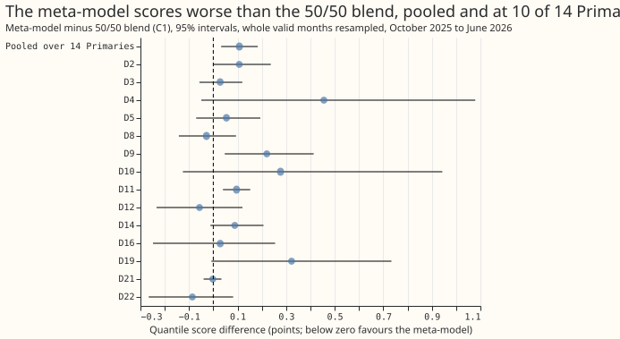
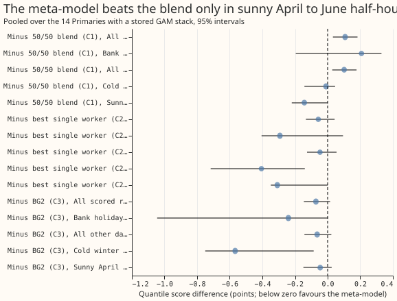
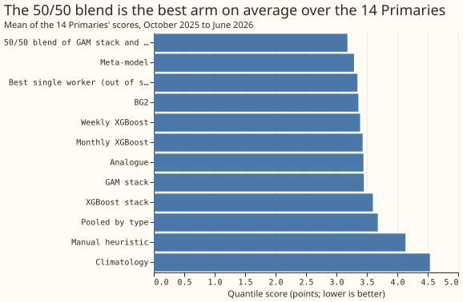

**Take-home message: weighting the stored forecasts by context made the forecast worse than a fixed
50/50 blend at most Primaries, so a meta-model is not the architecture to use at every
substation.** We asked whether the second-level XGBoost model of
[experiment 373](../00373-d8-meta-model-weights-worker-forecasts/result.md), which we call the
meta-model, would beat a fixed average of two forecasts at all 16 Primary substations, not only at D8.
The meta-model sees the quantiles of seven stored forecasts (six at D15 and D18), the lead time,
the power at the forecast's origin, the calendar, and each forecast's error over the previous 7
days. The fixed average is the 50/50 blend of the GAM stack and BG2. Pooled over the 14 Primaries that have a stored
GAM stack, the meta-model's quantile score was 3.288 (percent of capacity; lower is better) against
3.181 for the blend. Its score was worse by 0.107 points (95% interval +0.032 to +0.183). It was
lower than the blend at 4 Primaries and higher at 10. The verdict is `not supported`.

**Terms.** A Primary is a primary substation of the electricity distribution network, and D2 to D22
are anonymised labels for 16 of them. The GAM stack is a forecast from a generalised additive model
with a Kalman filter. BG2 is the best-guess blend of five machine-learning forecasts (BG2's
members). A point is 1% of a substation's effective capacity, and a lower quantile score is better.
The `not supported` verdict follows the decision rule in the front matter.

**The meta-model reproduces experiment 373 at D8 and fails to generalise.** At D8 the meta-model
scored 7.406, the blend 7.434, and the best single forecast 7.405, equal to experiment 373's.
No forecast was fitted again: the five members of BG2 and BG2 are rebuilt for all 16 Primaries from
the stored refit predictions of
[experiment 87](../00087-bg2-best-guess-assembled-with-drop-one-ablations/result.md) with the code of
[experiment 360](../00360-bg2-member-drop-one-at-d8/result.md), and the GAM stack comes from
experiments [252](../00252-gam-stack-at-eight-more-primaries/result.md),
[155](../00155-dp-bg-stage2-assembly-night-offset-and-error-correction/result.md), and
[355](../00355-d8-weekly-refit-and-median-band-swap/result.md). Only the meta-model is new, and its
settings are those of experiment 373 with no tuning.

**Figure 1: the meta-model scores worse than the blend at 10 of 14 Primaries.**

**Figure 2: only in sunny April-to-June half-hours is the meta-model clearly lower than the blend.**

**Figure 3: the 50/50 blend is the lowest-scoring arm on average, ahead of the meta-model and BG2.**

## Results

- **Arms.** Meta-model; meta-model without lagged power; meta-model without calendar inputs; best
  single worker chosen out of sample (BG2 excluded); 50/50 blend of GAM stack and BG2; GAM stack;
  BG2; each of BG2's five members alone; climatology; manual heuristic. Code is in
  `ml-experiments/00375-*/` (`e00375_build.py`, `e00375_meta.py`, `e00375_score.py`,
  `e00375_charts.py`) and copies experiment 373's recipe.
- **Rows.** 48,409 to 73,365 half-hourly rows per Primary, October 2025 to June 2026 (the first
  three months only train the meta-model), leads up to 168 hours, outside the hand-filtered
  load-shift events at the 13 Primaries whose stack file carries the event mask (D8, D15, and D18
  carry none, so no events are removed there), `fold_a_daily_gap_v1`. Intervals resample whole valid
  months, the same months at every Primary (20,000 resamples, seed 0); the pooled figure is the mean of the Primaries' means.
- **Gate.** The rebuilt D8 frame reproduces the GAM stack (8.338), BG2 (7.593), and the five members
  (7.560, 7.694, 7.472, 7.633, 8.562) on 96,986 rows, and the D8 meta-model, blend, and best single
  scores equal experiment 373's.
- **Per Primary** (quantile score in points of capacity; the last column is the meta-model minus the
  blend):

| Primary | Rows | Meta-model | 50/50 blend | BG2 | Meta-model minus blend (95%) |
|---|---|---|---|---|---|
| D2 | 73,365 | 2.118 | 2.011 | 2.198 | +0.107 (-0.000 to +0.237) |
| D3 | 71,378 | 1.508 | 1.480 | 1.722 | +0.028 (-0.057 to +0.119) |
| D4 | 72,764 | 2.877 | 2.422 | 2.664 | +0.455 (-0.050 to +1.079) |
| D5 | 60,456 | 3.438 | 3.384 | 3.584 | +0.054 (-0.071 to +0.194) |
| D8 | 73,331 | 7.406 | 7.434 | 7.570 | -0.028 (-0.142 to +0.093) |
| D9 | 73,319 | 2.493 | 2.272 | 2.504 | +0.220 (+0.047 to +0.413) |
| D10 | 72,689 | 3.482 | 3.205 | 3.465 | +0.277 (-0.125 to +0.943) |
| D11 | 73,365 | 2.432 | 2.337 | 2.610 | +0.095 (+0.040 to +0.152) |
| D12 | 71,618 | 6.819 | 6.876 | 6.650 | -0.057 (-0.234 to +0.120) |
| D14 | 71,990 | 2.133 | 2.045 | 2.354 | +0.088 (-0.012 to +0.207) |
| D16 | 68,073 | 2.569 | 2.541 | 2.676 | +0.029 (-0.248 to +0.255) |
| D19 | 72,764 | 3.345 | 3.023 | 3.236 | +0.322 (-0.008 to +0.733) |
| D21 | 73,143 | 2.005 | 2.008 | 2.272 | -0.002 (-0.040 to +0.033) |
| D22 | 72,202 | 3.409 | 3.495 | 3.533 | -0.086 (-0.266 to +0.082) |
| D15 (no stack) | 48,409 | 10.935 | blend = BG2 | 11.017 | -0.082 (-1.014 to +0.797), against BG2 |
| D18 (no stack) | 57,786 | 2.712 | blend = BG2 | 2.792 | -0.080 (-0.154 to -0.021), against BG2 |

- **Contrasts, pooled over the 14 Primaries with a stack (95%).** C1 meta-model minus the blend
  +0.107 (+0.032 to +0.183). C2 minus the best single worker -0.057 (-0.133 to +0.043). C3 minus BG2
  -0.072 (-0.146 to +0.015). C4 minus the meta-model without lagged power +0.005 (-0.001 to +0.010).
  C5 minus the meta-model without calendar inputs +0.021 (-0.006 to +0.053). The meta-model is below
  the best single worker at 9 of 14 Primaries (wholly below at 2) and below BG2 at 10 of 14 (wholly
  below at 6).
- **Mean absolute scores over the 14 Primaries.** 50/50 blend 3.181; meta-model 3.288; best single
  worker 3.345; BG2 3.360; GAM stack 3.450; manual heuristic 4.134; climatology 4.535. The blend is
  below BG2 at 13 of 14 Primaries.
- **Slices, C1 pooled (95%).** Cold winter nights -0.010 (-0.142 to +0.046). Sunny April-to-June
  half-hours -0.143 (-0.220 to -0.026). Bank holidays and 24 December to 2 January +0.208 (-0.195 to
  +0.356). All other days +0.101 (+0.028 to +0.177). Experiment 373's holiday gain at D8 (-0.471)
  does not appear at the other Primaries: only D4, D5, D8, D12, and D22 are lower there.
- **Primaries with no stored stack (D15, D18).** The base is BG2, the blend is BG2, and these two are
  not in the pooled figure. The meta-model is lower than BG2 at both (D18 wholly below, -0.080,
  -0.154 to -0.021; D15 -0.082, -1.014 to +0.797). Pooled they are -0.081 (-0.548 to +0.365).
- **Tails** (mean over the 14 Primaries; share of readings at or below q01, q05, and q95, q99,
  nominal 0.01, 0.05, 0.95, 0.99): meta-model 0.013, 0.071, 0.919, 0.981; blend 0.007, 0.042, 0.957,
  0.991; BG2 0.007, 0.042, 0.944, 0.987. Pinball loss at q01 / q05 / q95 / q99: meta-model 0.210 /
  0.742 / 0.896 / 0.271; blend 0.213 / 0.742 / 0.841 / 0.263; BG2 0.244 / 0.781 / 0.895 / 0.314.
- **Serving cost.** The meta-model needs every worker to run for every substation, plus one XGBoost
  fit per Primary per refit, for a score that is higher than the blend's.
- **Caveat on D8.** It is unproven whether the generator explains the steps and the gap at D8. The
  results are one scored year, with leads up to 168 hours, shorter than NGED's 1 to 10 days.
- **Schedule.** The members and BG2 use experiment 87's stored monthly and weekly refits. The
  meta-model is refitted every month on all earlier months.

## Checks

- **Median forecast minus the blend's median, per Primary** (points, mean over rows): D2 +0.52, D3
  -0.44, D4 -0.04, D5 -0.36, D8 +0.02, D9 -0.16, D10 +1.16, D11 +0.08, D12 -1.90, D14 +0.21, D15
  +5.37, D16 -0.86, D18 +0.45, D19 -0.11, D21 +0.20, D22 -0.18. The stored forecasts hold no mean,
  so the median stands in for the mean forecast.
- **Error of the median beside the score contrast.** Mean absolute error of the median forecast over
  the 14 Primaries (points): blend 5.616; meta-model 5.797; best single worker 5.880; BG2 5.935. The
  meta-model is higher than the blend on error at 12 of 14 Primaries, the same direction as C1.
- **Leave-one-out.** Dropping any one Primary leaves C1 between +0.081 and +0.122, with every
  interval above zero, so no site drives the result.
- **Triggers.** None of the seven triggers in the `ml-experiment` skill fired. The gate passed; the result agrees with the pre-registered expectation that the
  prediction would fail; the score and error contrasts agree; leaving one Primary out never
  flips C1; C4 and C5 move the score by less than their interval half-widths; D8's C1 interval
  (-0.142 to +0.093) matches experiment 373's (-0.145 to +0.094); and no later design depends on this
  result. No audit was run.

## Scope and what to try next

- **Not run.** The replicate year (2024-25), because the rolling-origin worker forecasts of earlier
  years are not stored for any Primary, and D15 and D18 with a stack, which was never stored there.
- **What the experiment narrows.** A learned per-Primary weighting does not beat a fixed 50/50 blend
  of the GAM stack and BG2 on ordinary days at 14 Primaries, so the next gain in uncertainty is more
  likely to come from a better single forecast than from a better combiner. The one lead left is
  sunny April-to-June half-hours, where the meta-model is lower than the blend by 0.143 points
  (-0.220 to -0.026), a slice chosen after the first look.
