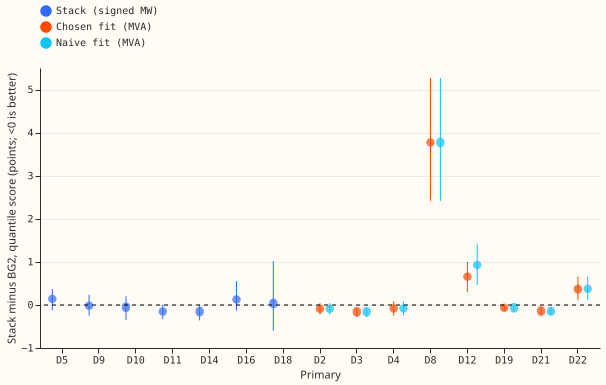
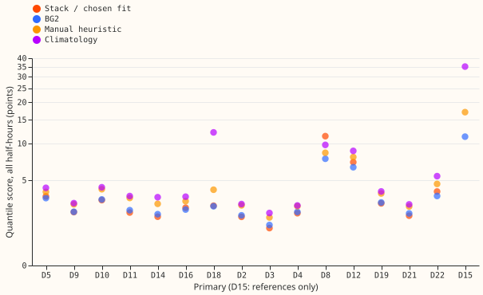
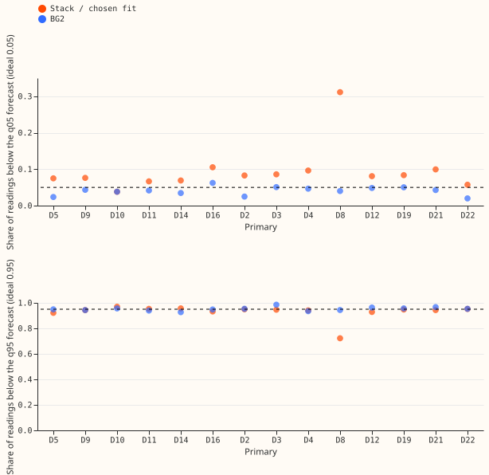

# One GAM stack at all 16 Primaries, with the MVA treatment as an explicit arm

**One stack, run unchanged, scores level with BG2 on average at the six Primaries that report signed
megawatts, but one year of data cannot rule out a gap of 0.13 points, and the stack is worse than
BG2 on sunny half-hours.** BG2 is the production-style forecast. Stack minus BG2 over all
half-hours, pooled over the six, is -0.02 points of effective capacity (percent of a Primary's
capacity; 95% interval -0.17 to +0.13). The registered bar was an upper end below +0.10, so the
verdict for that group is inconclusive. The sunny-daylight gap is +0.46 (+0.20 to +0.70). Winter and
cold nights go the other way (-0.29 and -0.44). Every result holds for reactive power zero.

We asked whether the best-guess stack of [experiment
252](../00252-gam-stack-at-eight-more-primaries/result.md), with stage 2, scores as well as BG2 at
every Primary, and how much of the gap at the eight Primaries that report only apparent power
(megavolt-amperes, MVA) comes from the MVA treatment. The six signed-MW Primaries are D5, D9, D10,
D11, D14, and D16. We ran the unchanged chain of experiment 252 there (its `control` source), took
the eight MVA-only Primaries from [experiment
374](../00374-mva-fold-stage-two-at-eight-primaries/result.md), and scored all three groups with the
rows, metric, and bootstrap of experiment 374.

**At the eight MVA-only Primaries the gap to BG2 is a Marsh Lane (D8) gap, and the rule adds 0.03
points.** The rule-chosen fit (the fit through the meter at Stickney, D12, and the naive fit
elsewhere) minus BG2 is +0.53 (+0.35 to +0.73), and +0.07 (-0.03 to +0.17) without D8. The naive
fit at all eight minus BG2 is +0.57 (+0.40 to +0.75). The rule-chosen fit minus the naive fit is
-0.03 (-0.08 to +0.01), and it is exactly zero at seven Primaries. At D12 it is -0.27 (-0.61 to
+0.04). The rule changes the forecast at D12 only.

## Results (quantile score in points of effective capacity; lower is better)

- **Signed-MW group (D5, D9, D10, D11, D14, D16): inconclusive.** Stack minus BG2 is -0.02 (-0.17
  to +0.13). Per Primary: D5 +0.14, D9 -0.02, D10 -0.05, D11 -0.15, D14 -0.15, D16 +0.13; every
  interval includes zero. Stack minus the manual heuristic is -0.70 (-0.96 to -0.44), and minus
  climatology -0.97 (-1.31 to -0.65).
- **Slices, stack minus BG2, signed-MW group.** Sunny daylight +0.46 (+0.20 to +0.70); winter
  nights -0.17 (-0.30 to +0.03); cold nights -0.44 (-0.95 to -0.00); Economy 7 step +0.10 (-0.02 to
  +0.22). Registered prediction P1 (between -0.20 and +0.20) holds.
- **Absolute scores, all half-hours (stack, BG2, manual heuristic, climatology).** D5 3.52, 3.38,
  3.90, 4.26; D9 2.38, 2.40, 2.91, 3.00; D10 3.22, 3.28, 4.13, 4.31; D11 2.35, 2.51, 3.39, 3.55;
  D14 2.09, 2.25, 2.95, 3.45; D16 2.67, 2.55, 3.15, 3.49.
- **MVA-only group (D2, D3, D4, D8, D12, D19, D21, D22): descriptive.** Chosen fit with stage 2
  minus BG2 +0.53 (+0.35 to +0.73); naive fit with stage 2 minus BG2 +0.57 (+0.40 to +0.75); A1
  minus BG2 +0.56 (+0.39 to +0.75). By Primary, chosen minus BG2: D8 +3.77 (+2.42 to +5.27), D12
  +0.65, D22 +0.37, and -0.07 to -0.16 at D2, D3, D4, D19, and D21. Without D8: chosen +0.07
  (-0.03 to +0.17), naive +0.11 (-0.00 to +0.22). P2 and P3 hold.
- **D8 on its own.** Chosen and naive fits score 11.37, BG2 7.59, climatology 9.76, manual
  heuristic 8.47. D8 is the only Primary where the stack trails climatology.
- **Slices, chosen minus BG2, MVA-only group.** Sunny daylight +0.65 (+0.41 to +0.90); winter nights
  +0.28 (+0.16 to +0.39); cold nights -0.12 (-0.26 to +0.13); Economy 7 step +0.71 (+0.29 to
  +1.26).
- **D18 (third group).** The stack fits with 12 monthly fits and borrows its spread from the six
  signed-MW Primaries. Stack 2.81, BG2 2.78, manual heuristic 4.09, climatology 12.13; stack minus
  BG2 +0.04 (-0.60 to +1.01) on 61,519 rows, one Primary and few months, so the interval is wide.
- **D15 (third group).** No ensemble store exists and fetching one was out of scope, so only
  references are scored: BG2 11.27, manual heuristic 17.02, climatology 35.14 (experiment 372).
- **Pooled training.** Not run: it needs machinery that does not exist (the brief allowed it only
  if the plan found no new machinery).
- **Tail calibration** (share of readings at or below each quantile, mean over the Primaries of
  the group; ideal 0.01, 0.05, 0.95, 0.99; pinball loss not computed). Signed-MW stack: 0.024,
  0.072, 0.946, 0.982; BG2: 0.010, 0.041, 0.944, 0.983. MVA-only chosen fit: 0.054, 0.112, 0.916,
  0.964; BG2: 0.005, 0.040, 0.957, 0.995. P4 (signed-MW q05 coverage above 0.08) fails: the mean is
  0.072, and D16 alone is above 0.08 (0.105). The stack's lower tail is still wider than BG2's at
  five of six Primaries (D10 equal), and sunny-half-hour q05 coverage is 0.157 against 0.104.

## Checks

- **Control gate.** This experiment's stage-2 arm d equals experiment 155's stored arm d to a
  maximum difference of 0.0 in q50 at all six signed-MW Primaries. The MVA-only numbers reproduce
  experiment 374's (+0.53, -0.03, +0.07 without D8).
- **Median against mean forecast.** 0.00 at every Primary for every arm.
- **Mean-forecast error beside the contrasts.** Error of the mean forecast against BG2's median, in
  megawatts: D5 6.01 against 5.88; D9 4.21 against 4.33; D10 5.31 against 5.62; D11 4.21 against
  4.48; D14 3.69 against 3.96; D16 4.48 against 4.45. The direction agrees with the quantile score
  at all six Primaries (at D16 the gap is 0.03 MW).
- **Leave one Primary out (signed-MW).** The stack-minus-BG2 interval has an upper end of +0.09
  without D5 and +0.11 to +0.17 without any other Primary. The point estimate flips sign without
  D11 or D14 (+0.01), so trigger 4 fired for the sign. The verdict is inconclusive in all six
  leave-one-out runs, except that leaving out D5 would meet the +0.10 bar.
- **Triggers.** Trigger 4 fired as described. Triggers 1 (the gate passed), 3, 5 (no nested arm in
  the signed-MW group; D8's stage-2 worsening is experiment 374's finding), 6, and 7 did not fire.
  Trigger 2: P4 contradicts its prediction, and the explanation is untested. No Opus audit ran,
  because the brief allows Sonnet only and the verdict does not depend on trigger 4: the
  registered rule uses the upper end of the pooled interval, which is above +0.10 with every
  Primary except D5.

## Caveats and what to try next

- Reactive power zero only; experiment 366's rule fails at power factor 0.97. For D8, it is
  unproven whether the generator explains the steps and the gap.
- One scored year and twelve month-blocks give wide intervals. Monthly refits on 24 months were
  used, not weekly production refits.
- The signed-MW stack pins the solar capacity to the stored capacity vintages, and the MVA-only
  stack has no capacity vintage (experiment 252), so the two groups do not share every design
  choice.
- The Economy 7 slice is the four half-hours ending at 00:30, 01:00, 07:30, and 08:00 UK local
  time, defined here.
- Next: the stack's sunny-half-hour gap to BG2 (+0.46 at the six signed-MW Primaries) is the
  largest cross-group weakness. A narrower lower tail (q05 coverage 0.07 to 0.11) is the second.
