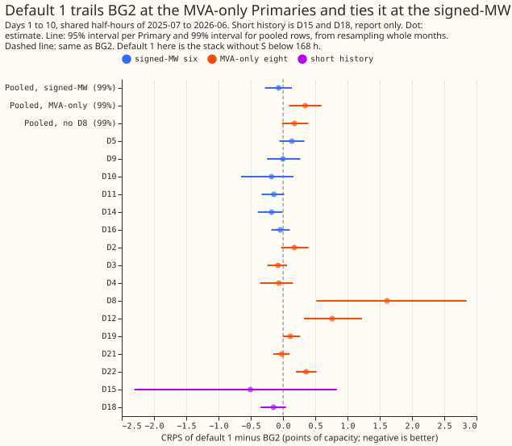

# The GAM stack, extended to 14 days, scored against BG2 at all 16 Primaries under demand-v1

**The stack scores level with BG2 at the six Primaries that report signed megawatts, and trails it
at the eight that report only apparent power. The stack beats climatology at all 14 countable
Primaries and the manual heuristic at 13 of 14 (D8 is the exception).** A Primary is a 33 kV to 11
kV substation, labelled D2 to D22 here. The stack is a generalised additive model (GAM) with a
correction stage, fitted per Primary, and is "Primary demand research default 1, extended to 336 h"
with one deliberate gap: it has no two-number solar summary S at any lead, which default 1 includes
below 168 hours, so the arm is labelled **stack without S below 168 h**. The stack is not default 3,
because it has no daylight heuristic blend. A score is the quantile score (twice the mean pinball
loss over 11 quantiles, which equals the continuous ranked probability score, CRPS, up to the
estimation from 11 quantiles), in points of effective capacity (percent of a Primary's capacity). A
negative difference means the stack is better. BG2 is the best-guess forecast of experiment 87,
which production does not run. "MVA-only" Primaries report apparent power in megavolt-amperes (MVA)
and no signed megawatts (MW); every result there assumes reactive power is zero. twCRPS is the
threshold-weighted CRPS of the protocol.

**Signed-MW six: supported.** Stack minus BG2 at days 1 to 10, pooled over the six, is -0.07 (99%
interval -0.28 to +0.14, 20,000 resamples of whole months). The registered margin was an upper end
below +0.20, and +0.14 is below it. Days 8 to 10 give -0.02 (-0.27 to +0.19), and days 11 to 14 give
-0.03 (-0.30 to +0.18). Registered predictions P1 (within -0.20 to +0.20) and P3 (days 8 to 10 trail
more than days 1 to 10; true on the point estimates, with overlapping intervals) hold.

**MVA-only eight: partly supported.** Stack minus BG2 is +0.34 (+0.09 to +0.60) with D8 and +0.18
(-0.02 to +0.39) without. Registered predictions P2 (+0.30 to +0.90 with D8; -0.05 to +0.25 without)
holds numerically on both ranges. D8 alone is +1.61 (95% interval +0.52 to +2.85), and removing D8
halves the gap. The point estimate without D8 stays above zero, and its 95% interval (+0.03 to
+0.33, leave-one-out below) excludes zero, so the gap is not wholly a D8 gap. The verdict is a
judgement, because the decision rule sets no threshold for this group. Days 8 to 10 give +0.34
(+0.05 to +0.67) and days 11 to 14 give +0.46 (+0.09 to +0.92) with D8, so the gap grows with lead.

**D15 and D18 (short history, report only).** Stack minus BG2 is -0.29 (-1.30 to +0.39) over 6
months. D18 is scorable from 2026-01 and D15 from 2026-03 (the 12-month minimum history), so the
intervals cover 4 to 6 months and are wide.

## Results (quantile score in points of effective capacity; lower is better)

- **Absolute scores, days 1 to 10 (stack, BG2, manual heuristic, climatology).** Signed-MW: D5 4.08,
  3.94, 4.35, 4.48; D9 2.51, 2.51, 2.92, 2.99; D10 3.27, 3.45, 4.16, 4.31; D11 2.43, 2.57, 3.41,
  3.55; D14 2.21, 2.39, 3.01, 3.47; D16 3.20, 3.24, 3.80, 4.20. MVA-only: D2 2.47, 2.30, 2.86, 2.93;
  D3 1.67, 1.75, 2.11, 2.33; D4 2.45, 2.51, 2.80, 2.83; D8 9.23, 7.61, 8.31, 9.64; D12 7.52, 6.75,
  7.92, 8.83; D19 3.29, 3.18, 3.79, 3.93; D21 2.35, 2.38, 2.77, 2.91; D22 4.10, 3.75, 4.71, 5.47.
  Short history: D15 12.85, 13.35, 22.59, 46.20; D18 2.50, 2.65, 4.02, 7.11.
- **Per-Primary stack minus BG2 (95%, 2,000 resamples).** The interval excludes zero in the stack's
  favour at D14 only (-0.18, -0.39 to -0.01). It excludes zero against the stack at D12 (+0.76), D22
  (+0.36), and D8 (+1.61).
- **Primaries won, days 1 to 10 (D15 and D18 not counted, denominator 14).** Against BG2 the stack
  wins 8 and loses 6; against the manual heuristic 13 and 1; against climatology 14 and 0.
  Prediction P4 holds.
- **Against the other references, pooled, days 1 to 10 (99%).** Minus the manual heuristic: -0.66
  (-1.03 to -0.32) signed-MW, -0.29 (-0.60 to -0.03) MVA-only with D8, -0.44 (-0.77 to -0.20)
  without D8. Minus climatology: -0.88 (-1.29 to -0.50), -0.73 (-1.15 to -0.37), -0.77 (-1.25 to
  -0.38). At days 11 to 14 the stack no longer beats the manual heuristic at the MVA-only Primaries
  with D8 (+0.14, -0.24 to +0.57).
- **Leave one Primary out (95%).** The signed-MW point estimate stays negative whichever Primary is
  left out (-0.05 to -0.11), and every interval includes zero. The MVA-only point estimate stays
  positive: +0.18 without D8 (+0.03 to +0.33, which excludes zero) and +0.28 to +0.41 otherwise.
- **D8, two arms, days 1 to 10 on shared rows.** The own-residual arm (the row in every table)
  scores 9.23 (BG2 scores 7.62 on these rows, and 7.61 on the 126,430 rows of the table above). The
  donor-spread arm (spread from D2, D3, D4, D19, D21, D22) scores 11.59. BG2 scores 7.62. The own
  arm starts at fold month 2025-08 and has under 12 months of history before 2026-04, so its early
  months are labelled short history. It is unproven whether the generator explains the steps and the
  gap at D8.
- **Slices, stack minus BG2, pooled (descriptive: the protocol's slice table has no interval).**
  Signed-MW (stack / BG2 scores in brackets): sunny daylight +0.49 (4.49 / 4.00); sunny April to
  June +0.70 (4.38 / 3.68); winter nights -0.13 (3.12 / 3.25); cold nights -0.37 (4.18 / 4.55);
  Economy 7 step -0.05 (1.94 / 1.99); Christmas +0.66 (4.38 / 3.72); bank holidays +0.01. MVA-only:
  sunny daylight +0.69; sunny April to June +0.72; winter nights +0.02; cold nights -0.44; Economy 7
  step +0.45; Christmas -0.55; bank holidays +0.02. The sunny-half-hour gap is the largest in both
  groups.
- **Load-shift event rows (hand-labelled events) and the 7 days after.** Signed-MW: event rows 7.35
  against 7.96 for BG2 (-0.61); the 7 days after 5.11 against 5.07. MVA-only: event rows 5.46
  against 5.15 (+0.31); the 7 days after 2.98 against 2.88. The pooled event rows hold 28,120
  half-hours at the signed-MW six, 9,416 at the MVA-only eight, and 189 at D15 and D18.
- **Tail calibration, days 1 to 10 (share of readings at or below each quantile, mean over the
  group; ideal 0.01, 0.05, 0.95, 0.99).** Signed-MW stack 0.022, 0.067, 0.946, 0.982; BG2 0.010,
  0.045, 0.932, 0.975. MVA-only stack 0.021, 0.070, 0.944, 0.982; BG2 0.005, 0.042, 0.955, 0.995.
  Short history stack 0.034, 0.083, 0.893, 0.967. Prediction P5 (signed-MW q05 coverage above 0.08)
  fails at 0.067.
- **twCRPS, days 1 to 10, mean over the group (stack, BG2).** Signed-MW 0.327, 0.355; MVA-only
  0.226, 0.195; the stack is better at the signed-MW six and worse at the MVA-only eight.
- **Avoidable curtailment cost, signed-MW six, scored year (pounds, as printed by
  `studies.eval_protocol`).** At a limit of 0.5 of capacity the stack costs £59.8 million against
  £72.9 million for BG2 (lower at all six). At a limit of 0.9 it costs £4.2 million against £7.3
  million (lower at D10, D14, D16, and D9; higher at D5 and D11).
- **Replicate months (April to June 2025, no BG2).** The stack alone scores 2.86, 3.04, 2.59 at the
  signed-MW six and 3.49, 3.29, 3.07 at the MVA-only seven (without D8, which has no fold before
  2025-08) in April, May, and June 2025, against 3.09, 3.26, 2.85 at the signed-MW six a year later.
  The MVA-only figures a year later include D8 (5.05, 4.00, 3.86) and are not comparable. The
  reference files hold only the 292 `daily_gap` runs, so no replicate reference exists.
- **Overlay C: default 3's stored forecasts, days 8 to 10 only.** Experiment 322 stored default 3's
  quantiles at 168 to 240 hours at the signed-MW six, on its older folds (one fit, not monthly
  folds). On the 245,463 half-hours that both hold, pooled over the six: default 3 scores 3.276, the
  stack without S 3.335, and BG2 3.358. Beyond 240 hours and at the other ten Primaries default 3 is
  not fitted. The comparison crosses a change of training regime, so the 0.06 gap is descriptive.

## Checks

- **Control gate.** Not a row-for-row reproduction, because experiments 374 and 376 stored one fixed
  fit with one tuning month and no monthly folds. On the headline contrasts, the signed-MW stack
  minus BG2 in [experiment 376](../00376-all-primaries-gam-stack-with-mva-treatment-arms/result.md)
  was -0.02 (-0.17 to +0.13, 0.5 to 168 h) against -0.07 here, a difference of 0.05, which is at the
  limit; the MVA-only gap there was +0.57 (naive fit, 95%) against +0.34 here, which is not within
  0.05. Most of the difference comes from D8: here the D8 row is the own-residual arm, and the D8
  gap to BG2 is +1.61 against +3.77 in 376.
- **Median against mean forecast.** The median minus the mean is 0.00 at every Primary: the stored
  `mean` is the corrected mean around which stage 2 centres the quantiles, so the median equals it
  by construction and no independent mean-forecast contrast exists.
- **Triggers.** Trigger 2 fired (P5 failed and the cause is untested). Trigger 7 applies, because
  the experiment 378 session builds on the stored stage-2 forecasts. Trigger 1 fired in part (the
  control gate above is not within 0.05 at the MVA-only eight, with the cause given). Triggers 3
  (the mean equals the median), 4 (no leave-one-out sign flip), 5, and 6 (no sister experiment at
  demand-v1) did not fire. A fresh Sonnet agent audited the headline contrasts by its own code from
  the stored forecasts and reproduced them (signed-MW -0.068, MVA-only +0.344, +0.178 without D8, D8
  +1.613). It found no unit error and no lookahead in the stage-2 spread. It found that 55 to 92
  rows at D8 and D9 store a missing reading as zero in the stage-2 inputs (under 0.05% of rows,
  scoring unaffected); this was not fixed.

## Caveats and what to try next

- Reactive power is assumed zero at the MVA-only Primaries. The naive fit of [experiment
  374](../00374-mva-fold-stage-two-at-eight-primaries/result.md)  is used at all eight; the
  rule-chosen fit through the meter at D12 was not run.
- The stack has no solar summary S below 168 hours, so the stack is not default 1 as the research
  default log defines it, and the sunny-half-hour gap may be an effect of that absence.
- The tier-1 daylight blend of experiment 322 (D1) was not tried: its weights are fitted per fold
  from trailing rows in experiments 317, 319, and 322 and tied to their six-Primary chain.
- The load-shift detector arm (default 1 with a detector, without, and with the hand labels as an
  oracle) was not run in this experiment; the load-shift detector arm is a separate follow-up.
- Missing readings at D8 and D9 enter stage 2 as zeros in under 0.05% of rows (see Checks).
- Days 11 to 14 are beyond NGED's 1 to 10 day horizon and are descriptive only.
- The protocol page says D15 and D18 are scored from earlier months than the code allows: with the
  12-month rule D18 is first scorable in 2026-01 and D15 in 2026-03.
- D15 has no pool rows in experiment 103, so a local feature mask supplies its training rows, and
  its ensemble arrays were built from the production archive read-only (the same extraction as
  experiment 152, checked against D10's stored arrays with a maximum difference of 0).
