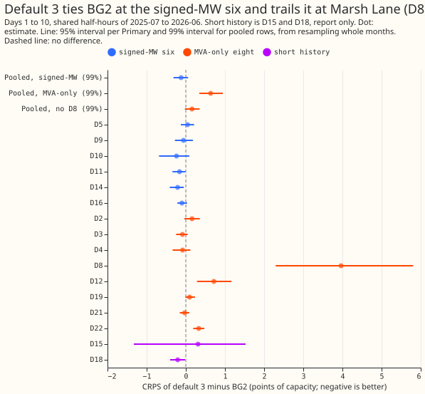
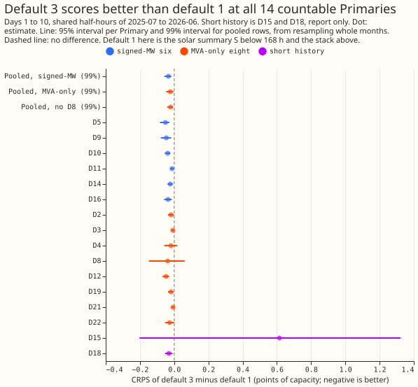
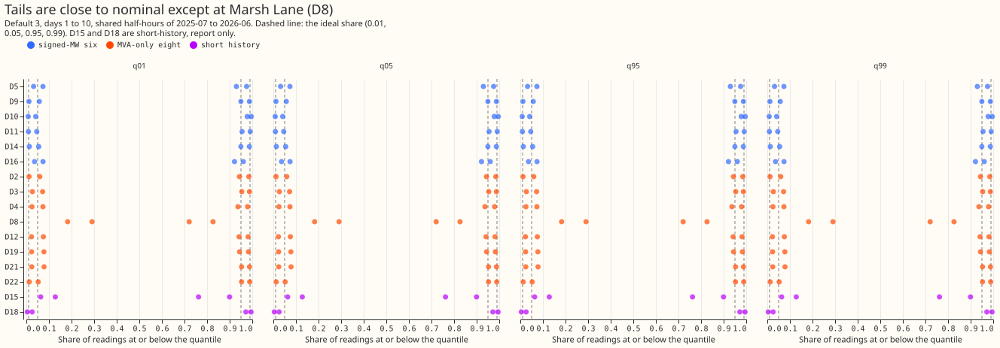

# Primary demand research default 3, ported to all 16 Primaries, scored against BG2 under demand-v1

**Default 3 scores level with BG2 at the six Primaries that report signed megawatts, and trails BG2
at the eight that report only apparent power, almost all of that at Marsh Lane (D8).** Default 3 is
our research demand forecast for a Primary, a 33 kV to 11 kV substation (labelled D2 to D22 here).
BG2 is the best-guess forecast of experiment 87, which production does not run. The next paragraph
defines the other terms.

**Terms.**

- **Default 1 and default 3.** Default 1 is the generalised additive model (GAM) stack of
  experiment 377, with the two-number solar summary S added below 168 hours. S summarises the
  solar response of the 51 ensemble weather members as a mean and a standard deviation. Default 3
  is default 1 with S also at 168 to 240 hours, and with a blend towards the manual heuristic's
  median on daylight half-hours (sun above 5 degrees) at 168 to 240 hours. The "stack without S" is
  experiment 377's forecast as stored, with S at no lead.
- **Score.** The quantile score is twice the mean pinball loss over 11 quantiles. It equals the
  continuous ranked probability score (CRPS) up to the error from using 11 quantiles. Scores are in
  points of effective capacity (percent of a Primary's capacity). A difference below zero favours
  the first-named forecast. twCRPS is the threshold-weighted CRPS of the protocol, which weights
  the high-demand tail. The 1%, 5%, 95%, and 99% quantiles are written q01, q05, q95, and q99, and
  their coverage is the share of readings at or below the quantile.
- **Signed-MW and MVA-only.** Signed-MW Primaries report real power in megawatts (MW), with its
  sign. MVA-only Primaries report apparent power in megavolt-amperes (MVA), so every result there
  assumes reactive power is zero. They use the naive fit of experiment 377 (the fit that treats
  the meter reading as real power), not the rule-chosen fit of experiment 374 (a fit through the
  meter, chosen by a rule per Primary).
- **D8 spread.** D8 has less than 12 months of history, so its forecast spread comes from the
  residuals of six other Primaries ("donor spread"); experiment 377 also fitted a spread from D8's
  own past errors ("own-residual spread").
- **Short history.** D15 and D18 have under 12 months of history before the scored year, so they
  are report only and enter no tally.

**Signed-MW six: supported.** Default 3 minus BG2 at days 1 to 10, pooled over the six, is -0.12
(99% interval -0.31 to +0.06, 20,000 resamples of whole months). The registered margin was an
upper end below +0.20, and +0.06 is below it. Days 8 to 10 (168 to 240 hours; BG2 is stored out to
351 hours) give -0.14 (-0.33 to +0.01). Default 3 minus default 1 is -0.03 (-0.06 to -0.02) at days
1 to 10 and -0.12 (-0.19 to -0.05) at days 8 to 10.

**MVA-only eight: partly supported.** Default 3 minus BG2 is +0.63 (+0.35 to +0.94) with D8 and
+0.16 (-0.02 to +0.35) without. The registered prediction (+0.30 to +0.90 with D8; -0.05 to +0.25
without) holds on both ranges. D8 alone is +3.97 (95% interval +2.29 to +5.81). D8 uses the donor
spread in every arm here; with its own-residual spread, experiment 377 found +1.61 for the stack
without S. Default 3 minus default 1 is -0.02 (-0.05 to -0.004) with D8 and -0.02 (-0.04 to -0.01)
without. At days 8 to 10 it is -0.08 with D8 (-0.16 to -0.01), inside the registered range of -0.20
to 0.

**D15 and D18 (short history, report only).** Default 3 minus BG2, pooled over half-hours, is
-0.001 (-0.93 to +0.70) over 6 months at D18 and 4 months at D15. D15 scores worse than default 1
(+0.62, -0.20 to +1.32) because it takes the signed-MW fits of S and the blend, and its 4 months
of scored history leave the interval wide.

## Method

- **Rows.** Experiment 377's second-stage forecasts at all 16 Primaries on the demand-v1 folds, one
  fit per fold month on earlier months only. Experiment 378 adds S at 0.5 to 168 hours, and S and
  the blend at 168 to 240 hours (the band that days 8 to 10 cover).
- **Solar summary S.** Each ensemble member's solar response is passed through the Primary's monthly
  fit of the solar term (experiment 184's code, run on experiment 377's setup; the gate on D5
  matched experiment 184's stored values exactly). S is the mean and standard deviation of the 51
  responses, with a scale and a spread factor fitted per lead band on the trailing 365 days of runs
  completed before the fold month.
- **Daylight blend.** At 168 to 240 hours the median moves towards the manual heuristic's median
  with a weight fitted per lead band and season group on the same trailing rows. The blend applies
  only where the sun is above 5 degrees.
- **Fit groups.** The fits are pooled within the signed-MW six and within the MVA-only seven
  without D8. D8 takes the MVA-only fits, and D15 and D18 take the signed-MW fits. The first fold
  month has no earlier rows, so S and the blend leave the forecast unchanged there.
- **Intervals.** Pooled contrasts use 99% intervals (20,000 resamples), as registered. Per-Primary
  contrasts use 95% intervals (2,000 resamples) because a single Primary has few months to
  resample.

## Results (quantile score in points of effective capacity; lower is better)

- **Absolute scores, days 1 to 10.**

| Primary | Default 3 | Default 1 | BG2 | Manual heuristic | Climatology |
|---|---|---|---|---|---|
| D5 | 3.99 | 4.04 | 3.94 | 4.35 | 4.48 |
| D9 | 2.45 | 2.50 | 2.51 | 2.92 | 2.99 |
| D10 | 3.21 | 3.25 | 3.45 | 4.16 | 4.31 |
| D11 | 2.41 | 2.42 | 2.57 | 3.41 | 3.55 |
| D14 | 2.18 | 2.20 | 2.39 | 3.01 | 3.47 |
| D16 | 3.15 | 3.18 | 3.24 | 3.80 | 4.20 |
| D2 | 2.46 | 2.47 | 2.30 | 2.86 | 2.93 |
| D3 | 1.66 | 1.67 | 1.75 | 2.11 | 2.33 |
| D4 | 2.43 | 2.45 | 2.51 | 2.80 | 2.83 |
| D8 | 11.61 | 11.65 | 7.64 | 8.54 | 9.76 |
| D12 | 7.47 | 7.52 | 6.75 | 7.92 | 8.83 |
| D19 | 3.28 | 3.29 | 3.18 | 3.79 | 3.93 |
| D21 | 2.34 | 2.35 | 2.38 | 2.77 | 2.91 |
| D22 | 4.08 | 4.10 | 3.75 | 4.71 | 5.47 |
| D15 | 13.67 | 13.05 | 13.35 | 22.59 | 46.20 |
| D18 | 2.44 | 2.47 | 2.65 | 4.02 | 7.11 |

- **Per-Primary default 3 minus BG2 (95%, 2,000 resamples).** The interval lies wholly below zero
  (default 3 is better) at D11 (-0.16), D14 (-0.21), and D18 (-0.21). It lies wholly above zero
  at D12 (+0.72), D22 (+0.33), and D8 (+3.97).
- **Primaries won, days 1 to 10 (the 14 Primaries with a full history).** Against BG2, default 3
  has the lower score at 8 and the higher at 6. Against the manual heuristic and against
  climatology, it has the lower score at 13 and the higher at 1 (D8). Against default 1 it has the
  lower score at all 14, and the interval lies wholly below zero at 10 of them.
- **Against the other references, pooled, days 1 to 10 (99%).** Minus the manual heuristic: -0.71
  (-1.06 to -0.39) signed-MW, -0.02 (-0.38 to +0.31) MVA-only with D8, -0.46 (-0.78 to -0.22)
  without D8. Minus climatology: -0.94 (-1.33 to -0.57), -0.46 (-0.91 to -0.09), -0.79 (-1.27 to
  -0.41).
- **Against the stack without S (99%).** Default 3 minus the stack without S is -0.05 (-0.09 to
  -0.03) at the signed-MW six and -0.02 (-0.05 to -0.00) at the MVA-only eight at days 1 to 10, and
  -0.12 and -0.08 at days 8 to 10. These differ from the contrasts against default 1 (-0.03 and
  -0.02) because default 1 already carries S below 168 hours, which accounts for the extra 0.02
  at the signed-MW six.
- **Leave one Primary out (95%).** Default 3 minus BG2 at the signed-MW six stays between -0.10 and
  -0.15 whichever Primary is left out, with intervals that lie wholly below zero only when D5 or
  D9 is left out. The MVA-only gap stays between +0.62 and +0.74 whichever Primary but D8 is left
  out, and is +0.16 (+0.02 to +0.30) without D8. Default 3 minus default 1 is negative with an
  interval wholly below zero in every leave-one-out case in both groups.
- **Error of the median beside the CRPS contrasts (99%).** The mean absolute error of the median
  points the same way as CRPS in every row: default 3 minus BG2 -0.22 (-0.55 to +0.12) signed-MW,
  +0.41 (+0.01 to +0.80) MVA-only with D8; default 3 minus default 1 -0.04 (-0.09 to -0.01) and
  -0.04 (-0.07 to -0.01); minus the manual heuristic -1.28 and -0.72.
- **Tail calibration, days 1 to 10 (share of readings at or below each quantile, mean over the
  group; ideal 0.01, 0.05, 0.95, 0.99).** Signed-MW default 3 0.018, 0.058, 0.947, 0.983; BG2 0.010,
  0.045, 0.932, 0.975. MVA-only default 3 0.041, 0.097, 0.918, 0.965; BG2 0.005, 0.042, 0.955,
  0.995. MVA-only without D8, default 3: 0.021, 0.070, 0.946, 0.985 (within 0.02 of nominal). D8
  alone: 0.183, 0.291, 0.721, 0.826. D15 and D18: 0.034, 0.077, 0.867, 0.947. At the signed-MW
  six the 1% quantile is too high at D16 and D5: 0.036 and 0.032 of readings fall below it, against
  0.01 ideal. Pinball loss at q01, q05, q95, q99 (default 3 against BG2, signed-MW): 0.245 against
  0.222, 0.739 against 0.686, 0.793 against 0.882, 0.262 against 0.323. At the MVA-only eight the
  pinball loss at q05 is 1.27 against 0.86 for BG2, mostly D8 (4.36).
- **twCRPS, days 1 to 10, mean over the group (default 3, BG2).** Signed-MW 0.324, 0.355; MVA-only
  0.206, 0.195. Default 3 is better at the signed-MW six and worse at the MVA-only eight, the same
  split as the CRPS.
- **Replicate months.** None: demand-v1 has no replicate period.

## Checks

- **Control gate.** The port reproduces experiment 322's stored default 3 at 168 to 240 hours on
  experiment 319's own rows at the six Primaries: 3.07596 points against 3.07596 (difference
  2e-10, largest single-quantile difference 1e-5), well inside the 0.05-point gate. The gate runs
  the same replay as the 16-Primary run, on experiment 322's rows and fold structure.
- **Median against mean forecast.** The median minus the mean is 0.00 at every Primary: the stored
  `mean` is the corrected mean around which stage 2 centres the quantiles, so the median equals it
  by construction and no independent mean-forecast contrast exists. The error of the median is
  reported beside the CRPS contrasts above, and agrees in direction in every row.
- **Triggers** (the seven audit triggers of the `ml-experiment` skill). The control gate passed
  (trigger 1). The registered predictions hold (trigger 2). The error of the median and the CRPS
  agree in direction (trigger 3). No leave-one-out case flips a sign (trigger 4). Trigger 5 (a
  nested arm beating the arm that contains it) did not fire. The pooled signed-MW interval is 0.37
  wide against 0.42 in experiment 377 (trigger 6). Trigger 7 (a later experiment will use default
  3 as its base) applies, and a fresh Sonnet audit re-derived the headline contrasts from the
  stored forecasts by its own code (-0.121, +0.634, +0.158, and -0.034 against default 1, all
  within 0.01), found no lookahead in the fits and no unit error, and confirmed that the median
  equals the mean in experiment 377's stage 2. It did not check the bootstrap intervals, the
  control gate, twCRPS, or the leave-one-out table; the control gate was checked by the gate script
  above.

## Caveats and what to try next

- Reactive power is assumed zero at the MVA-only Primaries, and the naive fit of experiment 377 is
  used at all eight. The rule-chosen fit of experiment 374 at 240 hours was not run.
- D8 uses the donor spread in every arm here, so its row differs from experiment 377's
  own-residual arm (+3.97 here against +1.61 for the stack without S against BG2). It is unproven
  whether a generator connected to D8 explains the steps and the gap at D8.
- The fits of S and of the blend are pooled within a group, so a Primary whose behaviour differs
  from its group's, such as D15, gets a fit that suits it less.
- The sunny-half-hour, Christmas, and load-shift slices of experiment 377 were not recomputed here.
- Experiment 378 reads the second-stage forecasts of experiment 377 and its stored ensemble arrays,
  so an error there carries into every number above.
