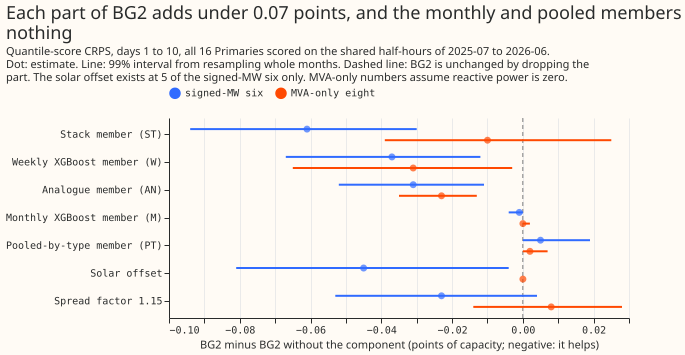
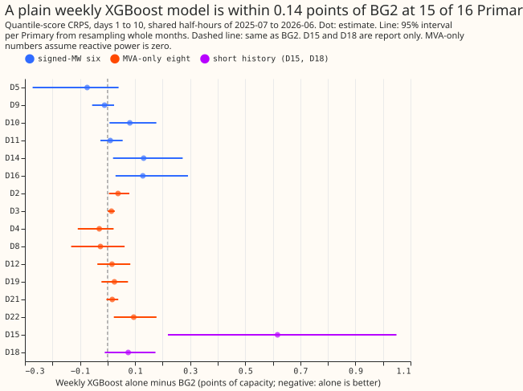
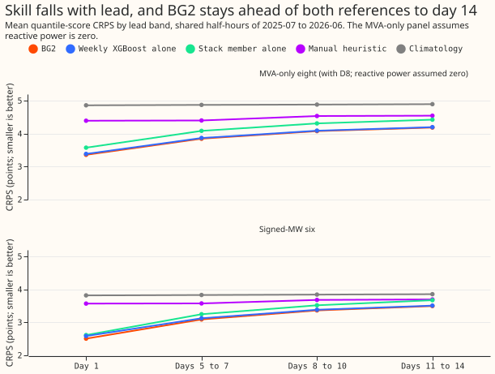

**Take-home message: a plain weekly-refitted XGBoost model scores within 0.05 percentage points of
capacity of BG2 at the six Primary substations whose meters record the direction of power flow, and
within 0.02 points at the eight whose meters record apparent power only.** BG2 is the five-model
blend built in [experiment 87](../00087-bg2-best-guess-assembled-with-drop-one-ablations/result.md),
so the blend adds little over its weekly-refitted XGBoost member, and two of its five members add
nothing measurable. BG2's upper tail is too narrow at the six signed-MW Primaries: 93.2% of outcomes
fall below its 95% quantile, and 97.6% below its 99% quantile. The verdict is `supported`: no single
blend member, the solar offset twins, or the spread factor changes the score by 0.10 points or more.

We asked how much each part of BG2 adds to its score. A Primary substation steps 33 kV or 66 kV down
to 11 kV, and the 16 Primaries here carry anonymised labels (D2 to D22). BG2 blends five models:
weekly-refitted XGBoost (W), monthly-refitted XGBoost (M), an analogue model (AN), an XGBoost model
pooled across substations of the same type (PT), and a frozen XGBoost model with a 14-day error
correction (ST). Each model's quantiles are widened about its median by a spread factor of 1.15.
At 5 of the 16 Primaries, the models also have twins that include a forecast of embedded solar
output (the solar offset twins). We rebuilt BG2 from experiment 87's stored forecasts with no refit,
as [experiment 360](../00360-bg2-member-drop-one-at-d8/result.md) did at four Primaries. We
re-blended BG2 without each member, and scored each member alone. The scoring follows the
[demand-v1 protocol](../evaluation-protocol-demand.md) at all 16 Primaries, at every lead to 14
days. The score is the continuous ranked probability score (CRPS), estimated from 11 quantiles, in
percentage points of effective capacity (1 point is 1% of a Primary's capacity; smaller is better).
The protocol reports three groups separately. The six signed-MW Primaries (D5, D9, D10, D11, D14,
and D16) have meters that record the sign of the flow. The eight MVA-only Primaries (D2, D3, D4, D8,
D12, D19, D21, and D22) have meters that record apparent power only, so their numbers assume
reactive power is zero. D15 and D18 have short histories and are reported without counting in any
verdict. The reference forecasts are `manual_heuristic` (NGED's rule of thumb) and `climatology`
(the average for each month, half-hour, and weekend flag). Production does not run BG2.

## Results

Scores are CRPS in percentage points of effective capacity for forecasts 1 to 10 days ahead, unless
stated. They cover the 3,660,652 half-hours scored by every arm in July 2025 to June 2026. A
negative difference in a drop-one contrast means the dropped part helps. Pooled intervals are 99%
intervals from resampling whole calendar months of the forecast origin (20,000 resamples).
Per-Primary and leave-one-out intervals are 95% intervals (2,000 resamples).

- **BG2 scores 3.016 at the signed-MW six and 3.788 at the MVA-only eight.** Without D8, the MVA-only
  eight score 3.236, and D15 and D18 together score 7.285. At the signed-MW six, `manual_heuristic`
  scores 3.606 and `climatology` 3.831. At the MVA-only eight they score 4.438 and 4.872. BG2 beats
  `manual_heuristic` by 0.589 (0.398 to 0.819) at the signed-MW six and 0.650 (0.504 to 0.823) at
  the MVA-only eight, and beats `climatology` by 0.814 and 1.084.
- **The weekly XGBoost model alone trails BG2 by 0.044 (0.006 to 0.090) at the signed-MW six.** It
  scores 3.061. At the MVA-only eight it trails by 0.018 (-0.013 to 0.056) and scores 3.807, and
  without D8 it trails by 0.025 (-0.006 to 0.063). The gap at the signed-MW six shrinks with lead:
  0.080 on day 1, 0.034 on days 5 to 7, 0.019 on days 8 to 10, and 0.014 on days 11 to 14 (-0.024
  to 0.066). The weekly XGBoost model alone is within 0.14 points of BG2 at 15 of 16 Primaries; D15
  is the exception at +0.617 (0.219 to 1.049). It scores better than BG2 on the point estimate at
  D4, D5, D8, and D9, with intervals that include zero.
- **Dropping the frozen-stack member (ST) changes the signed-MW six's score most.** Dropping ST
  changes the score by -0.061 (-0.094 to -0.030) at the signed-MW six and -0.010 (-0.039 to +0.025)
  at the MVA-only eight. Dropping W changes it by -0.037 (-0.067 to -0.012) and -0.031 (-0.065 to
  -0.003), and dropping AN by -0.031 (-0.052 to -0.011) and -0.023 (-0.035 to -0.013).
- **The monthly XGBoost and pooled-by-type members add nothing measurable.** Dropping M changes the
  score by -0.001 (-0.004 to 0.000) at the signed-MW six and 0.000 at the MVA-only eight. Dropping
  PT changes it by +0.005 (0.000 to 0.019) and +0.002, so BG2 scores marginally better without PT.
  PT alone is the weakest member, 0.401 (0.306 to 0.475) behind BG2 at the signed-MW six.
- **The solar offset twins help at the signed-MW six only.** BG2 minus the same blend without the
  offset twins is -0.045 (-0.081 to -0.004) at the signed-MW six, where D9, D10, D11, D14, and D16
  carry the twins. It is exactly 0 at the MVA-only eight, which have none. At days 11 to 14 the
  difference is -0.011 (-0.035 to +0.026).
- **The spread factor 1.15 is not shown to matter.** BG2 minus BG2 with spread factor 1.0 is -0.023
  (-0.053 to +0.004) at the signed-MW six and +0.008 (-0.014 to +0.028) at the MVA-only eight.
- **Experiment 87's build-up of BG2 gains little at each step.** The stages are the frozen XGBoost
  model, the same with a 14-day correction (the stack), monthly refitting, weekly refitting, the
  blend without offset twins, and BG2. At the signed-MW six they score 3.160, 3.209, 3.122, 3.090,
  3.061, and 3.016, so the five steps change the score by +0.049 (-0.012 to +0.116), -0.087
  (-0.203 to +0.006), -0.032 (-0.068 to 0.000), -0.029 (-0.066 to -0.002), and -0.045. At the
  MVA-only eight the six stages score 3.950, 4.023, 3.848, 3.807, 3.788, and 3.788. At D15 the
  frozen XGBoost model scores 34.366 against 35.178 for `climatology`, because its median is 0.47 of
  capacity too low, close to `climatology`'s 0.54. The 14-day correction removes most of this
  bias. The training window of the frozen model was not checked.
- **Experiment 377's GAM stack, on the half-hours it shares with BG2.** The stack is Primary demand
  research default 1, extended to 336 hours. It scores 2.954 against BG2's 3.016 at the signed-MW
  six (difference -0.062, 99% interval -0.268 to +0.145), and 4.083 against 3.743 at the MVA-only
  eight (+0.340, +0.108 to +0.577). D8 drives the MVA-only gap: +1.589 (95% interval +0.534 to
  +2.871). It is unproven whether the generator explains the steps and the gap at D8.

### Tail calibration

Pinball loss (in points of effective capacity) and coverage at four tail quantiles, and the
threshold-weighted CRPS (twCRPS, which weights outcomes above each Primary's 95th-percentile reading
more heavily), for forecasts 1 to 10 days ahead. Coverage is the share of outcomes below the
quantile, and its nominal value is 0.01, 0.05, 0.95, and 0.99.

| Group | Forecast | Pinball 1% | 5% | 95% | 99% | Coverage 1% | 5% | 95% | 99% | twCRPS |
|---|---|---|---|---|---|---|---|---|---|---|
| Signed-MW six | BG2 | 0.222 | 0.686 | 0.878 | 0.321 | 0.010 | 0.045 | 0.932 | 0.976 | 0.353 |
| Signed-MW six | Weekly XGBoost alone | 0.212 | 0.679 | 0.905 | 0.344 | 0.010 | 0.041 | 0.923 | 0.973 | 0.372 |
| Signed-MW six | `manual_heuristic` | 0.280 | 0.792 | 1.011 | 0.457 | 0.050 | 0.070 | 0.892 | 0.921 | 0.413 |
| Signed-MW six | `climatology` | 0.222 | 0.840 | 1.057 | 0.396 | 0.018 | 0.040 | 0.904 | 0.952 | 0.428 |
| MVA-only eight | BG2 | 0.261 | 0.863 | 0.970 | 0.353 | 0.005 | 0.042 | 0.955 | 0.995 | 0.195 |
| MVA-only eight | Weekly XGBoost alone | 0.258 | 0.865 | 0.983 | 0.357 | 0.005 | 0.043 | 0.954 | 0.995 | 0.200 |
| MVA-only eight | `manual_heuristic` | 0.413 | 1.005 | 1.162 | 0.476 | 0.068 | 0.094 | 0.903 | 0.930 | 0.238 |
| MVA-only eight | `climatology` | 0.379 | 1.160 | 1.189 | 0.348 | 0.045 | 0.085 | 0.928 | 0.968 | 0.243 |

- **BG2's upper tail is too narrow at the signed-MW six.** The 95% and 99% quantiles cover 0.932 and
  0.976, below the nominal 0.95 and 0.99. The weekly XGBoost model alone is slightly worse (0.923
  and 0.973).
- **BG2's tails are slightly too wide at the MVA-only eight.** The 1% quantile covers 0.005 and the
  99% quantile 0.995, against nominal 0.01 and 0.99.
- **The references have worse tail calibration than BG2.** `manual_heuristic` covers 0.050 at the 1%
  quantile at the signed-MW six, five times the nominal value.

### Load-shift events, weather slices, and curtailment cost

- **During hand-labelled load-shift events, BG2 scores 7.953 at the signed-MW six.** The weekly
  XGBoost model alone scores 8.521 and `manual_heuristic` 9.040, on 35,150 half-hours.
- **In the 7 days after each event ends, the references beat BG2.** BG2 scores 5.022 and the weekly
  XGBoost model alone 4.566, against 3.933 for `manual_heuristic` and 4.412 for `climatology`, on
  26,870 half-hours at the signed-MW six.
- **On sunny half-hours from April to June, BG2 and the weekly XGBoost model alone are close.** At
  the signed-MW six they score 3.692 and 3.717.
- **On cold nights (3 °C or below), the weekly XGBoost model alone trails BG2 by 0.33.** At the
  signed-MW six, BG2 scores 4.531, the weekly XGBoost model alone 4.864, and the frozen-stack member
  alone 4.563.
- **Avoidable curtailment cost, signed-MW six, scaled limit.** The cost is the measure of
  `studies.eval_protocol` at a price of £2,000 per MWh. The limit is 0.9 of each Primary's maximum
  flow before the scored year; the published thermal limit is not used. Summed over the six
  Primaries for the scored year, the cost is £8.35 million for BG2, £10.59 million for the weekly
  stage of experiment 87's build-up (no offset twins), £6.11 million for the frozen-stack member
  alone, £12.66 million for `manual_heuristic`, and £13.72 million for `climatology`. D16 drives the
  frozen-stack member's lead (£3.95 million against £6.05 million for BG2).
- **D15 and D18 (report only).** BG2 scores 7.285 across both, the weekly XGBoost model alone 7.610,
  and `manual_heuristic` 10.769.
- **We found no replicate period.** The stored forecasts start in July 2025, so no earlier year can
  be scored, and no month is excluded by the 12-month training-history rule.

## CRPS per Primary, days 1 to 10 (percentage points of effective capacity)

D15 is the worst Primary for every forecast. The rows run from the signed-MW six, to the MVA-only
eight, to the two report-only Primaries.

| Primary | BG2 | Weekly XGBoost alone | `manual_heuristic` | `climatology` |
|---|---|---|---|---|
| D5 | 3.942 | 3.868 | 4.345 | 4.477 |
| D9 | 2.519 | 2.507 | 2.923 | 2.994 |
| D10 | 3.450 | 3.531 | 4.156 | 4.308 |
| D11 | 2.568 | 2.578 | 3.412 | 3.544 |
| D14 | 2.387 | 2.518 | 3.006 | 3.466 |
| D16 | 3.243 | 3.371 | 3.802 | 4.201 |
| D2 | 2.299 | 2.337 | 2.858 | 2.930 |
| D3 | 1.753 | 1.767 | 2.111 | 2.333 |
| D4 | 2.517 | 2.487 | 2.802 | 2.829 |
| D8 | 7.652 | 7.626 | 8.545 | 9.756 |
| D12 | 6.760 | 6.775 | 7.924 | 8.827 |
| D19 | 3.187 | 3.212 | 3.789 | 3.930 |
| D21 | 2.378 | 2.395 | 2.767 | 2.904 |
| D22 | 3.758 | 3.854 | 4.705 | 5.465 |
| D15 (report only) | 12.020 | 12.636 | 18.068 | 35.178 |
| D18 (report only) | 3.219 | 3.294 | 4.500 | 12.979 |

## Checks

- **Median minus mean forecast per Primary:** not available. BG2 and its members store 11 quantiles
  and no mean, so the check cannot run. The mean absolute error of the median, beside each CRPS
  contrast, is the substitute below.
- **Error of the median beside each contrast (days 1 to 10, points):** the drop-one, offset, and
  alone-versus-BG2 contrasts have the same sign in the mean absolute error of the median as in CRPS.
  For example, dropping W changes the CRPS by -0.037 and the error of the median by -0.040. The weekly
  XGBoost model alone minus BG2 is +0.044 in CRPS and +0.074 in error of the median at the signed-MW
  six. The one disagreement we found is the spread factor at the MVA-only eight: CRPS +0.008, error
  of the median -0.016. The CRPS interval for that contrast includes zero.
- **Gates:** the re-blended BG2 equals experiment 87's stored BG2 on all 4,099,680 forecast rows of
  the 16 Primaries (no gap above 0.000005 points). The actuals stored with experiment 87's forecasts
  equal the readings in the feature cache to 0.0001 MW on the 4,004,653 forecast rows where both
  exist. The fast month bootstrap of `e00379_contrasts.py` agrees with the protocol module's
  `headline_month_bootstrap_contrast` for BG2 minus BG2 without W at the signed-MW six. Both give
  -0.03684, and the intervals are -0.0669 to -0.0119 and -0.0659 to -0.0121, which differ only
  through the random draws.
- **Audit triggers.** The `ml-experiment` skill lists seven. Four fired: trigger 2 (a result
  contradicts its own prediction: P2, P3, and P4 below), trigger 3 (the CRPS and the error of the
  median disagree in sign: the spread factor), trigger 4 (dropping one Primary flips a contrast's
  sign: the step from the frozen XGBoost model to the stack at the signed-MW six, +0.049 in total and
  -0.002 without D5), and trigger 5 (a nested arm beats the arm that contains it: BG2 without PT
  scores slightly below BG2).
- **A fresh Sonnet audit.** The audit re-derived the BG2 and weekly-alone CRPS, the drop-W contrast,
  the exact match between the re-blended and the stored BG2, the absence of leakage in the drop-one
  blend weights (each month's weights use only earlier valid months), and the unit handling. All
  were confirmed. It explained P2, qualified P3, and found the zero readings below. It did not
  check triggers 3 to 5, the tail table, or the curtailment cost. We accepted every finding.
- **Six isolated zero readings are scored.** At D9 (5 half-hours, 50 forecast rows) and D16 (1
  half-hour, 10 forecast rows), the feature cache holds a reading of exactly 0.0 between readings of
  43 to 59 points of capacity, which looks like telemetry dropping out. Experiment 87's stored actual
  is missing for these rows and this experiment keeps them, so the signed-MW six's absolute score is
  3.016 here and 3.014 on experiment 87's rows. The paired contrasts move by well under 0.01.

## Predictions

- **P1 held:** each drop-one change is under 0.10 points (the largest is 0.061).
- **P2 failed (weekly refitting beats monthly by 0.05 to 0.20).** Weekly beats monthly by 0.022
  (-0.047 to +0.002) at the signed-MW six and 0.041 (0.015 to 0.069) at the MVA-only eight. The audit
  found that experiment 87's 0.123 is an all-16-Primary figure, carried by D15 and D18 (0.56 to
  0.69 each). The same stored forecasts give 0.032 at the signed-MW six and 0.041 at the MVA-only
  eight under the protocol, and the change of metric explains about 0.02 of the difference.
- **P3 failed (the offset gain is under 0.03 at the signed-MW six).** The gain is 0.045. The
  prediction diluted the offset's effect over 5 of 16 Primaries, but 5 of the signed-MW six carry
  the twins, and each gains about 0.053. The gain spreads over all hours, including nights, so the
  contrast is BG2 minus the same blend without the offset twins. It also reflects the blend weights
  that are re-chosen when the models carry the twins. The audit could not separate those two effects.
- **P4 failed in both halves (each member alone within 0.30 of BG2, except ST, which trails by over
  0.50).** PT alone trails BG2 by 0.401, above 0.30, and ST alone trails by 0.145, under 0.50.
- **P5 held (BG2's lead over its best single XGBoost model narrows with lead).** The gap narrows from
  0.080 on day 1 to 0.014 on days 11 to 14.

## What to try next

- **Add the stack's 14-day error correction to the weekly XGBoost model alone.** Compare the result
  with the five-model blend on cold nights, where the weekly XGBoost model alone trails BG2 by 0.33
  points and the frozen-stack member does not.
- **Widen the upper tail of the weekly XGBoost model.** Its 95% quantile covers 0.923 at the
  signed-MW six.

## Code and data

- **Scripts** are in `ml-experiments/00379-bg2-components-all-16-primaries-to-14-days/`.
  `e00379_build.py` imports experiment 87's assembly code (`e00087_assemble.py` and
  `e00087_common.py`) from that experiment's folder, and `e00379_adapter.py` is a copy of experiment
  377's adapter.
- **Stored forecasts and scores** are in `data/ml-experiments/00379-*/work/` (private, never
  committed). Experiment 377's GAM stack is read from its `work/` folder and never written.
- **Refit schedule.** BG2 and its members keep the weekly and monthly refits that experiment 87
  fixed, and no model was refitted here. The refit schedule is under test: the contrast between
  weekly and monthly refitting is one of the results.
