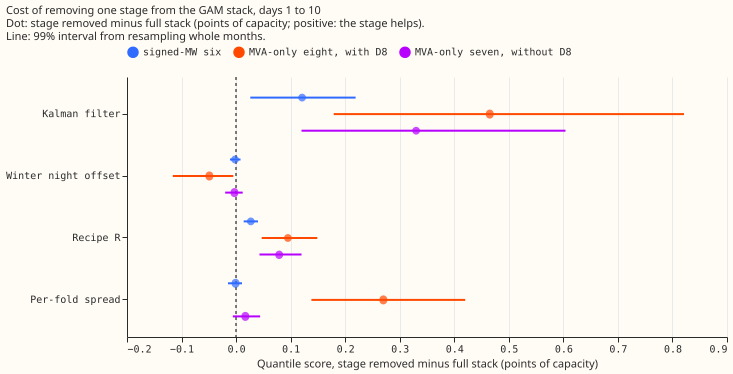
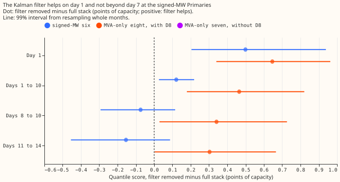
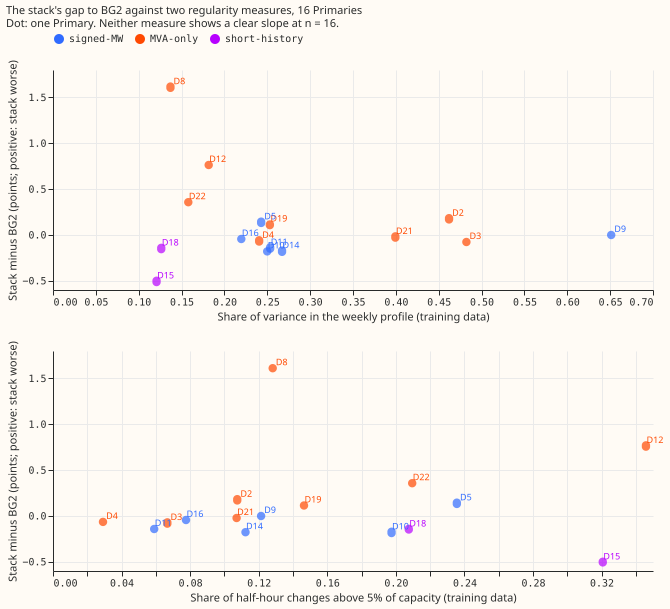

# The GAM stack taken apart at all 16 Primaries, and why it is jagged

**Two stages of the GAM stack carry its score and two do not.** A Primary is a 33 kV to 11 kV
substation, labelled D2 to D22. We took apart the stack that [experiment
377](../00377-demand-v1-first-run-feasibility/result.md) scored: a generalised additive model (GAM)
per Primary, a Kalman filter that corrects it from recent errors, a winter night offset, recipe R
(a 14-day error profile subtracted from the forecast), and spread tables fitted on earlier months.
We removed one stage at a time and scored the rest against BG2, the best-guess forecast of
experiment 87 that production does not run. We also built the stack up from the plain GAM, and
asked whether the stack does worse at the Primaries whose demand is less regular. A score is the
quantile score (twice the mean pinball loss over 11 quantiles, which equals the continuous ranked
probability score, CRPS, up to the estimation from 11 quantiles) in points of effective capacity,
and a difference is positive when the first forecast is worse. "MVA-only" Primaries report apparent
power in megavolt-amperes (MVA); every number there assumes reactive power is zero.

**Verdict: partly supported.** The Kalman filter and recipe R earn their place under the thresholds
registered in the plan. The winter offset and the per-fold spread do not, apart from D8. The
regularity hypothesis is not supported at n = 16, and 16 Primaries are too few to refute it.

## Results (quantile score, points of effective capacity; positive difference: stage helps)

- **Arms.** `full` is experiment 377's stack, rebuilt; it reproduces the stored quantiles exactly
  (largest difference 0.0 at all 16 Primaries). Stages: Kalman filter on stage 1's residuals
  (K), winter night offset (O), recipe R (R), per-fold spread (F). Not in the stack and not
  ablated: the solar summary S, the correction network H, and the daylight heuristic blend.
- **Absolute scores, days 1 to 10, mean over Primaries (full, plain GAM, BG2, manual heuristic,
  climatology).** Signed-MW six: 2.95, 3.32, 3.02, 3.61, 3.83. MVA-only eight: 4.14, 4.87, 3.78,
  4.41, 4.86. D15 and D18 (report only): 7.67, 19.98, 8.00, 13.30, 26.65. Pooled full minus BG2
  (99%): -0.07 (-0.28 to +0.14) signed-MW; +0.34 (+0.09 to +0.60) MVA-only; +0.18 (-0.02 to +0.39)
  without D8. The plain GAM minus BG2: +0.30 (+0.07 to +0.54), +1.05 (+0.73 to +1.39), +0.61
  (+0.38 to +0.90).
- **Removing one stage, days 1 to 10, 99% interval (signed-MW six; MVA-only eight with D8; MVA-only
  seven without D8).** K: +0.121 (+0.026 to +0.219); +0.465 (+0.179 to +0.821); +0.330 (+0.120 to
  +0.604). O: -0.002 (-0.011 to +0.008); -0.049 (-0.116 to -0.005); -0.003 (-0.020 to +0.012). R:
  +0.027 (+0.014 to +0.040); +0.095 (+0.047 to +0.149); +0.079 (+0.043 to +0.120). F (stage 1
  tuning-month spread instead): -0.001 (-0.015 to +0.011); +0.270 (+0.138 to +0.420); +0.017
  (-0.006 to +0.044). At D8 the per-fold arm is the own-residual spread and the replacement is the
  donor spread, so the +0.270 is D8's +1.6 spread effect and not a general spread effect.
- **Thresholds from the plan.** K (0.05): earns its place at both groups with D8; at the signed-MW
  six the point estimate is +0.12 but the effect is on day 1 only. O (0.02): does not. R (0.02):
  earns its place at the MVA-only Primaries (+0.08 to +0.10) and sits at the threshold at the
  signed-MW six (+0.027, a small gain). F (0.02): does not outside D8.
- **Build-up, days 1 to 10 (signed-MW; MVA-only with D8; without D8).** Adding F to the plain GAM:
  -0.001, -0.266, -0.039. Adding K: -0.328 (-0.466 to -0.193), -0.397, -0.293. Adding O: -0.011
  (-0.031 to +0.008), +0.048 (-0.022 to +0.154), -0.022. Adding R: -0.027 (-0.040 to -0.014),
  -0.095, -0.079. The filter is the largest single step by far.
- **The Kalman filter by lead, filter removed minus full (signed-MW; MVA-only with D8).** Day 1:
  +0.499 (+0.204 to +0.939); +0.646 (+0.340 to +0.963). Days 8 to 10: -0.074 (-0.293 to +0.115);
  +0.341 (+0.029 to +0.726). Days 11 to 14: -0.154 (-0.455 to +0.087); +0.303 (+0.003 to +0.666).
- **Leave one Primary out (95%).** K stays positive and excludes zero whichever Primary is left out
  (signed-MW +0.075 to +0.150; MVA-only +0.330 to +0.524). R stays positive (+0.025 to +0.030;
  +0.079 to +0.107). O never excludes zero at the signed-MW six.
- **Slices, days 1 to 10, full against filter removed (signed-MW; MVA-only).** Sunny daylight 4.49
  against 4.27; 5.68 against 5.72. Sunny April to June 4.38 against 4.20; 5.58 against 5.53. Cold
  nights 4.18 against 4.94; 3.30 against 4.27. Christmas 4.38 against 4.20; 3.41 against 3.81. The
  filter makes the sunny-half-hour and Christmas scores worse at the signed-MW six, the slices where
  the stack trails BG2 (3.99 and 3.72 for BG2 on sunny daylight and Christmas).
- **D15 and D18.** Without the filter D15's score is 17.2 (mean of both, against 7.7 with it) and
  q95 coverage is 0.32 at D15. The unfiltered forecast there is badly biased and the cause was not
  investigated.
- **Jaggedness measures** (registered in the plan; readings before 2025-07-01, hand-filtered events
  excluded). M1: share of variance in a half-hour-of-week profile, 0.12 (D15) to 0.65 (D9). M2:
  extra share explained by binned temperature, 0.01 (D4) to 0.50 (D3). M3: lag-1 autocorrelation of
  what remains, 0.84 to 0.98. M4: share of half-hour changes above 5% of capacity, 0.03 (D4) to
  0.35 (D12). M5 (reverse-flow share, signed-MW six only) is 0.000 to 0.002.
- **Spearman correlation with the gap (stack minus BG2, days 1 to 10), registered sign in
  brackets.** n = 16: M1 -0.02 (-) with permutation p = 0.94; M2 -0.02 (-) p = 0.94; M3 -0.19 (+)
  p = 0.46; M4 +0.19 (+) p = 0.48; M5 -0.21 (+) n = 6. The decision rule needs M1 at most -0.5 and M4
  at least +0.5 with p under 0.025, so H2 is not supported. Leave-one-out ranges: M1 -0.24 to +0.09,
  M4 +0.04 to +0.39. Post hoc at n = 14 (D15 and D18 dropped): M1 -0.45 (p = 0.10), M4 +0.53 (p =
  0.057), leave-one-out M4 +0.45 to +0.74. Both point the registered way and neither passes the
  rule. The gap is large at D8, D12, and D22, which have low weekly-profile shares (0.14, 0.18, 0.16),
  and at most +0.18 at D3 and D2, which have the highest shares after D9 (0.48 and 0.46); D9, with
  the highest share (0.65), has zero gap.
- **Placebo.** Time-shuffled readings give M1 to M3 near zero (0.003, 0.0002, 0.00) and M4 near 0.82
  (every Primary), so the measures read time structure. M1 is inflated on short histories
  (shuffled M1 is 0.57 at D15, 0.41 at D18, 0.03 at D9), so D15 and D18 are unreliable for M1 and
  the n = 14 rows are the cleaner test.

## Tail measures and curtailment cost

- **Tail calibration, days 1 to 10, mean over Primaries (coverage q01, q05, q95, q99; pinball
  q05, q95).** Signed-MW: full 0.022, 0.067, 0.946, 0.982; 0.773, 0.815. Filter removed 0.014,
  0.046, 0.917, 0.968; 0.725, 0.914. Plain GAM 0.011, 0.036, 0.875, 0.952; 0.756, 1.007. BG2
  0.010, 0.045, 0.932, 0.975; 0.686, 0.882. MVA-only: full 0.021, 0.070, 0.944, 0.982; 1.001, 1.124.
  Filter removed 0.024, 0.074, 0.928, 0.975. Spread removed 0.036, 0.088, 0.918, 0.963 (D8's donor
  spread and the stage 1 spread are narrow in both tails). BG2 0.005, 0.042, 0.955, 0.995. The
  stack's upper tail is better than BG2's at the signed-MW six (pinball q95 0.815 against 0.882)
  and its lower tail worse (q05 coverage 0.067 against 0.045). The full per-Primary table is below.
- **Avoidable curtailment cost, signed-MW six, limit 0.9 of the earlier maximum, in pounds (full,
  filter removed, plain GAM, BG2, manual heuristic).** All rows: 4.24 million, 10.09 million, 10.59
  million, 7.31 million, 10.41 million. Event rows (D5, D10, D14, D16 only; D9 and D11 have no scored
  half-hour above the limit): 2.81 million, 7.55 million, 7.80 million, 5.24 million, 6.88 million.
  The 7 days after events: 0.343 million, 0.226 million, 0.234 million, 0.285 million, 0.496 million.
- **At limit 0.5 (same order).** All rows: 59.8 million, 85.2 million, 98.2 million, 72.9 million,
  104.8 million. Event rows: 7.75 million, 22.99 million, 27.41 million, 11.96 million, 18.28
  million. The 7 days after events: 3.25 million, 2.67 million, 3.09 million, 4.07 million, 3.57
  million. The filter lowers the cost on all rows and during events, and raises it in the 7 days
  after events (at both limits), which agrees with experiment 367's finding that the Kalman
  transient adds error after a step.
- **No input is nulled** in this experiment, so there are no nulled rows to compare.

### Per-Primary tail measures, days 1 to 10

Coverage and pinball loss at q01, q05, q95, and q99, for the full stack, the stack without the
Kalman filter, and BG2.

| Primary | arm | cov q01 | cov q05 | cov q95 | cov q99 | pin q01 | pin q05 | pin q95 | pin q99 |
|---|---|---|---|---|---|---|---|---|---|
| D2 | full | 0.013 | 0.063 | 0.943 | 0.984 | 0.153 | 0.578 | 0.641 | 0.186 |
| D2 | no filter | 0.010 | 0.038 | 0.895 | 0.968 | 0.154 | 0.597 | 0.650 | 0.184 |
| D2 | bg2 | 0.002 | 0.030 | 0.953 | 0.993 | 0.199 | 0.501 | 0.564 | 0.279 |
| D3 | full | 0.026 | 0.072 | 0.951 | 0.986 | 0.146 | 0.445 | 0.433 | 0.130 |
| D3 | no filter | 0.045 | 0.114 | 0.972 | 0.992 | 0.179 | 0.494 | 0.465 | 0.127 |
| D3 | bg2 | 0.008 | 0.055 | 0.982 | 0.998 | 0.174 | 0.432 | 0.488 | 0.294 |
| D4 | full | 0.027 | 0.078 | 0.937 | 0.980 | 0.172 | 0.599 | 0.669 | 0.211 |
| D4 | no filter | 0.017 | 0.066 | 0.911 | 0.968 | 0.135 | 0.529 | 0.738 | 0.239 |
| D4 | bg2 | 0.005 | 0.047 | 0.933 | 0.989 | 0.163 | 0.506 | 0.761 | 0.286 |
| D5 | full | 0.037 | 0.087 | 0.927 | 0.975 | 0.458 | 1.180 | 1.110 | 0.377 |
| D5 | no filter | 0.032 | 0.067 | 0.867 | 0.953 | 0.398 | 1.126 | 1.134 | 0.336 |
| D5 | bg2 | 0.001 | 0.044 | 0.921 | 0.983 | 0.349 | 0.924 | 1.128 | 0.429 |
| D8 | full | 0.018 | 0.059 | 0.934 | 0.970 | 0.574 | 2.148 | 2.591 | 0.786 |
| D8 | no filter | 0.023 | 0.067 | 0.918 | 0.954 | 0.640 | 2.305 | 3.380 | 1.327 |
| D8 | bg2 | 0.002 | 0.041 | 0.939 | 0.997 | 0.380 | 1.794 | 1.806 | 0.449 |
| D9 | full | 0.015 | 0.066 | 0.951 | 0.987 | 0.168 | 0.593 | 0.651 | 0.185 |
| D9 | no filter | 0.013 | 0.058 | 0.947 | 0.981 | 0.158 | 0.591 | 0.718 | 0.214 |
| D9 | bg2 | 0.010 | 0.047 | 0.942 | 0.985 | 0.168 | 0.544 | 0.644 | 0.189 |
| D10 | full | 0.012 | 0.051 | 0.979 | 0.996 | 0.202 | 0.738 | 1.005 | 0.265 |
| D10 | no filter | 0.006 | 0.029 | 0.979 | 0.996 | 0.196 | 0.721 | 0.994 | 0.260 |
| D10 | bg2 | 0.008 | 0.036 | 0.955 | 0.978 | 0.214 | 0.729 | 1.100 | 0.367 |
| D11 | full | 0.010 | 0.050 | 0.956 | 0.991 | 0.182 | 0.620 | 0.587 | 0.155 |
| D11 | no filter | 0.005 | 0.034 | 0.945 | 0.988 | 0.168 | 0.617 | 0.607 | 0.161 |
| D11 | bg2 | 0.011 | 0.041 | 0.940 | 0.985 | 0.185 | 0.610 | 0.645 | 0.171 |
| D12 | full | 0.023 | 0.077 | 0.939 | 0.981 | 0.489 | 1.760 | 2.042 | 0.578 |
| D12 | no filter | 0.039 | 0.120 | 0.956 | 0.990 | 0.479 | 1.761 | 2.311 | 0.590 |
| D12 | bg2 | 0.003 | 0.048 | 0.958 | 0.998 | 0.318 | 1.432 | 1.826 | 0.615 |
| D14 | full | 0.016 | 0.061 | 0.950 | 0.987 | 0.162 | 0.577 | 0.529 | 0.145 |
| D14 | no filter | 0.010 | 0.034 | 0.883 | 0.958 | 0.173 | 0.632 | 0.666 | 0.207 |
| D14 | bg2 | 0.010 | 0.039 | 0.923 | 0.972 | 0.184 | 0.586 | 0.614 | 0.195 |
| D15 | full | 0.058 | 0.120 | 0.827 | 0.945 | 1.153 | 3.231 | 4.210 | 1.302 |
| D15 | no filter | 0.000 | 0.000 | 0.319 | 0.604 | 0.865 | 3.836 | 18.564 | 7.446 |
| D15 | bg2 | 0.001 | 0.023 | 0.873 | 0.993 | 0.710 | 2.698 | 3.384 | 0.762 |
| D16 | full | 0.042 | 0.086 | 0.911 | 0.956 | 0.359 | 0.928 | 1.006 | 0.488 |
| D16 | no filter | 0.017 | 0.053 | 0.881 | 0.935 | 0.187 | 0.661 | 1.364 | 0.821 |
| D16 | bg2 | 0.019 | 0.061 | 0.910 | 0.950 | 0.231 | 0.722 | 1.161 | 0.590 |
| D18 | full | 0.010 | 0.045 | 0.958 | 0.989 | 0.210 | 0.647 | 0.681 | 0.211 |
| D18 | no filter | 0.002 | 0.009 | 0.780 | 0.919 | 0.245 | 0.849 | 1.126 | 0.383 |
| D18 | bg2 | 0.000 | 0.017 | 0.981 | 1.000 | 0.399 | 0.611 | 0.719 | 0.385 |
| D19 | full | 0.024 | 0.079 | 0.944 | 0.983 | 0.226 | 0.795 | 0.903 | 0.275 |
| D19 | no filter | 0.026 | 0.083 | 0.930 | 0.976 | 0.215 | 0.784 | 0.924 | 0.292 |
| D19 | bg2 | 0.010 | 0.052 | 0.955 | 0.991 | 0.229 | 0.701 | 0.830 | 0.314 |
| D21 | full | 0.024 | 0.079 | 0.951 | 0.987 | 0.207 | 0.629 | 0.559 | 0.155 |
| D21 | no filter | 0.025 | 0.088 | 0.948 | 0.986 | 0.203 | 0.640 | 0.553 | 0.148 |
| D21 | bg2 | 0.011 | 0.044 | 0.965 | 0.997 | 0.246 | 0.617 | 0.557 | 0.276 |
| D22 | full | 0.013 | 0.056 | 0.951 | 0.988 | 0.288 | 1.051 | 1.156 | 0.331 |
| D22 | no filter | 0.008 | 0.020 | 0.891 | 0.968 | 0.336 | 1.322 | 1.163 | 0.337 |
| D22 | bg2 | 0.002 | 0.019 | 0.951 | 0.997 | 0.384 | 0.939 | 0.895 | 0.305 |

## Checks

- **Control.** The arm `full` equals experiment 377's stored stack: the largest absolute difference in
  q50 and q95 is 0.0 at all 16 Primaries on the scored year.
- **Median minus mean forecast, per site.** 0.0 at every Primary and every arm: the stored `mean`
  is the centre of the centred spread tables, so no independent mean-forecast contrast exists.
- **Triggers fired.** Trigger 2 (predictions P1 days 1 to 10, P2 and P3 at the MVA-only eight, P5
  at the MVA-only eight, and P6 failed, and the MVA-only misses are explained by D8 alone only
  partly); trigger 5 (the arm without the winter offset beats the full stack at the MVA-only eight,
  and the arm without the filter beats it at days 8 to 14 at the signed-MW six, within noise).
  Triggers 1, 3, 4, 6, 7 did not fire. The audit and the triage of its findings are listed under
  "Audit" below.
- **Placebos.** A permutation placebo (10,000 shuffles of each measure across Primaries) gives the
  p values above; a time-shuffled-readings placebo gives M1 to M3 near zero.

## Caveats and what to try next

- The stack is experiment 377's, without S, H, and the heuristic blend; stage contrasts may differ
  in default 3, which experiment 378 builds.
- The per-fold spread contrast at D8 compares the own-residual arm with the donor spread, so it
  reports D8's spread choice and not whether refitting the spread monthly helps.
- D15 and D18 without the filter are badly biased; their contrasts are report only.
- H2 has 16 Primaries and a measure whose first 4 of 5 readings are not independent of each other.
  A larger test would use more Primaries or simulated series with set regularity.
- Next: a filter that fades out beyond day 7 (signed-MW days 8 to 14 score better without it), and
  a stack without the winter offset as the simpler release candidate.

## Audit

(Filled in after the audit.)
