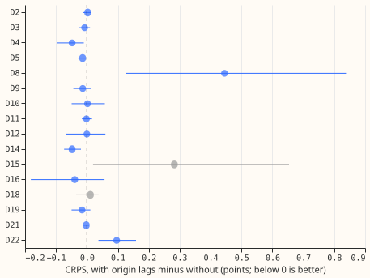
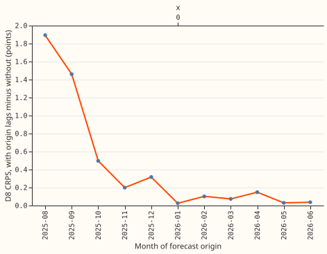

## Do three recent-power lags, added to the GAM stack as smooth terms, close the D8 gap?

**No. The terms made D8 worse, and changed the other Primaries by 0.05 points or less.** Experiment
371 found that monthly XGBoost leads the GAM stack at substation D8 mainly through three lagged
values of recent power. We gave the stack the same three values (the newest reading, the reading a
day earlier at the target half-hour, and the reading a week earlier) as smooth terms in its stage 2
mean correction, fitted each month on earlier months only, and scored the result under the
demand-v1 protocol. The terms sit in stage 2 because stage 1 does not depend on the forecast
origin. Each lag enters as an anomaly: the reading minus the stack's own mean for that half-hour.
The full design is in the plan above. The stack is "Primary demand research default 1, extended to
336 hours" (experiment 377); "default plus origin lags" is the spline arm, and a linear version is
a sensitivity arm. Scores are the quantile score (CRPS) in points of effective capacity, lower is
better, and contrasts are treatment minus default.

**Results (days 1 to 10, spline minus default, 99% intervals, 20,000 resamples of whole months).**

- D8 (own-residual arm): +0.445 (+0.090 to +0.983); default 9.227, spline 9.672, BG2 7.616.
- Days 1 to 2 at D8: +0.108 (-0.064 to +0.391). Days 3 to 10: +0.531 (+0.115 to +1.184). Days 8 to
  10: +0.695 (+0.162 to +1.489). The harm grows with lead, the opposite of prediction P2.
- Signed-MW six: -0.019 (-0.052 to +0.008); days 1 to 2: -0.043 (-0.061 to -0.028).
- MVA-only eight with D8: +0.055 (+0.012 to +0.125); without D8: +0.004 (-0.022 to +0.027).
- Placebos D2 and D4 pooled: -0.023 (-0.066 to +0.007). Both improve slightly, the opposite
  direction to D8, so neither placebo fails.
- Per Primary (95%): D8 +0.445 (+0.127 to +0.838), D22 +0.096 (+0.037 to +0.159), D15 +0.283
  (+0.020 to +0.654, report only), D14 -0.048 (-0.074 to -0.019), D4 -0.048 (-0.095 to -0.010). The
  spline wins at 10 of 14 counted Primaries. The worst Primary is D8.
- Linear arm: D8 +0.089 (+0.004 to +0.162); signed-MW six -0.022 (-0.043 to -0.001).
- D8 by month (days 1 to 10): +1.89 (2025-08), +1.46, +0.50, +0.20, +0.32, +0.03, +0.10, +0.07,
  +0.15, +0.03, +0.04 (2026-06). Leaving out August 2025 moves the pooled D8 difference from
  +0.445 to +0.293.
- Donor-spread arm at D8: default 11.588, spline 12.112 (+0.524).

**Tails.** At D8 the coverage of the 0.05 quantile is 0.0589 (default) and 0.0583 (spline), of the
0.95 quantile 0.934 and 0.933, and of the 0.99 quantile 0.970 and 0.968, so the lags neither fix nor
break the lower-tail undercoverage that experiment 377 found. The printed report holds the pinball
loss at the four tail quantiles and the twCRPS per group and per Primary for all six arms. The
twCRPS contrast at D8 is +0.050 (+0.011 to +0.118) (the spline is worse); at the signed-MW six it is
-0.004 (-0.015 to +0.002).

**Nulled rows.** A row is nulled when any of the three lags is missing (a gap in the power record).
Such rows are rare: 19 to 1,404 rows per Primary against 55,000 to 172,800 un-nulled rows. Their
coverage of the 5% to 95% interval is erratic because the samples are tiny (0.58 to 1.00), and
interval width on nulled rows is not systematically wider, since the treatment adds no widening
rule. A widening rule was not tried, because nulled rows are under 1% of every Primary except D21
(0.8%), D15 (1.1%), and D18 (0.7%).

## Checks

- Median minus mean forecast per site is 0.0 points for default and spline at every Primary, so the
  spread does not shift the forecast. The mean-forecast absolute error at D8 rises from 15.93 to
  16.47 points, in the same direction as the quantile score.
- Triggers that fired: 2 (the result contradicts its prediction P1, and the only tested explanation
  is the monthly pattern above, which is post hoc) and 5 (the default arm, nested inside the spline
  arm, beats it at D8). Triggers 1, 3, 4, and 6 did not fire (the placebos did not fail; the
  quantile and median-error contrasts agree in sign; leaving one month out leaves D8 positive at
  +0.293 to +0.489). Trigger 7 does not apply. An audit is requested; its findings are triaged in the
  pull request.

## Caveats and what to try next

- The terms are stage 2 additive terms, not stage 1 GAM terms and not interactions with the weather
  inputs. The refutation covers that form only.
- D8 has under 12 months of history for the whole scored year, so its fits have 1,000 to 20,000
  rows per band. A year of history may change D8's result; the by-month pattern suggests it would.
- Rows before 2024-07 carry no shift in the spread pool of the early fold months, which slightly
  widens the treated spread there.
- Next: the lags as origin-dependent inputs to stage 1, or an interaction of the day-lag anomaly
  with the stack's weather terms, tested at the Primaries with a year of history first.

Reuses experiment 377's folder (`e00377s2_common`, `e00377s2_corrections`, `e00377s3_stack`,
`e00377_adapter`, `e00377_score`) unchanged, and `studies.eval_protocol`. Schedule: monthly stage 2
refits, weekly stage 1 fits as stored by 377; the contrast depends on the schedule only through the
stage 2 fits. Lag source: the cleaned power the GAM trains on, available at forecast time up to 3.5
hours before the origin.

## Plan, registered before any score was read

**Where the terms enter.** The stack's stage 1 GAM predicts from the valid time's weather and
calendar and does not depend on the forecast origin, so a lag measured from the origin cannot be a
column of its design matrix without re-fitting stage 1 on one row per origin and valid time. The
stage 2 correction already depends on the origin (it contains recipe R, a profile of recent
residuals), so the terms enter there: one additive shift of the stage 2 mean, then the same
fold-by-fold spread. This is a stage 2 smooth term, not a stage 1 GAM term, and the write-up says so
in its opening.

**The three lags and their anomaly form.** For a run with origin `o` and a row with valid time `v`,
the newest usable reading is the half-hour ending at `o - 3.5 h` (371's telemetry delay of 3 hours
plus the half-hour a reading spans), the day lag is the latest earlier reading with `v`'s half-hour of
day, and the week lag is the latest earlier reading with `v`'s weekday and half-hour, all no later
than the newest usable reading (the definition of `origin_lags` in experiment 87). Each lag enters
as an **anomaly**: the reading minus the stack's own corrected mean for that half-hour, taken from
the run with the latest origin not after that half-hour (always before `o`, so it is known at `o`).
The anomaly removes the daily and weekly shape that a raw lag would carry, which a lag-only additive
term cannot remove.

**No lookahead, and no leaky lags.** Every lag time is at least 3.5 hours before `o`, so no lag is
at or after the origin at any lead; the nullification of leaky lags that the feature pipeline does
for lags shorter than the lead cannot trigger, and the code asserts that every lag index is at most
the newest usable index. A missing reading gives no contribution (the term is zero), so absent data
degrades to "default".

**Term form.** For each lag and each of the six protocol lead bands, a penalised cubic B-spline
(8 basis functions, second-difference penalty, weight fixed at 10 before any score is read) of the
anomaly, clipped to the 1st to 99th percentile of the fit rows; the shift is the sum of the three
terms, fitted by penalised least squares on the residual of the stack's mean, on rows whose origin
and valid time both precede the fold month's first instant (the 12-month rule), outside the
hand-filtered events. The spread for each fold month is fitted on earlier months' residuals of the
treated mean, each earlier month using its own out-of-fold shift. Fits start at cut 2024-07-01 (rows
before it get no shift). A band with under 2,000 fit rows gets no shift and is listed.
Sensitivity arm, pre-registered: the three terms linear (penalty weight infinite).

**Arms.** `default` (the 377 stack as stored, unchanged), `default_plus_origin_lags`, and
`default_plus_origin_lags_linear` (sensitivity only; at most one pre-registered arm can be adopted,
and it is the spline arm). BG2, climatology and the manual heuristic are the references.

**Rows and unit.** The 16 Primaries of experiment 377; D15 and D18 are report only, D8 follows
377's two-arm rule. Compute: 3 threads.

**Tails and nulled inputs.** The write-up reports pinball loss and coverage at the 0.01, 0.05, 0.95,
and 0.99 quantiles per group and per Primary, beside CRPS and twCRPS, and names the tail result in
the take-home. Rows whose lags are missing form the nulled rows; the write-up gives interval width
and coverage on nulled and un-nulled rows, and tries a simple widening rule if coverage falls short.
