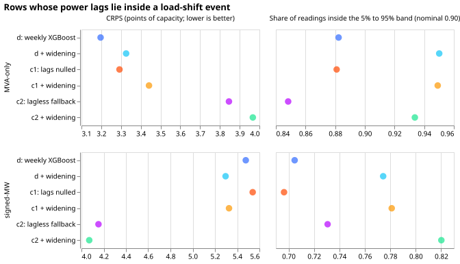

# Nulled load-shift lags and wider bands in the weekly XGBoost model

**Telling the weekly XGBoost model which of its power lags lie inside a load-shift event does not
repair its upper-tail forecasts.** The XGBoost model forecasts each Primary substation's half-hourly
power 1 to 10 days ahead and is refitted every week. A load shift is a period when National Grid
Electricity Distribution (NGED) moves a substation's load onto its neighbours. A power lag is the
substation's own power at the forecast origin, at the same time on the latest day, or at the same
time in the latest week. We took the hand-labelled load-shift events as known, which is a perfect
detector, and tested three fixes on the forecasts whose power lags lie inside an event. The fixes
were to set those lags to missing, to switch to a model with no power lags, and to widen the
forecast band.

At the six Primaries whose meters report signed megawatts (signed-MW), the model with no power lags
lowered the continuous ranked probability score (CRPS, lower is better), but the interval includes
zero and the result rests on two events. At the eight Primaries whose meters report only apparent
power (MVA-only), the same model raised the CRPS. The 5% to 95% band should contain 0.90 of the
readings. Fixed widening left the signed-MW share at 0.77 to 0.82. Widening by a factor fitted on
earlier months raised the share to 0.88 to 0.93, but the factor sat at its cap of 2 in most months,
which doubles the band width. Gate O is the pre-registered test of whether perfect labels help
enough to justify building a detector. Gate O failed, so the detector arm b2 was not run.

## Result

- **Verdict:** not supported. Gate O fails four of its five conditions (listed under Gate O below);
  the detector arm b2 did not
  run, as the stop rule requires.
- **Rows:** the contaminated-lag rows are rows outside events, days 1 to 10, with at least one of
  the three lags inside an event: 21,601 at the signed-MW six (6 months) and 22,232 at the MVA-only
  eight (8 months). They make up 2.2% and 1.6% of the main-score rows.
- **Arms:** d, the weekly member of BG2 (experiment 87, stored). c1, event targets dropped, lags
  inside events set to missing in training and at test time, 30% pseudo-event lag dropout in
  training. c2, a lagless model (event targets dropped) served on the contaminated rows, d elsewhere.
  Fixed widening (k = 1.28, tuning-adjacent) and as-of widening (k from earlier months, cap 2) on
  the contaminated rows. Seed 0, `colsample` 1.0, weekly refits, ENS control-member training.
- **CRPS on contaminated rows (points of capacity), signed-MW six:** d 5.477, c1 5.539, c2 4.153,
  d plus widening 5.296, c1 plus widening 5.326, c2 plus widening 4.070, BG2 6.095. MVA-only eight:
  d 3.197, c1 3.292, c2 3.846, d plus widening 3.326, c1 plus widening 3.442, c2 plus widening
  3.967, BG2 3.150.
- **Contrasts against d (95% Bonferroni over 6, month bootstrap):**

  | Group | Contrast | CRPS | Tail pinball (mean of q95 and q99) |
  |---|---|---|---|
  | signed-MW | c1 + widening | -0.15 (-0.86 to +1.06) | -0.22 (-0.39 to +0.06) |
  | signed-MW | c2 + widening | -1.41 (-3.12 to +0.32) | -0.70 (-2.23 to +0.06) |
  | signed-MW | widening alone | -0.18 (-0.46 to +0.16) | -0.34 (-0.89 to +0.06) |
  | MVA-only | c1 + widening | +0.24 (+0.09 to +0.35) | +0.11 (-0.05 to +0.25) |
  | MVA-only | c2 + widening | +0.77 (+0.17 to +1.54) | +0.18 (-0.03 to +0.51) |

- **Tail calibration on contaminated rows, signed-MW six (d, c1, c2, c2 plus widening):** q95
  pinball 2.29, 2.58, 1.58, 1.19; q99 pinball 0.58, 0.86, 0.43, 0.29; coverage of q95 0.774, 0.709,
  0.743, 0.824; coverage of q99 0.917, 0.889, 0.926, 0.972; coverage of the 5% to 95% band 0.705,
  0.696, 0.731, 0.820. At the MVA-only eight d already covers 0.882.
- **Nulled against un-nulled rows (signed-MW six, 5% to 95% band):** d covers 0.705 on contaminated
  rows (width 21.7 points) and 0.876 on ordinary rows (20.2). Widening by 1.28 widens the contaminated
  rows to 27.8 points and lifts coverage to 0.774. c1 and c2 do not widen the band (22.7 and 21.7).
- **Main score, outside events, days 1 to 10, minus d (90% interval):** signed-MW c1 -0.015
  (-0.032 to 0.000), c2 -0.029 (-0.066 to 0.000); MVA-only c1 -0.004 (-0.018 to +0.009), c2 +0.011
  (+0.003 to +0.019). Largest per-Primary difference among the countable Primaries: D12 +0.058 for
  c2. The report-only D18 is worse by +1.95 (c1) and +1.51 (c2), and D15 by +0.97 (c1).
- **Placebos D2, D9, D11, and D21:** arms c2 and widening equal d, bit for bit.

## Gate O: whether perfect labels justify building a detector

1. The CRPS interval of c2 plus widening includes zero (-3.12 to +0.32), and the tail pinball
   interval includes zero (upper bound +0.06). **Fails.**
2. The 5% to 95% coverage of c2 plus widening on contaminated rows is 0.820, 0.08 under 0.90.
   **Fails.**
3. Main headline per group within 0.02: signed-MW passes; MVA-only c2 plus widening has an upper
   bound of +0.023. **Fails for c2.**
4. No countable Primary worse than 0.05: D12 is +0.058 under c2. **Fails for c2.**
5. Placebos identical to d. **Passes.**

## Where the c2 gain comes from

- **Two events carry most of it.** On the contaminated rows attributed to each event, c2 minus d is
  -3.69 for the D16 event of 17.5 days over Christmas and -4.77 for the D10 event in November. For
  the 42-day D5 event it is -0.83. Leaving out the D16 event over Christmas moves the signed-MW c2
  plus widening contrast from -1.41 to -0.98 (the audit's attribution by lag gives -0.86, and -1.05
  without the D10 event, and -0.44 without both). Leaving out the D5 events leaves it at -1.37 and
  -1.57.
- **The gain grows with time since onset.** Signed-MW c2 minus d is -0.57 within 1 day of onset,
  -0.68 from 1 to 3 days, and -1.85 beyond 3 days. A detector can see events only after about a day
  (experiment 298), so the first-day rows are the ones it would miss.
- **No contaminated signed-MW rows lie in 20 December to 10 January,** because the events that cover
  that period exclude the rows.
- **D18 is the exception that matters.** One D18 event (December, 3 days) has a CRPS of 8.5 for d and
  53.0 for c2, a rise of 44 points, and drives the report-only group's loss.

## Avoidable-curtailment cost

The cost is in pounds at the scaled limit of 0.9 times the earlier maximum, over leads of 12 to 36
hours, for the signed-MW six (D9 and D11 have no event rows). No interval has been computed, because
the metric returns one total per series. During events D16 costs 7.76 million pounds for d, 9.87
million for c1, 9.56 million for c2, and 7.31 million for d plus widening; D5 costs 241 thousand for
d and 236 thousand to 246 thousand for the other arms; D10 and D14 cost about nothing. In the 7 days
after events D5 costs 185 thousand for d against 162 thousand for c1; D16 costs 50 thousand for d
against 63 thousand for c1 and 39 thousand for c2. Across all rows D16 costs 8.10 million for d and
10.16 million for c1, and no other signed-MW Primary differs between d, c1, and c2 by more than 3%.
The D16 numbers come from one site and one long event, so they are a lead for later work, not a
result.

## Checks

- **Median minus mean forecast per site:** not computed. The stored forecasts hold quantiles only.
- **Error of the median beside the quantile score:** stored in `work/scores/rows.parquet` and not
  tabulated here.
- **Audit triggers that fire:** trigger 2 (the c2 gain at the signed-MW six was not predicted, the
  prediction was no change beyond 0.1 points of CRPS on contaminated rows with W) and trigger 5
  (c2 plus widening scores better than c2 at the signed-MW six but worse at the MVA-only eight, and
  d plus widening is worse than d at the MVA-only eight). An audit by a fresh Sonnet agent re-derived
  every headline contrast from the stored arms (they reproduce) and found no training leakage; the
  audit's findings are in Caveats and limits below, and its report is in the private briefs folder.
- **Reproduction gate:** a refit of arm d at 4 of 52 weekly refits differs from the stored weekly
  member by at most 0.0043 CRPS points at the 14 countable Primaries, and by 0.015 and 0.016 at
  D15 and D18 (GPU subsampling noise). The gate is read at the countable Primaries.

## Caveats and limits

- **The event mask is padded by 24 hours on each side** (the feature cache's padding). The audit
  found that in 54% of the signed-MW contaminated rows and 81% of the MVA-only ones no lag lies
  inside the unpadded event, only inside the padding. On the 9,864 signed-MW rows with a lag inside
  the unpadded event, d covers 0.542 (not 0.705) and c2 plus widening minus d is -2.63 (-3.58 to
  +0.54). The pre-onset padding also tells the oracle arms about an event the forecaster cannot
  yet know, on 2,040 signed-MW rows; dropping them moves the contrast from -1.41 to about -1.50.
- **The sample is smaller than the group names suggest.** The signed-MW contaminated rows come from
  four series (D5, D10, D14, D16) and the MVA-only ones from five (D3, D4, D12, D19, D22).
- **Arm c2 is confounded.** The lagless model drops event targets in training and all three lags
  together; only c1 isolates the nulling, and c1 shows nothing.
- **Arm d is the stored weekly member; arms c1 and the lagless model are refits.** The
  refit-versus-stored
  difference was measured at 4 of 52 refits only (at most 0.0043 CRPS points), not at the events.
- **The as-of widening factor is pooled over 11 series,** including the report-only D15 and D18.
- **Lead range:** days 1 to 10 headline, leads to 14 days scored. NGED's horizon is 1 to 10 days.
- **Reactive power assumed zero** at the MVA-only eight.
- **The events are hand-labelled and known to the model at forecast time.** A live detector sees an
  event only after about a day, so these numbers are an upper bound on what a detector could give.
- **Fixed widening factor 1.28 is tuning-adjacent:** experiment 100 looked at the same year. The
  as-of factor reached its cap of 2 in most months (the full table is in `work/arms`).
- **Only 6 months at the signed-MW six** hold contaminated rows, so a month bootstrap has wide
  intervals. Not scored: injected-transfer scoring (aim 2), the second tuning of the lagless model,
  and arm a.
- **Lag-encroachment sweep not run:** the fitted boosters were not saved, because the fit script
  keeps only predictions, so a synthetic step in the lagged-power inputs cannot be scored.

## What the next experiment should answer

Whether a widening factor learned per Primary and lead from earlier contaminated rows, applied
without any detector (for example on rows whose lag disagrees with the lagless forecast), reaches
0.90 coverage. Experiment 309 tests the disagreement signal.

## Problems caused by the move

- Experiment 298's common module imports PyTorch, which a worktree synced without the `gpu` group
  lacks, so the neighbour tables were copied instead of imported.
- `pkill -f` on a script name also killed the calling shell.
