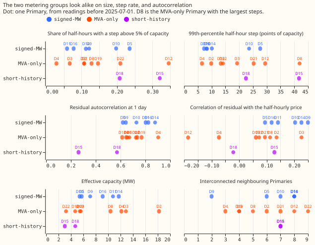
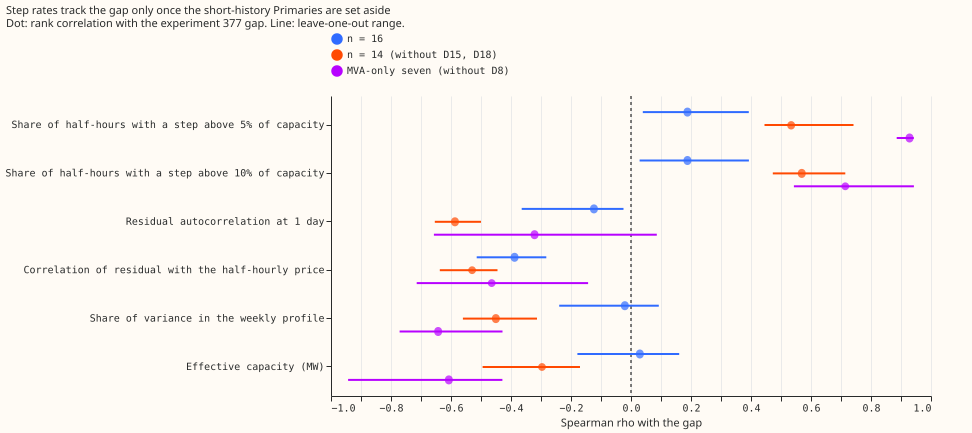
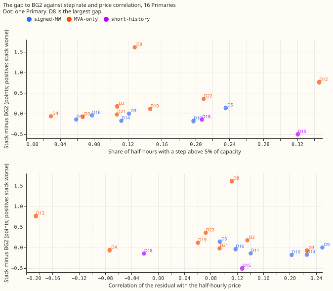

# What is special about the MVA-only Primaries?

**None of the four guesses explains why the GAM stack trails BG2 at the MVA-only Primaries.** A
Primary is a 33 kV to 11 kV substation. The labels D2 to D22 are the study's anonymised labels. The
"MVA-only" Primaries (D2, D3, D4, D8, D12, D19, D21, D22) report only apparent power in
megavolt-amperes, and every number for them assumes reactive power is zero. The "signed-MW"
Primaries (D5, D9, D10, D11, D14, D16) report power in signed megawatts. D15 and D18 have under a
year of history and are short-history. The GAM stack of [experiment
377](../00377-demand-v1-first-run-feasibility/result.md) trails BG2 by +0.18 quantile-score points
on average (3 of 7 Primaries are ahead of BG2) at the MVA-only Primaries without D8 and by +1.61 at
D8, where the quantile score is twice the mean pinball loss over 11 quantiles, in points of
effective capacity (lower is better). We compared the two metering groups on their size, age, step
rate, regularity, price response, and generators, and related each measure to the per-Primary gap by
rank correlation (n = 16). Experiment 380's measures M1 to M4 are reused from its stored table; the
others are new here.

**Verdict: not supported.** No hypothesis meets the decision rule in this page's front matter. The
groups do not differ on any measure except the two price correlations, and that difference has the
sign opposite to the one hypothesis C predicts.

## Results

- **Group comparison** (difference of medians, MVA-only minus signed-MW, 95% interval from
  resampling Primaries; Figure 1). Effective capacity: 7.99 against 8.11 MW, -0.12 (-5.27 to +6.41).
  Peak load: 8.2 against 7.7 MVA, +0.58 (-4.0 to +6.4). Neighbouring Primaries: 5.5 against 7.5,
  -2.0 (-4 to +2). Step rate above 5% of capacity (M4): 0.118 against 0.117, +0.001 (-0.099 to
  +0.093). 99th-percentile step: 16.7 against 9.2 points, +7.5 (-10.2 to +19.1). Share of half-hours
  with a step above 10%: 0.017 against 0.007, +0.009 (-0.035 to +0.037). Weekly-profile share (M1):
  0.247 against 0.252. Coefficient of variation: 0.285 against 0.280. Lag-1-hour residual
  autocorrelation: 0.875 against 0.927, -0.052 (-0.135 to +0.030). Lag-1-day: 0.698 against 0.765,
  -0.067 (-0.173 to +0.091). Price correlation of the residual: 0.083 against 0.172, -0.089 (-0.233
  to -0.003). Correlation of the half-hour change with the price change: 0.091 against 0.158, -0.067
  (-0.145 to -0.001). A placebo with the price shuffled in time gives 0.002 against 0.004.
- **Hypothesis A, age: cannot be tested with the files.** None of the hierarchy files gives a
  commissioning or install date. The first power reading is a proxy for the start of the record
  only: it is 2019-09 (the start of the stored telemetry) for all 8 MVA-only Primaries and for D5,
  D10, and D11 among the signed-MW Primaries, about 5 weeks later for D14, while D16 starts in late
  2020, D9 in 2023, and D15 and D18 in 2024 and 2025. Every Primary with a later first reading is
  therefore signed-MW, which fits "newer Primaries have megawatt metering". The record start
  truncates the age of the other 12 Primaries, so the MVA-only group may be older or the same age.
- **Hypothesis B, size: not shown.** Median effective capacity differs by -0.12 MW (interval above).
  Spearman correlation of capacity with the gap: +0.03 (n = 16), -0.30 (n = 14).
- **Hypothesis C, randomness: not shown.** M1 to M4, the step sizes, and the coefficient of
  variation do not differ between groups. At n = 16 the rank correlations with the experiment 377
  gap are +0.19 (M4) and +0.19 (steps above 10%), against the +0.4 predicted for M4. At n = 14 (D15
  and D18 dropped), the steps above 10% reach +0.57 (p = 0.033, leave-one-out +0.47 to +0.71) and
  the lag-1-day autocorrelation reaches -0.59 (p = 0.029). About 200 correlations were computed (21
  measures, 2 gaps, 5 row sets), so about 10 would pass p under 0.05 by chance.
- **Within the MVA-only group the gap follows the step rate.** Across the 8 MVA-only Primaries, M4
  has rho +0.79 (p = 0.031) and the steps above 10% rho +0.79 (p = 0.030); across the 7 without D8,
  M4 has rho +0.93 (p = 0.007, leave-one-out +0.89 to +0.94). The 6 signed-MW Primaries show rho
  +0.26 for M4 (p = 0.66) and +0.09 for the steps above 10%. The same relation holds for the
  experiment 378 gap (default 3 minus BG2, a CRPS gap in points, where D8's gap is +3.97): +0.79 for
  M4 across 8, +0.93 across 7. D12 (M4 0.346, gap +0.76) and D22 (M4 0.210, gap +0.36) have the
  highest step rates and gaps, and the relation survives dropping any one of the seven. D8's own gap
  (+1.61) does not follow from its step rate (0.128). D8's 99th-percentile step (41.9 points) is the
  largest of the 16. It is unproven whether the generator explains the steps and the gap.
- **Hypothesis D, embedded generation: not shown, and only partly measurable.** The hierarchy files
  list generators per bulk supply point, not per Primary, and only two bulk supply points (900004
  and 900005) carry the 16 Primaries. The count of listed generators at the bulk supply point is 6
  for both group medians, and its correlation with the gap is +0.07 (n = 16). The share of each
  Primary's load that is metered embedded generation cannot be formed from these files, so it is not
  reported.
- **Price-chasing: not higher at the MVA-only Primaries.** The residual's correlation with the
  Market Index Data price (a proxy for the intraday price) is lower at the MVA-only Primaries and
  negative at D12 (-0.185) and D4 (-0.073). At n = 14 its rank correlation with the gap is -0.53 (p
  = 0.055): the Primaries that follow the price most have the smallest gaps.

## Confounding

- Metering group is confounded with first-reading date (all 8 MVA-only Primaries start at the record
  start, and the four later starters are all signed-MW) and with the short-history Primaries, which
  all report MW.
- Generator counts take only two values within each group, so they cannot be separated from the
  bulk supply point.
- Capacity, step rate, autocorrelation, and price correlation are not tied to metering group
  (Figure 1).

## Checks

- Median minus mean forecast per site and the mean-forecast error beside each quantile-score
  contrast: not applicable, because no forecast is made. The audit triggers for forecasting scores
  do not fire.
- Measures use readings before 2025-07-01, with the hand-filtered events excluded, so none of them
  sees the scored year.
- Placebo: the price shuffled in time gives group medians of 0.002 and 0.004, and rank correlations
  with the gap of -0.24 (n = 14, p = 0.41) and +0.12 (n = 16, p = 0.66).
- First reading has no spread inside the MVA-only group, so its within-group correlation is
  undefined and is left out above.

## Caveats and next steps

- The data are 16 Primaries. A rank correlation has to be about 0.5 to reach p = 0.05, so a failure
  here is "not shown", not "false".
- The within-group step relation was found after looking at 200 correlations and rests on 7
  Primaries (it survives dropping any one). Treat it as a hypothesis to test, for example by adding
  a step term to the GAM at D12 and D22, or by simulating series with set step rates.
- Next: ask NGED for the commissioning dates of the Primaries and for the generator capacity behind
  each Primary, which would test hypotheses A and D directly.

## Code reuse

- Experiment 380's folder: M1 to M4 and the gap table (`jaggedness_table.parquet`), read, not
  rewritten.
- Experiment 377's folder: `e00377_adapter` and `e00377_score` for the feature cache.
- Experiment 378's folder: `score_report.txt` for the default 3 minus BG2 gap.
- Experiment 10's folder: the Market Index Data price (`market_index.parquet`, provider APXMIDP).
