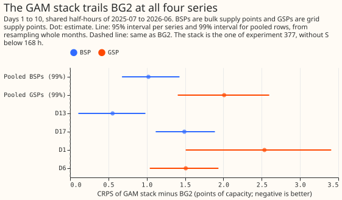
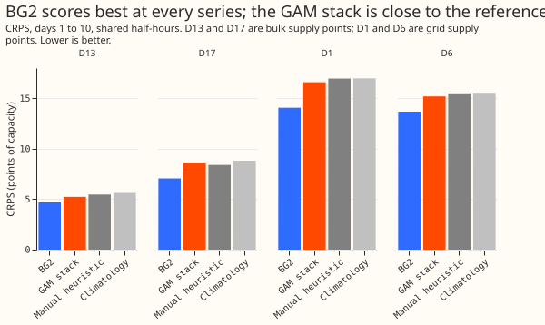

# BG2, the GAM stack, and the references at the bulk and grid supply points

**The GAM stack of experiment 377, fitted separately on the aggregate readings of two bulk supply
points and two grid supply points, scores much worse than BG2 and about level with the manual
heuristic and climatology.** A bulk supply point (BSP) connects the 132 kV network to the 33 kV
network, and a grid supply point (GSP) connects the transmission network to the 132 kV network.
The series are D13 and D17 (BSPs) and D1 and D6 (GSPs). The stack is a generalised additive model
with a correction stage, here labelled "stack without S below 168 h" (it has no two-number solar
summary below 168 hours and no daylight blend). BG2 at these series is the weekly-refitted XGBoost
model alone (experiment 87's `b_weekly`). Scores are the quantile score (the continuous ranked
probability score, CRPS, estimated from 11 quantiles) in points of effective capacity, and negative
differences favour the stack. No research default exists for this family, so nothing is adopted,
and a "simple weekly XGBoost" arm is added once experiment 381's weekly forecasts have been scored
at these series (stage D, a second pull request).

## Results (CRPS in points of effective capacity; lower is better)

- **Verdict.** Refuted for both groups. Stack minus BG2, days 1 to 10, 99% interval from 20,000
  resamples of whole months: BSPs +1.02 (+0.68 to +1.43); GSPs +2.01 (+1.41 to +2.60). The
  registered margin was +0.20 and both lower ends are above it. The BSPs and GSPs are never pooled
  together.
- **Per series (95%, 2,000 resamples).** D13 +0.55 (+0.11 to +0.98); D17 +1.49 (+1.12 to +1.89); D1
  +2.54 (+1.51 to +3.41); D6 +1.51 (+1.04 to +1.94). Leaving out one series leaves every pooled
  interval above zero (BSP without D13 +1.49, without D17 +0.55; GSP without D1 +1.51, without D6
  +2.54).
- **Absolute scores, days 1 to 10 (BG2, stack, manual heuristic, climatology).** D13 4.68, 5.23,
  5.47, 5.62; D17 7.06, 8.55, 8.39, 8.82; D1 14.06, 16.60, 16.97, 16.98; D6 13.68, 15.19, 15.50,
  15.55.
- **The stack against the references (99%).** Against the manual heuristic: BSPs -0.04 (-0.44 to
  +0.30), GSPs -0.34 (-1.02 to +0.13). Against climatology: BSPs -0.33 (-0.90 to +0.11), GSPs -0.37
  (-1.27 to +0.56). All four intervals include zero. The stack wins 0 of 4 series against BG2, 3 of
  4 against the manual heuristic, and 4 of 4 against climatology (days 1 to 10).
- **BG2 against the references (99%).** BG2 minus the manual heuristic is -1.06 (BSPs) and -2.35
  (GSPs); BG2 minus climatology is -1.35 and -2.38. All four intervals exclude zero.
- **By lead (stack minus BG2, pooled).** Days 8 to 10: BSPs +0.68 (+0.39 to +1.01), GSPs +0.94
  (+0.23 to +1.72). Days 11 to 14 (beyond NGED's horizon, descriptive): BSPs +0.62, GSPs +1.14. On
  day 1 the gap per series is D13 +0.90, D17 +2.39, D1 +4.94, D6 +1.64.
- **Slices (stack, BG2).** The gap is spread over every slice read: sunny half-hours (BSPs 11.9
  against 9.8, GSPs 15.2 against 14.2), winter nights, Economy 7 steps, and worst on Christmas and
  bank holidays (GSPs 22.0 against 15.9 on Christmas).
- **Tails, days 1 to 10 (stack; BG2).** Pinball loss at q01, q05, q95, q99 and coverage at the
  same quantiles are printed per series by `e00386_score_b.py`. Coverage at q05 is 0.063 (D13), 0.061
  (D17), 0.104 (D1), and 0.055 (D6) for the stack against 0.028, 0.037, 0.042, and 0.044 for BG2;
  coverage at q95 is 0.935, 0.927, 0.971, and 0.949 against 0.927, 0.960, 0.955, and 0.935. The
  stack's lower tail is too narrow at D1 and slightly at the other three; BG2's lower tail is too
  wide.
- **Curtailment cost** is not scored: the metric needs the node and generator tables, and the
  readings here are the aggregates alone.

## Checks

- **Median minus mean.** The stack's median equals its mean exactly (difference 0.0 at all four
  series), because the spread is added to the corrected mean as a centred table. The check cannot
  expose a shifted forecast here. BG2 stores no mean.
- **Mean-forecast error beside the quantile score.** The mean-forecast error was not computed; the
  error of the median forecast (MAE of the median, days 1 to 10) is printed and agrees in direction
  with CRPS at all four series (BG2 8.33, 12.62, 25.91, 24.89 for D13, D17, D1, D6).
- **Triggers fired.** Trigger 2: the result contradicts its registered predictions P1 and P2 (stack
  minus BG2 expected at most +0.40 and +0.80). The lead pattern supplies an untested explanation
  (the stack lacks BG2's recent-power input). No later experiment depends on this result yet. An
  audit by a fresh agent is requested in the pull request; its findings are triaged there.

## Setup and caveats

- **Code and reuse.** `ml-experiments/00386-*/` copies experiment 377's stack (`e00386b_*` and
  `e00386bs*_*`) and experiment 161's input rows; the ensemble arrays are rebuilt from the local
  ECMWF archive (read only, no fetch), and the rebuild reproduces D10's stored arrays exactly. BG2,
  climatology, and the manual heuristic are experiment 87's stored forecasts on `fold_a_daily_gap_v1`.
- **What could not be fitted.** The PV capacity is pinned to zero at all four series (no vintage
  exists), so the stack has no explicit solar term; the stack has no regional wind or solar input,
  which experiment 36 found helped at GSPs.
- **Protocol.** `demand-v1` metrics, folds by month, 12-month minimum history (all four series have
  more than 12 months). The protocol's group table knows only the Primaries, so the scoring script
  adds the labels BSP and GSP. The stack's monthly refit follows the new monthly rule.
- **Plan change.** The plan put the GSPs in stage C; the ensemble arrays for the GSPs were cheap to
  build, so the stack at the GSPs is in this pull request. Stage D (simple weekly XGBoost) remains.
- **What to try next.** A stack with a recent-power term at these aggregates, and a stack with the
  embedded generation and storage under each node as explicit terms.
