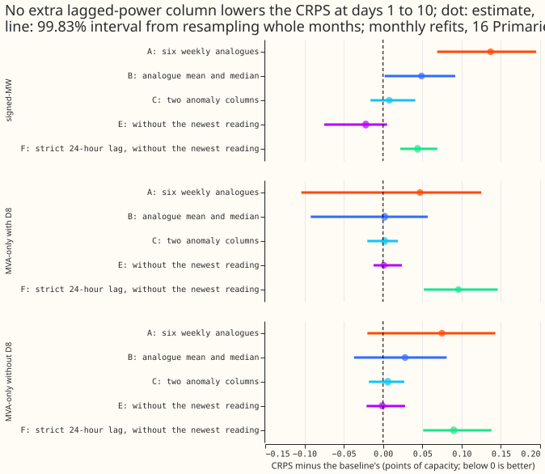
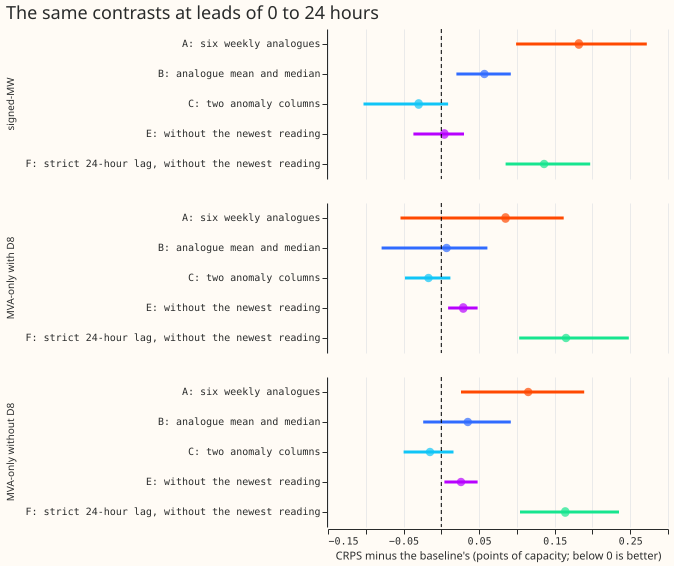
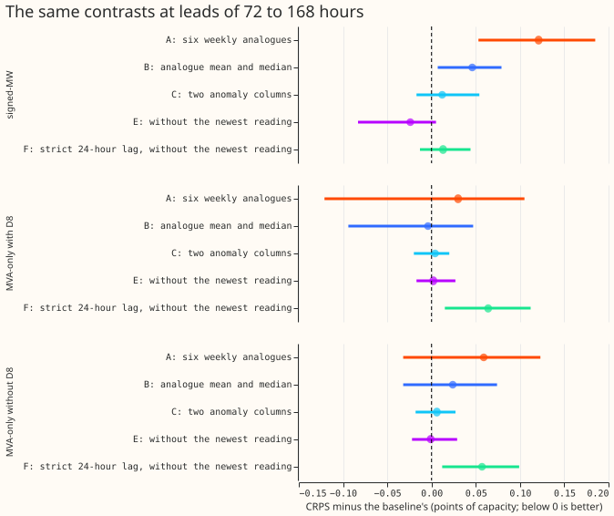
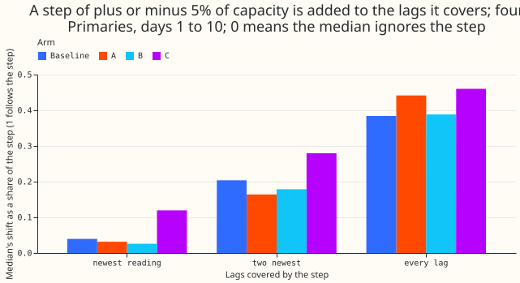

**Take-home message.** Giving the simple weekly-refitted XGBoost demand model more lagged-power
columns does not improve its forecast. Six weekly analogues make the forecast worse at 12 of the
16 Primaries, and the other column sets either change nothing or are worse. The model already uses
the three lags that matter, so the search for better inputs should look elsewhere. The verdict is
`not supported`.

We asked whether more columns of past power help an XGBoost model forecast Primary substation
demand 1 to 10 days ahead. We refitted the model with each of five column sets on the 1st of each
month, scored the forecasts on a year of held-out data, and subtracted the scores of the current
model (experiment 381's stored monthly control). A positive difference means the extra columns
made the forecast worse. The pre-registered prediction for the weekly analogues (a change between
-0.10 and +0.05 points) failed for arm A.

*Figure 1. Every arm's CRPS minus the baseline's at days 1 to 10, per group of Primaries. Points to
the right of the dashed line are worse than the baseline.*

*Figure 2. The contrasts at leads of 0 to 24 hours.*

*Figure 3. The contrasts at leads of 72 to 168 hours.*

*Figure 4. Lag-encroachment sweep: the share of a plus or minus 5% step that the median follows,
for a step on the newest lag reading, the two newest, and every lag.*

## Results

- **Arms and recipe.** The baseline is the three origin lags (the newest usable reading, the
  reading at the latest earlier time of the same half-hour of day, and the reading at the latest
  earlier time of the same weekday and half-hour). A is six weekly analogues (five new columns: the
  one-week analogue equals the baseline's week lag up to about 6.9 days of lead). B is their mean and
  median. C is two anomaly columns. E is the baseline without the newest reading. F is E with the
  day lag replaced by the power exactly 24 hours before the valid time. All arms use
  experiment 87's `n1h` recipe with monthly refits (192 fits each), column subsampling fixed at 1.0.
  Arm D was not fitted, because B and C did not each help alone.
- **Row set and scoring.** `fold_a_daily_gap_v1`, protocol `demand-v1`, 16 Primaries, valid times
  from 2025-07-01 to 2026-06-30, CRPS in points of effective capacity, headline band days 1 to 10.
  The scorer reads actuals from the shared, unfiltered cache of experiment 103. The check column
  (below) drops the flagged half-hours.
- **Baseline.** Experiment 381's stored monthly control. Its absolute CRPS at days 1 to 10 is in
  `work/score_monthly_final.log`; per Primary it ranges from 1.75 at D3 to 7.65 at D8, with D15
  (report only) at 15.60. BG2 is better than the baseline by +0.096 (+0.040 to +0.169) at the
  signed-MW six and +0.042 (-0.011 to +0.120) at the MVA-only eight; the baseline beats
  `manual_heuristic` by -0.494 and -0.588 and `climatology` by -0.720 and -1.029.
- **Days 1 to 10, arm minus baseline, 99.83% intervals (signed-MW six; MVA-only eight).** A:
  +0.137 (+0.069 to +0.195); +0.047 (-0.104 to +0.125). B: +0.049 (+0.002 to +0.092); +0.002
  (-0.092 to +0.057). C: +0.008 (-0.016 to +0.041); +0.002 (-0.020 to +0.019). E: -0.022
  (-0.075 to +0.005); +0.001 (-0.012 to +0.024). F: +0.044 (+0.022 to +0.069); +0.096 (+0.052 to
  +0.146). F minus E: +0.066 (+0.026 to +0.128); +0.095 (+0.060 to +0.133).
- **By lead band.** A is worse in every band at the signed-MW six (+0.182 at 0 to 24 hours,
  +0.131 at 168 to 240 hours). E gains nothing beyond 24 hours in the MVA-only group (-0.007 at 168
  to 240 hours) and loses +0.029 (+0.009 to +0.048) at 0 to 24 hours, so the prediction that E
  would help beyond 24 hours without losing below it failed. F is worse than the baseline at 0 to 24
  hours by +0.136 (signed-MW six) and +0.165 (MVA-only eight).
- **Per Primary (arm A, 95% intervals).** Worse at 12 Primaries with the interval above zero, and
  better only at D8 (-0.171, -0.499 to +0.035) and D15 (-1.725, -2.775 to -0.513; report only,
  4 scored months). Leaving out any one signed-MW Primary keeps the contrast between +0.111 and
  +0.151. Placebos: D2 +0.077 and D4 +0.146, both worse, so the loss is not specific to D8.
- **Tails (days 1 to 10, mean over Primaries; baseline against arm A).** At the signed-MW six the
  0.95 quantile pinball loss is 0.949 for the baseline and 1.011 for A, the 0.99 quantile pinball
  loss 0.386 and 0.404, and coverage of the 0.95 and 0.99 quantiles is 0.909 and 0.980 for the
  baseline against 0.898 and 0.977. Arms C, E, and F are within 0.02 of the baseline's tail
  numbers; arm B's 0.95 quantile pinball loss is 0.972.
- **Weekly cadence check (descriptive).** Refitted weekly with the same code, arm A minus the weekly
  baseline is +0.145 (+0.069 to +0.231) at the signed-MW six and +0.066 (-0.058 to +0.138) at the
  MVA-only eight, close to the monthly contrasts. Weekly arm B is partial (384 of 832 fits) and
  weekly arms C, E, and F were not fitted, so none is scored.
- **Slices (CRPS, baseline against A, E, F).** On the event rows (experiment 383's row set) at the
  signed-MW six: 8.789, 9.050, 8.313, 8.733. On cold nights at the signed-MW six: 4.933, 5.385,
  4.703, 4.901. These slices are post hoc and carry no interval. Arm E is lower on both slices.

## Sweep results

A prediction-only sweep adds a synthetic step of plus or minus 2%, 5%, and 10% of capacity to the
lagged-power inputs, then forecasts the 8 runs served by the refit of 2026-06-23 (the latest weekly
refit of the scored year, a rule fixed before any score was read) at four Primaries (D8, D4, D10,
D5), for the baseline and arms A, B, and C, to day 10. The refit for the sweep is a separate fit
with the boosters saved.

- **The median follows only a fraction of the step.** For a step of 5% of capacity, the baseline's
  median shifts by 0.04 of the step when only the newest reading is shifted, 0.20 when the two
  newest are, and 0.39 when every lag is shifted. Arm C follows more (0.12, 0.28, 0.47); arms A and B
  follow 0.44 (A) and 0.39 (B) against the baseline's 0.39.
- **No arm widens its band.** The width of the 1% to 99% band stays within 3% of its unshifted
  width in every arm and lead band up to a step of 5% (arm C reaches 1.029), and within 5% at a step
  of 10% (maximum 1.047, arm C).
- **The step level usually lies inside the bands.** At a step of 5% the level lies inside the 1% to
  99% band in 93% to 100% of rows, and q95 (q05 for a negative step) reaches it in 70% to 100%
  of rows. At 2% the bands cover it in 96% to 100% of rows, because the bands are already wide
  relative to a step that small.
- **Shifted lags worsen the CRPS.** Against the observed power, shifting every lag by -5% raises
  the CRPS by up to about 1.0 point (0.91 for A, 0.96 for B, 0.97 for C); the full tables are in `work/sweep_run.log`.

## Checks

- **Pre-registered predictions.** P1 (arms A and B move the score by -0.10 to +0.05) failed for A
  (+0.137) and held for B (+0.049, at the edge). P2 (largest gain at 72 to 168 h, near zero at 0 to
  24 h) failed: A is worst at 0 to 24 hours (+0.182). P3 (arm C within 0.05) held (+0.008). P4 (no
  placebo moves unless D8 does) failed: D2 (+0.077) and D4 (+0.146) moved while D8 did not.

- **Median minus mean forecast, per site (points of capacity, baseline).** The gap is negative at
  15 of 16 Primaries, between -3.04 (D15) and -0.14 (D18), with D22 at +0.03, so the forecasts are
  right-skewed. No arm moves the gap at any Primary by more than 0.3 points except D8 (baseline
  -0.58, A -0.87, B -0.99) and D15 (baseline -3.04, B -2.66, A -2.51); the full table is in
  `work/checks.log`.
- **Error of the median beside each contrast.** The mean absolute error of the median is worse than
  the baseline's for arm A at 14 of 16 Primaries (better only at D8 and D15) and for arm F at 14 of
  16 (better only at D16 and D18), the same direction as the CRPS.
- **Flagged half-hours (check column).** The shared cache holds 622 scored-year half-hours that
  cleaned power lacks (all exact zeros: D18 389, D15 196, D21 13, D8 9, D22 5, D9 5, D12 4, D16 1).
  The headline uses the shared unfiltered cache; the check column drops those half-hours. The
  contrasts for arms A, B, C, E, and F are unchanged to within 0.001 (for example A: +0.137 at the
  signed-MW six, +0.047 at the MVA-only eight). Experiment 388 scores one fold, so the count is
  622 in that fold.
- **Reproduction gate.** The weekly baseline refitted at 4 of 52 refits differs from experiment 87's
  stored weekly member by at most 0.0045 CRPS points at 15 Primaries and by 0.0195 at D22, against
  a gate of 0.01. No monthly baseline was refitted through the 388 script, so the monthly baseline
  is experiment 381's control (same recipe, same code path through experiment 87's functions). The
  gate's failure sets a noise floor of about 0.02 per Primary, small against A's +0.137 but not
  against the +0.047 at the MVA-only eight.
- **Triggers fired.** Trigger 2 (a result contradicts its prediction and an earlier experiment): a
  fresh Sonnet audit found no bug and reproduced D10 (+0.1038 against +0.1031) and D4 (+0.1446
  against +0.1455). Its findings, triaged: the gate caveat above (accepted, stated); `analogue_1w`
  duplicates the week lag (accepted, stated); D8 and D15 improve under A (accepted, stated); any
  mechanism for the loss is untested (accepted; one candidate, memorising the valid time from six
  weekly values, is a hypothesis).
- **Late steps.** The fresh Sonnet code review ran after the fits had started, not before the first
  run. It found one bug in the scorer's stored-baseline loader (duplicated July origins, which
  affected only the reference row), fixed before any score was read.

## Caveats and next steps

- **Lead range.** The headline is days 1 to 10 over 16 Primaries. The lag effects fall with lead, so
  a result at 0 to 24 hours is reported beside it.
- **One seed.** Each arm has one fit per refit.
- **Not tested.** Any arm that needs a second model or a blend; the 4-week anomaly window; a longer
  analogue window.
- **Next step.** Test dropping the newest reading on events only, and look for a hedge in the output
  (a wider band on rows whose lags lie in an event), not in more inputs.

## Pre-registered arms and design

All arms refit weekly with experiment 87's `n1h` recipe (half-life 0.5 years, 500 rounds, `eta`
0.05, whole history), one seed. `colsample_bytree` and `colsample_bynode` stay at 1.0, because
column subsampling would hand a wider arm a free win. A column is usable only when its meter reading
is at least 3.5 hours older than the forecast origin; otherwise it is null.

- **Baseline.** The three origin lags as `e00087_common.origin_lags` defines them: the newest usable
  reading, the reading at the latest earlier time with the valid time's half-hour of day, and the
  reading at the latest earlier time with the valid time's weekday and half-hour. The reproduction
  gate (experiment 383's: mean CRPS within 0.01 points at every Primary) refits the baseline at 4
  of the 52 weekly refits and compares it with experiment 87's stored weekly `n1h` member. The
  gate failed at one Primary: D22 differed by 0.0195 points, and the other 15 Primaries differed
  by at most 0.0045 (the GPU fit is not bit-reproducible, and the largest median gap sat at the
  refit of 2025-12-30). Because a stored baseline would carry that noise into every contrast, all
  contrasts use a baseline refitted at all 52 refits with the same code and settings as the arms.
  The stored `n1h` member remains a reference row, with the gate's gaps reported.
- **A, weekly analogues.** Baseline plus power at the valid time minus 1, 2, 3, 4, 5, and 6 weeks
  (6 columns); the 1-week analogue is null beyond about 6.9 days of lead.
- **B, analogue summaries.** Baseline plus the mean and median of whichever of those six are usable
  at the lead (2 columns; this is experiment 87's `a7` pair).
- **C, lag differences.** Baseline plus two columns. The origin anomaly is the newest usable reading
  minus the median reading at the same half-hour and weekday over the previous 4 weeks. The day-ago
  anomaly is the reading at the valid time minus 1 day minus the median reading at that half-hour
  and weekday over the previous 4 weeks, null when the one-day-earlier reading is not usable.
  The 4-week window is a choice, not a tested value.
- **E, drop the newest reading** (maintainer, 2026-10-30). The baseline without `lag_origin`, which
  is one noisy value that is the same for every valid time of a forecast origin. It keeps the
  same-time latest-day and latest-week lags. Prediction that can fail: E beats the baseline beyond
  24 hours and does not lose from 0 to 24 hours, so E is read by lead band before any pooled number.
- **F, strict 24-hour lag** (maintainer, 2026-10-30). E with the day lag replaced by the power
  exactly 24 hours before the valid time, null where that reading is not yet usable (leads beyond
  about 20.5 hours). F is also read against E, which shows what the older latest-day values add at
  long leads.
- **D, B plus C.** Fitted only if C2 and C3 each help alone (see the decision rule).

## Change of cadence to monthly refits (decided before any arm was scored)

The maintainer asked for monthly refits in most research. The headline contrasts are therefore
monthly: arms a, b, and c refitted on the 1st of each month from 2025-07-01 to 2026-06-01 (192 fits
per arm), against experiment 381's stored monthly control, which has experiment 87's `n1h`
recipe with no changes (the same columns, 500 rounds, `eta` 0.05, half-life 0.5 years, column
subsampling 1.0). The weekly baseline and weekly arm a (832 fits each) were finished first and give
a descriptive cadence check beside the monthly contrast. Weekly arm b is partial (384 of 832 fits)
and weekly arm c was not fitted, so neither is scored. Arm d is fitted only if b and c each help
alone at monthly refits. The decision rule above applies to the monthly contrasts.

## Sweep pre-registration (rule fixed before any score was read)

After the main fits, the baseline and arms a, b, and c are refitted once more at the latest weekly
refit of the scored year (2026-06-23), with the boosters saved, for a four-Primary screen to save
compute (D8 the target, D4 a placebo, D10 and D5 signed-MW; 16 fits in all). A prediction-only
sweep then adds a synthetic step of depth D (plus and minus 2%, 5%, and 10% of capacity) to the
lagged-power inputs: first the most recent lag only (k = 1), then the two most recent (k = 2), then
all of them,
including the weekly-analogue columns that lie inside the step. Per arm and lead band it reports
the shift of the median as a share of D, the band-width ratio against k = 0, and whether the
quantiles span both levels. It also reports, per arm: the share of event-level readings inside the
1-99% and 5-95% bands, whether q95 and q99 reach the event level at each k, and the price of
spanning (band widening, and CRPS outside events). NGED would accept a forecast whose median is the
normal running arrangement while its tails always span the normal and the abnormal levels. The sweep
uses at most 3 threads.
