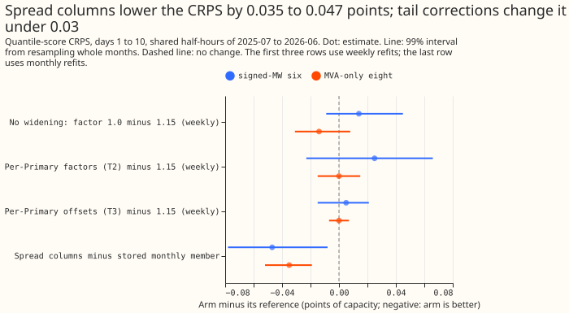
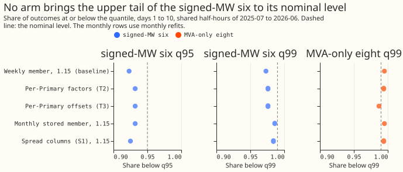
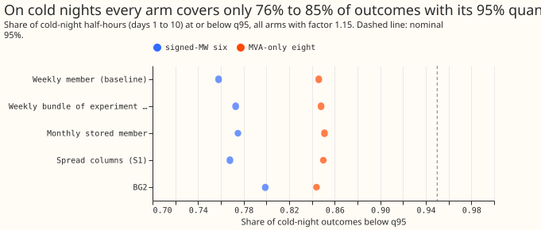

**Take-home message: correcting the tails of the simple weekly XGBoost demand forecast separately
for each substation and lead band, from its own misses over the previous months, does not fix the
tails.** The share of outcomes below the 95% quantile at the six Primary substations whose meters
record the direction of flow moves from 0.923 to 0.932, and the interval of that change includes
zero. Adding the mean and standard deviation of the 51 ensemble weather members as input columns
lowers the CRPS by 0.047 points at those six and 0.035 points at the eight whose meters record
apparent power only (about 1.5% and 0.9% of the error), but does not improve the tail coverage.
**On cold nights every arm covers only 0.72 to 0.80 of outcomes with its 95% quantile at the six
signed-MW Primaries and 0.80 to 0.85 at the eight MVA-only Primaries, against a nominal 0.95.** The
verdict is `not supported`, because no arm met the pre-registered tail rule.

We asked whether two small changes improve the extremes of the weekly-retrained XGBoost forecast of
Primary substation demand, which the [experiment
379](../00379-bg2-components-all-16-primaries-to-14-days/result.md) page found too narrow at the
upper end at the six signed-MW Primaries. The first change widens or shifts each quantile by an
amount set per Primary and per lead band from the forecast's own misses over the trailing months.
The second change gives the model four extra input columns: the mean and standard deviation, across
the 51 ensemble weather members, of the temperature and the shortwave radiation. We scored both
changes at all 16 Primaries under [demand-v1](../evaluation-protocol-demand.md), and also scored the
weekly bundle of [experiment
381](../00381-simple-weekly-xgboost-demand-against-gam-stack/result.md). The spread columns are
fitted with monthly refits and compared with the stored monthly member of [experiment
87](../00087-bg2-best-guess-assembled-with-drop-one-ablations/result.md), which has the same recipe,
the same 16 Primaries, and the same rows. The calibration arms use the weekly forecasts. S2, the
combination of the better calibration arm with the spread columns, was not run, because neither part
succeeded alone.

## Results

Scores are in percentage points of effective capacity for forecasts 1 to 10 days ahead, on the
3,660,652 half-hours scored by every arm in July 2025 to June 2026, unless stated. Pooled intervals
are 99% intervals from resampling whole calendar months (20,000 resamples). All numbers come from
`e00389_score.py` (log `work/scores/score_final.log`).

- **Arms.** Baseline: the stored weekly member of experiment 87 with factor 1.15. T1: factor 1.0.
  T2: factor per Primary, side, and lead band. T3: shift of q01, q05, q95, and q99 per Primary and
  lead band. S1: monthly refit with four ensemble columns. S0: the stored plain monthly member (no
  solar-offset twin), compared with S1. B: experiment 381's weekly bundle, scored raw and at 1.15.
  The tail corrections T2 and T3 start from the weekly member and use the first 60 days of data to
  start (fallback to the baseline until then).
- **Tail table, days 1 to 10 (share of outcomes below the quantile; nominal 0.01, 0.05, 0.95,
  0.99).**

| Group | Arm | q01 | q05 | q95 | q99 | CRPS |
|---|---|---|---|---|---|---|
| Signed-MW six | Weekly member, 1.15 | 0.010 | 0.041 | 0.923 | 0.973 | 3.061 |
| Signed-MW six | T1: 1.0 | 0.019 | 0.062 | 0.897 | 0.960 | 3.075 |
| Signed-MW six | T2 | 0.013 | 0.050 | 0.931 | 0.976 | 3.086 |
| Signed-MW six | T3 | 0.010 | 0.048 | 0.932 | 0.976 | 3.066 |
| Signed-MW six | Monthly member (S0), 1.15 | 0.004 | 0.034 | 0.932 | 0.986 | 3.122 |
| Signed-MW six | S1, 1.15 | 0.004 | 0.037 | 0.925 | 0.984 | 3.075 |
| Signed-MW six | S1, raw (factor 1.0) | 0.008 | 0.056 | 0.900 | 0.978 | 3.074 |
| Signed-MW six | S0, raw (factor 1.0) | 0.007 | 0.053 | 0.909 | 0.980 | 3.113 |
| Signed-MW six | BG2 | 0.010 | 0.045 | 0.932 | 0.976 | 3.016 |
| MVA-only eight | Weekly member, 1.15 | 0.005 | 0.043 | 0.954 | 0.995 | 3.807 |
| MVA-only eight | T2 | 0.010 | 0.058 | 0.949 | 0.994 | 3.807 |
| MVA-only eight | T3 | 0.011 | 0.052 | 0.949 | 0.987 | 3.807 |
| MVA-only eight | Monthly member (S0), 1.15 | 0.005 | 0.043 | 0.955 | 0.995 | 3.848 |
| MVA-only eight | S1, 1.15 | 0.006 | 0.049 | 0.949 | 0.994 | 3.812 |
| MVA-only eight | S1, raw | 0.013 | 0.076 | 0.927 | 0.990 | 3.807 |
| MVA-only eight | BG2 | 0.005 | 0.042 | 0.955 | 0.995 | 3.788 |

- **Tail corrections do not meet the rule.** The change in the absolute coverage error of the weekly
  member (signed-MW six): q95 -0.009 for T2 (99% interval -0.025 to +0.013) and -0.009 for T3
  (-0.025 to +0.014); q99 -0.004 for T2 and T3 (intervals -0.014 to +0.005). At the MVA-only eight,
  the q99 error changes by -0.001 (T2) and -0.002 (T3), with intervals that include zero. No arm cut
  the error by the 30% the rule asks for, and the CRPS contrasts are +0.025 (-0.023 to +0.066) for
  T2 and +0.005 (-0.015 to +0.021) for T3 at the signed-MW six.
- **Spread columns lower the CRPS but not the tails.** S1 minus S0, at factor 1.15: -0.047 (-0.078
  to -0.008) at the signed-MW six, -0.035 (-0.052 to -0.019) at the MVA-only eight, and -0.048
  (-0.063 to -0.034) without D8. At factor 1.0 the contrasts are -0.039 (-0.070 to +0.000) and
  -0.026 (-0.042 to -0.009). The mean absolute error of the median falls from 5.376 to 5.286
  (signed-MW six) and from 6.856 to 6.797 (MVA-only eight). The change in the q95 coverage error is
  +0.008 at the signed-MW six (-0.0085 to +0.0148), so the tails did not improve.
- **S1 lowers the CRPS at 14 of 16 Primaries.** Leaving out any one Primary leaves the contrast
  negative with a 99% interval that excludes zero: -0.044 to -0.050 at the signed-MW six and -0.027
  to -0.048 at the MVA-only eight. S1 scores worse at D8 (+0.056) and D15 (+0.250). D15 is the worst
  Primary for every arm (12.6 to 13.7), then D8 (7.6 to 7.8). Per-Primary values are in the log.
- **Cold nights.** The share of cold-night outcomes below q95 is 0.758 (weekly member), 0.775
  (stored monthly member), 0.768 (S1), 0.773 (bundle), and 0.799 (BG2) at the signed-MW six, and
  0.802 to 0.851 at the MVA-only eight (the raw arms sit at the low end), for 44,370 and 47,130
  half-hours. S1 lowers the CRPS on cold nights by 0.068 and 0.145 against S0. The share below q99
  is 0.82 to 0.93 at the signed-MW six.
- **Sunny half-hours (April to June).** S1 lowers the CRPS by 0.131 and 0.076 against S0.
- **Weekly bundle of experiment 381.** The stored bundle carries no 1.15 factor, while the baseline
  it was compared with does. At the signed-MW six the bundle scores 3.024 raw and 3.036 at 1.15, and
  the weekly member scores 3.075 raw and 3.061 at 1.15. The bundle's lead is therefore 0.051 raw and
  0.025 widened, against the 0.037 that mixes the raw bundle with the widened member.
- **Lead bands.** S1's gain over S0 shrinks with the lead: 0.089 on day 1, 0.036 on days 5 to 7,
  0.020 on days 8 to 10, and 0.028 on days 11 to 14 at the signed-MW six.

## Checks

- **Median minus mean forecast.** Not computed: the stored frames hold quantiles and no mean. The
  mean absolute error of the median falls with S1 (above), so the quantile-score contrast and the
  median-error contrast point the same way.
- **Triggers.** Trigger 2 fired: S1's gain (-0.047 and -0.035) exceeds the registered prediction
  (P4, a change under 0.03), and experiments 169 and 371 had found little from ensemble spread or
  mean. A Sonnet audit re-derived the headline contrasts from the stored arms; its findings and
  their triage are in the next bullet. No other trigger fired: leaving any one Primary out does not
  flip a sign of the S1 contrast.
- **Audit.** A fresh Sonnet audit recomputed the S1 minus S0 contrasts with its own code (-0.0474
  and -0.0352, the same intervals), found no leakage in the spread columns or the calibration
  windows, and found the S0 and S1 recipes identical apart from the four columns. A fresh refit of
  the monthly baseline at D5 and D12 (4 of 192 fits) differed from the stored member by -0.002 to
  +0.004 CRPS, against S1 gaps of -0.14 to +0.34 at the same refits. It raised three points, all
  accepted: the gate also failed its quantile criterion (stated under "Refit noise floor"); the gain
  looks like the ensemble mean more than the spread, since it is largest at 0 to 24 h (-0.089) and
  at q25 to q60 and absent at q01 and q99 (stated under "Caveats"); and S1 lowers the q95 coverage
  slightly (0.932 to 0.925 at the signed-MW six, 0.955 to 0.949 at the MVA-only eight), so q95 got a
  little worse.
- **Refit noise floor.** The gate refitted the weekly baseline at D5, D8, and D12 for the first 4
  refits (12 files) on the GPU. The mean absolute gap of the 11 quantiles against the stored
  forecasts was 0.062 points (the pre-registered limit was 0.001), and the mean CRPS gap was -0.0004
  points (limit 0.005), with the largest single-file CRPS gap -0.0059 at D8. The quantile gap
  reflects run-to-run noise of GPU fitting, so the gate is judged on the CRPS gap alone, a change
  made after seeing the result and recorded under "Changes made after the plan was first committed".
  The gate refitted the weekly member, so it is not a bound on the S1 contrast against the stored
  monthly member.

## Caveats

- **The S1 gain is against the stored monthly member**, which carries the same widening (1.15 and
  raw are both scored) and the same recipe, and not against a monthly refit made here. Mean-only and
  std-only arms are untested, so the page cannot say whether the ensemble mean or the ensemble
  spread carries the gain. The gain is not comparable with [experiment
  371](../00371-d8-monthly-xgboost-input-group-ablation/result.md)'s ensemble-mean arm, which
  changed only the prediction inputs.
- **The gain looks like the ensemble mean more than the spread.** It is largest at 0 to 24 h
  (-0.089) and falls to -0.020 at 168 to 240 h, it sits at q25 to q60, and q01 and q99 do not move.
  The columns are called spread columns here for brevity, but this experiment cannot separate the
  mean from the standard deviation.
- **The bundle of experiment 381 already carries a solar summary column**, so part of the benefit of
  ensemble spread may already be taken there. S1b, the bundle with spread columns, was not fitted.
- **Lead range.** All scores run to days 1 to 10 (14 days shown in the log). The replicate period of
  demand-v1 applies to a change that is adopted, and this result adopts nothing.
- **Weekly refits for T1 to T3, monthly for S1.** Monthly refits score about 0.06 worse than weekly
  refits at the signed-MW six (3.122 against 3.061), so S1 at 3.075 is within 0.014 of the weekly
  baseline.
- **Stop rule for blind alleys (demand-v2).** If the manager counts [experiment
  97](../00097-cal1-post-hoc-recalibration-of-bg2-quantiles-tails/result.md) (`refuted`),
  [experiment 164](../00164-calibration-cold-night-tail-under-coverage/result.md) (`refuted`), and
  [experiment 335](../00335-primary-demand-default-3-tail-calibration-at-0-5-to-240-hours/result.md)
  (`not supported`) as the same idea, this result is the fourth `not supported` or `refuted` verdict
  on post-hoc tail calibration; the supported result of [experiment
  160](../00160-calibration-band-width-fix-on-stage-2-winner/result.md) came before them. The
  manager decides which experiments share the idea.

## What to try next

The S1 gain splits into an ensemble-mean part and an ensemble-spread part that this experiment
cannot separate. Mean-only and std-only arms, fitted with the training columns changed, are the next
experiment. The cold-night under-coverage stays open: the fault lies in the median and the weather
inputs on cold nights, since no widening arm moved it.

## The pre-registered plan

The sections below are the plan as committed before any score was read, with its changes listed at
the end.

We ask whether the tails of the simple weekly-refitted XGBoost demand model can be improved with two
small changes at the 16 Primary substations. The weekly XGBoost member of
[BG2](../00087-bg2-best-guess-assembled-with-drop-one-ablations/result.md) is the baseline.

## Facts this plan relies on

- The baseline trains `reg:quantileerror` at 11 levels on the control member, applies the one model
  to all 51 members, pools them as an equal-weight mixture, and widens about the median by 1.15
  ([experiment 87](../00087-bg2-best-guess-assembled-with-drop-one-ablations/result.md); recipe in
  `e00087_common.py` lines 101 and 167 to 174).
- Experiment 379 reports baseline q01/q05/q95/q99 coverage of 0.010/0.041/0.923/0.973 at the
  signed-MW six and 0.005/0.043/0.954/0.995 at the MVA-only eight.
- [Experiment 97](../00097-cal1-post-hoc-recalibration-of-bg2-quantiles-tails/result.md) tried eight
  recalibrations of BG2 pooled by class over 9 months and none beat the interval; none was per
  Primary or per lead band on the XGBoost member alone.
- [Experiment 169](../00169-calibration-combined-fixes-and-ensemble-spread/result.md) found the
  ensemble spread added nothing to cold-night coverage of the GAM-based forecast. This plan departs
  from that advice only in testing the spread as an XGBoost input, which no experiment has done.
- Experiment 193 found a two-number solar summary (mean, standard deviation) kept 98% of the gain of
  all 51 members in the GAM stack.

## Arms

All arms use the weekly refit regime of experiment 87 (the `n1h` configuration, half-life 0.5
years, 500 rounds, eta 0.05, depth 6), `colsample_bytree` and `colsample_bynode` fixed at 1.0
(unchanged from the recipe, so no arm is given extra columns to sample from), `subsample` 0.8, the
fitting seed of experiment 87, the offset twins at the five offset Primaries (S1 follows the same
base-margin path as the baseline there), and the same rows.

- **Baseline.** The stored raw weekly member with factor 1.15 (experiment 379's `only_W`). Gate:
  the S1 fitting code, run with its spread columns switched off, refits the baseline at D5, D8,
  and D12 for the first four refits and must reproduce the stored raw quantiles to a mean absolute
  gap under 0.001 points of capacity and a CRPS gap under 0.005 points. The tolerance of experiment
  383's gate could not be found (its page is not on `main`), so this plan sets its own; the first
  run reports the gap.
- **T1, no widening.** The stored raw member with factor 1.0. No fit.
- **T2, per-Primary, per-lead-band factors.** For each Primary and each of the four lead bands of
  experiment 364 (0 to 24 h, 24 to 72 h, 72 to 168 h, 168 to 240 h), one upper and one lower factor
  multiplying the distance of each quantile from the median. Before each weekly refit, the factor
  is the smallest value in a grid (0.8 to 1.6 in steps of 0.05) at which the trailing year of the
  raw member's forecasts reaches nominal coverage. Only forecast rows whose valid time is at most
  3.5 hours before the refit enter (the observation is then known, as in `known_rows` of
  `e00087_fit_demand.py`); a forecast origin's 14-day horizon would otherwise reach past the refit.
  The scored runs start on 2025-07-01, so the window starts empty and grows. A Primary-band needs
  at least 60 days of such rows (about 60 origins); until then, and wherever the window is shorter,
  the factor is the global 1.15 of the baseline. The window is the trailing year of rows older
  than the refit, using the stored runs of 2025-07-01 onward only (earlier runs of the member are
  not stored). Coverage is checked at at q95 and q99 (upper) and q05 and q01
  (lower). The grid and the 14-day gap are fixed here. D8, D15, and D18 have under 12 months of
  history: D8 uses the donor spread (the mean of the factors of the MVA-only Primaries other than
  D8), and D15 and D18 are report-only with the same donor. The arm needs no refit, because
  recalibrating does not change the fitted model.
- **T3, per-Primary, per-lead-band quantile offsets.**
  The same trailing window, minimum of 60 days, bands, and
  fallback (no shift). Each of
  q01, q05, q95, q99 is shifted by the empirical quantile of the raw member's trailing misses
  (observed minus the member's quantile), in units of capacity, then the 11 quantiles are sorted to
  stay monotone. The same donor rule at D8, D15, and D18. No refit.
- **S1, ensemble spread columns.** The member refitted (monthly; see the changes below) with four
  extra columns: the mean and the standard deviation across the 51 members of `temperature_2m` and
  of `shortwave`, at the series' location and valid time. Training rows are the control member's
  rows, as in the baseline, with the spread columns taken from the same run's 51 members. Prediction
  rows carry the same spread columns on each of the 51 member rows (the column is a property of the
  run, not of the member), so each member's row differs only in its own weather. The 51-member
  archive for the training runs (2024-04-01 onward) comes from the stored ensemble stores of
  experiments 111, 152, 374, and 377, which hold 51-member temperature and shortwave for 821 origins
  from 2024-04-01 to 2026-06-30: D5, D9, D10, D11, D14, D16, and D18 in experiment 111, D2, D3, D4,
  D8, D12, D19, D21, and D22 in experiments 152 and 374, and D15 in `00377*/work/d15/ens_store/`.
  The store origins are stamped at the run's initialisation time plus the 9-hour publication delay,
  so the join key is `power_fcst_init_time`, not `nwp_init_time`; the first job asserts the keys
  match the control rows and that the stores cover all 16 Primaries. Training rows older than
  2024-04-01 have no spread columns; S1 drops them, and the baseline gate and a second control arm
  (the baseline refit on the same shortened history, columns off, `S0`) show how much of any S1
  change comes from the history rather than the columns. A train/serve shift is accepted and
  reported: the control member is one of the 51, so its deviation from the ensemble mean is small in
  training and larger for the other members at prediction. A window of 0 (the value at the valid
  time itself) is used, not experiment 169's 24-half-hour window, because the control member's own
  columns are also pointwise. Cost to port: a new data dependency at serving time (the 51-member
  forecast at the same grid points, already read to run the 51 members).
- **Second baseline, the weekly bundle (B).** The release candidate of [experiment
  381](../00381-simple-weekly-xgboost-demand-against-gam-stack/result.md): the plain weekly member
  plus a daily solar summary column, a sunny flag, and a 1-year half-life, read from 381's stored
  weekly forecasts (`arm_preds/weekly/bundle_solar+sunny+hl1`, read only). The first job checks
  whether those stored quantiles carry the 1.15 factor, by reproducing 381's printed bundle scores
  (D5 3.827, D12 6.716, D8 7.615) with and without it, and builds B-T1, B-T2, and B-T3 from the raw
  quantiles exactly as T1, T2, and T3 are built for the plain member. The success rule and contrasts
  apply to B-T1 to B-T3 against B with factor 1.15. The bundle already carries a solar summary
  column, so some of the gain from ensemble spread columns may be taken already; the write-up says
  so. S1 is fitted on the plain member first. **S1b**, the bundle refitted with the four spread
  columns, runs only if S1 meets the success rule, to avoid a second full refit.
- **S0, history control.** The baseline refit on S1's shortened history with the spread columns off.
- **S2, best of T2 and T3 on S1.** Run only if S1 and the better of T2 and T3 each succeed alone,
  with the calibration table fitted on S1's own trailing forecasts. Otherwise reported as not run.
- Not included: a second model, a stacked stage, or a blend.

## Scoring

All 16 Primaries to 14 days under [demand-v1](../evaluation-protocol-demand.md), through the scorer
of experiment 379, adding for every arm and every Primary: CRPS, coverage and pinball loss at q01,
q05, q95, q99, and twCRPS. Reported by lead band beside days 1 to 10, for the worst Primary, with
leave-one-out per group, on cold nights and sunny half-hours, and with D2 and D4 as placebos for any
change aimed at D8 or at one group. References: BG2, default 3 of the GAM stack, `manual_heuristic`,
`climatology`. The first fit and the gate print before any other arm is read.

## Compute

T1, T2, and T3 are post-hoc on stored forecasts and need no fit. S1 refits 16 series over 52
weekly refits (the weekly regime of experiment 87; that experiment's full `n1h` run, which also did
the monthly regime, BSP, and GSP, took 53 GPU hours). Slot: 3 threads, `MemoryMax=16G`, one GPU
fit at a time, checked with `uptime` and `nvidia-smi` in the first minutes. Folders of
experiments 379 and 381 are read only.

## Changes made after the plan was first committed

- **Before any score was read.** T3 shifts the baseline's 1.15-widened quantiles, not the raw ones,
  so its interior stays equal to the baseline's. T2 picks, per side, the grid factor with the
  smallest summed absolute coverage error over the two quantiles of that side (q95 and q99; q05
  and q01), with a fifth lead band of 240 to 336 hours. Rows with no reading are left out of the
  calibration. S0, the history control, is dropped because the training rows already start on
  2024-04-01, the first day of the ensemble stores. The weekly bundle of experiment 381 turned out
  to be stored without the 1.15 factor; the plan scores it raw and at 1.15.
- **After seeing the gate result (recorded so a reader can judge it).** The gate was pre-registered
  as a mean absolute quantile gap under 0.001 points and a CRPS gap under 0.005 points. The
  refitted baseline on D5, D8, and D12 over the first 4 weekly refits gave a mean absolute quantile
  gap of 0.062 points and a mean CRPS gap of -0.0004 points (mean over the 12 files of the absolute
  CRPS gap 0.0019, largest 0.0059 at D8 on the refit of 2025-07-08). The quantile criterion failed;
  the CRPS criterion passed. We kept the CRPS criterion only, because the refits run on a GPU whose
  run-to-run differences move individual quantiles but not the score. The refit noise floor is
  therefore about 0.002 points of CRPS, and an S1 difference under that size is not read.
- **By the manager's instruction, after the T1 to T3 scores.** S1 and its control S0 are fitted at
  monthly refits (the 12 refits of experiment 87's monthly regime, 2025-07-01 to 2026-06-01), not
  weekly, because a weekly S1 would take 12 to 20 hours. The T1 to T3 results stay on the weekly
  forecasts. Monthly S1 is therefore compared with a monthly S0 refitted here under the same
  recipe, not with the weekly baseline, and an S1 gain is re-checked weekly only if S1 wins. S1
  uses the offset twins at the five offset Primaries, as the baseline does. Fitted boosters are
  saved as `.ubj` files under `work/boosters/` of this experiment's private data folder, one per
  Primary and refit (path `data/ml-experiments/00389-*/work/boosters/`).
