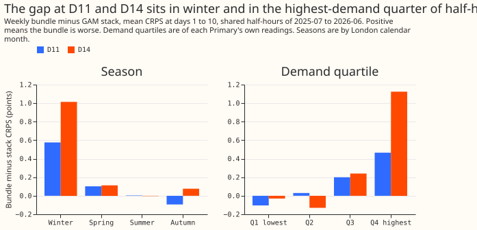
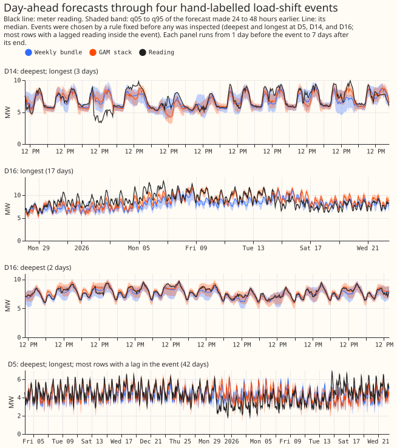
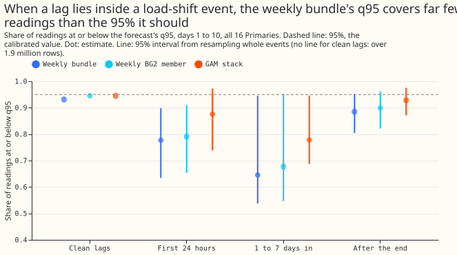

# Why the weekly XGBoost model trails the GAM stack at two Primaries, and what a load-shift event does

**The weekly XGBoost model loses to the GAM stack at the Primaries D11 and D14 because of winter,
high-demand half-hours, and not because of load-shift events.** A Primary is one of the 16 primary
substations scored here, and D11 and D14 are two of them. The weekly model ("the weekly bundle") is
the XGBoost model of [experiment
381](../00381-simple-weekly-xgboost-demand-against-gam-stack/result.md), refitted weekly with a
solar summary, a sunny flag, and a 1-year half-life on the training weights. The GAM stack is the
generalised additive model pipeline of [experiment
377](../00377-demand-v1-first-run-feasibility/result.md), without its smoothing stage S below 168
hours. **Most of the gap is the stack's Kalman filter (a filter that updates the stack's estimate of
the current level of demand), and a rolling median of recent errors does not copy it.** When a
recent reading lies inside a load-shift event (a period in which load has been moved between
Primaries), the share of readings that fall below the bundle's 95th-percentile forecast ("q95
coverage") drops to 0.749, where 0.95 is calibrated, and its 90% band between the 5th and 95th
percentiles narrows slightly. Most of that failure comes from rows whose target also lies inside an
event, and from 5 of the Primaries.

We asked two questions of forecasts already stored, and refitted nothing. First, where does the
bundle lose to the GAM stack at D11 and D14, and does following the recent level of demand close the
gap? Second, what happens to the bundle's tails and median when one of its three recent-power inputs
(its "lags") lies inside a hand-labelled load-shift event? The score is the continuous ranked
probability score (CRPS), in points of effective capacity, where a point is 1% of the Primary's
effective capacity. It covers days 1 to 10 ahead and the half-hours that every forecast shares from
2025-07 to 2026-06, under the `demand-v1` protocol. Intervals resample whole months (Part A) or
whole events (Part B). The figures of experiment 383 are interim, because that experiment has not
yet merged.

## Part A: the D11 and D14 gap

**The re-score reproduces experiment 381.** CRPS at days 1 to 10 over 138,044 half-hours per
Primary:

| Primary | Weekly bundle | GAM stack | Bundle minus stack (95% interval) |
|---|---|---|---|
| D11 | 2.577 | 2.429 | +0.148 (+0.016 to +0.301) |
| D14 | 2.509 | 2.208 | +0.301 (+0.042 to +0.633) |
| Signed-MW six | 3.023 | 2.948 | +0.075 (-0.076 to +0.220) |

Experiment 383's first re-score used the plain weekly member of 383 on rows with clean lags, which
is a different forecast from the bundle, so its +0.160 and +0.343 differ.

**Winter and the highest-demand quarter carry the gap.** The share of the total gap, D11 then D14:

| Slice | D11 | D14 |
|---|---|---|
| Winter (December to February) | 98% | 84% |
| Highest quarter of the Primary's own readings | 79% | 93% |
| Lowest quarter | -18% | -3% |
| Non-sunny half-hours | 112% | 108% |
| Lead days 1 to 3, 4 to 7, 8 to 10 | 43, 43, 14% | 34, 38, 28% |
| Six-hour blocks starting 00:00, 06:00, 12:00, 18:00 (London) | 9, 31, 40, 19% | 18, 40, 41, 1% |
| Event rows and the 7 days after | none in the year | -2% |

Sunny half-hours reduce the gap (-0.115 points at D11, -0.150 at D14). The D14 gap is the same at
all lead bands (+0.34, +0.29, +0.28), and the D11 gap falls from +0.21 to +0.07. Prediction P2 (the
same gap at days 1 to 3 and days 8 to 10) holds at D14 and fails at D11.

**A rolling median of recent errors does not close the gap in this test.** The offset is the median
of the bundle's own residuals over the previous 3, 7, or 14 days, using only readings at least 3.5
hours before the forecast was issued, added to every quantile.

| Primary | Bundle | Offset 3 days | Offset 7 days | Offset 14 days | GAM stack |
|---|---|---|---|---|---|
| D11 | 2.577 | 2.820 | 2.723 | 2.633 | 2.429 |
| D14 | 2.509 | 2.460 | 2.430 | 2.378 | 2.208 |
| Signed-MW six | 3.023 | 3.151 | 3.121 | 3.099 | 2.948 |

The 7-day offset widens the D11 gap by 0.146 points (95% interval of the change +0.034 to +0.284)
and closes 26% of the D14 gap (the change is -0.080, with an interval of -0.285 to +0.082).
Prediction P1 (the 7-day offset closes at least half the gap at both Primaries) is not supported.
The share closed at D14 rises with the window (16%, 26%, 43%) and every interval includes zero, so
the test cannot rule out a gain at D14. Each offset also comes from the forecast with the shortest
lead for each reading (0.5 to 24 hours), and the offset is applied to leads of up to 14 days.

**The stack's Kalman filter carries the gap.** Experiment 380's stack without its Kalman filter
scores 2.529 at D11, 2.559 at D14, and 3.069 over the signed-MW six, against the bundle's 2.577,
2.509, and 3.023. Without the filter, the stack still leads the bundle by 0.048 points at D11 and
trails it by 0.050 at D14. Over the signed-MW six the stack without its filter is worse than the
bundle, so the filter explains the gap at D11 and D14 only.

**BG2 has no lead at D11, and its member `ST` carries its lead at D14.** BG2 is the best-guess
ensemble of five members from experiment 379. At D11 the bundle (2.577), the plain weekly member
(2.579), and full BG2 (2.572) are level. At D14 full BG2 scores 2.385 against the bundle's 2.509,
and the member named `ST` scores 2.424, the best single member.

**The bundle's upper tail is too low at D11 and D14.** At D14 its q95 coverage is 0.902, 0.898, and
0.894 across the three lead bands, against 0.949 to 0.952 for the GAM stack, and its q99 pinball
loss is about 0.30 against 0.14. At D11 its q95 coverage is 0.921 to 0.928, against 0.955 to 0.957.
The six-hour block starting 12:00 is worst at D14 (q95 coverage 0.881, q99 0.967).

## Part B: load-shift events in the lags

**The sample is small, and 19 events supply every row with an event lag.** The padded hand-filtered
mask holds 115 events. Of these, 33 end in or after the scored year, and 29 of those 33 match a row
of the label table that gives a depth. Only 19 events have a half-hour with a lag inside them. There
are 56,285 such half-hours and 1,974,571 with clean lags, over all 16 Primaries. The event slices
below overlap, because an event can show several phases (45 phase slices from 33 events), so slice
counts do not add to 19.

**A lag inside an event breaks the upper tail of both XGBoost-type forecasts, and the GAM stack
fails less.** Bundle, plain weekly BG2 member, and GAM stack, on rows with an event lag against
clean rows:

| Measure | Bundle, event / clean | Weekly member, event / clean | GAM stack, event / clean |
|---|---|---|---|
| q05 coverage (0.05 calibrated) | 0.124 / 0.057 | 0.084 / 0.039 | 0.163 / 0.067 |
| q95 coverage (0.95 calibrated) | 0.749 / 0.931 | 0.772 / 0.945 | 0.845 / 0.945 |
| q99 coverage (0.99 calibrated) | 0.890 / 0.991 | 0.890 / 0.989 | 0.914 / 0.984 |
| 90% band width, points | 22.1 / 24.5 | 25.4 / 27.4 | 24.3 / 26.6 |
| CRPS | 6.19 / 3.58 | 6.31 / 3.59 | 6.04 / 3.70 |

Prediction P3 (q95 coverage below 0.85 and a band at most 10% wider) holds: the bundle's band is 10%
narrower, and so is the stack's, though the two row sets differ in Primary and season. The stack's
lower tail fails more than the bundle's (q01 coverage 0.117 against 0.002). Experiment 383's interim
figures for the signed-MW six (21,601 rows; q95 0.774, q99 0.917, band 21.7 points) agree in
direction.

**Most of the failure is on rows whose target also lies inside an event.** Of the 56,285 rows with
an event lag, 20,742 (37%) also have their target inside an event, and their bundle q95 coverage is
0.566 (CRPS 9.21). Rows with an event lag and a target outside an event have q95 coverage 0.855
(CRPS 4.42), against 0.933 and 3.56 for rows that are clean in both ways. The failure comes from D5
(0.640), D16 (0.591), D10 (0.528), D18 (0.744), and D22 (0.796). At D12, D14, D3, D4, and D19 the
event rows score 0.93 to 0.98, and D8, D9, D11, and D15 have no event rows. The event-versus-clean
contrast therefore mixes a contaminated lag with a target that is itself shifted.

**The upper tail fails most in the middle of a long event.** The bundle's q95 coverage, with the
number of events in brackets and the GAM stack beside it:

| Slice | Bundle | GAM stack |
|---|---|---|
| First 24 hours of the event (15) | 0.777 | 0.876 |
| 24 hours or more after the onset, before the end (11) | 0.646 | 0.778 |
| Up to 7 days after the end (19) | 0.885 | 0.928 |
| Events of 1 to 7 days (17) | 0.899 | 0.946 |
| Events of over 7 days (2, descriptive only) | 0.578 | 0.730 |

The depth quartile cuts come from all 115 events, so the four scored groups are not quartiles of the
scored events. Depth quartiles, from shallowest Q1 to deepest Q4, hold 4, 2, 5, and 7 events and
give bundle q95 coverage 0.902, 0.574, 0.931, and 0.707, so no steady depth effect shows. Slices
with fewer than 5 events (Q1, Q2, over 7 days) are descriptive only. No event is shorter than 24
hours, because the mask is padded.

**When the forecast is issued before an event starts and the target lies inside it, neither forecast
is calibrated.** Across these 19 events (all three lags clean), readings inside an event fall inside
the 5th-to-95th-percentile band 70% of the time for the bundle (interval 59% to 81%) and 73% for the
GAM stack, against 90% for a calibrated forecast. The bundle puts 1.6% of readings below its q01 and
7.3% above its q99, and the stack 4.6% and 11.0%, against 1% each.

**The median is not clearly pulled towards the lagged level.** The signed median error (median minus
actual, in points of capacity) for rows whose target lies in an event is -2.43 with an event lag
against -2.23 with clean lags for events of 1 to 7 days (bundle, 17 events), and -3.19 against
-12.76 for events of over 7 days (2 events). The GAM stack gives -0.44 against -0.63 and +1.29
against -11.51. The bundle's median on rows with an event lag is lower than the stack's (mean signed
error -2.46 against +0.41 points over all event-lag rows), with about equal mean absolute error (9.5
and 9.2 points). Prediction P4 (the bias follows the event's depth) is not supported. The with-lag
and clean-lag rows differ in when the forecast was issued, so these comparisons are not like for
like. The mean absolute error of the median on rows with an event lag is 9.5 points for the bundle,
against 6.4 on clean rows.

**Not done.** The panel of synthetic injected events is missing: experiment 88 (the
synthetic-transfer recovery experiment) stores only logs, and an injection needs a refit, which this
analysis excludes.

## Checks

- **Median minus mean.** Not computed: the stored forecasts hold quantiles only. The mean absolute
  error of the median appears beside the Part B numbers above.
- **Which audit triggers fired.** One: the result contradicted prediction P1, and the explanation
  (the Kalman filter, not a level offset, carries the gap) was tested with experiment 380's stack
  without its filter, as Part A records.
- **Verdict.** Partly supported: P2 holds at D14 only, P1 fails, P3 holds, and P4 fails. The
  hypothesis that the bundle lacks the Kalman filter's level tracking is supported only through the
  no-Kalman-filter arm, not through the offset.
- **Cadence.** The monthly-refit rule does not apply, because nothing is refitted.

## Caveats and what to try next

- Part B rests on 19 events with an event lag (33 end in the scored year, 29 of those with a depth
  label), 2 of them over 7 days. Those two events give the lowest coverage figures (0.578 and
  0.574).
- The demand quartiles are cut on the realised readings, so a forecast that shrinks towards the mean
  loses on the highest quarter by construction, and the 79% and 93% shares partly reflect that
  choice.
- Part A covers two single series over one winter, and the signed-MW six gap (+0.075) has an
  interval that includes zero.
- Event depth comes from a hand label table, matched by Primary and onset.
- The Kalman filter acts on the stack's own residual terms, so this analysis does not show which
  part of its adaptation matters. Experiment 388 (lagged-power column sets) could add a recent-level
  input of that kind. Experiment 389 (tail calibration) could score event-lag rows separately and
  test a widening rule on them.
- The avoidable curtailment cost was not re-scored here.

## Audit

A Sonnet audit confirmed every quoted number against the printed reports, found no leakage in the
offset or the lag flags, and checked that every arm is scored on the same rows. Its findings and
their triage:

- **Accepted, high:** the event-lag contrast mixes contaminated lags with shifted targets and five
  Primaries. The page now says so and gives the split.
- **Accepted, medium:** the count of events in Part B (19, not 33); the offset is not matched to the
  forecast's lead and the D14 test is underpowered; the demand quartiles use the realised outcome;
  the stack's median is less biased than the bundle's. All are now in the text.
- **Accepted, low:** the 12:00 block wording; the stack's lower tail; the phase label; the depth
  cuts; the Kalman result holds at D11 and D14 only; the B2 wording.
- **Rejected:** none. The empty-window offset of 0.0 is left as it is, because no window was empty.
