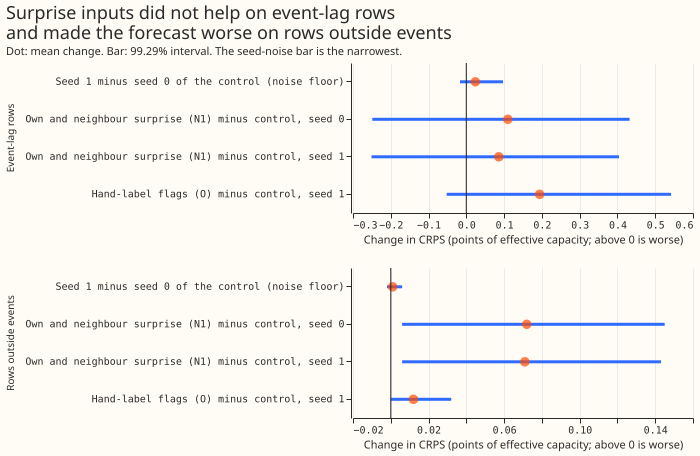

# Does a "surprise" input let XGBoost handle load-shift events?

**A "surprise" input does not let the monthly XGBoost demand model handle load-shift events, and it
makes the forecast slightly worse on the ordinary rows.** A load shift moves demand between
substations, so a lagged power reading inside one misleads the model. The surprise input is the
normal score of each lagged reading's probability integral transform against a lagless forecast
from a first-stage model, at the Primary and at its neighbours. On rows whose lag lies inside a
labelled event, the surprise columns did not help (+0.110 points of CRPS, interval -0.249 to
+0.432). On rows outside events they cost +0.072 (+0.006 to +0.145), against a +0.02 tolerance.
A Primary is one of the 16 primary substations scored here. CRPS is the continuous ranked
probability score, in points of effective capacity.

**The oracle did not beat the control either.** The oracle O
gets hand-label flags for the target and each lag. On event-lag rows it scored +0.218 points worse
than the control (all 16 Primaries). The interval against seed 1 is -0.052 to +0.542, so the result
is "no gain" and not "harm".
BG2 scores lower than B0 (3.016 against 3.123), so headroom exists elsewhere in the model.

**The explicit detector failed its pre-registered check, so whether detector state adds to
surprise is untested.** Arms N2, N2 without the veto, and N3 were not fitted: the manager held them
after the known-answer gate failed and the surprise arms came out worse than the control. This
experiment therefore answers the question about surprise columns and leaves the detector-state
half open.

## Result

All numbers are CRPS differences in points of effective capacity (above 0 is worse), days 1 to 10,
raw bands. Intervals are 99.29% (Bonferroni across the seven planned contrasts at a 95% family
level), resampling whole events on event slices and calendar months elsewhere. "Event-lag rows" are
rows whose target lies outside an event but has a lag inside one.

| Contrast | Primaries | Event-lag rows | Rows outside events and 7 days after |
|---|---|---|---|
| Seed 1 minus seed 0 of the control (noise floor) | 16 | +0.024 (-0.017 to +0.097) | +0.001 (-0.002 to +0.006) |
| N1 minus B0, seed 0 | 16 | +0.110 (-0.249 to +0.432) | +0.072 (+0.006 to +0.145) |
| N1 minus B0, seed 1 | 16 | +0.086 (-0.251 to +0.404) | +0.071 (+0.006 to +0.143) |
| O minus B0, seed 1 | 16 | +0.194 (-0.052 to +0.542) | +0.012 (+0.000 to +0.032) |
| N0 minus B0 (own surprise only) | 7 | -0.038 (-0.649 to +0.578) | +0.055 (+0.015 to +0.103) |
| N1 minus N0 (neighbours) | 7 | +0.314 (+0.062 to +0.749) | +0.028 (+0.007 to +0.054) |
| N1-ERA5 minus N1 (hindsight weather) | 7 | -0.004 (-0.496 to +0.654) | -0.020 (-0.064 to +0.008) |
| N1-ERA5 minus B0, seed 1 | 7 | +0.263 (+0.061 to +0.538) | +0.063 (+0.025 to +0.108) |

- **Against both control seeds** every contrast has the same sign and a similar size: N1 is +0.110
  and +0.086, O is +0.218 and +0.194, and the control seeds differ by +0.024. The noise floor is
  small beside the shifts but the event-lag intervals still include zero, so the event-lag result
  is "no help" and not "harm".
- **Signed-MW six and MVA-only eight, separately.** N1 minus B0 on event-lag rows is +0.277
  (-0.508 to +1.002) at the signed-MW six and -0.068 (-0.314 to +0.084) at the MVA-only eight. The
  pooled 16-Primary result is driven by D10 (+1.85) and D16 (+0.78) among the signed-MW six;
  leaving D10 out gives +0.049.
- **Own surprise alone (N0)** moved the event-lag rows by -0.038, an 18% cut of the 0.207 oracle
  gap, which meets prediction P1 in size but with an interval that includes zero. The neighbour
  columns undid it and more (N1 minus N0 +0.314), against prediction P2.
- **The oracle gap on contaminated rows.** O minus B0 is +0.218 at all 16 Primaries,
  +0.207 at the signed-MW six, and +0.332 at the MVA-only eight, so a hand-label flag also did
  not help at the MVA-only Primaries.
- **Absolute scores (all rows, days 1 to 10, signed-MW six, seed 0):** B0 3.123, N1 3.229, O 3.110,
  BG2 3.016. These use the 150-round screening
  recipe, so they are not comparable to experiment 381's.
- **ERA5-fed against ENS-driven surprise (C6):** N1-ERA5 is -0.020 (-0.064 to +0.008) on ordinary
  rows, so hindsight weather does not rescue the surprise columns.
- **Avoidable curtailment cost** (GBP, all rows, signed-MW six): B0 12.65M, seed 1
  12.63M, N0 13.10M, N1 13.15M, N1-ERA5 12.80M, O 12.26M, `manual_heuristic` 12.66M, BG2 8.35M.

## The detector and its gate

**The pre-registered known-answer gate failed.** Injected transfers at shares of capacity of 10%
and 25%: recall at 25% and 2 days or more was 0.42 (gate 0.55); the veto kept 0.98 of plain hits
(gate 0.95); the veto dropped 0.33 of placebo alarms (gate 0.5). At the tuned threshold (k = 2.3
ENS,
2.35 ERA5-fed) the detector marked 0 of 7 labelled transfers in the ENS version (1 of 7 in the
ERA5-fed
version), at 1.70 false
alarms per Primary-year.

**A post hoc gate in megawatts passed, and is labelled as such.** The label table holds transfers
of 0.71, 1.1, and 2.3 MW at the quartiles, which are small shares of a Primary's capacity.
Re-running the gate with those depths gave recall 0.63, veto keeps 0.98, and veto drops 0.91 of
placebo alarms. This was chosen after seeing the failure, so it does not replace the pre-registered
result. It suggests the detector works at the real transfer depths and failed the gate through the
choice of depths.

## Checks

- **Median minus mean forecast per site (points, days 1 to 10).** B0 and N1 differ by less than 0.1
  at most Primaries. The one sign change is at D22 (+0.098 for B0, -0.110 for N1). The full table is
  in `work/scores_core/printed_report.txt`.
- **Mean error beside the quantile contrasts.** The mean absolute error of the median moves with
  CRPS: N1 minus B0 +0.210 (-0.311 to +0.748) on event-lag rows, seed noise +0.025.
- **Which audit triggers fired.** Two: the neighbour columns reversed the sign of prediction P2,
  and O came out worse than the control. A Sonnet audit of the scoring and
  the oracle flags found no bug. The seed-1 control shows that seed noise
  (+0.001 outside events) is far smaller than the +0.072 harm outside events.
- **Design target.** The sweep for the three median and tail tolerances was not run (see below).

## Caveats and what to try next

- **N2, N2 without the veto, N3 were not fitted.** The manager held them. Predictions P3 and the C3,
  C4, C5, and C7 contrasts are therefore untested, and the lag-encroachment sweep, the P5
  correlation, and the code-review check for leakage were not run as separate steps.
- **The detector's tuning window is shorter than the distillation's** (2024-11 to 2025-06, because
  stage 1 starts in 2024-10).
- **The recipe is the 150-round screening recipe**, not experiment 87's 500 rounds, so scores are
not
  comparable to experiment 381's.
- **Two sets of Primaries.** B0, N1, and O ran at all 16; N0 and N1-ERA5 at 7 (the signed-MW six
  plus D8), so their contrasts use those 7.
- **Event-lag rows are about 2.4% of the rows** (64,006 of 2.63M at 16 Primaries) and come from 27
  events; every event-lag interval is wide.
- **Scores were printed from saved rows at half precision** for the 16-Primary pass (float32
  except the CRPS and error columns), after the full-precision pass ran out of memory.
- **Stop rule.** By the `verdict` in each page's front matter, experiments 89 and 90 (`refuted`) and
  383 (`not supported`) count on the idea "handle load-shift events inside the XGBoost lags", and
  this experiment is the fourth. Experiment 5 (`refuted`) tests lag placement, so the manager
  decides whether it counts. Experiments 8, 18, and 88 (`inconclusive`) do not count; 390 (`partly
  supported`) does not
  count either, and the manager decides whether it tests the same idea.

## Data and reproduction

- **Surprise tables for experiment 392:**
`data/ml-experiments/00391-xgboost-lag-surprise-second-stage/surprise_tables/`.
- **Boosters:** `.../work/boosters/<arm>/` (12 monthly refits per Primary).
- **Printed reports:** `.../work/scores_core/printed_report.txt` and
  `.../work/scores_subset/printed_report.txt`.
- **Code:** `ml-experiments/00391-xgboost-lag-surprise-second-stage/`; run order is stage 1,
  detector, fit, assemble, score, charts.
