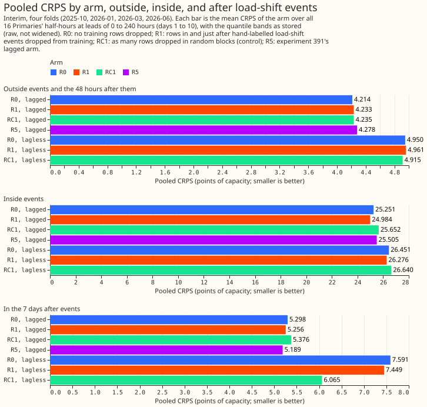
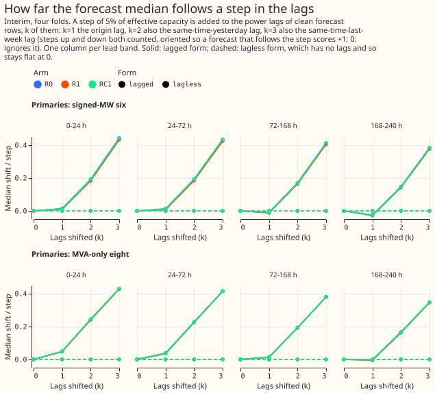
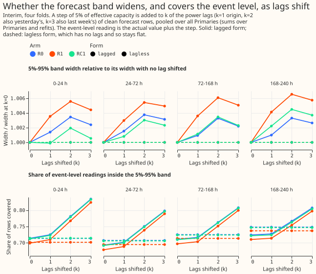
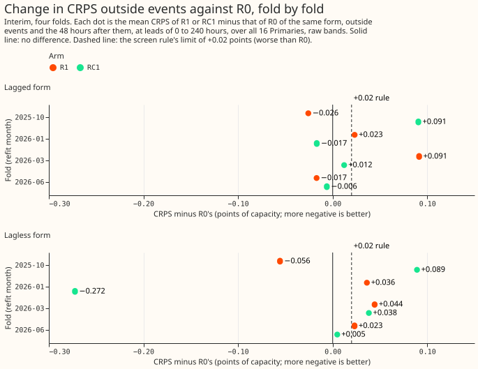

# An NRA forecast from XGBoost trained with load-shift events removed from its targets

**Removing the labelled load-shift events from the training targets of the monthly XGBoost demand
model does not stop its median from following a load shift in its recent-power inputs.** A load
shift is a period when National Grid Electricity Distribution moves a substation's load onto its
neighbours. A forecast of what the substation would draw without a load shift is called a
normal-running-arrangement (NRA) forecast. We trained the XGBoost model with the half-hours of 66
hand-labelled load shifts, and the 48 hours after each, left out of its training targets, and
compared it with the same model trained on everything and with a model trained with the same number
of half-hours left out at random. We then added a synthetic load shift of 5% of the substation's
capacity to the recent-power inputs of clean half-hours and measured how far the forecast median
moved. With all three recent-power inputs inside the synthetic event, the median moved by about 40%
of the step in every arm that has those inputs, masked or not. Only a model without recent-power
inputs did not move.

## Result

- **Screen, not a full year.** Scores come from four monthly refits (2025-10, 2026-01, 2026-03,
  2026-06), each scoring its month, 16 Primaries, leads to 336 hours, headline days 1 to 10. They
  are
  interim: four folds give wide intervals, so no interval or 99% claim is made. Refits are monthly,
  `colsample` is 1.0, one seed, the training window is experiment 87's whole-history window.
  Experiment 87's `n1h` recipe is used throughout; widening is raw unless stated.
- **Arms.** R0 (unmasked; lagged form is experiment 381's stored monthly control, reproduced to
  within 0.0011 of capacity at D2 and D8, and experiment 402's boosters of it are used for the
  sweep), R1 (labelled events and the 48 hours after dropped from training targets), RC1 (as many
  half-hours dropped at random, in blocks of the same lengths), R5 (experiment 391's N1, surprise
  columns, not refitted, lagged only). Each arm except R5 has a lagged and a lagless form.
- **R2 and RC2 were dropped.** They need the detector masks of experiment 391, which are on hold,
  and R1 already gave a null result. Arms R3 and R4 were not run.
- **CRPS, points of capacity (pooled, four folds).** Outside events and the 48 hours after (879,769
  half-hours): lagged R0 4.214, R1 4.233, RC1 4.235, R5 4.278; lagless R0 4.950, R1 4.961, RC1
  4.915. Inside events (13,494): lagged R0 25.25, R1 24.98, RC1 25.65, R5 25.50; lagless 26.45,
  26.28, 26.64. In the 7 days after (46,176): lagged 5.298, 5.256, 5.376, 5.189 (R5); lagless 7.591,
  7.449, 6.065. All rows (906,597): lagged 4.548, 4.563, 4.576, 4.614; lagless 5.310, 5.316, 5.259.
- **Screen rule (a)** (no worse than +0.02 against the control in at least 3 of 4 folds): R1 lagged
  passes 2 of 4 folds and R1 lagless 1 of 4 at raw widening, and 3 of 4 and 2 of 4 at 1.15
  widening, so the verdict depends on the widening. Rule (b) cannot be decided (matched events fall
  in 3 of 4 folds and every arm follows about 0 of the depth). R1 is indistinguishable from RC1 on
  every pooled score, so the full year was not run.
- **Band coverage inside events.** The 5% to 95% band covers 0.31 to 0.32 of readings for the lagged
  arms (nominal 0.90) and 0.23 for the lagless arms; all arms under-cover during a load shift.
- **Avoidable-curtailment cost** (signed-MW six, limit 0.9, GBP, dominated by D16): during events
  lagged R0 8.71 million, R1 8.76 million, RC1 8.77 million, R5 8.88 million; lagless R0 9.02
  million, R1 9.01 million, RC1 9.07 million. In the 7 days after: lagged 257 thousand, 256
  thousand, 261 thousand, 260 thousand (R5); lagless 232 thousand, 234 thousand, 231 thousand.
- **Lag-encroachment sweep** (step of 5% of capacity added to the lag columns of clean half-hours;
  level k adds it to the origin lag, then also the day-earlier lag, then also the week-earlier lag;
  both signs; leads 24 to 72 hours). The median moves, as a share of the step: k = 1, about 0 to
  2%; k = 2, 15% to 20%; k = 3, 38% to 41%, for lagged R0, R1, and RC1 in both metering groups, and
  within one point of one another. Lagless forms move by exactly 0 at every k, which tests the
  code. The 5% to 95% band width stays within 1% of its width at k = 0. Coverage of the event-level
  reading rises from 0.68 to 0.70 at k = 0 to 0.78 to 0.82 at k = 3, while coverage of the clean
  reading falls from 0.86 to 0.88 to 0.81 to 0.85. Experiment 391's N1 (R5) was not swept, because
  its surprise columns need recomputing from the shifted lags.
- **Injected transfers in training** (4 Primaries, the 2026-01 fold, 15 to 18 synthetic events of
  0.71, 1.1, or 2.3 MW per Primary added to the training targets and lags): the mean absolute
  difference of the median from the clean-trained forecast is 0.79 points of capacity for the
  unmasked lagged model and 0.87 for the masked one, and 0.42 and 0.59 for the lagless forms. Depth
  recovered is -0.11 (lagged) and -0.40 (lagless). The lagless difference of 0.42 is a fit-noise
  floor, so this check cannot show recovery either way.
- **Check 2** (share of labelled depth followed, 9 matched events in 3 folds): 0.00 plus or minus
  0.05 for every arm, including the unmasked one, because at leads beyond a day the lags sit far
  from the event half-hours. One merged event (D5, 2025-12-05 to 2026-01-14) is excluded.
- **Flagged-count check column.** Scoring on experiment 87's `observed.parquet` with flagged
  half-hours dropped from every arm removes 173 half-hours (170 at D18 in the 2025-10 fold, 3 at D8
  in the 2026-03 fold); the per-fold numbers of the rule check agree with the headline run.
- **Event plots.** `figure_events_1.svg` to `figure_events_6.svg` draw six real labelled events
  across both metering groups (two are report-only Primaries), marking the start and end of each and
  showing the actuals, the median, and the 5% to 95% band of the unmasked lagged, unmasked lagless,
  and masked lagged forecasts. Events not in the label table may also be present.
  `figure_examples.svg` is a fan chart of one event.

## Checks

- **Median minus mean forecast per site:** not computed. The stored forecasts hold quantiles only.
- **Error of the median beside the quantile score:** printed by the scorer, not tabulated.
- **Audit triggers that fire:** trigger 5, because the random-block control moves the 7-day-after
  slice of the lagless form by 1.5 CRPS points (6.065 against 7.591 for the unmasked model) and
  RC1 lagless moved by -0.27 in the 2026-01 fold, although it should change nothing. This is
  evidence that fit-to-fit noise on small slices is large, and no conclusion rests on those slices.
  A Sonnet audit re-derived the headline contrasts (Opus was not used, per the maintainer's rule).
- **Late reviews.** The code review (a fresh Sonnet agent) ran after the first fits had started, and
  its findings were fixed before RC1 started; R1 and R0 lagless were fitted before the fixes, which
  affect only the random-block control and events closer than 48 hours.

## Caveats

- **Flagged half-hours.** The feature cache comes from experiment 103's `rows.parquet` without the
  `drop_reason` filter; it supplies the load-shift event masks and the headline scoring actuals.
  The fits read experiment 87's own files, where flagged half-hours are nulls.
- **Device.** One R0 lagless fit (D2, 2025-10) was fitted on CPU as a benchmark; all other fits
  ran on the GPU.
- **Four folds, one seed.** The monthly screen holds only four test months, and the matched events
  are 27, of which 9 are matched with a depth.
- **Weekly refits** are not used, so absolute and tail numbers are monthly-schedule numbers.

## What the next experiment should answer

Whether an NRA forecast needs a model that is told which lags to distrust, such as one trained on
synthetic events injected into its lags and targets together (the sweep shows the lags carry about
40% of a step into the median), or whether dropping the lags on suspect rows and widening the band
is enough. The injected-transfer check here was too noisy to answer it; a second seed of the control
would give its noise floor.

## Plan (written before any result)

## What experiment 383 already settles

- **383's mask rule differs from R1's.** Its `lagless` arm drops training rows whose valid time
  lies in the *padded* hand-filtered mask of the feature cache (24 hours of padding on each side
  of an event, taken from `load_or_build_feature_cache`). R1 here drops rows inside an event and
  the 48 hours after it ends, with no padding before the onset. Its refits are weekly; this
  experiment refits monthly. Its forecasts are therefore not comparable with R0 arm for arm.
- **Consequence for R1.** The rules differ, so R1 is refitted monthly under the brief's rule
  (event plus 48 hours after), as R0's twin; the manager agreed on 2026-10-29. 383's stored
  `lagless` arm is not reused because its padding, its weekly cadence, and its single lagless form
  make it incomparable with R0 arm for arm.
- **Which NRA checks 383 reports.** Check 4 (tails and avoidable-curtailment cost) on
  contaminated-lag rows, during events, in the 7 days after, and on all rows, and a partial check 1
  (main score outside events, days 1 to 10, no lead bands). It does not report check 2 (share of
  labelled depth followed), check 3 (injected transfers), or the lag-encroachment sweep (its
  boosters were not saved). All three are new here, as are R2, R3, R4, and the random-block control.
- **Evidence read so far.** 383's lagless arm lowered CRPS on contaminated rows at the signed-MW
  six (rests on two events) and raised it at the MVA-only eight; nulling lags (c1) did nothing.

## Arms

Every arm is experiment 87's `n1h` XGBoost member, refitted **monthly** (maintainer rule,
2026-10-29), `colsample_bytree` and `colsample_bynode` fixed at 1.0, one seed, the same training
rows and parameters as R0. Each arm is fitted in a **lagged** form (three origin lags) and a
**lagless** form (no power lags). Weekly refits are not used, so every absolute and tail number is
labelled monthly; any winner is re-checked weekly before a release claim.

- **R0:** no rows dropped; the control.
- **R1:** rows whose valid time lies inside a hand-labelled transfer, or within 48 hours after it
  ends, are dropped, using only events that ended before the fold's `train_end`. A ceiling, never
  a candidate.
- **R2:** the same rule applied to half-hours the "deep and long" detector marks (not run).
- **RC1, RC2:** as many rows as R1 and R2 drop, in random blocks of the same lengths, as a control
  for the smaller training set (RC2 not run).
- **R5:** no mask; experiment 391's arm N1 with surprise columns, stored and not refitted.
- **R3, R4:** the train-detect-retrain loop and R2 with neighbour surprise columns (not run).

- **Detector.** Taken from experiment 391's `e00391_detector.py` (plan PR 41, not yet merged); if
  391 has not merged when R2 is due, the file is copied into this folder with a note. The mask for
  a fold uses only half-hours before its `train_end`, and the detector's tuning months are fixed
  before any score is read.
- **R5 shares 391's N1 forecasts and surprise tables**; the plan does not refit it. The published
  tables are in `data/ml-experiments/00391-xgboost-lag-surprise-second-stage/surprise_tables/`
  (`half_hourly/<site>.parquet`: quantiles, `u`, `r_mw`, and the `refit` that predicted each row;
  `origins/<site>.parquet`: `z`, `z_noise`, `r_sigma` per 6-hourly origin). Each row comes from a
  monthly lagless fit that trained on no row at or after its refit. They cover all 16 Primaries from
  2024-10-01 (D15 and D18 from 2025-03) to 2026-06-30, which spans the scored months 2025-07 to
  2026-06. The same tables serve the R2 detector mask, which therefore starts in 2024-10: R2's
  training masks for early refits rest on under a year of detector history, and the page says so.
  N1 keeps the three lags, so R5 exists in the lagged form only. Experiment 391 refits with no
  widening and scores raw and at 1.15, which this experiment copies. N1's forecasts will be under
  its `work/arm_preds/monthly/n1/` and its boosters under `work/boosters/n1/`, which the sweep
  reads.
- **R0 lagged reuses experiment 381's monthly `control`** (`work/arm_preds/monthly/control/`, 192
  files, 16 Primaries by 12 refits, origins 2025-07-01 to 2026-06-01, no 1.15 widening), as the
  manager allowed. The recipe matches: 381's control uses `fd.input_columns(a7=False)` and
  experiment 87's `n1h` configuration with `common.N_ROUNDS`, the same modules this experiment's fit
  script calls, and drops no rows. A reproduction gate confirms it before use: one refit (D2,
  2025-07-01) is fitted here and must match the stored file within 0.0043 CRPS points, 383's gate.
  If it fails, R0 lagged is refitted. R0 lagless is always fitted here.
- **Widening.** Each arm's quantiles are stored raw, and every score is reported raw and at the
  1.15 widening factor, for R0 and every arm alike. The widening of 391's N1 is read from its page
  before any comparison with R5.
- **Porting cost:** R1 and R2 change only the training targets (R2 needs the detector in the
  training loop, not in serving); R5 adds a stage 1 model and two column sets to serving.

## Planned contrasts

C1 R1 minus R0. C2 R2 minus R0. C3 R2 minus R1 (does the detector mask match the oracle). C4 R5
minus R0. C5 R5 minus R2 (does surprise match the detector). C6 R1 minus Rc1. C7 R2 minus Rc2. Each
is read on four slices: outside events and the 48 hours after (harm), inside events, the 7 days
after, and all rows.

## Few-fold screen (manager's instruction, 2026-10-30; rule fixed before any score is read)

All new fits first run on four monthly refits only: 2025-10 (autumn), 2026-01 (winter), 2026-03
(spring), and 2026-06 (summer), each scoring the month to the next refit. **Deviation from the
common brief's screen:** the training window stays experiment 87's `n1h` window (whole history),
not 24 months, because experiment 381's stored control (R0 lagged) uses that window and reusing it
saves its fits; the window is the same for every arm. R0 lagless, R1 and RC1 are fitted on the four
refits; R2 and RC2 follow on the same four.

- **Advance rule.** An arm advances to the other eight refits when, against its control on the same
  folds, (a) pooled CRPS outside events and the 48 hours after is no worse than +0.02 points in at
  least 3 of 4 folds, and (b) on rows inside events or the 7 days after, the lagless form follows
  less of the labelled depth than R0 lagless in at least 3 of 4 folds. R1 is run on the full year
  only when it beats RC1 on (b) in 3 of 4 folds; otherwise the control shows that the removal is
  not the cause and the full year is not run for R1 or RC1.
- **Noise floor.** A second seed of R0 lagless on the same four folds, at two Primaries (D2, D8).
- **What the screen says.** Four months give wide intervals, so screen numbers are interim and carry
  no 99% claim. Check 3 (injected transfers) and the sweep need only the saved boosters and run on
  the four folds regardless of the advance rule.

## The four NRA checks (pre-registered)

1. **No harm outside events:** arm minus R0, all 16 Primaries to 14 days, by lead band.
2. **NRA gap inside events:** for the half-hours inside a labelled transfer and the 48 hours after,
   the median's movement from its pre-event level divided by the label table's depth (MW), as a
   share of capacity. Low-confidence labels are reported separately.
3. **Injected transfers:** steps of known depth and duration (quartiles of the label table, 0.71,
   1.1, and 2.3 MW; both signs; durations drawn from the labelled events) are added to clean
   periods of the training history as in the `dp_nra` experiment, the arm is refitted with the
   injected events treated as labelled (R1) or run through the detector (R2), and the share of the
   clean original recovered is reported per arm. Restricted to the signed-MW six and four of the
   MVA-only eight; the subset is fixed before looking.
4. **Tails and cost:** coverage at q01, q05, q95, q99 and avoidable-curtailment cost during events,
   in the 7 days after, and across all rows.

## Lag-encroachment sweep

Prediction-only, on the saved boosters of every refit (path in the front matter's size line). The
three lags are
ordered by recency: origin, day-earlier, week-earlier (the exact times come from experiment 87's
`origin_lags`). Levels k = 0 to 3. A step of depth D (2%, 5%, 10% of capacity and the three
quartile depths; both signs) is added to every lag inside the synthetic event. For R5 and R4 the
surprise and neighbour columns are recomputed from the shifted lags, with the neighbour carrying
the opposite step. Cases (a) event under way and (b) event ended are reported separately, by lead
band, per group and per Primary. The lagless forms must show share 0 and no widening, which tests
the code. A few real labelled events chosen by a rule fixed here (the longest event per Primary
with high confidence) are compared with the synthetic ones.

## Time series plots of real events (maintainer, 2026-10-30)

At least 6 plots, spread over both metering groups (the signed-MW six and the MVA-only eight), each
for one real labelled event from the corrected label table. Each plot marks the event's start and
end and shows the actuals, the median, and the 5% to 95% band of R0, R1, and R5, in the lagged and
lagless forms where both exist, from the forecast origin one day before the onset. The events are
chosen by a rule fixed before looking: for each of the two groups, the three events with the largest
labelled depth that fall inside the four screen folds (fewer if fewer exist, said on the page).
Plots follow the `dataviz` skill, label substations by anonymised letters, and name no generator.

## Also reported

Per Primary, worst Primary, per group (signed-MW six, MVA-only eight, D15 and D18 report-only),
labelled events per Primary and per slice, D2 and D4 as placebos, the mean of the median minus the
mean forecast per site, and which audit triggers fired. Figures follow the `dataviz` skill and show
no metered generator's name or ID.

## Order and compute

R0 and R1 first, then RC1, then the checks, the sweep, and the injected-transfer fits. The fits ran
as three single-thread GPU processes (the sweep on CPU), each under a 16 GB memory limit.

## Caveat: flagged exact-zero half-hours (manager, 2026-10-30)

**The fits are clean; the scoring actuals are not yet.** The fits read training targets from
`common.ENS_TRAIN_PATH` and lags from `common.load_series_arrays` (the ERA5 file and experiment
87's own `inputs/observed.parquet`), where flagged half-hours are nulls. The feature cache from
experiment 103's `rows.parquet`, which has no `drop_reason` filter, enters only the load-shift event
masks and the scoring actuals (experiment 377's `actuals_and_context`). About 622 flagged
exact-zero Primary half-hours (the manager's figure, to be re-counted here) therefore sit in the
scored actuals, identically for every arm, so contrasts between arms are like-for-like while
absolute scores include them. **The scorer takes the actuals source as a parameter and reports
both:**
the headline uses experiment 381's actuals (experiment 377's `actuals_and_context`), so the numbers
stay comparable; the check column uses experiment 87's `observed.parquet`, with the flagged
half-hours dropped from every arm (the same rows for all arms) and the count of dropped half-hours
reported per fold and per Primary. Which source becomes the standard is the maintainer's choice, via
the XGBoost Discuss session, and the merge waits for it.

**Flagged-count check column, measured by the scorer before any arm is read.** Of the half-hours
in the four screen folds that are finite in the cache, 173 are null in `observed.parquet`: 170 at
D18 in the 2025-10 fold, 3 at D8 in the 2026-03 fold, and none in the 2026-01 and 2026-06 folds.
That
is far below the manager's figure of about 622, which presumably spans more than these folds. The
event masks still come from `dp_features` (experiment 103's rows); only the masks do, because the
fits read training rows, lags, and inference inputs from experiment 87's own files.

## Sources

Builds on experiment 383's oracle-mask arms, experiment 75 (a training-target mask in the weekly
XGBoost model) and experiment 44 (the share of the best guess's score a perfect detector could
gain), experiment
100 (dropped half-hours in XGBoost), experiment 391's detector and surprise columns, and the
`dp_nra` experiment's injected-transfer scoring.
