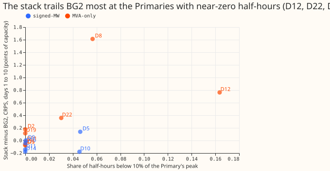
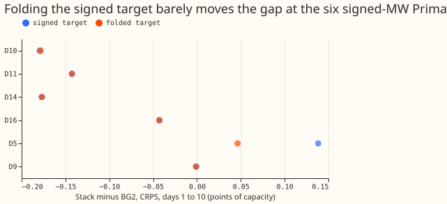
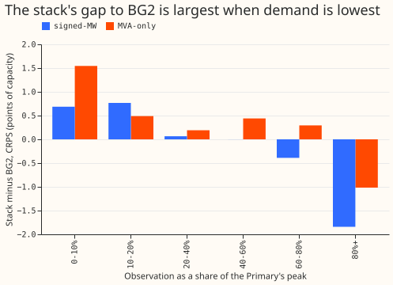

# Does apparent power's fold of signed power explain the GAM stack's gap at eight Primaries?

**Folding the signed series moves the stack's gap to BG2 by only -0.015 points pooled, so the fold
does not explain the gap.** We asked whether the generalised additive model (GAM) stack of
experiment 377 trails BG2 (the best-guess forecast of experiment 87, which production does not run)
at the eight Primary substations that report only apparent power in megavolt-amperes (MVA-only)
because apparent power is the absolute value of a signed flow. A Primary is a 33 kV to 11 kV
substation, labelled D2 to D22 here. Six other Primaries report signed megawatts (MW).

A score is the continuous ranked probability score (CRPS), estimated from 11 quantiles, in points
of effective capacity (percent of the Primary's effective capacity in MW). A negative stack-minus-BG2
difference favours the stack. Reactive power is assumed zero at the MVA-only Primaries, and nothing
was fitted. The stack is "stack without S below 168 h" of experiment 377: it has no two-number
solar summary below 168 hours.

We took the stored forecasts of the stack, BG2, and the manual heuristic (NGED's rule of thumb), and
replaced both the forecast and the observation by their absolute values at the six signed-MW
Primaries. We also measured how often each Primary's demand falls below 10% of its peak (the
"near-zero share") and how the stack's gap varies with that share. Folding barely moves the gap,
and the gap does not follow the near-zero share with a statistically clear relation. D5 is the
exception, where folding lowers the gap by 0.092. D8 is reported on its own throughout.

## Results

- **Verdict: not supported.** The hypothesis counted as supported only if both predictions held, and
  neither did. The stack-minus-BG2 gap over days 1 to 10 reproduces experiment 377's: -0.068 (99%
  interval -0.280 to +0.138) over the six signed-MW Primaries and +0.344 (+0.093 to +0.595) over
  the eight MVA-only Primaries.
- **Prediction 1 (the gap grows with the near-zero share): not shown.** Across the 14 countable
  Primaries the Spearman correlation is +0.53 (95% bootstrap over Primaries -0.11 to +0.92). It is
  +0.41 without D8, +0.79 within the eight MVA-only Primaries, and +0.41 within the six signed-MW
  Primaries. The interval includes zero. The near-zero share is 0 at D2, D3, D4, D19, D11, and D14,
  under 0.1% at D9, D16, and D21, and positive at D12 (16.4%), D8 (5.7%), D10 and D5 (4.6% each),
  and D22 (3.0%). Pooled over the 14, the gap is +1.31 on near-zero half-hours and +0.14
  elsewhere (descriptive).
- **Prediction 2 (the gap is more positive on the folded target): refuted.** Pooled over the six,
  stack minus BG2 is -0.068 on the signed target and -0.083 on the folded target (99% intervals
  -0.280 to +0.138 and -0.284 to +0.107). The folded minus signed difference is -0.015 (-0.034 to
  -0.002), so folding makes the stack look slightly better, the opposite of the prediction. Only
  D5 moves (-0.092, 95% interval -0.180 to -0.024). D10 moves by +0.001, and D9, D11, D14, and D16
  move by under 0.001. Against `manual_heuristic` the pooled gap is -0.657 signed and -0.671
  folded. The mean absolute error (MAE) of the median is 5.03 for the stack and 5.24 for BG2 on the
  folded target, and 5.06 and 5.24 on the signed target. D10 flows backwards in 0.7% of
  half-hours and D5 never does, so D10's folded series is nearly its signed series.
- **D8's gap is not a near-zero effect.** D8's gap is +1.61: +1.68 on half-hours above 10% of peak
  and +0.43 inside the near-zero half-hours, mostly at 30% to 70% of peak. At D12 (gap +0.76) the
  gap is +1.72 inside and +0.58 elsewhere. At D22 (gap +0.36) it is +2.47 inside and +0.29
  elsewhere.
- **Contrast 3 (error shape).** At the eight MVA-only Primaries the stack's median forecast is on
  average 16.0 points too high when the observation is under 10% of the Primary's peak (8.7 at the
  six signed-MW Primaries), and the gap to BG2 there is +1.54 (+0.69 at the six). The largest 5% of
  absolute residuals fall on half-hours under 20% of peak 33% of the time at the eight MVA-only
  Primaries (12% of all their rows) and 18% of the time at the six signed-MW Primaries (7% of all
  their rows). The sign estimate of experiment 387 joined to none of the stack's rows, so the
  residual is not split by flow direction.
- **Contrast 4 (other explanations).** The stack-minus-BG2 gap on days 1 to 3 and on days 8 to 10
  is +0.39 (+0.15 to +0.61) and +0.34 (+0.05 to +0.67) at the eight MVA-only Primaries, and -0.15
  (-0.38 to +0.08) and -0.02 (-0.27 to +0.19) at the six signed-MW Primaries (99% intervals).
  Experiment 384 stores the number of generators at each Primary's bulk supply point, not their
  share of capacity: D12, D22, D8, D14, D16, and D5 each have 8 generators, so the count does not
  separate the large gaps from the small. Experiment 386 found the stack trailing BG2 by +1.02
  (+0.68 to +1.43) at two bulk supply points and +2.01 (+1.41 to +2.60) at two grid supply points,
  which are sums of many Primaries' demand; this analysis does not decide between aggregation
  level and the fold.
- **Floor against the benchmarks (`demand-v2`, days 1 to 10).** The floor requires a Primary's
  CRPS to be no greater than `manual_heuristic`'s and no more than 1.10 times BG2's. The stack fails
  it at D12 (1.113 times BG2's CRPS) and at D8 (1.212 times BG2, and 9.23 against the heuristic's
  8.31). The other 12 Primaries pass; D22 is the nearest at 1.095.
- **Tail coverage, stack against BG2 (days 1 to 10).** At the six signed-MW Primaries, coverage at
  q05 is 0.050 to 0.087 for the stack and 0.036 to 0.061 for BG2 (target 0.05), and at q99 0.956 to
  0.996 and 0.950 to 0.985 (target 0.99). At the eight MVA-only Primaries the stack's q05 coverage
  is 0.056 to 0.079 and its q99 coverage 0.970 to 0.988. The stack's lower tail is too narrow, as
  in experiment 377.

## Checks

- **Median minus mean forecast.** Zero at every Primary: the stored mean equals the stage-2
  median by construction (experiment 377), so no independent mean-forecast contrast exists.
- **Error of the median beside the quantile score.** The MAE contrast points the same way as the
  folded CRPS contrast (stack better than BG2, slightly more so folded).
- **Audit.** A fresh Sonnet agent re-derived the group gaps, the near-zero shares, the inside and
  outside gaps at D8, D12, and D22, the folded gaps, and the Spearman correlations from the raw
  stored files and matched every number.
- **Triggers.** None of the seven triggers of the audit rule fired. Removing D8 lowers the
  MVA-only gap from +0.344 to +0.178 (experiment 377), and the verdict does not depend on it.

## Caveats and what to try next

- Four of the six signed-MW Primaries rarely come near zero, so the folded test has little power.
  The test cannot run at D12, which reverses flow, because its series is already folded.
  Experiments 152, 372, and 374 found a fold gain at D12 only, with an interval including zero over
  a full year.
- The folded quantiles are the sorted absolute values of the 11 quantiles. This is exact where the
  whole forecast sits on one side of zero and understates the mass at zero otherwise.
- No Primary has a stored reactive-power series alongside its active power (the prior-work check
  searched experiments 79, 110, 152, and 358), so true MVA was not built.
- One option for a next test is a term for the lowest-demand state at the MVA-only Primaries, where
  the median forecast is 16.0 points of capacity too high under 10% of peak.
