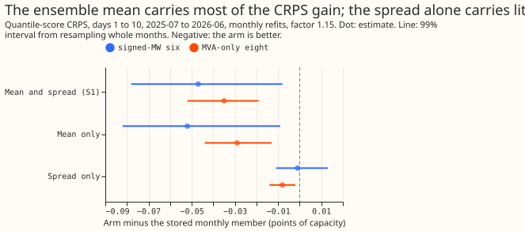
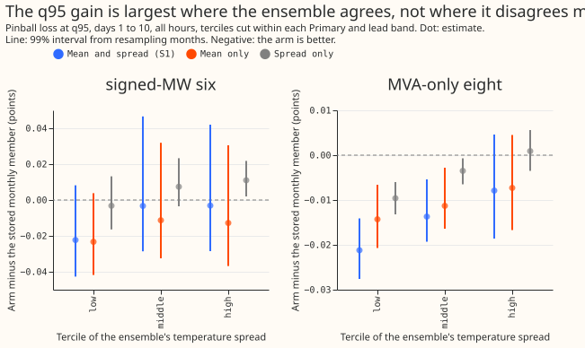
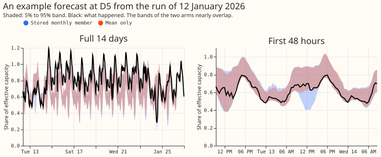

**Take-home message: the mean of the 51 ensemble weather members gives the simple XGBoost demand
forecast its gain from those members, and the spread of the members adds almost nothing.** Here "the
simple XGBoost demand forecast" is the monthly-refitted XGBoost model of the half-hourly demand of
16 Primary substations. We gave that model, as extra inputs, only the mean across the 51 members of
the temperature and of the shortwave radiation (the mean-only arm), or only their standard deviation
(the spread-only arm). The error score is the continuous ranked probability score (CRPS), in
percentage points of each substation's effective capacity. The mean-only arm lowers it by 0.052
points at the 6 substations whose meters record the direction of flow (the signed-MW six) and by
0.029 points at the 8 whose meters record apparent power only (the MVA-only eight). The spread-only
arm lowers it by 0.001 and 0.008 points. **Neither input fixes the tails: on cold nights the 95%
quantile of the forecast still lies above only 0.77 to 0.78 of outcomes at the signed-MW six,
against a nominal 0.95.** The verdict is `supported`: the mean-only arm recovers about 110% of the
gain of experiment 389's four-column arm at the signed-MW six and 82% at the MVA-only eight, and the
spread-only arm recovers about 1% and 24%.

[Experiment 389](../00389-xgboost-tail-calibration-and-ensemble-spread-columns/result.md) found that
four extra input columns (the mean and the standard deviation across the 51 members, each for
temperature and for shortwave) lowered the CRPS by 0.047 and 0.035 points at the two groups, and
that the gain looked like an effect of the mean. This experiment splits the four columns into two
arms of two columns each. Both arms use the recipe of the stored monthly forecast of [experiment
87](../00087-bg2-best-guess-assembled-with-drop-one-ablations/result.md) (12 monthly refits at all
16 Primaries). The control is that stored forecast, which receives none of the extra columns. All
quantiles are widened about the median by a factor of 1.15, as in experiment 87. Experiment 389's
four-column arm is the second comparison. The hypothesis and two predictions (see the front matter)
were written after experiment 389's scores and before either arm was scored. The mean-only score was
read before the spread-only arm was scored, so the spread-only comparison is not blind.

## Results

Scores are in points of effective capacity for forecasts 1 to 10 days ahead on the half-hours of
July 2025 to June 2026 that every arm scores (3,844,106 half-hours, a different set from experiment
389's because the arm set differs, so S0M and S1M differ from experiment 389's printed values in the
third decimal). Intervals are 99% intervals from resampling whole calendar months, 20,000 resamples.
All numbers come from `e00394_score.py` and `e00394_bins.py`.

| Group | Arm | CRPS | MAE of median | q05 | q95 | q99 |
|---|---|---|---|---|---|---|
| Signed-MW six | Stored monthly member (S0M) | 3.121 | 5.375 | 0.034 | 0.932 | 0.986 |
| Signed-MW six | Four columns (S1) | 3.074 | 5.284 | 0.037 | 0.925 | 0.985 |
| Signed-MW six | Mean only | 3.069 | 5.281 | 0.037 | 0.926 | 0.985 |
| Signed-MW six | Spread only | 3.121 | 5.373 | 0.034 | 0.930 | 0.985 |
| Signed-MW six | BG2 | 3.016 | 5.244 | 0.045 | 0.932 | 0.976 |
| MVA-only eight | Stored monthly member (S0M) | 3.847 | 6.855 | 0.043 | 0.955 | 0.995 |
| MVA-only eight | Four columns (S1) | 3.812 | 6.796 | 0.049 | 0.949 | 0.994 |
| MVA-only eight | Mean only | 3.818 | 6.808 | 0.048 | 0.950 | 0.994 |
| MVA-only eight | Spread only | 3.839 | 6.847 | 0.043 | 0.953 | 0.995 |
| MVA-only eight | BG2 | 3.788 | 6.766 | 0.042 | 0.955 | 0.995 |

The q05, q95, and q99 columns are the share of outcomes below that quantile (nominal 0.05, 0.95,
and 0.99).

- **Mean-only arm.** Mean only minus S0M: -0.052 (-0.082 to -0.009) at the signed-MW six, -0.029
  (-0.044 to -0.013) at the MVA-only eight, and -0.041 (-0.057 to -0.025) at the eight without D8.
  Leaving out any one Primary leaves each contrast negative with a 99% interval excluding zero
  (-0.050 to -0.054 at the six; -0.024 to -0.041 at the eight). Mean only lowers the CRPS at 14 of
  16 Primaries; it is worse at D8 (+0.058) and D15 (+0.403, report only).
- **Spread-only arm.** Spread only minus S0M: -0.001 (-0.011 to +0.013) at the six, -0.008 (-0.014
  to -0.002) at the eight, and -0.009 (-0.014 to -0.003) at the eight without D8. The spread-only
  arm lowers the CRPS at 12 of 16 Primaries (11 if D16, where the change is -0.0005, counts as
  zero).
- **Mean and spread together.** Mean only minus S1: -0.005 (-0.019 to +0.006) at the six and +0.006
  (+0.002 to +0.010) at the eight. Spread only minus S1: +0.047 (+0.011 to +0.072) at the six and
  +0.027 (+0.010 to +0.042) at the eight. The mean-only arm recovers about 110% of the S1 gain at
  the six (0.052 of 0.047) and 82% at the eight (0.029 of 0.035), so the prediction of at least 70%
  holds. The spread-only arm recovers 1% at the six and 24% at the eight (0.008 of 0.035), so the
  prediction of under 30% holds.
- **Tails.** A negative change in absolute coverage error means the share of outcomes below the
  quantile moved towards nominal. Against S0M at the signed-MW six, the change at q95 is +0.006 for
  the mean-only arm (99% interval -0.006 to +0.012) and +0.002 for the spread-only arm (-0.004 to
  +0.006). At q05 it is -0.003 for the mean-only arm (-0.005 to -0.001), a small gain from 0.034 to
  0.037 towards 0.05. At the MVA-only eight the change at q95 is -0.004 and -0.001. At q99 the
  intervals include zero except at the MVA-only eight (-0.0004, -0.0009 to -0.0000, and -0.0002,
  -0.0006 to -0.0000). No arm moves any coverage by more than 0.006.
- **Cold nights.** The share of outcomes below q95 at the six is 0.775 (S0M), 0.769 (S1), 0.776
  (mean only), 0.769 (spread only), and 0.800 (BG2), over 44,370 half-hours; at the eight it is
  0.851, 0.850, 0.855, 0.849, and 0.845. Mean only lowers the CRPS on cold nights by 0.086 (six) and
  0.113 (eight) against S0M; spread only by -0.006 and 0.032.
- **Sunny half-hours (April to June).** Mean only lowers the CRPS by 0.131 (six) and 0.070 (eight);
  spread only raises it by 0.011 (six) and 0.017 (eight).

## Spread terciles

The maintainer expected spread to help when weather uncertainty is high and to calibrate sunny
summer half-hours. We cut each Primary's rows, within each of the five lead bands of experiment 389,
into terciles of the ensemble's temperature spread at the row's lead, and scored every arm in each
tercile. All-hour rows are the stored half-hours of days 1 to 10 with a finite actual (not the
scorer's shared set). Intervals resample the calendar months of the valid time (13 months, because
leads run past 30 June 2026).

- **High spread does not favour the spread columns.** At the signed-MW six, spread only minus S0M at
  q95 is -0.003, +0.007, and +0.011 points in the low, middle, and high temperature-spread terciles
  (99% intervals -0.016 to +0.013, -0.004 to +0.023, and +0.002 to +0.022), so it is worse in the
  high tercile. At the eight it is -0.010, -0.004, and +0.001.
- **The mean's gain is also largest in the low-spread tercile.** At q95, mean only minus S0M is
  -0.023, -0.011, and -0.013 at the six and -0.014, -0.011, and -0.007 at the eight; the interval of
  every tercile at the six includes zero, as does the high tercile at the eight.
- **q05 and q95 coverage barely moves across terciles.** At the six, the share below q05 for S0M is
  0.044, 0.035, and 0.036 across the three terciles; the arms move it by at most 0.004. The share
  below q95 is 0.947, 0.937, and 0.931 for S0M; the arms move it by at most 0.008.
- **June to August sunny half-hours: no arm calibrates them.** Sunny means the ensemble-mean
  shortwave is in the top quarter of all of a Primary's June-to-August rows, night included, so the
  selection is roughly the brighter half of daytime rows. Terciles cut the shortwave spread within
  each Primary and lead band. At the six, the stored monthly member's q95 covers 0.98, 0.97, and
  0.97 of outcomes in the low, middle, and high shortwave-spread terciles, above the nominal 0.95,
  and the mean-only arm covers 0.970, 0.966, and 0.965; the q95 pinball loss falls by 0.047, 0.036,
  and 0.051 points with the mean, and by 0.012, rises by 0.004, and rises by 0.009 with the spread.
  The scored year holds only 3 June-to-August months (July and August 2025, June 2026), so the
  intervals resample whole days (99 to 102 days per tercile); they are too narrow to trust as a
  month-level claim.

## Checks

- **Median minus mean forecast.** Not computed: the stored frames hold quantiles and no mean. The
  mean absolute error of the median falls in step with the CRPS (mean only 5.281 against 5.375 at
  the six), so the quantile and median contrasts point the same way.
- **Triggers.** Audit trigger 2 (a result that contradicts an earlier experiment's finding) fired.
  [Experiment 371](../00371-d8-monthly-xgboost-input-group-ablation/result.md) found that an
  ensemble-mean arm added 0.007 points, and this experiment finds 0.052 and 0.029. A possible
  explanation is that experiment 371 changed only the prediction inputs while the arms here train on
  the columns. This experiment did not test that explanation.
- **Audit and review.** A fresh Sonnet agent audited the pipeline these arms share with the
  four-column arm in experiment 389. It re-derived the four-column contrasts from the stored
  forecasts and found no use of a later forecast run or later weather in the training rows or the
  prediction rows. A fresh Sonnet agent reviewed this experiment's code after scoring had started
  and found no blocking problem.
- **Leaving one Primary out.** Leaving out any one Primary does not flip the sign of the mean-only
  contrast. For the spread-only arm at the signed-MW six the leave-one-out contrasts range from
  -0.003 to +0.001, with intervals that include zero, which matches the pooled contrast.

## Caveats

- **No fresh S0M refit.** The control is the stored monthly member, as in experiment 389; experiment
  389's audit found that a fresh refit of it at D5 and D12 (4 of 192 fits) differed from the stored
  member by -0.002 to +0.004 CRPS, while S1 differed from it by -0.143 to +0.340 at the same refits.
- **Cleaned data and the short-history cut.** Experiment 87's pipeline, which these arms inherit,
  predates the standing practices that clean the power data of `substation_zero` half-hours and cut
  D15 and D18 before 2025-03-01, so the result holds for the stored recipe and not for a cleaned
  one.
- **Four columns, two variables.** The mean-only and spread-only arms each hold the columns of
  temperature and of shortwave together, so the page cannot say which variable carries the gain.
- **Lead range.** All scores run to days 1 to 10; days 11 to 14 are in the log.

## What to try next

The mean of the 51 members carries the gain, which suggests testing the mean of each weather
variable the model already uses, and the temperature mean without the shortwave mean, to see which
variable carries it. The cold-night under-coverage stays open, because no ensemble input moved it.
