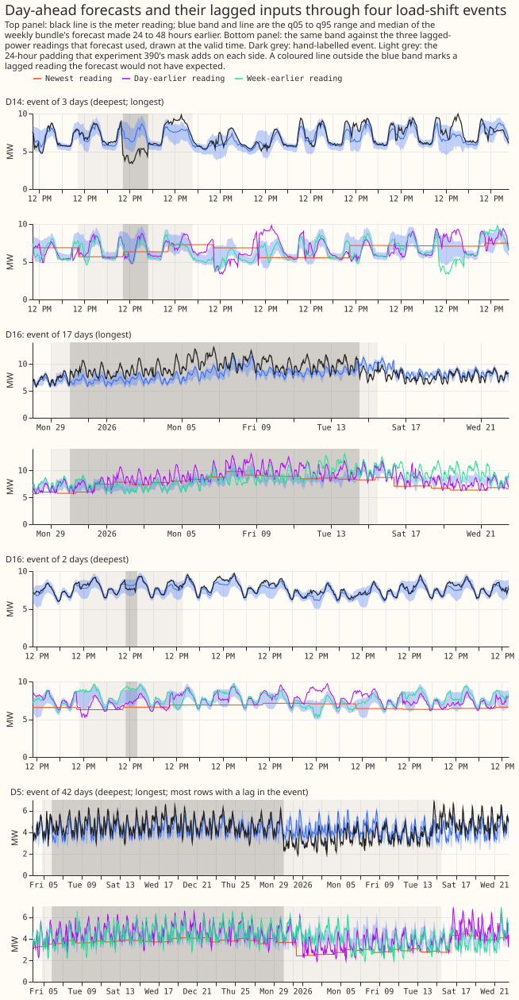

# A level state, a winter re-score, spread bins, a short-history anchor, and lag-event harm, all on stored forecasts

**A level filter on the weekly XGBoost model's own residuals closes part of the model's gap to the
GAM stack at D14 and widens it at D11, so the filter is not the whole explanation.** The weekly
bundle is [experiment
381](../00381-simple-weekly-xgboost-demand-against-gam-stack/result.md)'s XGBoost model (solar
summary, sunny flag, 1-year half-life). The GAM stack is [experiment
377](../00377-demand-v1-first-run-feasibility/result.md)'s stack without its smoothing stage S below
168 hours. D11 and D14 are two of the 16 Primaries (primary substations) scored here. The filter
follows [experiment 136](../00136-dp-bg-stage1-assembly-on-the-ensemble-mean/result.md)'s two-state
filter, which in turn follows the variational noise filter of [de Vilmarest and Wintenberger
(2022)](https://arxiv.org/abs/2104.10777). [Experiment
390](../00390-xgboost-d11-d14-gap-and-load-shift-event-lags/result.md) found that a rolling median
offset does not copy the filter.

**Nothing in this experiment is refitted.** Every number re-scores forecasts that earlier experiments
stored, so the monthly-refit rule does not apply. The score is the continuous ranked probability
score (CRPS) in points of effective capacity (1 point is 1% of the Primary's effective capacity), for
days 1 to 10 unless stated, on `fold_a_daily_gap_v1` under `demand-v1`. Intervals resample whole
months, or whole events in Part F. "Raw" means the stored forecast without widening, and `_w` means
widened by the factor 1.15 about the median.

## Part A: a level state on the weekly bundle

**The stack's two-state filter closes 41% of the bundle's D14 gap and widens its D11 gap.** K0 is the
stored weekly bundle. K1 runs experiment 377's two-state filter (a level plus an AR(1) transient, one
filter per hour band, pooled noise settings from `e00377_run.noise_hyper`) on the bundle's
residuals, using readings at least 3.5 hours before the origin. K2 is a one-state random-walk level
with a gain and a per-half-hour decay fitted per Primary on an expanding window (prior gain 0.05,
decay 0.998 where there is no training data), and K3 pools K2's two numbers across the 16 Primaries.

| Primary | K0 | K1 | K2 | K3 | GAM stack |
|---|---|---|---|---|---|
| D11 | 2.577 | 2.672 | 2.615 | 2.679 | 2.429 |
| D14 | 2.510 | 2.387 | 2.45 | 2.44 | 2.209 |

- K1 at D11 is worse than K0 by +0.095 points (interval +0.035 to +0.152).
- K1 closes 41% of the D14 gap, K2 closes 19%, and K3 closes 25%.
- On the signed-MW six, K0 scores 3.023, K2 3.001, K3 3.000, K1 3.043, and the GAM stack 2.949.
- On the MVA-only eight, K0 scores 3.721, K2 3.743, and K1 3.804.
- In the 0 to 24 h band on the signed-MW six, K0 scores 2.584 and K2 2.429.
- Cold-night q95 coverage on the signed-MW six rises from 0.773 (K0) to 0.806 (K2) and 0.841 (K1),
  against 0.880 for the GAM stack.
- K4 (the GAM stack without its filter, plus K2, on six Primaries) scores 2.898 against the stack's
  own 2.954, so K2 recovers the stack's filtered score and slightly beats it.

**Predictions.** P1 fails: K1 closes at least half of the gap at neither D11 nor D14. P2 fails: K2
closes under half at both. P3 holds: K4 recovers the stack's score within 0.03 points. P4 holds: the
0 to 24 h band improves, so the transient does not hurt it. The porting threshold is not met.

## Part B: winter re-score

**Economy 7 columns change nothing, and the ensemble mean and spread columns help cold nights.**
Against `monthly/control`, the Economy 7 arm differs by -0.000 on the winter signed-MW six (interval
-0.004 to +0.004), and by +0.005 at D14 in winter (+0.001 to +0.012). Experiment 389's S1M (mean and
standard deviation of temperature and shortwave radiation as columns) differs by -0.040 on the
signed-MW six (-0.065 to -0.010), -0.031 on the MVA-only eight, -0.058 at D11, -0.032 at D14, and
-0.070 (six) and -0.144 (eight) on cold nights. S0M equals the control. S1M closes 36% of the D11 gap
and 7% of the D14 gap; the solar arm closes 12% of the D14 gap. Cold-night q95 coverage on the
signed-MW six is 0.734 for the control, 0.726 for S1M, and 0.879 for the GAM stack. P5 holds for the
Economy 7 arm only.

## Part C: spread bins

**S1M's gain over S0M does not rise with temperature spread.** Experiment 394's tables were not
available, so only the top-decile and regime bins are scored. S1M minus S0M by temperature-spread
bin: lower tercile -0.038, middle -0.017, upper -0.020, top decile -0.019 (-0.053 to +0.018). By the
share of the 51 ensemble members below 5 °C at the week's coldest day: all warm -0.023, 0 to 25%
+0.021, split +0.015, 75 to 100% -0.067, all cold -0.075. The gain therefore sits where the ensemble
agrees on cold weather, not where it is split. All-row q95 coverage moves from 0.921 to 0.913, and
the ratio of 90% band width to absolute error from 3.74 to 3.62. The intervals are 95%. P6 fails.

## Part D: short-history level anchor

**A 7-day level anchor helps D15 and nothing else.** The anchor is the median of the bundle's own
residuals over the previous 7, 14 or 28 days, shrunk by the days of history over the window length.
At D15 (4 scored months) the score falls from 15.186 to 13.593 (7 days), 14.071 (14 days), and 14.151
(28 days); the 7-day change is -1.593 (-3.574 to +0.609), and the median bias falls from -17.0 to
-4.8 points. D18 (6 scored months) gains nothing. On the other 14 Primaries the 7-day anchor changes
the score by +0.101 (+0.049 to +0.153), the 14-day anchor by +0.069 (+0.006 to +0.137), and the
28-day anchor by +0.017 (-0.025 to +0.057). P7 holds for the 7-day anchor's bias at D15 and fails
its no-harm clause for the 7- and 14-day anchors. The 14-day anchor's bias was not reported.

## Part E: lag-encroachment sweep on experiment 391's boosters

**Shifting lag readings into an event moves the median a little and the band hardly at all.** Experiment
391's stored `b0` boosters, 16 Primaries and 521,442 rows per setting, were given lag columns shifted
by the event step for k = 1, 2 and 3 of the origin, day and week lags. The median moves by 1.3%, 17.3%
and 36.8% of the step. The 90% band is 1.005, 1.009 and 1.008 times as wide as with clean lags. The
clean reading lies inside the 90% band on 0.875 of rows at k = 0 and 0.826 at k = 3, and the
event-level reading inside it on 0.681 and 0.784. The q95 reaches the event level on 0.701 of rows at
k = 0 and 0.812 at k = 3. No lagless booster is stored, no `n1` sweep was run, and no real-event
comparison was made.

## Part F: score on unpadded hand-labelled load-shift events

**On rows whose target lies outside every event, a power lag inside an event raises the score by
about 1 point for the weekly bundle and about 1.7 to 2.0 for the GAM stack.** Events are the 184
merged hand-labelled intervals of `briefs/sw_block_detector_label_table.csv`, unpadded. No forecast
predicts an event, so a median that stays at normal running is the desired behaviour; the harm table
therefore scores rows whose target lies outside the event, and coverage inside events is description
only. Harm is the CRPS of rows with one to three lags in an event, minus the same Primaries' rows
with clean lags; intervals resample whole events (34 events for the signed-MW six, 25 for the
MVA-only eight). Flagged exact-zero half-hours are dropped (`filtered`, the headline); the unfiltered
figures differ in the third decimal.

| Forecast | Six: harm (interval) | Eight: harm (interval) | Six, 3 lags: q95 coverage |
|---|---|---|---|
| Weekly bundle | +1.03 (+0.05 to +2.32) | +0.37 (-0.18 to +1.05) | 0.831 |
| Monthly control | +0.57 (-0.03 to +1.49) | +0.50 (-0.13 to +1.25) | 0.818 |
| GAM stack | +1.67 (+0.06 to +3.77) | +1.97 (+0.46 to +3.80) | 0.840 |
| Experiment 383 d | +0.97 (+0.08 to +2.10) | +0.47 (-0.17 to +1.24) | 0.822 |
| Experiment 383 c1 | +0.79 (+0.09 to +1.74) | +0.44 (-0.14 to +1.19) | 0.735 |
| Experiment 383 c2 | +0.36 (-0.15 to +1.15) | +0.60 (+0.02 to +1.38) | 0.779 |

With clean lags the bundle's q95 coverage is 0.928 on the six.

**The median sits at normal running when no lag is in the event and moves most of the way to the event
reading when lags are.** The depth missed per event is |median(actual − median forecast)| over
|depth|, where 0 means the median reaches the event reading and 1 means it stays at normal running.
For the weekly bundle it is 0.50 with no lag in the event (52 events), 0.19 with one or two (27), and
0.16 with three (16). The monthly control scores 0.42, 0.20 and 0.12; the GAM stack 0.63, 0.30 and
0.27; experiment 383's c2 0.39, 0.15 and 0.14. Lag encroachment therefore drags the median into the
event. The 90% band stays about as wide (the bundle's median width is 23.1, 26.1 and 24.2 points).

**The 24-hour padded mask overstates the failure.** On the bundle's signed-MW six, rows with a lag
in the padded mask and a target outside it have q95 coverage 0.786 (interval 0.506 to 0.932, 13
events); the unpadded labels give 0.902 (0.819 to 0.960, 34 events). The intervals overlap. Of 36,718
padded-contaminated rows, 8,485 have no lag in an unpadded event.

**The label table's sign column is unreliable.** The median of actual minus forecast has the sign of
`depth_mw` in only 68% of events with no lag in the event, and by Primary it ranges from 7 of 7
(D8) to 1 of 4 (D3) and 0 of 1 (D18, D19). No signed statistic is reported for that reason.
Curtailment cost was not re-scored in this experiment. Experiment 390's event-fan figure is redrawn
below with the event masks shaded.

## Checks

- **Which actuals the scorer read.** Experiment 103's `rows.parquet`, through the feature cache. It
  carries no `drop_reason` filter, so 38 unique scored half-hours of 256,981 (0.015%) are flagged
  `substation_zero`, all exactly zero: D21 13, D8 7, D22 5, D9 5, D12 4, D18 3, D16 1. The 622 flagged
  rows counted elsewhere are the cleaned table's flagged rows over the year, not scored half-hours.
  Part F drops the flagged rows and also reports the unfiltered numbers. Parts A to E
  score unfiltered; the 38 rows cannot move a mean by more than their share of the rows.
- **Flagged zeros inside labelled events.** 6 inside unpadded events (D22 5, D8 1) and 7 inside the
  24 h padded mask (D22 5, D8 2).
- **Median minus mean.** Not computed: the stored forecasts hold quantiles only.
- **Error of the mean beside each contrast.** Every contrast above carries its interval. Contrasts
  without an interval are descriptive.
- **Which audit triggers fired.** P1 and P2 contradicted the hypothesis, and P7's no-harm clause
  failed. The Part F signed-share definition was wrong in a first draft and was replaced by the
  sign-free definition above.
- **Verdict.** Partly supported: P3, P4 and P5 (Economy 7 only) hold; P1, P2, P6 fail; P7 holds for
  D15's bias and fails no-harm.
- **Cadence.** Nothing is refitted, so the monthly-refit rule does not apply.

## Caveats and what to try next

- D15 has 4 scored months and D18 has 6, so Part D rests on very few months.
- Part C could not be set beside experiment 394's tables.
- Part F draws no per-forecast chart of coverage by lag count and event length; the tables carry it.
- The Part F events for D5 overlap in the padded mask, which merges later events.
- Experiment 391's `n1`, `n0`, and `o` boosters were not swept, and no lagless booster exists.
- The signed event depth cannot be used until the label table's sign column is checked.
