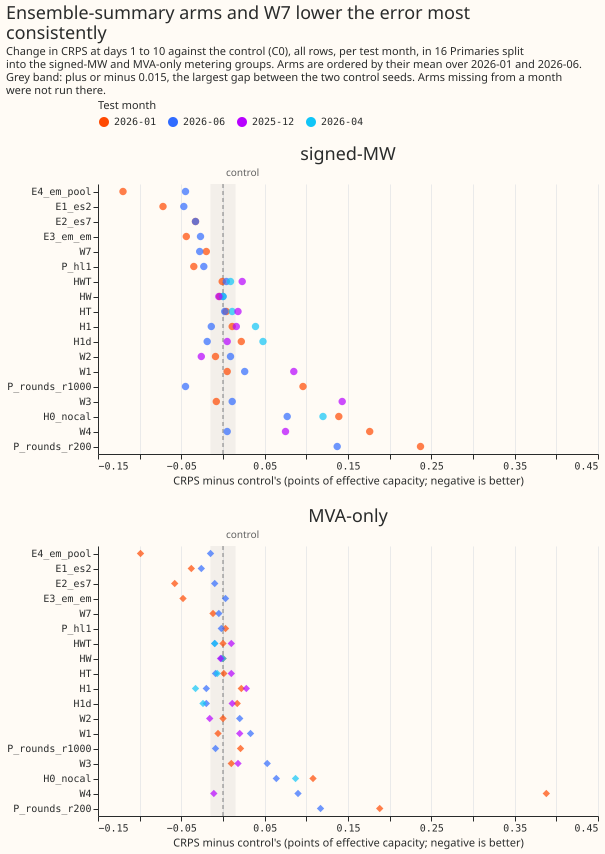
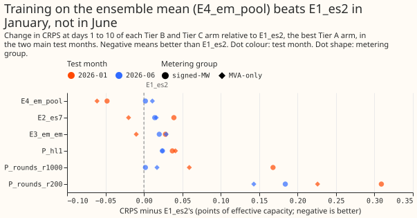
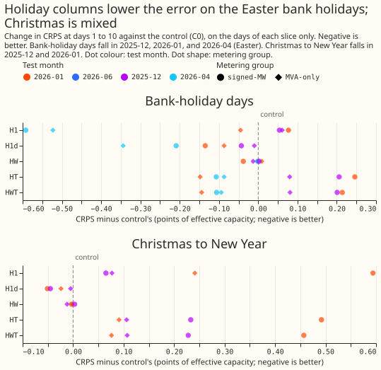

**Take-home: giving the weekly XGBoost demand model the ensemble's view of the weather lowered the
forecast error a little in every test month and metering group we scored, with three arms (E1_es2,
E2_es7, and E4_em_pool). Only the shortwave-trend arm W7 did so too, by less, and no other change
did.** The two arms that did best trained on the ensemble mean (E4_em_pool, which lowered the
continuous ranked probability score, CRPS, by 0.015 to 0.120 points of effective capacity against
the control) or added the ensemble's mean and spread of temperature and shortwave radiation (E1_es2,
0.026 to 0.072 points). Those gains are 0.4% to 2.7% of the control's CRPS, measured in two main
test months, so they justify a full-year test and nothing more. Holiday columns lowered the error on
the Easter bank holidays by about 0.5 points but raised it on all days at the Primaries with signed
meters. The winter weather columns were neutral to worse, 200 boosting rounds was clearly worse than
500, and the window-summary arms of the lag-surprise idea all raised the error. Verdict: partly
supported. A screen supports no 99% claim: every number here is a point difference from the control,
set against a noise floor from refitting with another seed, in a few test months.

**What we asked.** We asked which small changes to the weekly XGBoost demand model of [experiment
87](../00087-bg2-best-guess-assembled-with-drop-one-ablations/result.md) lower its CRPS enough to
deserve a full year of testing. That model fits one XGBoost model per Primary substation, trained on
the control member of the European Centre for Medium-Range Weather Forecasts (ECMWF) ensemble
forecast. We refitted it monthly with each change on up to four test months, and compared each arm
with an unchanged control (C0) over days 1 to 10 of the forecast, the horizon that the electricity
distribution network operator (NGED) cares about. Primaries split into two metering groups: the
signed-MW six (D5, D9, D10, D11, D14, and D16, whose meters record the sign of power flow) and the
MVA-only eight (D2, D3, D4, D8, D12, D19, D21, and D22, whose meters do not). D15 and D18 are scored
for the report only. D-codes are anonymised Primary substations. The caveat that matters most for
NGED's use: the screen covers days 1 to 10 pooled, and holds no result for any single lead band.

## Results

The table lists the change in all-rows CRPS from C0 in the two main test months. Negative is better.
The last two rows give C0's own CRPS and the noise floor, the absolute CRPS gap between C0 and a
second control fitted with another seed (C1).

| Arm | 2026-01 signed-MW | 2026-01 MVA-only | 2026-06 signed-MW | 2026-06 MVA-only |
|---|---|---|---|---|
| E4_em_pool | -0.120 | -0.099 | -0.045 | -0.015 |
| E1_es2 | -0.072 | -0.038 | -0.047 | -0.026 |
| E2_es7 | -0.033 | -0.058 | -0.033 | -0.010 |
| E3_em_em | -0.044 | -0.048 | -0.027 | +0.003 |
| W7 | -0.020 | -0.012 | -0.028 | -0.005 |
| P_hl1 | -0.035 | +0.003 | -0.023 | -0.002 |
| H1 | +0.011 | +0.022 | -0.014 | -0.020 |
| HT | +0.004 | +0.001 | +0.002 | -0.009 |
| HW | -0.004 | 0.000 | 0.000 | -0.002 |
| W1 | +0.005 | -0.006 | +0.026 | +0.033 |
| W2 | -0.009 | 0.000 | +0.009 | +0.020 |
| W3 | -0.008 | +0.010 | +0.011 | +0.053 |
| W4 | +0.176 | +0.388 | +0.005 | +0.090 |
| P_rounds_r1000 | +0.096 | +0.021 | -0.045 | -0.009 |
| P_rounds_r200 | +0.237 | +0.188 | +0.137 | +0.117 |
| H0_nocal | +0.139 | +0.108 | +0.077 | +0.064 |
| C0's CRPS | 4.509 | 3.823 | 2.725 | 3.527 |
| Noise floor | 0.015 | 0.004 | 0.001 | 0.002 |

- **Ensemble-summary arms lowered the error most consistently.** E1_es2 (the ensemble's mean and
  standard deviation of temperature and shortwave radiation replace the control member's two
  columns) is the only Tier A arm below C0 in both main months and both groups. It gained 0.7% to
  1.7% of C0's CRPS. E4_em_pool (train on the ensemble mean of the 7 weather variables, then apply
  to the 51 members and pool them) is the best Tier B arm, and beats E1_es2 clearly only in January
  (second figure below). E2_es7 (E1_es2's summary for all 7 variables) is also below C0 in all four
  cells, but gains less than E1_es2 in 2026-01 at the signed-MW six, although it holds more inputs.
- **W7 is a small gain.** W7 (trailing means of shortwave radiation and the 3-hour change in the
  clear-sky index) is below C0 in all four cells, by 0.005 to 0.028 points. Each gap exceeds that
cell's noise floor, but one gap (0.005 points) is under 0.01.
- **Holiday columns help on bank-holiday days and cost on all days.** At Easter (2026-04) H1 lowered
  CRPS on the bank-holiday days by 0.592 points at the signed-MW six and 0.523 at the MVA-only
  eight. The same arm raised all-rows CRPS by 0.039 at the signed-MW six in 2026-04, and raised the
  Christmas-slice CRPS by 0.065 and 0.594 points in 2025-12 and 2026-01 at the signed-MW six. H1d
(only the signed days to the nearest bank holiday) lowered Easter CRPS by 0.209 and 0.344 points and
the Christmas slice by about 0.05 at the signed-MW six, with all-rows changes of -0.024 to +0.048.
HW did nothing, and HT and HWT raised the Christmas-slice CRPS by up to 0.49 points (third figure
below).
- **Winter weather columns are neutral to worse.** W1, W3, and W4 raised CRPS in at least three of
  the four main cells, and W4 (sine and cosine of the day of year) raised it by 0.176 and 0.388
  points in January. W2 (the monotone constraint on temperature) helped only in 2025-12, by 0.026
  and 0.016 points.
- **Boosting rounds.** 200 rounds is clearly worse than 500 in every cell (+0.117 to +0.237). 1000
  rounds helps in June (-0.045 and -0.009) and hurts in January (+0.096 and +0.021). A half-life of
  1 year (P_hl1) lowers CRPS in 3 of 4 cells, by up to 0.035 points.
- **The calendar columns the control holds matter.** Removing the hour and weekday columns
  (H0_nocal) raised CRPS by 0.064 to 0.139 points, so those columns carry real information.
- **Tails.** The control's 95% upper quantile covers 78% of readings at the signed-MW six and 90.5%
  at the MVA-only eight in January (nominal 95%). No arm repairs that. 1000 rounds lowers coverage
  further, from 0.781 to 0.749 and from 0.922 to 0.881 at the signed-MW six in January and June. A
  noise floor of at most 0.015 points applies in every fold and group.

**Window-summary arms hurt.** The arms WS A1 to A3 (window summaries of the lag surprise of
[experiment 391](../00391-xgboost-lag-surprise-second-stage/result.md)) were scored against that
experiment's `b0` control on 7 Primaries (the signed-MW six and D8), over 1,681,386 shared
half-hours. All rows, change in CRPS from `b0` (`b0`'s CRPS in brackets): at the signed-MW six
+0.100, +0.106, and +0.111 for A1, A2, and A3 (3.123); at D8 +0.134, +0.041, and +0.121 (7.684). The
second `b0` seed differs by at most 0.001 on all rows and 0.010 on the 21,601 event-lag rows outside
events, where A1 to A3 raised CRPS by +0.114, +0.250, and +0.275 (`b0` 4.957). None of the three
arms improved on `b0` in any group or slice.

## Folds and dropped half-hours

Each fold trains on all rows from 2024-04-01 up to a 24-month window and scores the following
month's daily runs. All 16 Primaries are scored in every fold. 2026-01 and 2026-06 are the main
folds, and 2025-12 (Christmas) and 2026-04 (Easter) are event folds. **The scorer dropped 11
half-hours flagged `substation_zero` in 2025-12 and none in the other three folds.**

| Fold | Training window (months) | Half-hours scored | C0's CRPS (signed-MW, MVA-only) | Noise floor (signed-MW, MVA-only) | Flagged half-hours dropped |
|---|---|---|---|---|---|
| 2025-12 | 20 | 332,599 | 4.326, 4.375 | 0.003, 0.006 | 11 |
| 2026-01 | 21 | 333,312 | 4.509, 3.823 | 0.015, 0.004 | 0 |
| 2026-04 | 24 | 321,263 | 2.988, 4.285 | 0.002, 0.002 | 0 |
| 2026-06 | 24 | 248,024 | 2.725, 3.527 | 0.001, 0.002 | 0 |

## Predictions

- **P1 (ensemble-summary gains larger in the high-spread tercile): not tested.** The spread-tercile
  slices were not scored. The all-rows gain is small, as predicted.
- **P2 (W1 lowers winter CRPS by 0.05 to 0.15 points and all rows by under 0.03): not confirmed.**
  W1 raised winter CRPS by 0.085 points at the signed-MW six in 2025-12, and moved January by +0.005
  and -0.006.
- **P3 (holiday columns lower holiday-day CRPS by 0.3 to 1.0 points and move other rows by under
  0.01): not confirmed.** H1 lowered Easter CRPS by 0.5 to 0.6 points but moved all rows by up to
  0.039 points, and raised the Christmas-slice CRPS.
- **P4 (W4 does not help): confirmed.** W4 was worse in 5 of the 6 cells in which it was scored, and
  clearly worse in January.
- **P5 (at most 3 of 13 hyperparameter settings pass): not tested.** Only 3 of the 13 settings ran
  (P_rounds, scored at 200, 500, and 1000 rounds, counts as one fit; P_hl1), and the go rule needs 4
  folds.
- **P6 (four-band split moves CRPS by under 0.03 and shows a jump at a band edge): not tested.** The
  lead-band split was not run.

## Checks

- **Median minus mean forecast, per site, and the error of the mean or median forecast beside each
  CRPS contrast:** not computed for this page, because the page uses only the committed screen
  table.
- **Audit triggers.** Trigger 2 fires: W1 and the holiday columns contradict P2 and P3, and no
  explanation was tested. Trigger 5 fires: E2_es7 holds E1_es2's inputs and more, and scores worse
  than E1_es2 at the signed-MW six in 2026-01 (-0.033 against -0.072, a gap above the 0.015 noise
  floor). No audit has run. Every number here is an interim screen figure.
- **Examples of the forecasts and the avoidable-curtailment cost** are not on this page: the
  committed result files hold neither.

## What did not run

None of the following is a negative result.

- **Tier D** (the lead-band split B4 and B2, W5, W6) and **six Tier C settings** (P_eta010,
  P_depth4, P_depth8, P_mcw10, P_sub06, P_lambda10): dropped by the maintainer on 2026-10-31,
  because they do not feed the model-release or neural-recipe decision.
- **E5 (`all51`)**: the other five weather variables hold no per-member data before 2025-07.
- **E6 (`ensq`)**: not built. The arm needs a clear-sky helper that W7 gained only afterwards, and
  the maintainer's list did not include it.
- **Round 2 and stage 2**: the folds 2025-10 and 2026-03 and the full-year evaluation of the best
  three arms were not run, because the manager cut the scope to "write up what exists". The
  pre-registered go rule (a win in at least 3 of 4 base folds) is therefore not applied. The drop
  rule can be read on the two main folds: W4 and P_rounds_r200 are worse than C0 by more than the
  noise floor in all four main cells, so the rule drops them. The screen-level reading is that
  E4_em_pool, E1_es2, E2_es7, and W7 improve all four main cells.
- **The winter arms W1 to W4** ran on 2025-12 and the main folds, and the holiday arms on all four
  folds. The ensemble arms ran on the main folds only.

## Method

**Arms.** Every arm refits monthly, fits one XGBoost model per Primary per fold on the control
member, and keeps `colsample_bytree` at 1.0. The 17 input columns of the control are the seven
weather variables, the solar zenith and azimuth, local hour, local weekday, a lockdown indicator,
`days_to_christmas`, the lead, and the three origin lags. Arms that ran:

| Tier | Arm | Change |
|---|---|---|
| A | C0, C1 | Control with seeds 0 and 1; the gap between them is the noise floor |
| A | E1_es2 | Mean and standard deviation of temperature and shortwave across the 51 members replace the two control-member columns |
| A | H0_nocal | Control without hour and weekday columns |
| A | H1, H1d | Bank-holiday flag, signed days to the nearest bank holiday, and the flags for the days before and after; H1d adds only the signed days |
| A | HW, HT, HWT | Adds `is_weekend`, `holiday_type`, or both |
| A | W1 | Trailing means of temperature over 6, 24, 72, and 168 hours and the degrees below 15.5 °C of each |
| A | W2, W3, W4 | Monotone constraint on temperature; W1 plus W2; sine and cosine of day of year |
| A2 | W7 | Trailing means of shortwave over 3, 6, and 24 hours and the 3-hour change in the clear-sky index |
| B | E2_es7, E3_em_em, E4_em_pool | E1_es2 with all 7 variables; train and apply on the ensemble mean; train on the mean, apply to the 51 members and pool |
| C | P_rounds, P_hl1 | One 1000-round fit scored at 200, 500, and 1000 rounds; recency half-life of 1 year |
| D | WS A1 to A3 | Window summaries of the lag surprise, scored against experiment 391's `b0` |

**Pre-registered rules.** An arm is dropped if its days 1 to 10 CRPS exceeds C0's by more than the
noise floor in both main folds at both groups. An arm goes to the full evaluation if it beats C0 in
at least 3 of its 4 base folds and its pooled gain exceeds the noise floor at either group. Every
change here costs little or nothing in production, so any gain whose full-year interval excludes
zero would be worth porting, and a screen supports no such claim. The committed table holds raw
scores only, with no widened (factor 1.15) score.

**What the plan found out before fitting.** The control already holds `days_to_christmas`, so the
plan dropped the holiday arm H2. Training data start on 2024-04-01, so only the 2026-04 and 2026-06
folds have the full 24-month window. The four screen months in the brief hold almost no bank
holidays, so the plan added the two event folds. Only temperature and shortwave exist for all 51
members before 2025-07, which limits E1_es2 to those two variables and made E5 impossible. No
national school-holiday calendar exists, so the plan skipped arm H3.

## Run record and changes since the plan

**Fits ran mostly on the CPU, with 4 threads per process.** The graphics processor was about three
times slower than the CPU for these fits while other sessions shared it. The 2026-01 fold for the
first six Primaries (D2, D3, D4, D5, D8, D9) was fitted on the graphics processor, except W1 and W3,
which were refitted on the CPU. Every other fit ran on the CPU. For those six Primaries, W1 and W3
are therefore compared with a control fitted on a different device. The seed-to-seed difference
between C0 and C1 is at most 0.015 points of CRPS, and the two devices were not compared directly.

**The first 8 Primaries (D2, D3, D4, D8, D5, D9, D10, D11) ran first on both main folds, then the
other 8.** The order let the interim arm table appear after a fraction of the compute.

**The code review came after the first fits.** A fresh Sonnet review of the arm code ran after the
first Tier A fits instead of before them, which breaks the order the experiment skill asks for. The
review found that the past half of the trailing temperature windows (W1, W3) stitched the earlier
runs together member by member, so the past temperature differed between the 51 members of one run.
The past half is now the ensemble mean of the earlier runs' first day, identical for all members.
The W1 and W3 fits made before the change were moved aside and refitted, and no result on this page
uses them.

**Tier C was cut to eight settings, and then to two fit sets.** The eight settings were `P_rounds`,
`P_eta010`, `P_depth8`, `P_depth4`, `P_mcw10`, `P_sub06`, `P_lambda10`, and `P_hl1`. Only `P_rounds`
and `P_hl1` ran (see "What did not run").

**Cleaned data.** The scorer drops half-hours flagged `substation_zero` in the cleaned power table
from the actuals, and prints the number dropped per fold (see "Folds and dropped half-hours").

**Window-surprise arms** (`e00396_surprise.py`) reuse experiment 391's stage 2 code, stage-1 tables,
refit months, and `b0` control, at 150 rounds on the seven Primaries of 391's secondary arms. The
printed report is `results/window_surprise_scores.txt`.

**Problems caused by the move:** none.
