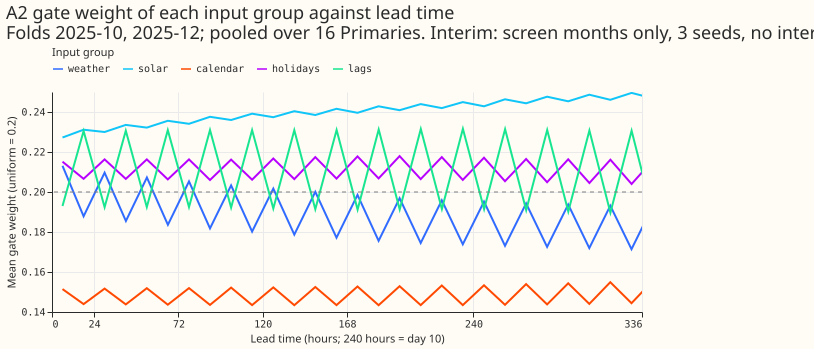
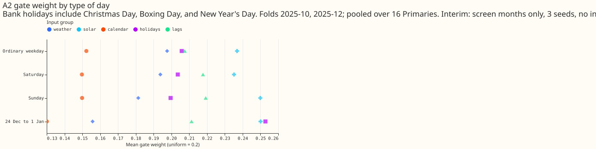

**Take-home message: a small neural network matches the simple XGBoost demand forecast on five test
months, and attention over its inputs does not help.** With the XGBoost model's inputs, one network
per Primary scores a CRPS (days 1 to 10) of 3.493 points of capacity at the six signed-MW Primaries,
against 3.542 for the monthly XGBoost control. One pooled network across the 16 Primaries scores
3.264, and 0.278 points below the control. **Attention does not help:** A2 (the gate sees the lead,
calendar, and holidays) scores 3.288 against 3.320 for A0 (uniform weights), and the gate weights
move by under 0.01 over lead time. The verdict is `partly supported`: the network matched XGBoost,
the attention part failed. **The tails are the open problem:** the networks cover 0.84 to 0.86 of
outcomes with their 95% quantile at the signed-MW six, so they are too narrow there. Every number
comes from five test months, so all are interim.

## Results

CRPS at days 1 to 10, mean over the five test months, mean over Primaries with equal weight, in
points of capacity (smaller is better).

| Arm | Signed-MW six | MVA-only eight |
|---|---|---|
| Plain network, one per Primary, 51 control-member passes | 3.493 | 3.989 |
| Plain network, one per Primary, one pass on mean and spread | 3.504 | 3.931 |
| Plain network, one pooled network | 3.264 | 3.860 |
| Pooled attention A0 (uniform weights) | 3.320 | 3.775 |
| Pooled attention A2 | 3.288 | 3.809 |
| XGBoost monthly control (experiment 389, S0M raw) | 3.542 | 4.014 |
| XGBoost with mean and spread columns (S1M raw) | 3.498 | 3.979 |
| XGBoost weekly bundle (experiment 381) | 3.412 | 3.936 |
| BG2 | 3.393 | 3.919 |
| GAM stack (experiment 377) | 3.239 | 4.140 |

- **Stage 1.** The per-Primary network beat S0M raw in 3 of 5 folds at the signed-MW six, short of
  the 4 of 5 the screen required, so stage 1 did not advance to the full year.
- **Stage 2.** A2 beat A0 in 1 of 5 folds at the signed-MW six. The stage 2 stop rule fired because
  the gate was inert.
- **Gate weights (A2).** W1 (weather weight falls from day 1 to days 8 to 10): +0.010. W2 (lag
  weight falls): +0.004. W3 (calendar plus holiday weight rises): +0.004. W4 (holiday weight over 24
  December to 1 January): +0.043, short of the 0.05 required. W6: the largest range of any group's
  mean weight over lead bands is 0.0095, under 0.05, so the gate is reported as inert.
- **Tails.** At the signed-MW six the networks' q95 coverage is 0.84 to 0.86 and q99 coverage 0.93
  to 0.94, against 0.86 and 0.96 for the XGBoost control. Widening by 1.15 lifts the pooled
  network's q95 coverage to 0.88 to 0.89. At the MVA-only eight q95 coverage is 0.91 to 0.92. The
  networks' q99 pinball loss is lower than XGBoost's (0.41 to 0.44 against 0.49 at the signed-MW
  six).

## Predictions

- **P1 failed in the network's favour.** The plain network does not trail S0M raw; it leads it by
  0.049 points.
- **P2 failed.** The network's q95 and q99 coverage is further from nominal than the XGBoost model's.
- **P3 half held.** The one-pass arm is within 0.05 points of the member arm at both groups, but
  its tail coverage is not better.
- **P4 failed narrowly.** A2 minus A0 is -0.033 at the signed-MW six and +0.034 at the MVA-only
  eight, just outside the plus or minus 0.03 the prediction allowed.
- **P5 not tested.** The stop rule fired before the lead-band contrast was read.
- **W1 to W4 and W6 failed**, as listed above.

## Not run

The permutation importance of each input group, arm A3, the Primary-embedding ablation, the
pinball-loss head, and the full-year runs. The stop rules fired before any of them. The other
gate plots are in the experiment's private folder.

## Deviations

- Early stopping holds out one week in every 12, not every fourth week (see the plan below).
- The widening of 1.15 about the median on q01, q05, q95, and q99 is applied at scoring.
- The summary scheme rebuilds the ensemble mean and spread for the training runs of 2024-04 to
  2025-06 from the archive, and uses the stored 51-member frames from 2025-07-01. On 2025-07-01 the
  two routes gave identical values.
- Every fitted network is saved under `work/models/` in the experiment's private folder.
- Reused forecasts are the stored XGBoost, GAM stack, BG2, `manual_heuristic`, and `climatology`
  sets listed below. No XGBoost model was refitted.

## Plan as committed before any fit

### Question

**We test whether a small neural network can replace the simple XGBoost model for Primary demand,
and whether attention over its inputs helps.** Two experiments queued by the maintainer share one
network and one scorer, so they run as two stages of one experiment. The maintainer asked for the
merge in chat on 2026-10-30.

- **Stage 1: a plain mixture density network against XGBoost.** A mixture density network is a
  neural network that outputs the weights, means, and standard deviations of three Gaussians.
  Experiment 334's plain network trailed the generalised additive stack but saw different inputs
  from the XGBoost model, so it could not answer the question. Stage 1 gives the network the XGBoost
  model's inputs, training rows, and refit schedule.
- **Stage 2: attention over five input groups.** The network encodes weather, solar geometry,
  routine calendar, holidays, and the three origin lags into one 32-wide token each. A softmax
  gate weights the tokens. The gate sees the lead time in A1, the lead, calendar, and holidays in
  A2, and the lead, calendar, holidays, and weather in A3, always with the Primary embedding. A0
  fixes the weights at 0.2. The design is in `briefs/attention_mdn_design_answer.md` and its
  addendum (private).

### Reused predictions and what is fitted

**No XGBoost model is refitted.** The references are stored forecasts, read from the private
folders of earlier experiments. A fitted network is the only new fit.

- **Experiment 389, arms S0M raw and S1M raw (monthly refits, 16 Primaries, daily origins from
  2025-07-01 to 2026-06-30).** S0M is the like-for-like XGBoost control for monthly refits. S1M is
  the same model given the ensemble mean and standard deviation of temperature and shortwave
  radiation as extra columns, the fair control for the one-pass arm. Both are raw; the 1.15
  widening of the four outer quantiles about the median is applied after loading and both versions
  are scored.
- **Experiment 381, weekly bundle `bundle_solar+sunny+hl1` and monthly `control` (raw).** The
  weekly bundle favours the control on refit cadence; the page says so wherever it is quoted.
- **Experiments 377, 87, and the manual heuristic and climatology of experiment 87.** The GAM stack,
  BG2, `manual_heuristic`, and `climatology`, as stored under demand-v2.
- **Experiment 391 (open pull request).** Not used: it had not merged when this plan was written.

The scorer restricts each arm and each reference to the half-hours they share, and prints the shared
count. The stored rows cover the same 16 Primaries and origins as the networks' rows. A gap would
show as a shorter shared count.

### Inputs and rows

**The network sees the XGBoost model's inputs, plus two bank-holiday columns.** `e00397_prep.py`
builds them from experiment 87's control-member training rows.

- **Weather.** Seven columns: shortwave, longwave, temperature, dew point, surface pressure,
  precipitation (through `log1p`), and 10 m wind speed. The `member` scheme uses one ensemble
  member's seven columns. The network trains on the control member and, at forecast time, is applied
  to each of the 51 members, giving a 153-component mixture pooled with equal member weights. The
  `summary` scheme uses the ensemble mean and standard deviation of each column (14 columns),
  computed once per run, and is applied once.
- **Why the summary scheme needs new data.** Only the control member is stored for the training
  months 2024-04 to 2025-06. `e00397_prep.py summaries` rebuilds the 51-member rows from the
  archive for those runs with experiment 48's frame builder, and reads the stored 51-member frames
  from 2025-07-01. `e00397_prep.py check` compares the two routes on 2025-07-01 before any use.
- **Other groups.** Solar geometry (the cosine of the zenith angle, and the sine and cosine of the
  azimuth), routine calendar (the hour of day at one and two cycles per day, one-hot weekday, the
  lockdown indicator), holidays (an inside-window flag, scaled signed days to Christmas, a tent
  function, a bank-holiday flag, and scaled signed days to the nearest holiday clipped at 7 days),
  and the three origin lags with an is-missing flag and an age in hours for each. The lead enters
  as the lead divided by 336 hours and its square root, and is never gated.
- **Normalisation.** Weather, lags, and scaled day counts are standardised with each fold's training
  rows only, clipped at 5 standard deviations, and the statistics are saved with the weights. A
  missing lag is flagged and set to 0 after standardisation. The preparation raises if any weather
  value is not finite, because the XGBoost frame builder already rejects a valid time that lacks
  a member. The target is power over effective capacity, standardised with each Primary's training
  mean and standard deviation, and mapped back before scoring.
- **Training rows.** The control member's rows from experiment 87's training table, with the
  XGBoost model's rule: a fold sees a row only if its valid time is at least 3.5 hours before the
  refit and its run began at or before the refit, within the 24 months before the refit. Row
  weights halve every 0.5 years, as for the XGBoost model. Hand-filtered load-shift events stay in
  the rows, as for the XGBoost control.

### Folds, refits, and arms

**Screen folds.** Test months 2025-10, 2025-12, 2026-01, 2026-03, and 2026-06. The four months are
those of `common.md` and December is added because none of the four contains Christmas. Each fold
trains on the 24 months before its test month and scores that month, with one refit at the start of
the month. Monthly refits of the full year follow only for an advancing screen.

**Early stopping uses one week in every 12.** The design asked for every fourth week with a purge
of 14 days before and 7 days after each held-out week. That purge covers every week of a four-week
cycle and leaves no rows to train on, so the held-out week comes every 12 weeks. Runs that begin in
the two weeks before, or the week after, a held-out week are dropped from training.

**Arms.**

- `plain_own`: one plain network per Primary (arm 2 of the swap brief), 64 hidden units, two layers,
  three components, six seeds for the chosen setting and three during the screen.
- `plain_pooled`: one plain network across the 16 Primaries with an 8-wide Primary embedding (arm 4),
  fitted in stage 2 as the reference for attention whatever arm 2 shows.
- `A0` to `A3`: the attention network, pooled with a Primary embedding in the head, and in the gate's
  query for A1 to A3. `A2` without the embedding in the query is the ablation.
- One pinball-loss head (arm 3 of the swap brief) runs only if `plain_own` lands within 0.1 points
  of S0M raw.

**Hyperparameters.** A pre-registered grid of ten settings (`GRID` in `e00397_fit.py`) varies the
width (32, 64, 128), layers (2, 3), components (2, 3, 5), learning rate, weight decay, and dropout.
Each setting is fitted with two seeds on a validation block (train to 2025-03, validate 2025-04 to
2025-06, which lie before every scored month) and chosen by the lowest mean quantile score at days 1
to 10 over the 14 countable Primaries, with ties to the smaller network. The 51-member frames of
the validation months are not stored, so the validation block is scored with the control member's
pass. This ranks settings and is not a forecast score. The scored-month score of the chosen setting
and the next two is reported, and the ten settings count as the tuning budget. The attention
network's token width (16 or 32) and dropout (0 or 0.1) are then tried on A0 with the chosen head,
plus the second-best head at token width 32 with both dropouts; A1 to A3 inherit the A0 setting so
that tuning cannot favour them.

**Loss and optimiser.** Mean negative log-likelihood weighted by row age, AdamW at a learning rate of
5e-4 and a weight decay of 1e-3 unless the setting says otherwise, batch 16,384, at most 40 epochs,
patience 6. Every network is saved with its standardiser and setting.

### Checks the write-up reports

- **Cold winter nights first**, then the pooled score, then cold nights at 3 °C or below, sunny
  half-hours, the Economy 7 step hours, the Christmas slice, and bank holidays.
- **Tails.** Coverage and pinball loss at q01, q05, q95, and q99, per group and per Primary, raw and
  widened by 1.15.
- **Floor.** The demand-v2 floor (candidate no worse than `manual_heuristic`, and within 1.10 times
  BG2, at each Primary, point estimates), and the median minus the mean forecast per Primary.
- **Avoidable-curtailment cost** at the signed-MW six, at the scaled limit of 0.9 times the maximum
  observed export, swept at 0.75 and 0.5.
- **Attention.** Gate weights by lead band, hour of day, day type, and per Primary, and the Christmas
  weeks; token norms beside the weights; and the permutation importance of each group for A0 and A2
  (shuffle the group's columns within a month, rescore), because attention weights alone do not show
  what drives the output.
- **D8** uses the network's own forecast, with the caveat "it is unproven whether the generator
  explains the steps and the gap". D15 and D18 are report-only.
- **Absolute scores** of every arm beside the references.

### Counting towards the demand-v2 stop rule

**This experiment counts if it ends `not supported` or `refuted`.** The idea is "a neural network as
the main demand model". Experiment 334 (`not supported`) is the only counted experiment so far, so
the count is 1 of 3 and rises to 2 of 3 here. The maintainer named this experiment, which counts as
approval whatever the count.

### Advice followed from earlier experiments

- **Followed.** Experiment 334: give a neural replacement the past-week information and score cold
  winter nights before the pooled score (the three origin lags and the cold-night slice here).
  Experiment 381: compare tails and avoidable-curtailment cost, not only CRPS. Experiment 389: test
  the ensemble mean and spread as inputs (the `summary` scheme against S1M).
- **Departed from.** Experiment 334 advised testing neural parts as additions to the stack. The
  maintainer asked for the replacement test, so this experiment tests the replacement.

### Compute

**Estimate, to be replaced by a measured time.** A pooled fold has about 7 million rows and 46
columns, about 1.3 GB, which fits on the GPU. The design's estimate is 2 to 4 minutes per pooled fit
on the GPU and 20 to 40 minutes on three CPU threads. The first task after the slot is granted is to
time one fit on each and choose the faster. Fit counts: the grid is 20 per-Primary sets; the stage 1
screen is 5 folds, 3 seeds, 2 schemes; the stage 2 simplest version is 5 folds, 3 seeds, 3 arms
(A0, A2, `plain_pooled`). The slot is 3 threads, the GPU, and `MemoryMax=16G`.

## Problems caused by the move

None.
