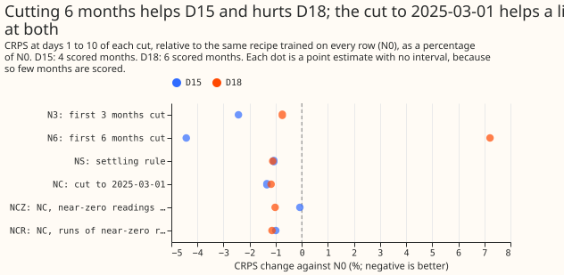
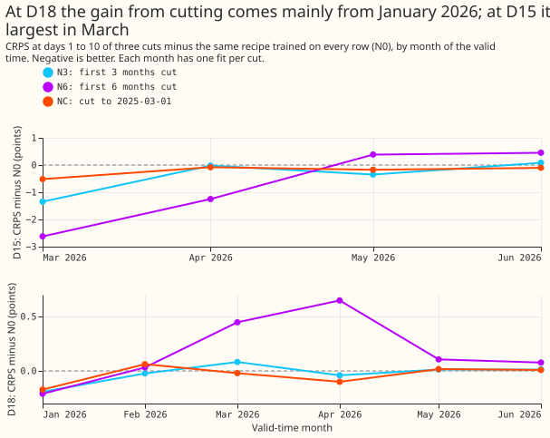
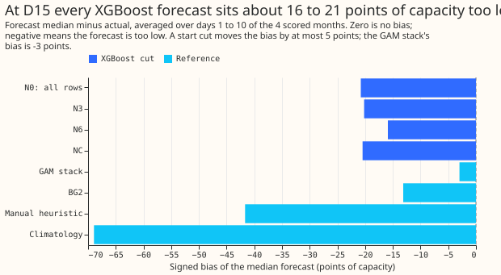

# Does cutting the first months of D15 and D18 help the monthly XGBoost demand forecast?

**Cutting the noisy start of D15 and D18 lowers the monthly XGBoost demand forecast's error by
about 1%, and cutting 6 months is not safe.** We asked whether leaving out the first months of
readings, taken while a new substation's meter was being commissioned, gives a better forecast at
D15 and D18, the two Primary substations whose history starts after the weather archive does. We
refitted the XGBoost model of [experiment 381](../00381-simple-weekly-xgboost-demand-against-gam-stack/result.md)
(refitted monthly, with the first months of each series dropped in six different ways) and scored
the forecasts for the months the protocol scores: January to June 2026 at D18, and March to June
2026 at D15. The cut to 2025-03-01 (NC) lowered the error at both Primaries by about 1%. A 6-month
cut lowered D15's error by 4.4% and raised D18's by 7.2%. The result says nothing about the other
14 Primaries, which have history from before the weather archive starts.

**Verdict: partly supported.** The prediction that D18 gains 3% or more from NC failed (it gained
1.2%). The prediction that no cut gains more than 2% at D15 also failed (N3 gained 2.4%, N6 4.4%). P3
failed for NCZ at D15, which was 1.28% worse than NC (15.594 against 15.397); NCR (+0.34%) and both
removals at D18 (within 0.2%) held.
The decision rule asks for a lower CRPS in two thirds of the scored months and in the pooled
figure. At D15 the arms N3, NS, NC, and NCR met it, and N6 and NCZ did not. At D18 no arm met it.
The porting threshold is zero, because production already holds a cut date per Primary as the
settling rule. Every figure below is a point estimate, because 4 and 6 scored months are too few
for an interval.

**Figure 1.** Each cut's days 1 to 10 CRPS, relative to the control N0 refitted in the same
environment (percentages of N0, negative is better).

| Arm | D15 CRPS | D15 months lower | D18 CRPS | D18 months lower |
|---|---|---|---|---|
| N0, all rows (refitted) | 15.606 | | 2.696 | |
| N0, stored (experiment 381) | 15.599 | 3 of 4 | 2.696 | 3 of 6 |
| N3, first 3 months cut | 15.227 | 3 of 4 | 2.676 | 3 of 6 |
| N6, first 6 months cut | 14.915 | 2 of 4 | 2.891 | 1 of 6 |
| NS, settling rule | 15.439 | 3 of 4 | 2.666 | 3 of 6 |
| NC, cut to 2025-03-01 | 15.397 | 4 of 4 | 2.665 | 3 of 6 |
| NCZ, NC and near-zero removed | 15.594 | 2 of 4 | 2.669 | 3 of 6 |
| NCR, NC and near-zero runs removed | 15.450 | 4 of 4 | 2.665 | 3 of 6 |
| GAM stack | 12.848 | | 2.499 | |
| BG2 | 13.354 | | 2.646 | |
| `manual_heuristic` | 22.590 | | 4.015 | |
| `climatology` | 46.195 | | 7.114 | |

CRPS is in points of capacity at days 1 to 10 under `demand-v1` (report only), raw (no 1.15
widening). The columns "months lower" count scored valid-time months in which the arm beat the
refitted N0. Every arm is the plain monthly control recipe (`colsample_*` fixed at 1.0), seed 0.
The widened rows (1.15) are in the scoring log: N0 15.464 and NC 15.274 at D15, N0 2.753 and NC
2.708 at D18. Widening lowers D15's CRPS and raises D18's, and it reorders arms that are within 0.1
points of each other.

**Figure 2.** The gain depends on the month, which is why the months-lower counts are low.

At D18 the gain comes mainly from January 2026, the month served by the refit with the shortest
history (2.82 for N0, 2.65 for NC). From February on, NC is within 0.1 points of N0 and sometimes
worse. At D15 the cuts help most in March 2026 (23.40 for N0, 22.88 for NC and 20.78 for N6) and
little afterwards. N6 raises D18's CRPS by 0.45 points in March 2026 and 0.65 in April 2026.

**Figure 3.** D15's error is a level error that no start cut removes.

At D15 the median forecast of every XGBoost arm is 15.9 to 20.9 points of capacity below the
actual, averaged over days 1 to 10 (N0 -20.8, N3 -20.2, N6 -15.9, NC -20.5). The GAM stack's bias
is -3.0 and BG2's is -13.1. At D18 the biases are small (N0 -0.66, N6 +1.00). Cutting 6 months
removes about a quarter of D15's bias. D15's level stepped up in July 2025,
September 2025, and March 2026, so a model trained on the earlier months learns a level that no
longer holds, and a cut at one date cannot remove that.

## What each cut costs in production

Every arm needs one cut date per Primary. NS needs the settling rule, which production already
holds (D15 to 2025-03-20, D18 to 2025-03-04). N3 and N6 need the first reading's date plus a
number of months. NC needs the single date 2025-03-01. NCZ and NCR also need a row filter on the
power data and on the three origin lags, so they cost more and gain nothing.

## Checks

- **How many near-zero readings were removed.** NCZ removed 104 half-hours at D15 and 10 at D18
  (readings of 0.009 MW or less, 2025-03-01 to 2026-06-30), all inside the scored year. NCR removed
  16 and 2. At D15 most removed readings are single half-hours, so they are real crossings of zero
  by a series that swings by about 2 MW and exports; this is why NCZ is 1.3% worse than NC at D15.
  D18's July 2025 dip (1 to 3 July) was left in, as planned.
- **The same rows.** Scoring on the rows NCZ keeps (`ncz_common`) changes each XGBoost arm's CRPS
  by 0.003 points or less, except N6 at D15 (0.017). D18's values are identical. The two row sets
  rank the raw XGBoost arms identically.
- **Reproduction.** The stored N0 of experiment 381 and the N0 refitted here differ by 0.007
  points of CRPS at D15 and 0.0005 at D18. The forecasts differ by a mean of 0.001 (maximum 0.021)
  of capacity at the median; the `uv.lock` library versions (xgboost 3.4.1, numpy 2.5.4, polars
  2.1.0) are the same, and we did not find the cause. All contrasts use the refitted N0.
- **The settling cut uses later data.** `new_meter_settling` takes each series' capacity from
  all readings up to 2026-06-30, not up to each refit, so NS's cut dates (D15 2025-03-20, D18
  2025-03-04) could move by days if recomputed at each refit. They match the dates the plan quotes.
- **Power source.** The training power came from `studies.power.scan_power`, not from the stored
  `observed.parquet`. The two agree on every shared half-hour at D15 and D18, and the training
  labels agree to 5e-7 MW.
- **Median minus mean forecast, per site.** N0: -0.116 MW at D15 and -0.019 MW at D18. NC: -0.124
  and -0.030. A cut does not shift the gap.
- **MAE of the median.** D15: N0 28.05, N6 26.64, NC 27.62. D18: N0 4.738, N6 5.068, NC 4.732.
  It points the same way as the CRPS contrast for N6, NC, and NS. For N3 and NCZ at D18 and NCZ at
  D15 the MAE is within 0.02 of N0, on the other side of it.
- **Audit triggers.** Trigger 2 fired: the results contradict predictions P1, P2, and P3. The
  explanation (the refit with the shortest history gains most, and D15's error is a level error)
  is in Figures 2 and 3 and in the take-home message. Trigger 7 may apply, because the research
  default for the other experiments now drops rows before 2025-03-01 (NC); that default rests only
  on NC being no worse than N0 and on production's existing cut date, and the result is not
  replicated. No audit has run.
- **Curtailment cost.** The scorer returns no cost for D15 and D18, because neither is one of the
  signed-MW Primaries it defines the cost for.

## Limits

The scored months are 4 at D15 and 6 at D18, one seed, one fit per refit. A gain of 1% is larger
than the refit noise (0.007 and 0.0005 points) but is not shown to exceed the month-to-month
variation. NGED's horizon is 1 to 10 days and the headline band covers it. D18 steps up by about
1.5 MW around 2026-07, after the scored year, and no claim is made about that step.

## What the next experiment should answer

Why D15's median forecast is 16 to 21 points of capacity too low while the GAM stack's is 3 points
too low: a level input, a shorter training window anchored on recent months, or the stack's own
level term are the candidates. The level anchor of the sister experiment on stored forecasts has
not merged and was not added.
