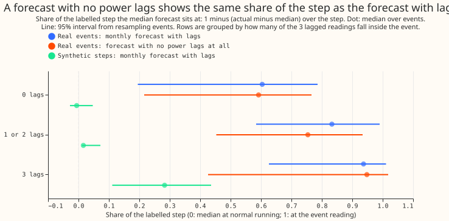
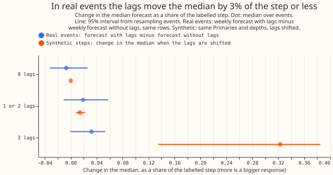
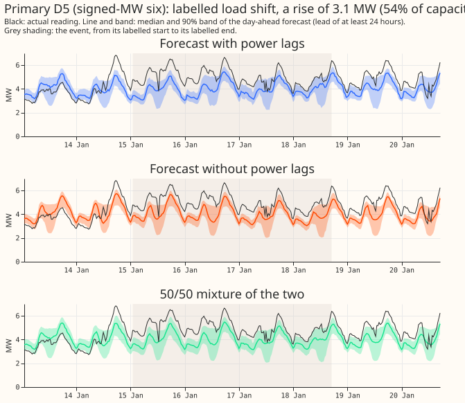
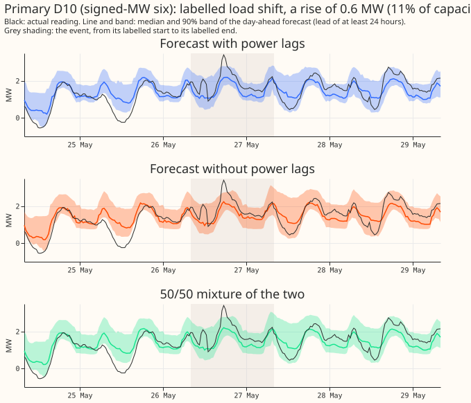
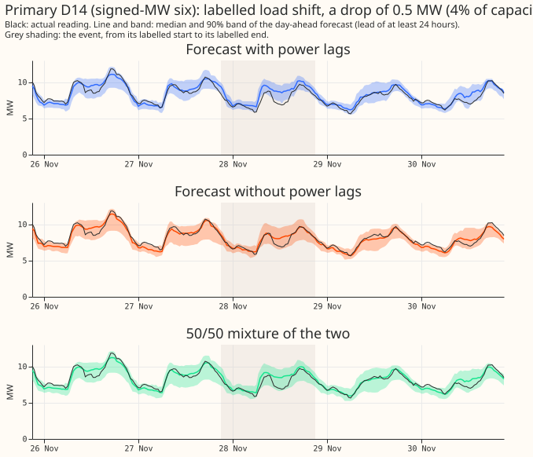
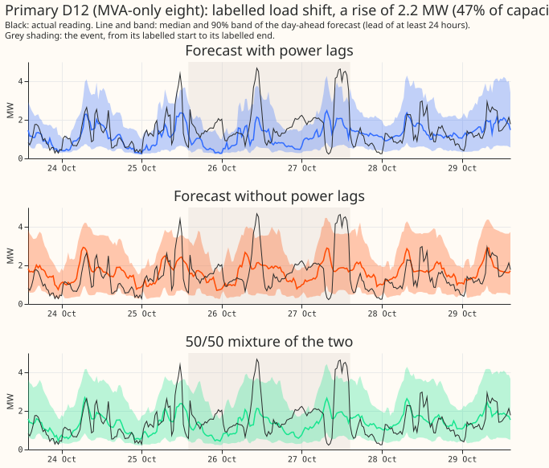
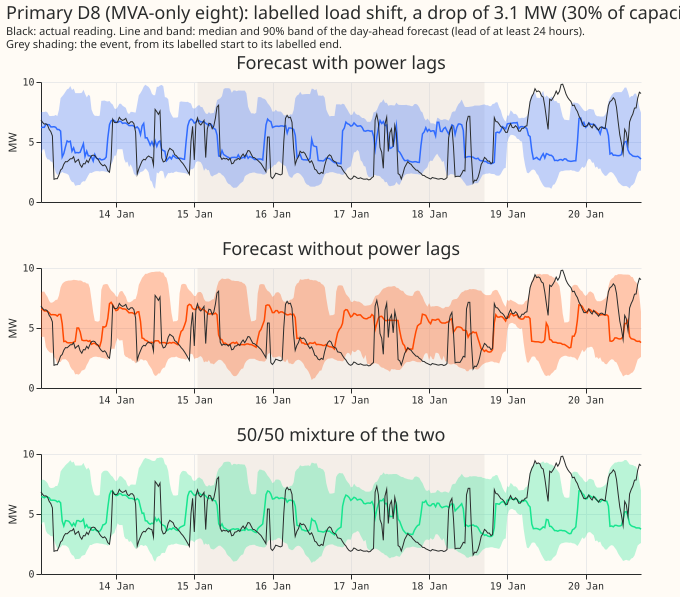
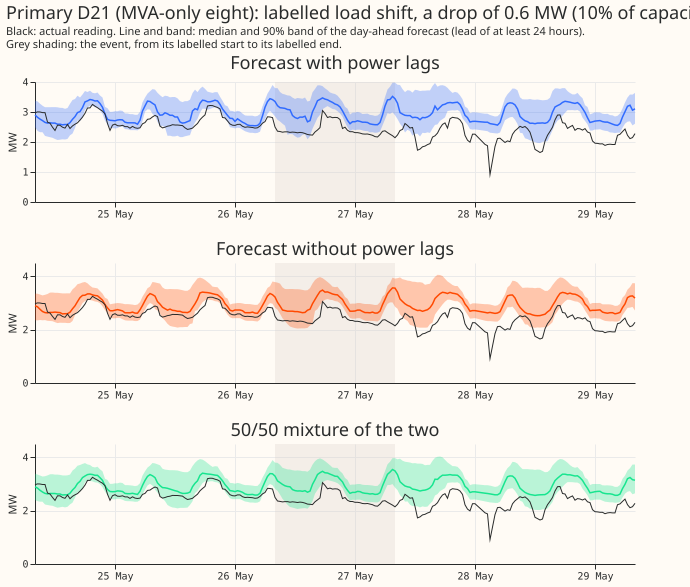

# Experiment 401: real and synthetic load-shift median share, and a fixed mixture of two forecasts

**Real load-shift events barely change what the power lags tell the forecast, and a fixed 50/50
mixture of the forecast with lags and the forecast without lags does about as well as the learned
blend at the six Primaries with signed readings.** The share of a labelled step that experiment 395
called "followed" (0.94 with all 3 lagged readings inside the event) is not a response to the lags:
a forecast with no power lags at all reaches 0.95. The forecast with lags moves its median by only
0.03 more than the forecast without lags on the same rows. Verdict: partly supported. Job 1 settles
why the real and synthetic numbers disagree. Job 2's claim holds at the six and fails at the eight.
The next step is a learned blender trained on synthetic steps, only if the lags matter in real
events, which Job 1 puts in doubt.

We asked two questions about the weekly XGBoost forecast of Primary-substation demand. The first:
experiment 395 found that a synthetic step added to the lagged power readings moves the median
forecast by 37% of the step, yet the labelled real events show the median at 0.94 of the event
reading, so why do they disagree? We re-ran the comparison on the same events, with the same depth
and the same Primary, and tested each possible cause by one small calculation. The second: can
experiment 400's learned blend of the two forecasts be replaced by a fixed weight? We scored fixed
weights, a weight per lead time, and two ways of mixing (mixing the distributions, or averaging
their quantiles) on the stored forecasts. Nothing was refitted. The synthetic arm re-predicts
experiment 391's plain monthly boosters (`b0`); the weekly bundle's boosters are not stored, so the
real arm uses experiment 381's monthly control. Part E and Part H of
[experiment 395](https://github.com/openclimatefix/nged-ml-research/pull/49) and experiment 400's
mixture code are reused (named in the Plan).

## Figures

Figure 1 compares the shares. Figure 2 compares the response to the lags. The six time series
plots show real events at both metering groups: the three Primaries on the first three plots are in
the signed-MW six, the last three in the MVA-only eight.

## Results

### Job 1: real against synthetic share

Medians over events, 95% intervals from resampling events, rows with the target inside the event, lead
under 240 hours, flagged half-hours dropped (`e00401_share.py`, tables R1, S1, B1 to B5).

- **Real shares reproduce experiment 395 Part H.** Monthly control: 0.604, 0.833, 0.937 at 0, 1 or
  2, and 3 lags (52, 27, and 16 events). Weekly bundle: 0.523, 0.830, 0.940.
- **A forecast with no power lags reads almost the same.** The lagless forecast (experiment 383's
  raw arm) reads 0.592, 0.754, 0.948 on the same events (table R1). Its 3-lag share of 0.948 comes
  from a forecast that never sees a lag, so the share does not measure lag response.
- **Synthetic steps of the same depth and Primary move the median little.** The synthetic observed
  share of the monthly boosters is -0.006, 0.016, and 0.283 at 0, 1 or 2, and 3 lags (the same
  52, 27, and 16 events). The response share (Part E's definition) is 0.000, 0.014, and 0.323 (table
  S1). So depth and rows are not what separates 0.37 from 0.94.
- **The 0-lag share of 0.52 to 0.60 is the labelled step against the measured step.** A forecast
  blind to the event reads `1 - measured step / labelled step`. The measured step is 0.62 times the
  labelled step (median over 175 event-Primary pairs, none of opposite sign). With the measured step
  in place of the labelled one the monthly control's 0-lag share falls from 0.604 to 0.244 (table
  B1), and the lagless forecast's share (0.592) matches the monthly control's, so the lags
  contribute nothing at 0 lags (table B2). Forecast noise does not move the median (the synthetic
  0-lag share is -0.006, with an interquartile range over rows of 0.72, table B3). Events under a
  day read 0.30 and events over 7 days read 0.97 at 0 lags (table B4), so the events' own length
  matters: a long event is mostly inside the training window.
- **The response to the lags in real events is about 0.03 of the step.** Weekly forecast with lags
  minus weekly forecast without lags, per row, then medians over events: -0.007 (-0.029 to +0.027)
  at 0 lags, +0.019 (-0.011 to +0.058) at 1 or 2, +0.032 (0.000 to +0.074) at 3 (table B5). The
  synthetic response at 3 lags is 0.338 (0.298 to 0.378) over all 184 events.

### Job 2: fixed mixture, CRPS in points of effective capacity (`e00401_report.py`)

Rows: days 1 to 10, valid times from 2025-10-01, 96 flagged exact-zero half-hours dropped (D12 8,
D18 24, D22 40, D8 24). Event-lag rows are those with 1 to 3 lags inside a corrected event and the
target outside; 20,327 rows (28 events) at the six, 20,911 (19 events) at the eight.

| CRPS minus forecast with lags (95% interval) | Six, event-lag rows | Eight, event-lag rows | Six, outside events | Eight, outside events |
|---|---|---|---|---|
| Mixture w = 0.3 | -0.99 (-2.44 to +0.05) | +0.28 (+0.01 to +0.55) | +0.027 (-0.027 to +0.083) | +0.059 (+0.023 to +0.096) |
| Mixture w = 0.5 | -0.90 (-2.16 to -0.01) | +0.14 (-0.04 to +0.31) | -0.019 (-0.054 to +0.016) | +0.004 (-0.022 to +0.029) |
| Mixture w = 0.7 | -0.66 (-1.54 to -0.04) | +0.05 (-0.05 to +0.14) | -0.034 (-0.055 to -0.014) | -0.021 (-0.038 to -0.005) |
| Mixture, per-lead weight | -0.62 (-1.48 to -0.03) | +0.04 (-0.04 to +0.12) | -0.033 (-0.051 to -0.017) | -0.028 (-0.043 to -0.014) |
| Quantile average w = 0.5 | -0.82 (-2.01 to +0.01) | +0.18 (-0.03 to +0.37) | -0.024 (-0.063 to +0.017) | +0.008 (-0.025 to +0.039) |
| Learned blend B2 (experiment 400) | -0.75 (-1.78 to -0.03) | +0.09 | +0.03 (-0.01 to +0.08) | not rerun |

- **Headline pair, 99.58% intervals (Bonferroni, k = 12).** Mixture w = 0.5 minus B2 on event-lag
  rows: -0.151 (-0.363 to +0.015) at the six, +0.050 (+0.012 to +0.090) at the eight. Outside
  events: +0.010 (+0.002 to +0.019) at the six, +0.017 (+0.011 to +0.023) at the eight. Mixture w =
  0.5 minus forecast with lags outside events: -0.019 (-0.051 to +0.013) at the six, +0.004 (-0.020
  to +0.026) at the eight.
- **Decision rule.** "A fixed mixture does as well as B2" holds at the six (upper ends +0.015 on
  event-lag rows and +0.019 outside events, both within the +0.1 and +0.05 margins) and fails at the
  eight on the strict reading (the event-lag interval excludes zero at +0.012 to +0.090, still under
  the +0.1 margin). The claim is interim until the audit.
- **Fitted weights are not a surprise response.** The per-lead weight on the forecast with lags
  falls with lead, from 0.90 at day 1 to 0.62 at day 10 (mean over months), so the per-lead arm
  gives no gain on event-lag rows (-0.62 against -0.90 for w = 0.5), and gains 0.001 (six) and 0.007
  (eight) points over the best fixed weight on all rows (P5).
- **Mixing beats averaging only slightly.** Mixture minus quantile average at w = 0.5 is -0.079
  (-0.164 to +0.005) at the six and -0.032 (-0.071 to +0.003) at the eight on event-lag rows.
- **Widening (1.15).** The widened arm is the raw arm with each quantile moved from the median by
  1.15 times its distance. Differences against the widened forecast with lags are within 0.1 of the
  raw differences (for example w = 0.5 mixture: -0.82 at the six, event-lag rows). B2 is raw only.
- **The six are driven by one Primary.** Mixture w = 0.5 minus lags on event-lag rows per Primary:
  D16 -3.35 (4,644 rows), D5 -0.12 (10,460), D10 -0.45, D14 -0.28; D18 +4.18 (198 rows), D12 +0.61.
- **D15 and D18 (neither in the six nor the eight).** Outside events the w = 0.5 mixture is +2.33
  at D15 and worse than B2 by 0.94, because the forecast without lags scores far worse there.
- **Smoothness.** The largest half-hour change of the median across an event onset, 95th percentile
  (points of capacity): forecast with lags 15.8, lagless 16.0, w = 0.5 mixture 12.9, B2 13.3 (384
  onsets).
- **Cold nights (six).** Event-lag rows, 538 rows in 10 events: mixture w = 0.5 minus lags
  -1.71 (-3.05 to -0.06); eight: +0.24 (-0.10 to +0.47).
- **Avoidable curtailment cost, GBP over the six signed-MW Primaries, limit 0.9 x maximum.** During
  events the w = 0.5 mixture costs 89,000 more than the forecast with lags (6.65 million against
  6.56 million) and B2 costs 61,000 more; the GAM stack costs 3.74 million less. In the 7 days after
  events: -3,800 (w = 0.5), -3,000 (B2); stack +112,000. Across all rows: +102,000 (w = 0.5),
  +40,000 (B2), stack -4.87 million. The mixtures reduce CRPS on event-lag rows without reducing
  curtailment cost; the widened arms reduce cost by 61,000 to 243,000 (during events and all rows).
- **Tail calibration (six, event-lag rows).** q95 coverage 0.884 (lags), 0.894 (w = 0.5 mixture),
  0.895 (B2); q99 0.967, 0.968, 0.969; q05 coverage 0.115, 0.009, 0.009 (nominal 0.05 and 0.99 of
  0.95). Mixture 90% width 26.6 against 23.0 for the forecast with lags.

## Checks

- **Median forecast minus mean forecast.** Not available: the stored arms hold the median and
  quantiles, not the mean. The error of the median forecast stands beside each contrast instead.
- **Median error beside the CRPS contrast** (event-lag rows). Six: w = 0.5 minus lags CRPS -0.90 and
  median absolute error -1.37; B2 minus lags -0.75 and -0.49; w = 0.5 minus B2 -0.15 and -0.88.
  Eight: w = 0.5 minus lags +0.14 and +0.23. The two measures agree in sign everywhere.
- **Triggers fired.** Trigger 2 (the 0.94 share contradicted its earlier reading; the page tests an
  explanation in tables B1 to B5). Trigger 4 (the six's gain is dominated by D16; the leave-one-out
  check is in the audit). Trigger 7 (a learned blender trained on synthetic steps depends on the Job
  1 result). Audit: pending.

## Caveats

- **Weekly bundle boosters are not stored,** so Job 1's synthetic arm uses `b0` and its real arm the
  monthly control; the response comparison (table B5) uses the weekly forecasts for both.
- **Weekly forecast with lags and the lagless forecast are different fitted XGBoost models**
  (experiment 381 and 383), so their difference includes more than the lags; its median at 0 lags is
  -0.007, the size of that background.
- **Experiment 395 is unmerged** (PR 49): its Part F rows, tags, and corrected label table are read
  from the stored work folder and from a copy of the CSV in experiment 400's folder.
- **Lead range is days 1 to 10** (lead under 240 hours), the whole NGED range of 1 to 10 days.
- **The wide results at the eight come from 19 events** and the per-Primary numbers from as few as
  77 rows (D19, D4).
- **Departures from the plan.** The synthetic rows use all clean rows of 5 runs (the 15th of
  October, December, February, April, and June), not 5,000 rows per event; the exact CRPS of the
  mixtures was not computed (CRPS comes from the 11 quantiles, as the protocol defines it); the rows
  are not matched to the real rows' lead distribution.
- **Not tested:** whether the lags matter at all in real events, because the real events in the
  scored months are few (52, 27, and 16 events by lag status).

## What the next experiment should answer

Whether the forecast with lags and the forecast without lags differ in real events only through
the lags, by refitting both with identical settings, and whether the 0.03 response is the
whole story or a training effect.

## Plan

Two stored-forecast jobs from the load-shift Discuss session (maintainer-approved 2026-10-30). Both
re-score or re-predict stored forecasts; no booster is refitted. Sonnet only. Protocol `demand-v1`.
All numbers are interim until the Sonnet audit.

### Job 1: why do the real-event and synthetic-step medians disagree?

- **The two numbers.** Experiment 395 Part E predicts experiment 391's plain monthly control b0 with
  a synthetic step added to the first `k` lagged-power inputs: the median moves by 1.3%, 17.3%, and
  36.8% of the step at `k` = 1, 2, 3. Part F scores real labelled events with the corrected signs
  and finds the median at 0.52, 0.83, and 0.94 of the event reading with 0, 1 or 2, and 3 lags in
  the event.
- **The two quantities differ in definition, and the plan reports both on both arms.** Part E's
  response share is `(q50 with the step - q50 without) / step`. Part F's share is
  `1 - (actual - q50) / step`. The second share equals 1 when the median matches the observed
  reading, whatever the cause, and it equals `1 - measured step / labelled step` when the forecast
  ignores the event.
- **(a) Same events.** The real arm is experiment 381's monthly control (rows of Part F; it scores
  0.60, 0.83, 0.94). The synthetic arm uses b0's stored boosters: for each corrected event with a
  measurable depth and at least 10 rows in a lag-status group, take every clean scored row of the
  same Primary (no target in a padded event, no lag in an event, not flagged) in the months where
  boosters exist, add the corrected signed depth (as a fraction of the Primary's capacity) to the
  `k` newest lagged inputs and to the actual reading, where `k` = 0, 1, 2 (reported separately and
  as "1 or 2"), and 3. The row sample keeps the lead distribution of the event's real rows (up to
  5,000 rows per event and `k`, fixed seed). The comparison is the per-event median share, then the
  median over events, for the real and the synthetic arm on the same event list, using both share
  definitions on the synthetic arm.
- **The weekly bundle's boosters are not stored** (only experiment 391's `n1`, `b0`, and later
  boosters exist), so the comparison runs on the monthly control for both arms, as the brief allows.
  The first step checks that b0's predictions on the clean rows match experiment 381's monthly
  control to within a stated tolerance; if they do not, the page says so and uses b0 alone for both
  arms.
- **(b) Why 0.52 at 0 lags.** Four small calculations on the real rows with 0 lags in the event: 1.
  *Labelled against measured depth.* Recompute the share with the event's measured step
  (`measured_depth_first_mw` in the corrected table) in place of the labelled depth. The Part F
  tables report a measured step of 0.63 times the labelled depth. 2. *A blind forecast.* Compute the
  share of experiment 383's raw lagless forecast (no power lags at all) on the same rows. A forecast
  blind to the event shows `1 - measured / labelled` rather than 0, so the lagless share is the
  zero-information reference. 3. *Forecast noise.* Take clean rows of the same Primaries with a
  zero-size step and compute the same share: its median and its spread show how much forecast error
  moves the per-event median. 4. *The 48-hour dilution.* Recompute the real share on the first 48
  hours, the first 6 hours, and the rest of each event separately, and on events by length class, to
  separate the dilution of a deepening step from the events' own shape.
- **Reported:** a table of real and matched-synthetic shares by lag status with intervals, the
  four calculations in one table, and two figures (real against synthetic share by lag status; the
  zero-information reference against the 0-lag share).

### Job 2: fixed mixture of the forecast with lags and the forecast without lags

- **Inputs.** The forecast with lags is experiment 381's weekly bundle; the forecast without lags is
  experiment 383's raw lagless arm (`work/arms/lagless.parquet`, not arm c2). The scored rows, the
  label table, and the flagged-zero handling are experiment 400's (Part F slice table; flagged
  half-hours tagged and dropped; the count per scored set is stated on the page).
- **Arms.** (1) Fixed weight `w` on the forecast with lags in {0.3, 0.5, 0.7}. (2) A per-lead
  weight: for each scored month, for each lead day 1 to 10, the `w` in {0.1, 0.2, ..., 0.9} that
  minimises the exact CRPS of the mixture on the earlier months' rows (flagged half-hours dropped,
  pooled over Primaries); the page reports whether the chosen weight rises or falls with lead. (3)
  Each weight function as a mixture of distributions (CDF mixing, experiment 400's `e00400_mixture`)
  and as an average of quantiles. Each arm is written raw and widened by 1.15, where "widened by
  1.15" means each quantile moves from the arm's median by 1.15 times its distance (the convention
  of experiment 383's `widen`). The 1.15 arms are the widened versions of the raw arms, not new
  fits. B2 and the `w` = 0.5 mixture come from experiment 400's tables, and 400's B2 is raw only;
  the page says so wherever B2 is compared with a widened arm.
- **Reported, per group (signed-MW six, MVA-only eight) and per Primary:** the Part F harm table
  (CRPS minus the forecast with lags by lag count inside an event), the cost outside events,
  smoothness (largest half-hour change in the median across an event onset), avoidable curtailment
  cost during events, in the 7 days after, and on all rows, as differences against the forecast with
  lags and the GAM stack, and cold-night rows (the coldest 5% of valid times at each Primary). Tail
  calibration (0.01, 0.05, 0.95, 0.99 pinball loss and coverage) sits beside CRPS.
- **Audit.** The claim "a fixed mixture does as well as B2" goes to the Sonnet audit before any
  adoption sentence is written.

### Process and sizing

- **Stored.** Small tables under the private `work/` folder; nothing new in git beyond scripts and
  the page.
- **Production serving path / degradation rule.** Not touched.
- **More than one design.** Yes (synthetic placement; weight function): the plan fixes both.
- **Callers.** The scripts import experiments 391, 395, and 400.
- **Cadence and compute.** Prediction-only with b0's monthly boosters; stored forecasts only for Job
  2; no GPU; at most 2 cores; `MemoryMax=6G`; `systemd-run --user --scope -p OOMPolicy=continue`.
- **Advice followed.** Train on injected events, not real rows alone (experiment 400): Job 2 only
  re-weights stored forecasts and does not fit a surprise response.
- **Cut for D15 and D18 (maintainer, 2026-10-30).** No row before 2025-03-01 enters: every stored
  forecast is scored from 2025-10-01 and no training is done here.
- **Caveats stated in advance.** Weekly-bundle boosters are not stored. Experiment 395 is unmerged
  (PR 49); the corrected label table is copied from its head. Experiment 400's learned blend is raw
  only.
