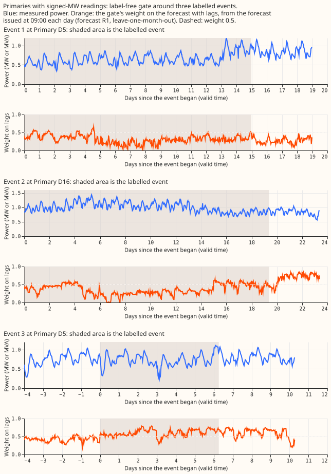
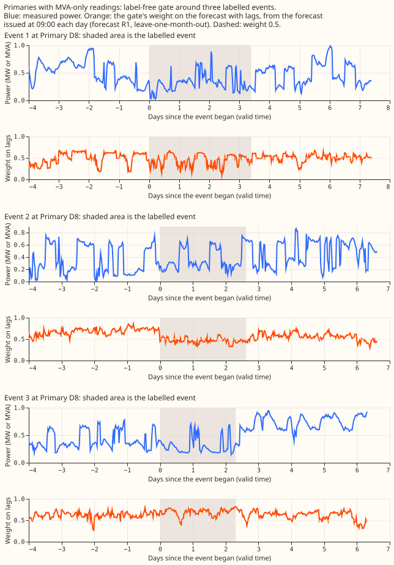

# Experiment 402: a learned gate between a forecast with power lags and a forecast without them

## Results

**Caveat repeated in every table: NGED's logs miss some load-shift events.** The clean-lag baseline
is optimistic and the real-event slices undercount events. Every number below is a mean exact CRPS,
in points of effective capacity, over the rows named; smaller is better. "Forecast R1" is experiment
392's lagged forecast trained with the labelled events removed (a ceiling); "the R0 pair" is the
forecast with lags refitted here on plain targets, beside experiment 392's R0 forecast without lags.
Step 4 scores forecast R1 leave-one-month-out over four months (2025-10, 2026-01, 2026-03, 2026-06);
step 5 scores the R0 pair forward-only (2026-01, 2026-03, 2026-06).

**Step 1 (analytic ceilings).** A perfect event flag has little headroom at the six Primaries with
signed readings and none at the eight with MVA-only readings. Held out by event, the flag oracle
beats the fitted constant mixture per group by about 0.14 points on harm rows at the six (the
0.3-point bar in prediction P1 is not met, and the interval reaches -0.47 to +0.08), and the gain
rests on one event (event 55 at D16). At the eight, the lags help outside events, so no mixture
beats the forecast with lags on harm rows. The label-free median-gap-decile constant already takes
most of the flag oracle's gain. The per-row oracle weight would save 0.7 points, and 0.41 of that is
on clean rows, so it is mostly knowledge of the outcome.

**Step 2 (real-event counterfactual).** The share of a step that the lagged booster passes on is
about 0.13 with one lag in the event, 0.15 with two, and 0.30 with three. That agrees with
experiment 395 Part E (not Part F), and the synthetic step matches the real events within about 10%.
The factor-of-2 rule (P2) does not fire, so the injection is not redesigned.

**Steps 4 and 5 (the gate).** Mean exact CRPS over all rows of the injected test world and of the
real-event rows.

| Rows | Forecast with lags | Forecast without lags | Fixed 50/50 | Constant mixture per group | Gate, full | Gate, flag (ceiling) |
|---|---|---|---|---|---|---|
| Injected, six, forecast R1 | 4.576 | 4.439 | 4.307 | 4.306 | 4.247 | 4.232 |
| Injected, eight, forecast R1 | 5.449 | 5.522 | 5.297 | 5.312 | 5.278 | 5.246 |
| Real, six, forecast R1 | 4.291 | 4.439 | 4.220 | 4.210 | 4.207 | not defined |
| Real, eight, forecast R1 | 5.196 | 5.522 | 5.220 | 5.172 | 5.226 | not defined |
| Injected, six, R0 pair | 4.822 | 4.778 | 4.605 | 4.637 | 4.531 | 4.524 |
| Injected, eight, R0 pair | 5.475 | 5.414 | 5.288 | 5.286 | 5.263 | 5.244 |
| Real, six, R0 pair | 4.533 | 4.778 | 4.515 | 4.516 | 4.492 | not defined |
| Real, eight, R0 pair | 5.191 | 5.414 | 5.202 | 5.169 | 5.198 | not defined |

- **P3 holds at the six, and just holds at the eight.** The full gate captures 79% of the flag
  gate's gain at the six and 52% at the eight (forecast R1), so the stop rule (under half) does not
  fire. The single-step gate (lag surprise plus lead time) already captures 76% at the six, so the
  window means, the median gap, and the neighbour features add little.
- **P4 is only partly met.** On real harm rows at the six the full gate beats the fixed 50/50
  mixture by 0.10 points (forecast R1; 0.08 for the R0 pair), meets the 0.1-point `small gain`
  threshold only against the fixed mixture, and does not clearly beat the fitted constant mixture
  (0.04 and -0.02 points). It costs under 0.05 points on clean rows.
- **The gate does what it was built for on injected corruption.** On injected harm rows at the six
  it lowers its mean weight on the forecast with lags from 0.51 (clean rows) to 0.42, and scores
  4.11 against 4.34 for the fixed 50/50 mixture and 5.29 for the forecast with lags. At the eight it
  matches the forecast without lags (5.55 against 5.51).
- **It loses where the target is inside a real event.** On real rows at the six whose target is
  inside a labelled event (about 8,000 rows) the injected-trained gate scores 10.75 against 10.50
  for the fixed 50/50 mixture, because its mean weight on lags falls to 0.38. A gate trained on real
  labels (not deployable at scale) scores 10.41.
- **Real harm rows are too few for a firm contrast.** There are 11,000 such rows at the six and
  6,600 at the eight, in a handful of events, so these gains are estimates, not tests.
- **The metering-group split matters little.** One gate with the group as an input, and one gate per
  group, differ from the pooled gate by under 0.5%.

**Event plots.** Figure 1 and Figure 2 show three labelled events at the Primaries with signed
readings and three at the Primaries with MVA-only readings. At the six, the weight is low (about
0.3) through the first two events at D5 and D16 and stays low for days after the second event ends,
but rises above 0.5 inside the third event at D5, so the gate does not respond to the labelled event
itself. At the eight, the weight falls from about 0.6 to about 0.4 inside the first two events at D8
and does not move in the third. The plots show one forecast per day (issued at 09:00, shortest
lead).

## Not run

- The per-Primary contrast intervals, the smoothness and promptness measurements, the
  lag-encroachment sweep, the avoidable-curtailment and cold-night tables, and the tail-coverage
  tables from the plan were not produced. The slice report (`e00402_report.py`) gives the per-group
  harm, event, and clean tables only. The result is a screen, and the maintainer decides whether
  those tables are worth building.
- Twelve monthly refits (against four) were not run.
- A data-derived neighbour graph would need the connection list for each of about 1,300 substations.
  The gate here used the NGED list for 16 Primaries.

## Checks

- Median minus mean forecast per site and the mean-forecast error beside each quantile-score
  contrast were not computed; the contrasts above are scores of the 11-quantile mixture's exact CRPS
  only.
- Audit triggers fired: none that this experiment's change to production code could set off, because
  it touches nothing under `src/` or `packages/`.
- Protocol 11-quantile CRPS beside the exact CRPS was not tabulated; every score here is the exact
  CRPS.

## Plan

- **Question.** Experiment 400 fitted a mixture weight from the lag surprise scores on real rows
  and found that the weight hardly moved around load shifts, because event-lag rows are 2.6% of the
  fit. Can a gate trained on injected events, whose truth is known, learn when to trust the lags?
  The gate must need no NGED load-shift labels, because about 1,300 substations will have none.
  The real label table (`sw_block_detector_label_table_corrected.csv`, 133 rows, 112 usable) is
  used only to choose the injected depth and duration distributions and to evaluate.
- **Design source.** The proposal, its two debate rounds (round 1 Sonnet, round 2 critic), and the
  maintainer's instructions of 2026-10-30 are in `briefs/load_shift_lag_gate_brief.md`. The critic's
  corrections govern. Credit: the mixture-of-two-forecasts blend is experiment 400's; the surprise
  scores are experiment 391's stage 1; the R1 boosters and the injection harness are experiments
  392 and 395 (Part E).
- **Gate model.** One weight per row, depending on lead time. The CDF of the mixture is
  F2 + w (F1 - F2), so its exact CRPS is A w² + B w + C with A = ∫(F1-F2)², B = 2∫(F1-F2)(F2-H),
  C = CRPS(F2), where F1 has lags, F2 has none, and H is the step at the actual. The label is
  w* = -B / (2A), the sample weight is A, and the gate is a shallow XGBoost squared-error booster
  with identity link, prediction clipped to [0, 1]. A logistic baseline is the first arm. A small
  neural network is tried only if the XGBoost gate plateaus. The CDFs are linear between the 11
  quantiles with the outer segments extended to levels 0 and 1, as in experiment 400.
- **No over-smoothing (maintainer).** Load-shift events are sudden. The only smoother allowed is
  causal and short, along valid time within one run. Report each smoother's half-life and the delay
  of the blend's response at an onset against the unsmoothed weight. A delay of more than a few
  half-hours is a failure of that smoother.
- **Injection.** Clean periods only (no labelled event, flagged zeros dropped). A donor Primary
  loses a fraction f of its own series and one or more connected recipient neighbours gain it
  (load conserved, both polarities). f is the table's depth divided by the donor's trailing 30-day
  mean; the depth quantiles in MW at 0, 10, 25, 50, 75, 90, 100% are about 0.17, 0.52, 0.70, 1.10,
  2.2, 3.0, 5.4, and the duration quantiles in hours about 2.4, 4.8, 8.1, 47.9, 84, 168, 747 (the
  proposer's tally, re-counted in step 1). A parametric rule needs no table: log-uniform
  interpolation of f between these quantiles. 30% of events have no observed recipient (31 of 112
  rows name one Primary; swept at 0%, 30%, 60%). Transient spikes and outliers that are not load
  shifts are injected too: single half-hours and runs of up to 6 half-hours at 0.5 to 3 times the
  donor's trailing 30-day standard deviation, both signs. Injected events never enter evaluation.
- **Gate features.** For each of the three lags: the single-step surprise and the signed MW
  residual, with window statistics at half-widths 1.5, 3, 6, 12 h (24 h; 84 h for the week lag
  only): mean, median, min, max, standard deviation, signed sum, count above the band, and a
  triangular tent mean. All windows of all three lags truncate at the telemetry cut-off, as
  `e00391_fit.py` does with `NEWEST_AGE`. Neighbour features from the neighbours' own surprise at
  the same lag time: max, min, sum, and the counts above +1 and below -1. The sign logic is learned.
  The gap between the two forecasts' medians is a named feature, ablated.
- **Surprise source and alignment.** Every surprise comes from experiment 391's stage-1 `ens`
  table (`work/stage1/ens/<site>.parquet`), which refits monthly from 2024-10-01 and predicts only
  the half-hours from its refit to the next, so `u` is out of sample for every lag time from
  2024-10. For an injected series the injected value is passed through the stored stage-1 quantiles
  of that half-hour (no new prediction). The four forecast refits (2025-10-01, 2026-01-01,
  2026-03-01, 2026-06-01) each use lag times at or before the origin, whose stage-1 refit is the
  one at the start of that lag time's month. Stage 1 reads the ENS control member and keeps one row
  per valid time (150 rounds, eta 0.15); the forecasts with and without lags pool 51 members at
  500 rounds. The gate therefore sees a surprise from a different recipe than the forecasts. Step 4
  checks that the surprise separates injected events from clean periods at the lag times, and
  reports the gap as a caveat.
- **Cleaned data.** Every training row, lag, and scoring actual uses cleaned data with flagged
  `substation_zero` half-hours dropped. The count dropped per fold is reported.
- **Steps (stop rules above).**
    1. **Analytic ceilings (no fit; at most 4 cores, `MemoryMax=10G` in total with step 2).**
       A, B, and C per row from experiment 381's weekly bundle (forecast with lags) and
       experiment 383's `work/arms/lagless.parquet` (forecast without lags), over Part F's rows.
       Evaluate the per-row oracle weight, the flag oracle (best constant w on event-lag rows, the
       fitted constant elsewhere), and the fitted constant mixture with lead time. One stated
       widening: both forecasts are used raw, as in experiment 400. Also on the R1 pair's four
       months.
    2. **Real-event counterfactual and synthetic sweep (at most 4 cores, shared with step 1).**
       Re-predict experiment 392's R1 lagged boosters
       (`00392-.../work/boosters/r1_lagged/<site>_s0_<refit>.ubj`) with the lags inside each
       corrected labelled event replaced by the stage-1 median, and compare the share of the step
       passed on with that of synthetic steps of the same depth and lag count. This settles the
       disagreement between experiment 395 Part E (median moves 36.8% of a step with all three
       lags affected) and Part F (median share 0.94).
    3. **Refit the lagged forecast on plain targets (arm R0 lagged) at the four refit dates.**
       500 rounds, monthly recipe, experiment 392's `e00392_fit.py --arms r0 --forms lagged`,
       boosters saved under this experiment's folder. Starts when the manager grants the GPU
       slot, in parallel with step 2. About 2 hours of GPU; cores and GPU processes reported to the
       manager before it starts.
    4. **Gate screen on the R1 pair.** Leave-one-month-out across the four refit months (training
       rows with valid time on or after the first of the scored month are cut). Arms: (a) fitted
       constant mixture; (b) gate given the injected truth flags; (c) single-step surprise only;
       (d) all window statistics; (e) own-Primary-only; plus nested feature sets. Core estimate
       given to the manager before it starts.
    5. **Forward-only confirmation on the R0 pair.** Train on injected events only; evaluate on
       real events that end at least 14 days before the scored month, logged transfers (66) and
       scanned events separately, with and without D8 and D5. Optional real-label arm, separate:
       it could not be repeated at scale, and 46 of the 112 labels were found by scanning the
       series the gate reads.
- **Per-group splits (maintainer, relayed 2026-10-30).** Before steps 4 and 5, every gate arm in
  step 4 is run three ways: one pooled gate, one gate with the metering unit (signed MW or MVA-only)
  as an input, and a separate gate per group. The fitted constant mixture and the flag oracle get the
  same split (one weight per group against one pooled weight), so that the upper bound is stated per
  group. Every table reports per Primary as well as per group; D15 and D18 are report-only.
- **Why the MVA-only eight differ.** Step 1 reports, per Primary, whether the lags help the forecast
  with lags outside events, how many events each Primary has, and how deep and long they are
  relative to capacity.
- **Event time-series plots (maintainer, relayed 2026-10-30).** The result page shows at least 6
  time-series plots of real events from the corrected label table, covering both metering groups
  (signed MW and MVA-only). Each plot marks when the event starts and ends and shows the actual
  reading, the median, and the 90% band of the forecast with lags, the forecast without lags, and
  each gate's blend. Plots follow the `dataviz` skill. Generators are not involved (demand series
  only), so no anonymisation is needed.
- **Caveat: unlabelled events (relayed 2026-10-30).** NGED says load-shift events may be missing
  from their logs (one on 2022-01-12 is not in the label table). Clean-lag rows and clean training
  periods can therefore contain events that no label covers. The harm table's baseline (clean-lag
  rows) is optimistic, and the real-event slices undercount events. Every write-up repeats this
  caveat. Injected events stay the main training signal because they need no logs.
- **Changes after the Opus plan review.**
    - **Comparators.** Every stop rule and contrast uses the fitted constant mixture per group (one
      weight per lead day and metering group) as its comparator, and also reports the forecast
      without lags. The pooled constant is descriptive only. Step 1 also reports leave-one-Primary-out
      and leave-one-event-out contrasts, and clusters the bootstrap by load-shift event (all Primaries
      the event touched).
    - **Non-inferiority margin.** The contrast over harm rows, clean rows, and the 7 days after each
      event is pooled per group. Clean rows are 96% of rows at the six, so the clean-row margin at
      the six is 0.005 points. At the eight the target is non-inferiority against the forecast with
      lags (margin 0.01 points). The gate with the metering unit as an input and the gate per group
      are the headline arms; the pooled gate is descriptive.
    - **Arms.** Arm (b) gets the injected flags plus every feature of arm (d) and bounds it; the
      flag-only version is a separate arm. A new arm (f) is the same gate trained on real, unmodified
      rows (label w* needs only actual readings), so a gain is credited to the injection only if
      (d) beats (f). Step 1 adds feature oracles (a constant per group, lead day, and decile of the
      absolute gap between the two medians).
    - **Folds.** Step 4 is true leave-one-month-out, cutting training rows whose valid time or lag
      time is in the scored month and origins within 14 days before it. Step 5 is forward-only and
      evaluates harm rows whose target is in the scored month; the 14-day rule applies to the
      training events of the real-label arm. Constants are cross-fitted on the same folds.
    - **Injection.** Step 2 adds a variant that scales the series by a fraction (the injection the
      plan uses) beside the constant step, and repeats on the R0 lagged boosters. At the eight, only
      windows whose reading stays above 20% of capacity receive an injection. Spike size is 4 to 20
      times the stage-1 residual's median absolute deviation. A sensitivity arm chooses clean base
      periods without labels.
    - **Power.** Step 5 is an estimate with a leave-one-event-out table, not a test. Step 1 is
      repeated on the R1 pair (using experiment 392's stored forecasts) and on the R0 pair.
- **Pre-registered contrasts (step 5).** Each of arms (c), (d), (e), and the logistic baseline
  minus the forecast with lags, minus the fitted constant mixture, and minus the forecast without
  lags, on (i) rows whose target is outside every event and whose lags touch one, by number of lags,
  at the six and at the MVA-only eight; (ii) all other rows outside the 7 days after. The
  Bonferroni k is fixed in the commit that precedes step 5. Intervals: months resampled for pooled
  rows, events for event slices.
- **Reports** (as in the brief): the harm table; cost outside events per Primary; weight by lag
  status, injected kind, and lead; smoothness and promptness; the lag-encroachment sweep on the
  blend; avoidable curtailment during events and in the following 7 days; cold nights separately;
  tail coverage at 0.01, 0.05, 0.95, 0.99. What a data-derived neighbour graph would need at scale
  is stated in the write-up.
- **Compute.** Steps 1 and 2: at most 4 cores and `MemoryMax=10G` in total, run with
  `systemd-run --user --scope -p MemoryMax=10G -p OOMPolicy=continue`, one BLAS thread per
  process, spawn start method. Later steps wait for the manager.
- **Earlier advice followed.** Experiment 400's two advice items: train on injected events, and
  include a fitted constant-weight mixture beside the fixed 50/50 mixture.
- **Cadence.** Monthly refits only (maintainer, 2026-10-30).
