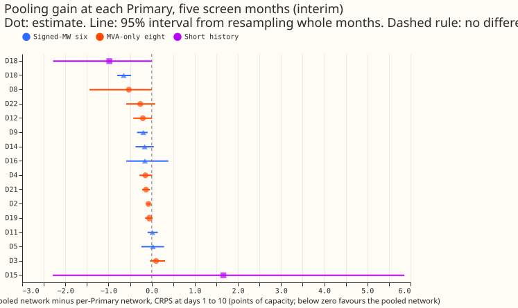

**Take-home message: one pooled neural network beats one network per Primary at both substation
groups.** Pooled A0 (the pooled network with uniform input-group weights) lowers the CRPS at days 1
to 10 by 0.185 points of capacity at the six signed-MW Primaries (95% interval -0.300 to -0.061) and
by 0.161 points at the eight MVA-only Primaries (-0.272 to -0.089), and 11 of the 14 countable
Primaries gain. **The gain does not grow where the history is shorter** (correlation -0.02), so the
mechanism the prediction named is not what carries it. At D15 and D18 the result is mixed: D18 gains
0.98 points and D15 loses 1.66 under A0, while the pooled plain network gains at both. The verdict is
`supported (interim)`, because the pre-registered rule held on five test months.

## Results

CRPS at days 1 to 10, mean over Primaries with equal weight, in points of capacity.

| Group | Per-Primary plain | Pooled plain | Pooled A0 | A0 minus per-Primary (95% interval) |
|---|---|---|---|---|
| Signed-MW six | 3.536 | 3.295 | 3.351 | -0.185 (-0.300 to -0.061) |
| MVA-only eight | 3.952 | 3.881 | 3.791 | -0.161 (-0.272 to -0.089) |
| MVA-only seven (no D8) | 3.336 | 3.294 | 3.227 | -0.109 (-0.124 to -0.090) |
| D15 and D18 (report-only) | 10.494 | 9.278 | 10.835 | +0.336 (-1.815 to +2.709) |

- Per Primary, the largest gains under A0 are D10 (-0.647, interval -0.798 to -0.478), D8 (-0.528),
  and D18 (-0.980). D2 (-0.073) and D21 (-0.131) gain with intervals that exclude zero.
- D11 (+0.017), D5 (+0.030), D3 (+0.103), and D15 (+1.663) do not gain, and none of their intervals
  excludes zero.
- The pooled plain network gains more than A0 at the signed-MW six (-0.241 against -0.185) and less
  at the MVA-only eight (-0.071 against -0.161).

## Predictions and decision rule

- **P1 held.** Both groups have negative differences with intervals below zero.
- **P2 failed.** The correlation of the gain with months of history is -0.02, not below -0.3.
- **P3 failed.** D15 loses under A0, so D15 and D18 do not both gain more than the median Primary.
- **P4 failed narrowly.** The best three Primaries carry 60% of the summed gain, and the prediction
  required under 60%.
- **The decision rule is met:** both group intervals lie below zero and 11 of 14 Primaries gain.

## Limits

- Five test months (2025-10, 2025-12, 2026-01, 2026-03, and 2026-06) give few resamples for the
  month-block bootstrap, so every interval is interim.
- A0 differs from the per-Primary network in two ways: pooling, and the five-token input encoder.
  The pooled plain network separates them: it gains 0.241 and 0.071 points at the two groups.
- The forecasts and scores are those of experiment 397; nothing was refitted.

## Problems caused by the move

None.
