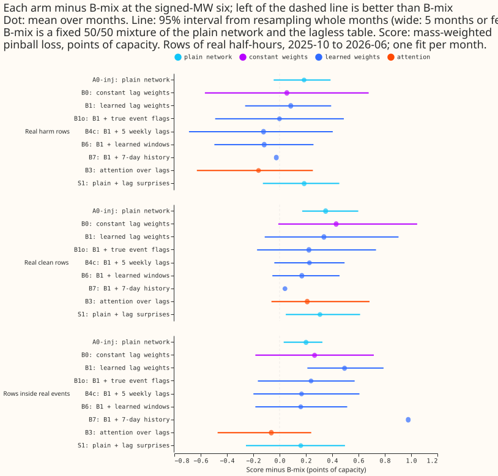
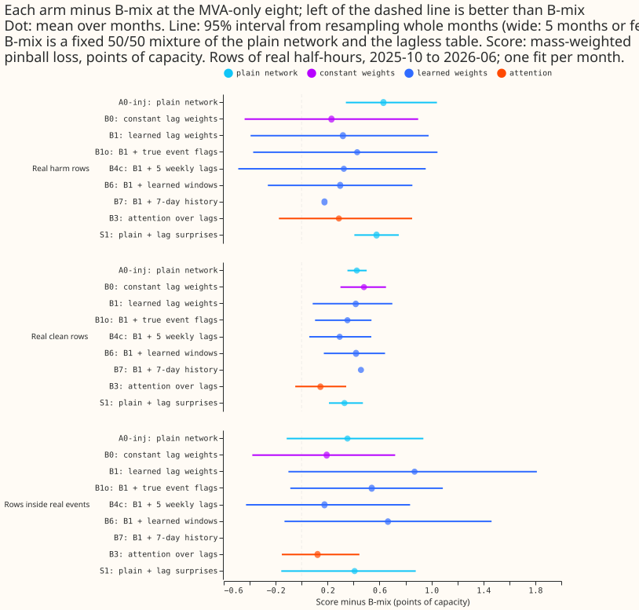
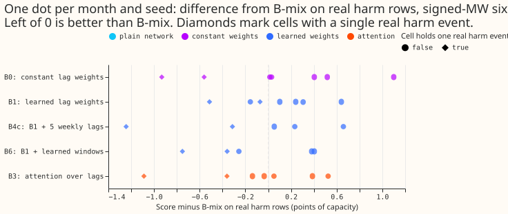
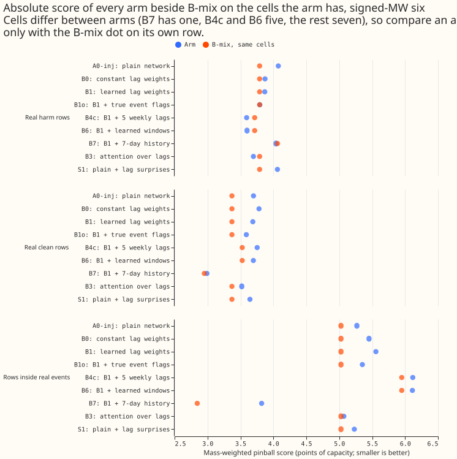
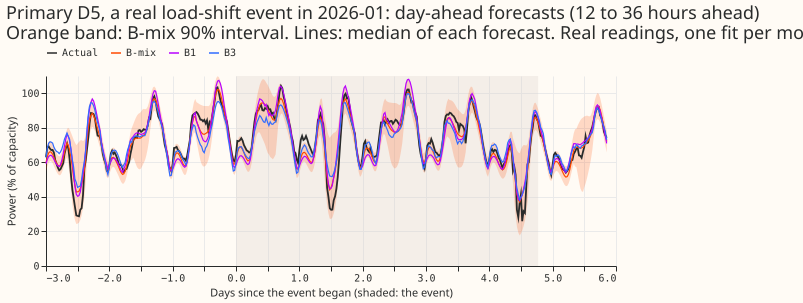
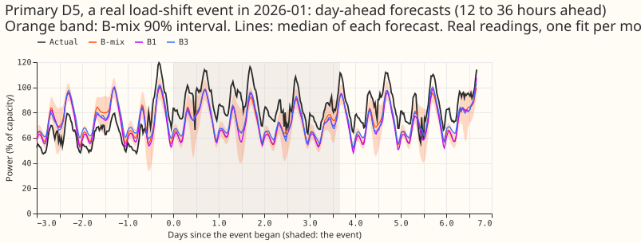
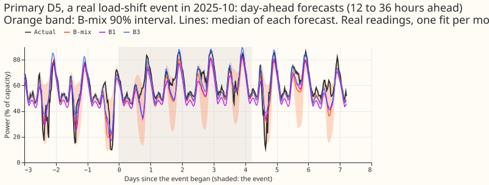
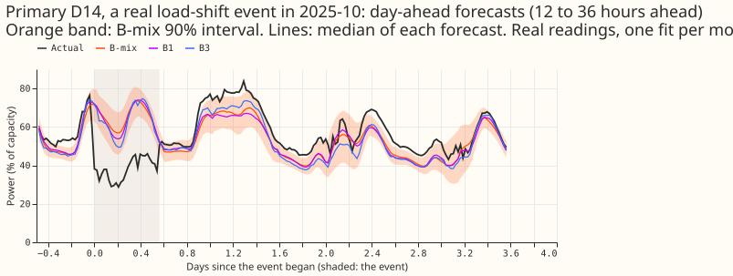
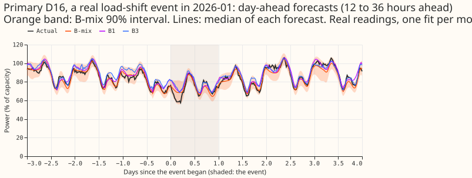
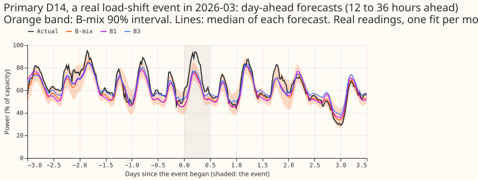

**Take-home message (interim and unaudited: 5 scored months, 1 to 3 seeds per month, no Bonferroni
correction): a fixed 50/50 mixture of the plain network and the lagless forecast (B-mix) scores as
well as every trust network we trained, so the learned trust weights do not yet earn their
complexity.** No arm beats B-mix with a 95% interval that excludes zero on real harm rows, real
clean rows, or rows inside real events at the signed-MW six. Attention over the lags (B3) and
learned windows over the surprise series (B6) are nominally 0.16 and 0.12 points of capacity ahead
of B-mix on real harm rows, with intervals that include zero. The trust weights themselves are
almost inert: B1's mean combined trust is 0.92 outside real events and 0.94 inside them, and B1o,
which is given the true event flags, shows no lower trust inside events either. The batch 1 stop
rule did not fire (B1 minus B0 on harm rows is +0.03, interval -0.29 to +0.35), so the gain a trust
head adds over a constant lag weight is not visible in this screen. The maintainer decides whether
B3 or B6 is worth carrying into the lag-trust evaluation, which is held until several design
iterations are done.

## Results

The tables below read the pooled contrasts of `e00404_pool.py` (pushed with this page). Each
contrast is the mean over the arm's cells of the arm's score minus the reference arm's score on the
same rows, in points of capacity (negative is better than the reference), with a 95% interval from
resampling whole months. A cell is one scored month and one seed. B-mix, A0-inj, B0, B1, B1o, B3, and
S1 have all 7 cells (2026-06 seeds 0 to 2; 2026-03, 2026-01, 2025-12, and 2025-10, seed 0). B4c and
B6 have 5 cells (the five months, seed 0). B7 has 1 cell (2026-06, seed 0). Every interval is wide
because it rests on at most five months, so none of it is a claim.

**No arm separates from B-mix at the signed-MW six.** B-mix is a fixed mixture of the saved A0-inj
network's forecast and the cross-fitted lagless table's forecast, each with weight one half.

| Arm | Real harm rows | Real clean rows | Rows inside real events |
|---|---|---|---|
| A0-inj | +0.19 [-0.02, +0.40] | +0.35 [+0.17, +0.60] | +0.20 [+0.03, +0.33] |
| B0 | +0.06 [-0.57, +0.68] | +0.43 [-0.01, +1.05] | +0.27 [-0.18, +0.72] |
| B1 | +0.09 [-0.26, +0.39] | +0.34 [-0.11, +0.90] | +0.49 [+0.21, +0.79] |
| B1o | 0.00 [-0.49, +0.49] | +0.22 [-0.17, +0.75] | +0.24 [-0.17, +0.57] |
| B3 | -0.16 [-0.63, +0.25] | +0.21 [-0.06, +0.68] | -0.06 [-0.47, +0.24] |
| S1 | +0.19 [-0.13, +0.45] | +0.31 [+0.05, +0.61] | +0.16 [-0.26, +0.50] |
| B4c (5 cells) | -0.12 [-0.69, +0.40] | +0.23 [-0.04, +0.49] | +0.17 [-0.20, +0.61] |
| B6 (5 cells) | -0.12 [-0.50, +0.26] | +0.17 [-0.06, +0.46] | +0.16 [-0.18, +0.51] |
| B7 (1 cell) | -0.03 | +0.04 | +0.98 |

Score minus B-mix at the signed-MW six, in points of capacity. B-mix's own scores are 3.79 on real
harm rows, 3.37 on real clean rows, and 5.03 inside real events (the values for the arms with 5
cells are measured against B-mix on those 5 cells).

**B-mix is clearly ahead at the MVA-only eight.** Every arm is worse than B-mix on real clean rows
there (B3 +0.14 [-0.05, +0.34], the best; B0 +0.48 [+0.30, +0.65]), and on real harm rows (B3 +0.29
[-0.17, +0.85]; B4c +0.52 [+0.07, +1.32]). Three of the seven cells hold a single real harm event
at the MVA-only eight.

**The pooled differences hide a large spread between cells.** B3's difference from B-mix on real
harm rows runs from -1.09 to +0.53 across the 7 cells, and the cells with a single real harm event
(diamonds) carry the largest values in both directions.

**B3 and B6 beat B1 on real harm rows and inside real events.** The contrast against B1 at the
signed-MW six: B3 minus B1 is -0.24 [-0.52, +0.03] on harm rows and -0.56 [-0.75, -0.36] inside
events (7 cells); B6 minus B1 is -0.16 [-0.26, -0.03] and -0.31 [-0.58, -0.02] (5 cells). B0 minus B1
is -0.03 [-0.35, +0.29] on harm rows, so B1's learned weights do no better than B0's constant weights.

**The trust weights are almost inert, even given the true event flags.** The mean over the 7 cells
of the geometric mean of B1's three trust weights is 0.92 on real rows whose lags lie outside real
events (padded) and 0.94 inside them, so the inert rule (outside minus inside under 0.1) fires. B1o
gives 0.91 outside and 0.90 inside. B0's constant weight is 0.98 everywhere.

**Reading of the oracle control.** B1o, with the true per-lag event flag as three extra trust-head
inputs, scores 0.00 [-0.49, +0.49] against B-mix on real harm rows and +0.24 [-0.17, +0.57] inside
real events, against B1's +0.09 and +0.49. Having the exact flags helps B1 by 0.09 on harm rows
(-0.09 [-0.29, +0.10]) and by 0.26 inside events (-0.26 [-0.48, -0.05]) but still leaves B1o
behind B-mix inside events. We read this as evidence that the limit is in the calibration module,
the lagless forecast, or the mixture rule, and not in detecting events. Only the B1 version of the
oracle exists; the attention version was dropped.

**The encroachment sweep shows B1 and B0 follow a shifted lag more than A0-inj does.** A step of 5%
of capacity added to the newest 3 lags moves the median of A0-inj by 0.12 of the step, of B1 by 0.22,
and of B0 by 0.25 (lead band 0, 2026-06 seed 0). Band widths stay within 0.99 and 1.03 of their
unshifted width for all arms, and the masked-lag control moves by 0.0 (about 1e-8) for B0 and B1.
This is one month and one seed, and the sweep was not run for B3, B6, or S1.

**Which pre-registered predictions held (signed-MW six, real harm rows unless stated).**

| Prediction | Observed | Verdict |
|---|---|---|
| P1: B1 minus A0-inj between -0.05 and -0.2 | -0.10 [-0.40, +0.22] | holds, interval includes 0 |
| P2: B1 minus B0 between -0.05 and -0.3 | +0.03 [-0.29, +0.35] | fails |
| P3: B1 minus A0-inj on clean rows under 0.05 | -0.01 | holds |
| P4: trust outside minus inside events at least 0.1 | -0.03 | fails (inert rule fires) |
| P5: B1 beats B2 | B1 minus B2 -0.76 (one cell) | holds on 1 cell |
| P7: A0-inj minus A0 below -0.1 on harm rows | +0.22 (one cell) | fails on 1 cell |
| P8: B5 within 0.03 of B1 outside events | B5 minus B1 +0.12 (one cell) | fails on 1 cell |
| P9: B3 beats B2 by under 0.1 | -0.74 on 2026-06 seed 0 | beats by more than predicted |
| P10: B4a to B4c within 0.1 of B1 | B4c minus B1 -0.16 [-0.50, +0.18]; B4a -0.18; B4b +0.29 | fails |
| P11: B6 within 0.1 of B1 | -0.16 [-0.26, -0.03] | fails: B6 gains |
| P12: B7 lowers harm-row CRPS by under 0.05 | +0.13 (one cell) | fails on 1 cell |
| P13: B1m within 0.1 of B1 | +0.06 (one cell) | holds on 1 cell |
| P16: B1 minus B3 between -0.05 and +0.05 | +0.24 [-0.03, +0.52] | fails |

P6 (the MVA-only eight is inert) and the batch 0 prediction P0 are not tested on this page. B8, B9,
B1-rw, and B1-nn were not run, and neither were P14 and P15.

**Deviations from the plan.** The batch 1 stop rule did not fire, and batch 2 ran on the manager's
direction ("iterate rather than stop"). B-mix, S1, B1g (B1 plus the gap between the lagged and
lagless means), B1o, and the encroachment sweep were added after the plan was written. B1g is
indistinguishable from B1 (harm rows -0.17 and -0.16 against B-mix on 2026-06 seed 0). Training and
scoring worlds come from experiment 428's injected worlds, and the lagless tables were cross-fitted
with K=6 contiguous blocks.

## Question

**We test whether one neural network can learn how much to trust each lagged power reading, with no
event labels.** A load-shift event moves demand between neighbouring Primaries for hours or weeks.
The power the network sees at the same time yesterday or last week can then be abnormal, and a
forecast that copies that power inherits the abnormality. NGED cannot supply event labels for about
1,300 substations, and every binary event detector tried so far has scored poorly. The maintainer's
design replaces the detector with a continuous trust weight per lagged input, learned end to end.

- **Lagless module.** A mixture density network (3 Gaussians) that sees weather, solar geometry,
  calendar, holidays, and a Primary embedding, and no power lag.
- **Calibration module.** A second network that outputs a lagged mixture (3 Gaussians) from the
  lagless forecast, the three lags, the Primary embedding, and an indicator of signed-MW or
  MVA-only metering. It does not see the trust inputs.
- **Trust head.** A separate small network that reads only the trust inputs below, the lead time,
  the Primary embedding, and the metering indicator, and outputs one weight in [0, 1] per lag.
  Feeding the trust inputs only to this head stops the calibration module from falling back on the
  lagless forecast inside the lagged head, which would leave the trust weight unidentified and let
  it collapse to a constant, as the logistic gate of experiment 400 did (about 0.6).
- **The three lags.** `lag_origin` (the newest reading before the forecast origin),
  `lag_same_time_latest_day` (the reading at the target's time of day on the latest day before the
  origin), and `lag_same_time_latest_week` (the same on the latest week before the origin), as in
  the weekly XGBoost member. Each carries its age in hours and an is-missing flag.
- **Output.** A mixture of the lagless and lagged distributions (6 Gaussians), never an average of
  quantiles. The weight on the lagged mixture is the product of the 3 per-lag trust weights, so one
  untrusted lag lowers it, and the lagless distribution takes the weight 1 minus that product.
  Arm B1m replaces the product by the mean of the 3 weights.
- **Training scheme (a departure from fully end to end).** Cross-fitting makes the lagless forecast
  a precomputed table. The lagless module trains on its own mixture negative log-likelihood, and
  the rest of the network trains on the final mixture negative log-likelihood of the clean series,
  on injected events, with the lagless forecast held fixed. No separate stage on event labels is
  used. The fully joint version, in which the lagless module trains jointly with a stop-gradient
  and no cross-fit, is arm B9, run last and labelled in-sample.
- **Series.** Each Primary series is one series per substation.

## Review against the latest evidence

**The plan was reviewed against the pages merged since the brief was written** (experiments 387,
398, 399, 401, and 403, and the standing practices of the `ml-experiment` skill, read from `main` on
2026-10-30). Four changes follow; none alters the scope.

- **Fixed-mixture control.** Experiment 401's advice is to use a fixed mixture with a weight of 0.3
  to 0.5 on the forecast with lags as the control for any learned blend at the signed-MW Primaries.
  The plan adds a free arm F0: a fixed mixture, with weight 0.4 on the lagged forecast of A0-inj
  and 0.6 on L0, computed from stored forecasts. F0 is reported at the signed-MW six only, and not
  at the MVA-only eight or at D15 and D18.
- **How the lag response is measured.** The lag response is the forecast with lags minus the
  forecast without lags on the same rows, and never 1 minus the residual over the labelled step.
- **Standing practices followed.** Monthly refits; cleaned data, with the number of dropped
  `substation_zero` half-hours reported per fold; the D15 and D18 cut at 2025-03-01; every fitted
  network saved in the experiment's data folder; stored predictions reused as references; tails and
  the avoidable-curtailment cost reported beside CRPS; example forecast plots and event plots;
  draft pull request. The plan departs from the practice of four screen folds: it uses the five
  screen folds of experiment 397, so that its scores sit on the same rows as experiments 397 and
  403, and labels every number interim.
- **Evidence that tempers the expected gain.** Experiment 401 found real events move the forecast
  by 0.03 of the step or less, and that one event at D16 carries most of a fixed mixture's gain at
  the six. Experiment 402's `ceilings3.txt` found the flag oracle's gain has an interval that
  includes zero. The batch 0 and batch 1 stop rules already encode this.

## Design choices fixed by this plan

**The smoother and the surprise source are fixed here because the brief leaves them open.** Each is
a stated choice; a different choice is a later experiment.

- **Light causal smoother.** After the trust head, a causal moving average of 3 half-hours is
  applied over the lag's valid times, so that weights do not jump between adjacent half-hours.
  Events start suddenly, so the smoother is short. The write-up reports how many half-hours the
  smoothed trust weight takes to cross 0.5 after an injected onset, beside the unsmoothed weight.
- **Trust weights start at 0.5** with no regulariser. The write-up reports whether they stay near
  0.5.
- **Stop-gradient.** The surprises and the gap between the lagged and lagless medians pass through
  a stop-gradient, so the lagless module cannot shape its own surprises through the trust head.
- **Cross-fitted lagless forecast (leakage rule).** For each monthly refit, the months before the
  scored month in the training window are split into K = 6 contiguous blocks. For each block, a
  lagless module is fitted on the other 5 blocks and forecasts the held-out block. The 6
  cross-fitted forecasts form the table of out-of-sample lagless forecasts for the training rows.
  One further lagless module is fitted on all months before the scored month, for the scored month
  and for test-time inference. A lag whose valid time falls before the scored month takes its
  surprise from the cross-fit table and not from the further module, because the further module was
  fitted on those months. The table is shared across all arms and seeds, and is fitted once
  per refit and seed. The calibration module and the trust head both take the table's lagless
  mixture as input in training, and the further module's mixture at test time. A stop-gradient
  on the lagless forecast stops the lagless module shaping its own surprises. Cross-fitting never
  uses the scored month or later. The other blocks include later months than the held-out block,
  which a live forecast would not have, so the training surprises are somewhat larger than a fully
  fitted lagless forecast would give; the write-up lists this mismatch as a caveat. If the timed
  fits show K = 6 is too expensive, the plan settles on a smaller K and tells the manager.
- **Forecast origin and lead of the lagless forecast.** At a lag's valid time, the lagless
  forecast uses the ECMWF ENS (European Centre for Medium-Range Weather Forecasts ensemble) mean
  and spread of the freshest run available at the forecast origin (the latest run published by the
  valid time, leads 9 to 33 hours). That run exists at forecast time. ERA5 is not used. The training
  table applies the same
  freshest-run rule at every origin.
- **One pass on the ensemble summary.** The network sees the ENS mean and spread of each weather
  variable once. The 51-member scheme runs only as a check on the best arm.

## Trust inputs

- **Per lag.** The single-step surprise (the lag minus the lagless median at the lag's valid time)
  in capacity-normalised MW, kept signed, and the same value in units of the lagless band width.
  Both are given, because a clipped score loses magnitude.
- **Per lag, window statistics** of the surprise over windows centred on the lag (half-widths 1.5,
  3, 6, 12, and 24 hours, and 84 hours for the week lag only): mean, median, minimum, maximum,
  standard deviation, signed sum, count above the band, and a 12-hour triangular tent mean. Every
  window is truncated at the forecast origin and at the telemetry cut-off, and a truncated tent is
  renormalised to sum to 1.
- **Neighbours.** The same quantities for neighbouring Primaries from `neighbours_nged.json` (in
  the folder of experiment 383), with the signed logic learned and never hand-coded. Bulk supply
  points are added if their stored series exist; if not, the write-up says they were left out.
  At scale the graph must come from the data (for example the correlation of forecast residuals);
  the write-up states what that needs.
- **Lag age and is-missing flag** for each lag, and the gap between the lagged and lagless medians.
- **Recomputation after injection.** Every one of these inputs is recomputed from the injected
  series, including the neighbour, bulk-supply-point, B6, and B7 windows.

## Arms

All arms use the pooled plain mixture density network of experiment 397 (arm `plain_pooled`) as
their base: one network for all 16 Primaries, a learned Primary embedding, a 3-component Gaussian
mixture head. The maintainer's update of 2026-10-30 moved the base from the uniform-token arm of
experiment 397, called U0 here, to the plain network. The interim scores of experiment 397
(unaudited) were
3.264 at the signed-MW six and 3.860 at the MVA-only eight for the plain network, against 3.320 and
3.775 for U0, and the plain network's lead rests mainly on one fold, so this
plan infers no ranking between them. Both modules get the Primary embedding. The group gate over
input groups stays closed in every arm. Every arm trains on the injected data below, except A0.

**Batch 0 (a cheap check before batch 1).** Re-score the stored forecasts of experiment 402 on harm
rows with the lags inside each real event replaced by clean counterfactual values, using experiment
401's harness. This gives the most that any lag-trust method can gain, because experiment 401 found
real events move the forecast by only 0.02 to 0.03 of the step, yet the forecast with lags scores
5.119 against 4.292 without lags on harm rows, so most of that gap is the two forecasts differing as
whole forecasts. If the counterfactual gain is under 0.1 CRPS points at the signed-MW six, the plan
skips batches 1 and 2.

**Deviation from the batch 0 rule.** Experiment 411 ran batch 0 and was inconclusive. The gain at
the signed-MW six was -0.836 CRPS points (95% interval -2.578 to +1.226) on 9 events. One D5 event
flips the sign: without it the gain is +0.460 (95% interval -0.102 to +1.631). At the eight MVA-only
Primaries the gain was +0.024 (95% interval -0.574 to +1.529). The harness scored only 15 of the
184 corrected events. Experiments 411 and 414 reached only 9 signed-MW-six events. The 4 test months
and the sign, step, and bias filters capped that count, not gaps: 129 of the 184 events lie outside
the test months. The ceiling is therefore a thin figure from XGBoost models alone. Batch 1 runs
regardless, with no 12-refit extension and no looser event filters on this experiment's account.
The point estimate is under 0.1, so the rule as written would skip batches 1
and 2, but the interval spans zero. The neural Discuss session therefore ruled that batches 1 and 2
run. The batch 1 stop rule stays as written.

**Batch 1:**

- **L0 (free).** The lagless module's own forecast, scored on all rows and on harm rows. Experiment
  402's weights suggest the lags help the signed-MW six only at days 1 to 2, and L0 shows that
  directly.
- **A0.** The pooled plain network with the three lags, trained on the plain clean data (the
  reference for the architecture alone).
- **A0-inj.** A0 trained on the same injected data as B1. B1 minus A0-inj isolates the
  architecture, and A0-inj minus A0 isolates the training data.
- **B0.** Constant trust: B1's architecture with one learned constant trust weight per metering
  group, lead band, and lag that does not depend on the trust inputs (the control experiment 400
  recommended). B1 minus
  B0 isolates the trust inputs.
- **B1.** The architecture above, with the three lags.
- **B2.** A0-inj with token-level lag dropout during training (each lag token zeroed with
  probability 0.2 and flagged missing) and no lagless module.
- **B5.** B1 without `lag_origin`.
- **B-mix (reference, free).** A fixed 50/50 mixture of A0-inj's lagged forecast and the lagless
  module's forecast (the neural Discuss session's request, 2026-10-31). It is scored on the same
  harm rows and event slices as every arm. Experiment 402 step 4 (interim, unaudited) found that a
  simple mixture captured most of a lag-surprise gate's gain on injected shifts at the six
  signed-MW Primaries (mean CRPS 4.307 for the mixture, 4.250 for the gate, 4.576 with lags, 4.439
  without). Any trust head or attention over lags in this experiment must beat B-mix to count.

**Design iterations after batch 1 (maintainer, 2026-10-31).** The maintainer expects several design
iterations (tokens and attention) and is optimistic about the idea, so a null at batch 1 does not
end this experiment. The plan allows at least two design iterations after batch 1 before concluding.
The batch 1 stop rule still decides whether the full batch 2 grid runs. If it fires, each iteration
changes the trust head or the attention over tokens, is scored on the same rows against B-mix, and
is reported as one more named arm. The manager is asked before the total passes 12 hours.

**Batch 2** (runs straight away if the batch 1 stop rule does not fire):

- **Carry-forward rule (maintainer, 2026-10-30).** B3 attends across the lag set that wins among
  B4a, B4b, B4c, and B1's three lags, together with the XGBoost lag experiment 388 when its page
  is available. The order of work therefore runs B4a, B4b, and B4c before B3. If B3 has already run
  with the 3 lags, it is rerun with the winning set. The adopted set is named in the arm label (for
  example B3-lags5), and the write-up says which earlier components were adopted and which were
  not, with the reason.
- **B3.** B1's lagless module and cross-fitted table, with an attention gate in place of the trust
  head and the product rule. The gate attends over 4 tokens: the 3 lag tokens (each the lag value
  with its age, missing flag, and trust inputs) and a lagless-forecast token. Its query is built
  from the lead time, the Primary embedding, and the metering indicator. The output is the gated sum
  of tokens fed to a 3-component mixture head. B3 minus B2 tests attention over lags, and B1 minus
  B3 compares the trust head with attention.
- **B6.** B1 with a 1D convolutional neural network over the surprise series in a window of 24
  hours either side of each lag (97 half-hourly steps), in place of the hand-built window
  statistics. Each window is zero-padded and truncated at the forecast origin. The network has two
  convolution layers (kernel 5, 16 channels) with global pooling.
- **B4a, B4b, and B4c.** B1 with more lags: the same weekday and time from each of the last
  N = 1, 3, and 5 weeks, plus the median across the N weeks and the median minus the latest week.
  The three values of N are three separate arms.
- **B8a and B8b (low priority; run after B1 reads clean).** B1 plus an auxiliary probe head that
  reads the
  trust head's hidden layer and predicts, for each lagged timestep, whether the injected generator
  put it inside an event or a spike. The loss is binary cross-entropy at a weight of 0.1 of the
  mixture loss in B8a and 0.3 in B8b. The probe trains only on the injected labels, which
  are known truth and need no NGED label, and it is never used at forecast time. Real-event labels
  come from the 112-row corrected table, so the write-up reports the event count per metering
  group beside every area figure, and says plainly if the probe works on injected events and fails
  on real ones, which would mean the injection is unrealistic.
- **B1m.** B1 with the mean of the 3 trust weights as the mixture weight.
- **B1-rw and B1-nn (neighbour controls).** B1-rw replaces each Primary's neighbour inputs with
  those of a degree-matched randomly chosen set of other Primaries (the graph rewired, with the
  same number of neighbours). B1-nn removes the neighbour inputs. B1 minus B1-rw tests whether
  neighbour identity matters in the trust head, and B1 minus B1-nn tests whether the neighbour
  inputs matter at all. The cross-fitted tables are reused.
- **B9 (last).** The fully joint version of B1: the lagless module trains jointly with a
  stop-gradient and no cross-fit. It is labelled in-sample.
- **B7 (lowest priority; runs last).** B1 plus a 1D convolutional neural network over the latest 7
  days of actual demand up to the forecast origin, with the same trust inputs.

The maintainer's expectation (not a result): B1 beats B2.

## Training data and events

**Training uses injected, load-conserving events with clean targets.** A drop at a donor Primary
reappears at the connected recipients, with the depth as a share of the donor's trailing 30-day
mean (truncated at the forecast origin). Durations and depths follow the corrected label table
`sw_block_detector_label_table_corrected.csv` in the folder of experiment 395 (use the corrected
signs). In 30% of events no recipient is observed (a guess, varied as a sensitivity). Transient
spikes that are not load shifts are injected too. The targets stay clean, so a target is never
inside an injected event. The loss is the mixture negative log-likelihood, which is a proper
scoring rule like CRPS and is what experiment 397 used.

**Injection rate.** 20% of training rows have at least one lag inside an injected event or spike,
against about 2.6% in real data. The rate is a stated default, and the worker states and justifies
any change. The injection is fixed per refit and seed, saved to disk, and not resampled each epoch.
The generator tunes its coverage on the real arrays until the realised share of rows reaches 20%.

**Which experiment the injection follows.** Experiment 395 Parts E and F disagree on the share of a
step that reaches the forecast (36.8% with all three lags affected in the synthetic sweep of Part
E, against a median share of 0.94 for real events in Part F; experiment 401 shows the 0.94 is not a
lag effect). The injection writes the full event
depth into the lag values, as a real event does, and does not set a share of the forecast. The
share that reaches the forecast is then an output, measured by the lag-encroachment sweep.

**Realism check before training: match surprise statistics, not a lag response.** In experiment
401's counterfactual (replace the lags inside each real event and re-predict), the real lag
response of the forecast is about 0.02 to 0.03 of the event step, against 0.32 to 0.34 for
synthetic events of the same kind (interim and unaudited). That response belongs to the fitted
forecaster and not to the injection, so the plan does not tune the injection to a response. It
matches the injected surprise statistics (the window statistics of the surprise series, the event
depth as a share of the series, and the duration) to those of real events, and redesigns the
injection if they differ by more than a factor of 2, as the lag-gate brief requires. For each
fold, the injected depths and durations are drawn, and all tuning is done, only from real events
outside that fold's scored month, so that the events that score an arm never tune its training
data. The write-up reports the fitted network's counterfactual lag response on injected and on real
events as a diagnostic. Every arm is judged on real events as well as injected ones. The plan
follows experiment 395 Part F (the full depth in the lag values) and not Part E.

**Evidence on constant-step injection.** Experiment 402's redone step 2 (interim, unaudited) gave
the median share of a step passed on by the R1 boosters as 0.133, 0.150, and 0.305 for real events
with 1, 2, and 3 lags inside, against 0.146, 0.158, and 0.328 for a synthetic constant step (ratios
1.05 to 1.10; 17, 14, and 6 events). The factor-of-2 rule does not fire, so a constant-step
injection is realistic for those boosters, and experiment 402 repeats the check on its R0 lagged
boosters. The two experiments measure different quantities: experiment 401 takes the forecast with
lags minus the forecast without lags, and experiment 402 takes the share of the step passed on. The
plan uses both as diagnostics on the fitted networks and does not tune the injection to either.

**Harm-row results are a lower bound.** Because some events are unlogged, harm-row results are
reported as a lower bound on harm. Our series are one per substation, not per transformer, so a
transformer-level event that conserves load across a substation's transformers does not appear.

**Shared injected worlds and B-mix (agreed with experiment 428, 2026-10-31).** Both experiments
read experiment 428's world files `seed{N}.npz` (power over capacity, shape [16, grid], and the
event code, shape [16, grid]; the data folder of experiment 428, `work/worlds/`), built by
experiment 402's `inject` on experiment 422's cleaned power with 10% coverage over 2024-05-01 to
2026-07-01. Training uses seeds 100 to 102 and scoring uses the held-out seeds 200 to 202, so the
scored months contain injected events and harm rows. Row classes come from experiment 428's
`e00428_predict.Flags`. B-mix halves the weights of the lagged forecast's components and of the
frozen lagless table's components and pools them on the capacity scale. Experiment 404 therefore
does not run its own injection.

**Frozen lagless table.** The cross-fitted lagless tables are frozen as built on 2026-10-31 by
commit `63d3799f` of this branch: K = 6 contiguous blocks, a pooled module with a Primary
embedding, 6 epochs, seeds 0 to 2, and scored months 2025-10, 2025-12, 2026-01, 2026-03, and
2026-06. Experiment 428's surprise-channel arm and recent-history encoders read the same files, so
no rebuild happens unless the experiment 428 worker and the manager agree first. In the 2026-06
table the 90% band covers 0.81 of observed power for the cross-fitted rows, so the bands are
somewhat narrow, and the write-up states this.

**Generator.** This experiment imports experiment 402's generator (`e00402_inject.py`), merged to
main in PR 56 under `ml-experiments/00402-lag-gate-learned-weight-injected-load-shifts-part-1/`.
The merged file differs from the draft copy first used here: the donor change is computed from the
donor's mean over its whole series and keeps the donor's shape. It differs from the generator first
written here in four ways: spikes are 4 to 20 times the stage-1 residual median absolute
deviation, MVA-only Primaries receive events only where the reading stays above 20% of capacity,
and base periods can exclude windows with a large stage-1 surprise. The signature takes the
MVA-only set and each Primary's residual deviation in MW. The write-up says which commit of the
generator each fit used.
The depths and durations come from the table's real events, so the test distribution informs the
generator's distributions even though the real events never enter training; the write-up states
this.

**Caveat on unlabelled events (carried into every write-up).** NGED says load-shift events may be
missing from its logs. The clean-lag rows and the clean training periods can therefore contain
events that no label covers. The harm table's clean-lag baseline is then optimistic, and the
real-event slices undercount the rows whose lags lie inside an event. Injected events stay the main
training signal because they need no logs.

**Real events are a held-out test only.** The label table's events never enter training. The
write-up reports the real-event count per fold and excludes folds without label coverage from the
harm rows.

## Leakage rules

- Cut every training row whose valid time is on or after the first day of the scored month.
- Truncate every window of every lag at the telemetry cut-off and at the forecast origin.
- Take surprises only from the cross-fitted lagless forecast described above, recomputed against
  the injected lag values after injection (surprises from the clean series would carry no event
  signal), never from the scored month or later.
- Inject the donor and its recipients together, so that the neighbour inputs never leak the clean
  value.
- Drop flagged exact-zero half-hours (`substation_zero`) from training, lags, inference, and scoring
  actuals.
- For D15 and D18, drop every row before 2025-03-01 from training rows, lag inputs, inference
  inputs, and scoring actuals (maintainer rule, 2026-10-30). This experiment does not test the cut.
  Experiment 399 may later supply better per-Primary dates, and the plan then follows them.

## Scoring

- **Harm rows (defined once).** A harm row is a half-hour of the real held-out data whose target
  is outside every real corrected event (unpadded, with the 7 days after each event excluded, as
  experiment 400 did) and at least one of whose 3 origin lags lies inside a real corrected event.
  The B4 arms' extra lags do not redefine the harm rows. A contrast on harm rows is the difference
  of the two arms' mean CRPS on those same rows, and scoring uses real data only.
- **Three row sets, scored separately beside the headline** (the neural Discuss session's request,
  2026-10-31): harm rows, clean rows (no lag and not the target inside an event), and rows whose
  target is inside a labelled real event. Experiment 402's slice tables (interim, unaudited) found
  that an injected-trained gate protects harm rows without losing on clean rows, but is worse than
  the fixed 50/50 mixture where the target is inside a real labelled event (signed-MW six: 10.75
  and 11.42 against 10.50 and 11.25, in points of effective capacity), because it cuts the lag weight
  to about 0.4. All experiment 402 figures are interim until its page merges. Every
  arm, B-mix included, is scored on all three sets, with whole-event bootstrap intervals.
- **Dominant events and coverage (neural Discuss session, 2026-10-31).** Real-event gains rest on
  very few events: in experiment 402 (interim, unaudited), one D16 event carried 110% of the step
  1 flag-oracle gain and one D5 event carried 64% of the real-harm gain. The write-up lists the
  events that dominate each real-event slice and reports each slice with and without its largest
  event. It also reports the 95% quantile's coverage inside real events beside CRPS, because
  every arm of experiment 402 covered only 0.65 to 0.68 of the targets there (target 0.95). The
  signed-MW six and the MVA-only eight are scored separately everywhere, because at the eight the
  gate beat the 50/50 mixture inside a real event and at the six it did not.
- **The harm table** of the lag-gate brief: rows whose target is outside every event but whose lags
  lie inside one, minus the rows with clean lags, by number of lags inside the event. Each arm minus
  A0 on the harm rows, with whole-event bootstrap intervals.
- **The lag-encroachment sweep** (experiment 392's protocol, required of every load-shift
  experiment by the maintainer, 2026-10-31): add a step of 5% of capacity to the lags of clean rows
  for k = 1, 2, and 3 lags, and report the median's shift as a share of the step, the band width
  ratio, and where the probability mass sits, for every arm. The code path and protocol come from
  the merged experiment 392 scripts on main (`e00392_sweep.py`: `shifted_matrix`, `clean_rows`,
  `sweep_site`, `widen`, `with_ratios`). The protocol adds D (5% of capacity, and 2.5% for neural
  networks, both signs) to the 1, 2, then 3 most recent lag columns of clean rows, over the lead
  bands from 24 to 72 hours and the others, on the four screen folds, with an origin stride of 3
  and the 1.15 widening. It reports the median shift as a share of D, the band-width ratio, and
  the coverage of clean and event-level readings. Experiment 404's network needs a
  predict-on-modified-lags interface for it. The sweep also includes a lag-masked control, whose
  shift must be exactly 0, the trust weight of each lag at each k, and 3 seeds.
- **Probe (B8).** The precision-recall area of the probe on held-out real events from the corrected
  label table, per metering group.
- **Loss outside events** and the overall five-fold CRPS, per Primary.
- **Tails.** Coverage and pinball loss at q01, q05, q95, and q99, raw and at the 1.15 widening,
  beside every headline score.
- **Example forecast plots (maintainer rule, 2026-10-30).** Example time series charts of
  probabilistic forecasts against the actuals: one day-ahead forecast, and one full 14-day horizon
  of a single forecast, with bands that widen with the horizon. Both are shown for one signed-MW
  Primary and one MVA-only Primary (4 charts), and one further chart shows a real load-shift event.
  Each shows the actuals, the median, and the 90% band for B1 and the reference arms. Substations
  are not covered by the anonymisation rule, and no metered generator's series appears here.
- **Event time-series plots (maintainer rule, 2026-10-30).** At least 6 plots, covering both
  metering groups (at least 3 from the signed-MW six and 3 from the MVA-only eight), each marking
  when the event starts and ends and showing the actual power, the median forecast, the 90% band
  (q05 to q95), and the trust weight of each of the 3 lags (for B3, the per-lag attention weights).
  Each plot compares the reference arms (A0, A0-inj, B0) with B1 on the same event. The set
  includes real events from the corrected label table, injected events, and at least one transient
  spike, and each plot is labelled real or injected. The set also includes the failure cases: the
  plots with the largest harm-row loss, not only favourable examples. Both groups of events use
  anonymised labels only where a metered generator's series appears, and none does here.
- **Checks.** The median minus the mean forecast per Primary, the error of the mean beside every
  quantile-score contrast, and which of the seven audit triggers of the `ml-experiment` skill fired.
- **Saved outputs, per arm, fold, and seed:** per-row per-lag trust weights, the combined trust, the
  event class of each row (inside, touching, or clean, unpadded), per-row CRPS, B3's attention
  weights, the B8 probe scores, and the forecast quantiles q01 to q99.
- **Folds, seeds, cadence.** The five screen folds of experiment 397, monthly refits, 3 seeds. More
  seeds only for a contrast within the seed noise.

## Code reviews

**A fresh Sonnet review of the lagless builder ran before its first build.** It found no leakage of
the scored month. It found that the cross-fit scaler used the held-out block's statistics, which
the builder now avoids by fitting a scaler per fold, and an off-by-one in the first valid index.

**A fresh Sonnet review of the training, scoring, and trust-input code ran before the first fit.**
It found six defects, all fixed or recorded. The forecast rebuilt its scalers from all origin days
instead of the saved training scalers (fixed). The padding between Primaries was too short for lag
centres before the table start (fixed). The score weighted unevenly spaced quantile levels equally
(fixed with the project's level weights). A clamp on the lagged weight zeroed its gradient (fixed).
The product rule identifies only the product of the three trust weights, so the per-lag columns
cannot be read as per-lag trust, and the write-up does not interpret them. The B3 gate takes the
lead, the Primary embedding, and the metering indicator, not the trust inputs, as the plan says.
B0 now learns one weight per metering group, lead band, and lag.

## Interfaces for the later evaluation experiment

**A separate lag-trust evaluation experiment will run on this experiment's saved networks once
the maintainer releases it** (manager, 2026-10-31; design in `briefs/lag_trust_evaluation_design_answer.md`,
section 4). The maintainer holds it until experiments 404 and 428 have each had several design iterations
and a design is picked, so batch 1 does not trigger it. This experiment therefore builds in five
interfaces, and saves every fitted network:

- A predict function that accepts modified lag values and recomputes every trust input from them
  with the `e00404_trust.py` functions.
- Per-row outputs: the trust weight of each lag, the combined trust, and the q01 to q99 quantiles
  of the final, lagged, and lagless mixtures.
- Inference overrides for the neighbour inputs: off, rewired, shuffled, and time-shifted.
- A deterministic evaluation mode with dropout off, so the lag-masked control returns exactly 0.
- Saved per-row tables keyed by Primary, origin, valid time, seed, and event class.

The write-up says which event count each figure uses: experiment 402's label rows (133 rows, 112
usable) or experiment 411's 184 corrected events. Experiment 392's one-lag figure is 0% to 2%.

## Compute

**The concurrency limit is 1 GPU process under 8 GB of GPU memory, 1 feeder core, and
`MemoryMax=8G`,** a stricter slot than the brief's 16 GB, because of the machine's load. The
manager asked for a request for more resources if a batch would take over 12 hours.

**Fit counts.** Each fit is one arm on one refit with one seed. The brief reports 50 to 200 seconds
per fit and about 600 fits in all; the plan's own count follows, and the first task after the slot
is granted is to time one fit of each kind and report K and the timed duration to the manager.

- **Cross-fitted lagless networks.** 6 block fits plus 1 final fit, so 7 per refit and seed, and 105
  over the 5 refits and 3 seeds. They are precomputed once per refit and seed and shared by every
  arm.
- **Injected windows.** The injected series and every window statistic, neighbour input, and B6 or
  B7 window are precomputed once per refit, with a fixed injection seed, and shared by every arm and
  seed.
- **Batch 1.** 6 arms times 5 refits times 3 seeds is 90 fits (A0 is read from experiment 397 if
  its rows match, which would remove 15).
- **Batch 2.** B3, B6, B4a, B4b, B4c, B8a, B8b, B1-rw, B1-nn, B1m, B7, and B9 are 12 arms, 180
  fits.
- **Memory per fit.** A pooled refit has about 7 million rows. With the trust inputs (about 150
  columns in float32) the host matrix is about 4 GB, which fits the 8 GB cap with the batch
  streamed to the GPU in blocks of 16,384 rows. B6 and B7 add window tensors that are built in
  blocks from the precomputed series, not stored in full. These figures are estimates; the first
  task after the slot is granted is to time and measure one fit of each kind.

Order of work once granted: batch 0 (the counterfactual re-score of the stored forecasts, which
takes no fit); the cross-fitted lagless networks; the realism check; A0 (reused if
experiment 397's rows match); A0-inj; B0; B1; B2; B5; the stop-rule check; then batch 2 if the
stop rule passes, in the order B4a, B4b, B4c, B3, B6, B8a, B8b, B1-rw, B1-nn, B1m, then B7 and B9.
Every arm
is in scope over the weekend, gated only by the pre-registered stop rules.

## Problems caused by the move

(The move of the research code from the production repository to this one.) None so far.
Experiment 397's modules live on an unmerged branch, so this experiment copies the files it needs
into its own folder.
