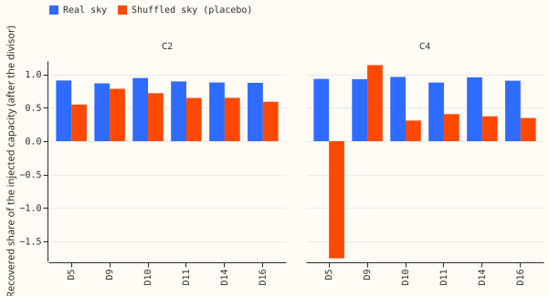

**Status: done. The known-answer test failed its placebo gate, so no score arm ran.** The sections
below are the plan, written before any fit; "Results" at the end reports what happened. The plan
follows the Discuss session's weekend brief, its Opus-reviewed revision, and the Sonnet review's
eight must-fix items.

## What is asked

**The question is whether a physical solar term, learned jointly with the demand forecast, lowers
the net-demand error where the GAM stack did not gain.** The GAM stack gained 0.047 points (interval
-0.029 to +0.135) from a better capacity estimate on the sunniest third (experiment 349). The score
moves about 0.02 points per 10% of capacity (the capacity-response page), so five folds may not
resolve a capacity contrast. The main question is therefore whether a small neural adapter improves
a physical solar forecast (C3 minus C2), which does not depend on resolving capacity.

## Terms

- **Net demand.** The power the Primary's meter reads. Embedded solar lowers it, so net demand is
  the demand without solar minus the solar output.
- **Signed-MW six.** The Primaries D5, D9, D10, D11, D14, and D16, which the meter reports in signed
  megawatts, so reverse flow shows as negative values. D15 and D18 are also signed, but they are
  report-only after the short-history cut (below). **MVA-only eight.** The eight Primaries whose
  meters fold reverse flow into positive values.
- **Solar term.** The embedded solar output at one Primary: a capacity (AC megawatts at the 99th
  percentile of daylight output, the unit of `docs/studies/embedded-pv-capacity.md`) times a
  physical response to the forecast irradiance and temperature.
- **Capacity.** One value per Primary and season-year (September to August, named by its
  September), as on the studies page.

## Data and rows

**The rows are experiment 397's.** The pooled plain network of experiment 397 stage 2 (16 Primaries,
learned 8-wide Primary embedding, 3-component Gaussian head, 2 hidden layers of 64) is the base. It
is fed the ECMWF ENS mean and spread of each weather column once per run (the `summary` scheme, the
maintainer's default of 2026-10-30). Folds are the five screen months (2025-10, 2025-12, 2026-01,
2026-03, 2026-06) with monthly refits on a 730-day window, and 3 seeds per arm. Rows come from the
raw matrices of experiment 397 (`work/raw/summary`), and `substation_zero` half-hours are dropped
from training, lags, inference, and scoring actuals as experiment 397 does.

**The short-history cut is applied.** For D15 and D18, all rows before 2025-03-01 are dropped from
training, lags, inference, and scoring (`common.md`, 2026-10-30). D15 and D18 stay report-only.

**Weather at lag times.** The lags are the Primary's own power at the lag times, so they carry
embedded solar already. The network uses no weather at lag times, so the ERA5 delay does not apply
here. The forecast-time irradiance is the ENS shortwave mean and standard deviation, both available
at forecast time.

## Architecture

**Net-demand mixture.** The demand module is the pooled plain network and outputs a mixture over
standardised demand `z` (power divided by effective capacity, then standardised per Primary, as in
experiment 397). The solar module outputs a mean `m` and a standard deviation `s` of the solar
output
in the same units. The net-demand mixture keeps the weights of the demand mixture. Component `k` has
mean `mu_k - m` and variance `sigma_k^2 + s^2`, on the assumption that demand and solar errors are
independent. This is one pass of the network per run, and the spread of the solar output comes from
the ENS spread input.

**Solar module.** The unit shape is computed offline, outside the network, and is fixed. It is the
AC
output per MW of AC capacity of a plant with tilt 35 degrees, azimuth 180 (south), a DC to AC ratio
of
1.15, and the existing 0.4% per degree derating, using the `studies.pv_physics` chain (the Erbs
split, isotropic sky, inverter clip) from the ENS mean shortwave and 2 m temperature, at the
Primary's latitude and longitude. These values are the population values of
`briefs/dp_pv_design_note.md`
(experiment 73 found that orientation is not identified at a Primary). The unit shape is evaluated
at the ENS mean shortwave and at the mean plus and minus one ENS standard deviation (a 3-point
quadrature), giving a mean `u` and a spread `u_sd` of the unit shape. The unit shape is scaled so
that its 99th percentile over daylight half-hours is 1, so that capacity has the unit of the studies
page.

**Capacity and the prior.** The solar mean is `C[p, y] * u * g`, where `C[p, y]` is the capacity of
Primary `p` in season-year `y`, and `g` is the adapter multiplier (1 in C1 and C2). The solar output
is clipped at `C[p, y]`. The studies page table
(`docs/studies/assets/embedded_pv_capacity_table.csv`)
gives a centre and a 95% interval for each Primary and season-year. The prior for `C[p, y]` is a
Gaussian centred on the centre of that table with a standard deviation of one quarter of the 95%
interval's width. The prior and the pinned capacity of C1 use only season-years that ended before
the refit: a cell
whose season-year has not ended takes the latest completed season-year's value (no hindsight). For
D5,
whose season-years are flagged, the centre is the midpoint of the library
range and the standard deviation is the range's width over four. The prior is a Gaussian log-prior
in
nats, added to the summed loss, so that in the mean loss it is divided by the effective row count.
It is weak by design: the data dominate wherever they are informative, and the C4 minus C3 contrast
measures how much the prior matters at all. At test time
the capacity is the as-of value of the last season-year in the training window, held flat across
the scored month (experiment 129's advice: no hindsight capacity).

**Adapter (C3, C4, C5).** A two-layer network of width 16 reads the ENS mean and spread of 2 m
temperature, longwave radiation, the clearness index (shortwave over 1000 W/m2 times the cosine of
the zenith), the unit shape's
spread, the sine and cosine of the day of
year, and the cosine of the zenith. It outputs `g = exp(0.5 * tanh(a))`, so `g` lies between 0.61
and
1.65, and the solar output is clipped to lie between 0 and `C[p, y]`. The output layer starts at
zero weights, so training starts from `g = 1`. The adapter shares its weights across Primaries.

**Demand module in the C arms.** Irradiance and the solar summary are removed from the demand
module's inputs. That means the mean and spread of shortwave radiation and the three solar-geometry
columns (cosine of zenith, sine and cosine of azimuth), which together let a network rebuild the
clear-sky solar bell. The matching control A0-noirr has the same removal and no solar module.
Removing
the geometry also removes the network's only season signal besides temperature, and A0-noirr pays
that cost too, so the contrast of a C arm against A0-noirr is like for like. This choice is the
plan's reading of "irradiance and the solar summary", and a reviewer may overrule it.

**The eight MVA-only Primaries.** The solar module does not run there, and they predict the observed
magnitude directly, as in experiment 397. They are reported separately, and no C-arm contrast
includes them, because A0-noirr removes irradiance there without a solar module to replace it. A
neural signed model for them waits for the signed-label gate of
`briefs/xgboost_mva_signed_label_cams_brief.md`.

## Arms

| Arm | Demand inputs | Solar module | Capacity |
|---|---|---|---|
| A0 | experiment 397 inputs | none | none |
| A0-noirr | A0 without shortwave mean and spread and without solar geometry | none | none |
| C1 | as A0-noirr | yes, no adapter | pinned to the experiment 269 estimate (`real_capacities.parquet`, `estimate_mw`, per site and season-year), not trained |
| C2 | as A0-noirr | yes, no adapter | learned per Primary and season-year, with the Gaussian prior |
| C3 | as A0-noirr | yes, with the adapter | as C2 |
| C4 | as A0-noirr | as C3 | as C3 with no prior, every capacity starting at a neutral 3 MW |
| C5a | as A0-noirr | as C3 | monthly path (free in time), symmetric smoothness penalty on month-to-month changes; changes only the time variation |
| C5b | as A0-noirr | as C3 | per season-year, with the persistence penalty (below); changes only the penalty |

**C3's penalty and C5's.** C3 has one capacity per season-year with no penalty on year-to-year
change beyond the Gaussian prior. C5b adds the persistence penalty
a Gaussian penalty on the relative step `r = (C[y] - C[y-1]) / C[y-1]`, with standard deviation 0.25
for a rise and 0.25 / sqrt(10) for a fall (a fall costs 10 times a rise of the same size), so a rise
is cheap and a fall is dear. C5a replaces the season-year capacity
with a monthly path and penalises the relative month-to-month change with standard deviation 0.05,
symmetrically. A full C5
(monthly path and persistence penalty together) is run only if both C5a and C5b move the score by
more than their minimum detectable effects. Every sudden fall of a learned capacity (more than 10%
in one step) is reported as a candidate meter failure, together with the date, because NGED
subtracts metered solar from the Primary's demand and a failed meter changes the Primary's series.

## Known-answer test (runs first, gates the score arms)

**The test adds a known extra capacity of one metered farm to the six Primaries and asks whether the
learned capacity rises by that increment.** It runs on one refit, the 2026-06 fold (the most data),
because the trained capacities are read from the fitted network and no scoring is needed.

- **Injection.** The held-out farm's recorded output, normalised by its own 99th percentile (the
  `farm_norm` of experiment 129), is scaled to an increment `X` equal to 50% of the studies page's
  2025/26 capacity at each Primary, and subtracted from the Primary's power (the sign convention of
  experiment 129's `inject`). The same subtraction applies to the three lags, which are rebuilt from
  the lag times, so a lag does not reveal the injected series. Injected tables are computed once per
  refit and saved in the experiment's private `work/` folder. A half-hour with a farm dropout is
  `NaN` and drops out of training, as in experiment 129.
- **Held-out farm.** The solar module's shape is physical (fixed population values), so no farm
  defines it. The studies-page prior was calibrated on the six farms, so a prior centred on that
  page could pull the recovery towards the page's value. C4 has no prior and so removes that
  circularity. The one farm with a short history is not used. The held-out farm is a fixed one of
  the others, and the three farms left are
  are
  the divisor farms: each is injected on its own into every Primary, in separate fits, and the
  divisor at a Primary is the median recovery of the three. A farm's label may appear in code and
  logs inside the private folder, and no published page carries a farm's series or name.
- **Recovery** is the learned capacity increment (injected minus not injected, at the last
  season-year in the window) divided by `X`, then divided by the divisor.
- **Gates, copied from experiment 129's page** (its "Gates" table): recovery after the divisor
  within
  0.75 to 1.25 at 5 of the 6 Primaries (experiment 129 used 4 of 5); the placebo difference of fits
  at most 0.20 of the real-sky recovery, median and maximum over Primaries (the placebo injects the
  held-out farm's output with its days shuffled within the month, so the cloud pattern is wrong and
  only the daylight shape is right; a learned increment should be small); and a drift gate.
- **The drift gate cannot run as written.** Experiment 129's drift gate is under 0.05 per 5 years of
  constant-farm recovery, and the networks here train on a 730-day window with ensemble weather
  only from 2024-04, so there are 2 season-years, not 5 years, to measure drift on. The gate is
  restated as: the recovery of the held-out farm differs between its two season-years by under 0.10
  of
  `X`. This restatement is a post-hoc scaling, so it is reported and does not gate.
- **Arms in the test.** C2 and C4, 3 seeds each, for these conditions: no injection, held-out farm,
  three divisor farms, and placebo (6 conditions per arm and seed), and C2 with experiment 129's
  increment penalty (0.1) on the held-out farm. That is (6 + 6 + 2) x 3 seeds = 42 fits (each of C2
  and C4 has 6 conditions; C2 with the increment penalty has a control and the held-out farm).
- **Decision.** The score arms (C1, C3, C4, C5a, C5b, A0, A0-noirr) run only if C2 passes the
  recovery gate and the placebo gate. If C2 fails, the page writes up the failure, with C4 beside
  it,
  and the score arms stop. C1 and C2 can be scored if only the drift restatement fails.

## Pre-registered contrasts and rules

All contrasts are at the signed-MW six, CRPS at days 1 to 10 (the headline band), in points of
effective capacity, with the month-block bootstrap of `studies.eval_protocol` at 95% (20,000
resamples) and a Bonferroni correction across the eight contrasts below. The MVA-only eight are
reported, not contrasted.

1. **C3 minus C2** (the adapter; the main question).
2. **C2 minus A0-noirr** (the physical term against no irradiance).
3. **C2 minus A0** (the physical term against the free irradiance input).
4. **C3 minus A0.**
5. **C2 minus C1** (learned against pinned capacity).
6. **C4 minus C3** (the prior).
7. **C5a minus C3** (time variation).
8. **C5b minus C3** (the persistence penalty).

**Minimum detectable effect.** For each contrast, the standard deviation over the 5 folds of the
seed-to-seed difference (the difference between two seeds of the contrast's two arms, for each pair
of seeds), times 2. A contrast is a gain only if its interval excludes zero **and** its point
estimate exceeds that minimum detectable effect. The adapter question (contrast 1) is decided by
this rule alone.

**Scoring slices.** Net-demand CRPS on all half-hours, the sunniest third of daylight half-hours,
sunny April to June, and the sunny-flag bias at D12. Tails: coverage and pinball loss at q01, q05,
q95, and q99, raw and at the 1.15 widening, against the widened reference. The cost at the scaled
export limit uses `studies.node_curtailment` at f = 0.9. Learned capacity per Primary against the
studies page, with intervals from seeds, and the capacity path with each sudden fall flagged.

## Net-demand mixture variance, and extra reports (fourth review)

**The solar variance is learned and bounded.** In the score arms the solar standard deviation is the
ENS-spread response times a learned positive scalar (shared across Primaries), clipped at half the
Primary's capacity so that no row can have a solar variance larger than its plausible output. The
net-demand variance is `sigma_k^2 + s^2 - 2 rho sigma_k s`, where `rho` is a learned correlation
between
the solar error and the demand error, one value per arm, bounded to -0.5 to 0.5 and starting at 0.
The known-answer fits (which do not score) use independence and the unscaled spread; the score arms
add
the scalar, the clip, and `rho`. A PIT histogram of the net-demand mixture at the signed-MW six
checks
the calibration, in daylight and at night.

**Two more reports.** C3 minus A0 is reported beside the main contrast, as the practical question
(does the explicit solar term beat the same network given irradiance?). The share of the daylight
variance that A0-noirr's demand module takes up from solar geometry, calendar, and the Primary
embedding alone is reported too. Removing irradiance does not fully remove the identifiability
problem, because cloud cover and temperature remain proxies for it, so capacity is identified only
from the irradiance anomaly within each geometry-and-season cell.

## Example charts

**The write-up shows probabilistic forecasts against actuals.** For one signed-MW Primary and one
MVA-only Primary, it shows a day-ahead forecast and one full 14-day forecast from a single run, with
the
quantile bands (they should widen with the horizon) and the actual power. Charts of metered
generators
are anonymised.

## Review of the code

The code was reviewed by a fresh Sonnet agent before any fit. It found two high-severity problems (a
prior and a pinned capacity that used the whole season-year, including months after the refit, and a
placebo shuffle that differed between the target and the lags) and five medium ones (the prior's
weight
differing from the plan, relative rather than absolute penalty steps, an adapter input that
duplicated
the unit shape, the no-prior arm starting at the studies value, and weight initialisation not
seeded).
All seven are fixed, and the plan text above now matches the code.

## Compute and fit counts

- **Score arms.** 8 arms x 5 refits x 3 seeds = 120 fits. At 50 to 200 seconds per fit that is 2 to
  7 hours.
- **Known-answer test.** 42 fits. Total 162 fits.
- **Resources.** One GPU process under 8 GB, one feeder core, `MemoryMax=8G` (the manager's limit
  until it is raised), `OMP_NUM_THREADS=1`. The injected tables are written once per refit and read
  by every fit that needs them.

## Stored forecasts, to be listed in the write-up

Monthly XGBoost (experiment 389), the weekly bundle (experiment 381), BG2, and the GAM stack. Their
paths are listed in the write-up after the scoring script reads them, and nothing is refitted.

## Earlier advice followed and departed from

- **Followed.** Use an as-of capacity, never a hindsight capacity (experiment 129). Test a penalty
  on
  jumps on a step-up injection before adopting it (experiment 129; the increment-penalty arm).
  Report absolute skill beside contrasts.
- **Departed from.** Experiment 129's five-year drift gate is restated for a two-season-year window
  (above).

## Checks the write-up will report

Median minus mean forecast per site; the mean-forecast error beside each quantile-score contrast;
which of the audit triggers fired.

## Results

**Take-home message: the known-answer test could not be passed, so the score arms did not run, and
the test as built cannot separate a read of the sky from a read of the daylight profile.** All
statements below are for the 2026-06 fold, 3 seeds, 6 Primaries, one held-out farm, and one shuffle.
The test added one real farm's output, scaled to 50% of each Primary's studies-page capacity, to the
six signed-MW Primaries (D5, D9, D10, D11, D14, D16), and fitted C2 and C4.

- **Recovery gate: passed, and uninformative.** After experiment 129's divisor, C2 recovers 0.87 to
  0.95 of the injected capacity at all 6 Primaries (needed: 0.75 to 1.25 at 5). C4 recovers 0.88 to
  0.96. The raw recovery is lower, 0.35 to 0.85 for C2. The divisor (0.38 to 0.93) is the median
  recovery of three other farms, which carry the same kind of signal, so the ratio sits near 1
  whatever the network reads (audit, finding 4).
- **Placebo gate: failed.** With the farm's days shuffled within each month, C2 recovers 0.60 to 0.91
  of the real-sky amount (median 0.73, maximum 0.91, limit 0.20). C4 recovers -1.88 to 1.23 (median
  absolute 0.43), and its ratio is unstable where the held-out recovery is small: D5's -1.88 divides
  by a raw recovery of 0.14.
- **The gap between real and shuffled sky is within seed noise at most Primaries.** In C2 at the
  as-of cell, the held-out minus placebo recovery is 0.35, 0.04, 0.12, 0.13, 0.09, and 0.17 of the
  injected capacity at D5, D9, D10, D11, D14, and D16, against seed standard deviations of 0.07 to
  0.28 for the held-out farm (audit, finding 3).
- **Drift: reported, not gating.** C2's raw recovery falls from the 2024/25 to the 2025/26 season-year
  by 0.07, 0.11, 0.05, 0.04, 0.07, and 0.10 of the injected capacity at D5, D9, D10, D11, D14, and
  D16 (restated limit 0.10: D9 exceeds it and D16 sits on it). The 2025/26 cell holds only September
  to May of rows.
- **Increment penalty: no effect.** C2 with experiment 129's increment penalty (0.1) recovers the
  same amounts as C2 (within 0.02 at every Primary).

## Audit

The placebo control failed, which triggers an audit. A fresh Sonnet agent ran it. It found no bug in
the injection, the rows, or the placebo map, and found that the 0.20 gate is out of reach here.

- **The shuffled series keeps most of the real series.** The half-hourly correlation of the shuffled
  with the real injected series is 0.79. A month-by-half-hour mean profile explains 78.5% of the real
  series' variance, and the day-to-day sky explains the other 21.5%. A least-squares read-out of the
  ensemble unit shape gives a shuffled-over-real ratio of 0.97, and even a forecast that matched the
  real day-to-day sky perfectly would give 0.84. The observed C2 ratios (0.60 to 0.91) sit at or below
  that benchmark.
- **The network has no other home for the profile.** The C arms remove irradiance and solar geometry
  from the demand module, and the module keeps no day-of-year term, so the seasonal daylight amplitude
  goes into the solar term. Experiment 129's placebo of 0.12 came from a target whose demand terms
  could represent the profile.
- **The ensemble forecast does carry some sky.** The correlation of the ensemble unit shape's
  day-to-day anomaly with the real farm's is 0.37 (0.01 with the shuffled series). Weak forecast skill
  is therefore neither necessary nor sufficient for the failure.
- **C4's smaller placebo response is a hint only.** At four Primaries C4's placebo-over-held ratio
  (0.32 to 0.47) is below C2's. The prior or the 10-to-1 persistence penalty may inflate C2's ratio.
  This was not tested.
- **Verdict.** `inconclusive` stands, because the CRPS hypothesis was never tested.

**Predictions.** K1's first half held (C2 recovers within the tolerance at 6 of 6 Primaries). Its
second half did not: C4's divided recovery (0.88 to 0.96) is as tight as C2's (0.87 to 0.95).
Predictions P1 to P5 are untested because the score arms did not run.

**What the next experiment should answer.** Can a solar capacity be read once the placebo is
calibrated to the network? The test would give the demand module a day-of-year by hour term, or inject
only the farm's day-to-day anomaly with its monthly profile removed, and set the placebo limit from
the profile-only benchmark.

## Problems caused by the move

None beyond a draft pull request for experiment 397 that is not merged: its code was imported from a
separate checkout.

## Reviews

- **Code review (before the first fit).** A fresh Sonnet agent found two high-severity and five
  medium-severity problems; all are fixed (see "Review of the code" above).
- **Write-up review.** A second fresh Sonnet agent found nine points (the drift range, the take-home
  scope, a C4 placebo caveat, unclosed predictions, the verdict wording, two untested readings stated
  as findings, a cross-experiment claim, line wrapping, and the farm letters). All are applied.
- **Audit.** The findings above are applied: the take-home, lessons, advice, and the "9 to 40%"
  wording changed. The audit's persistence-penalty hint is recorded and not acted on.
