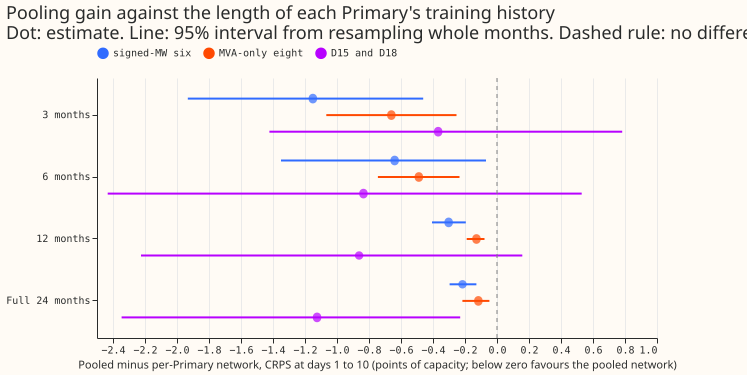
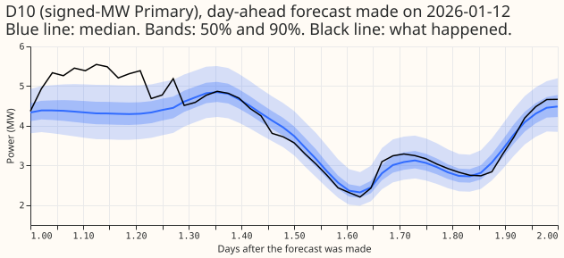
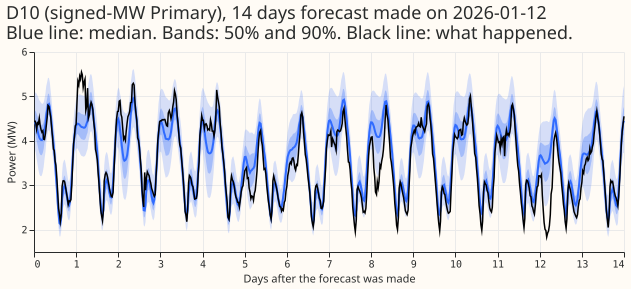
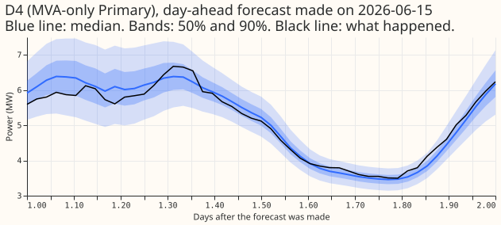
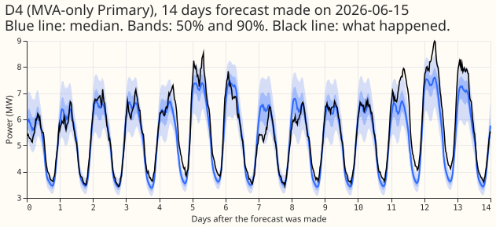

**Take-home message: the Primary embedding is what makes pooling work, and a pooled network helps most
where one Primary has little history.** One pooled network with no Primary input scores 0.574 points
of capacity worse than one network per Primary at the six signed-MW Primaries (95% interval +0.428
to +0.738), so sharing parameters alone gives no gain. Adding the 8-wide Primary embedding turns
that into a gain of 0.216 points (−0.296 to −0.129). **The pooling gain grows as one Primary's
history shortens:** with only that Primary cut to 3 months, the pooled network beats the per-Primary
network by 1.151 points at the signed-MW six (−1.932 to −0.461) and by 0.660 points at the MVA-only
eight (−1.067 to −0.253). The verdict is `not supported`: the hypothesis that the gain comes from
shared parameters and does not grow with short history failed on both counts. Every number comes
from five test months, so all are interim.

## Results

CRPS at days 1 to 10, mean over Primaries with equal weight, in points of capacity (smaller is
better). All arms except the last two columns use the D15 and D18 start cut.

| Group | Per-Primary | Pooled, embedding | Pooled, no embedding | Uncut per-Primary (397) | Uncut pooled (397) |
|---|---|---|---|---|---|
| Signed-MW six | 3.538 | 3.322 | 4.112 | 3.536 | 3.295 |
| MVA-only eight | 3.945 | 3.829 | 4.638 | 3.945 | 3.875 |
| D15 and D18 (report-only) | 9.825 | 8.703 | 11.968 | 10.126 | 8.894 |

CRPS when one Primary's history is cut, by length of that history (signed-MW six / MVA-only eight).

| History | Per-Primary | Pooled, embedding |
|---|---|---|
| 3 months | 5.303 / 5.147 | 4.152 / 4.487 |
| 6 months | 4.579 / 4.655 | 3.939 / 4.166 |
| 12 months | 3.621 / 4.034 | 3.319 / 3.905 |
| Full 24 months | 3.538 / 3.945 | 3.322 / 3.829 |

- **Contrasts (pooled with embedding minus per-Primary, signed-MW six / MVA-only eight).** Full
  window −0.216 / −0.116; 12 months −0.302 / −0.128; 6 months −0.640 / −0.488; 3 months −1.151 /
  −0.660. Every interval at the two groups lies below zero.
- **Contrasts without the embedding (signed-MW six / MVA-only eight).** No embedding minus
  per-Primary +0.574 / +0.693; no embedding minus embedding +0.789 / +0.809. Both intervals lie
  above zero.
- **Pooled network barely loses at 12 months.** At 12 months of history for the cut Primary, the
  pooled network scores 3.319 at the signed-MW six, the same as 3.322 at 24 months. The per-Primary
  network loses 0.083 (3.621 against 3.538).
- **D15 and D18.** The pooled network gains 1.125 points over the per-Primary network at the full
  window (−2.346 to −0.230) and 0.368 at 3 months (−1.423 to +0.782). The interval at 3 months
  spans zero, so the larger gain at D15 and D18 is not established.
- **Correlation of the gain with months of history** across the Primaries is −0.15 at
  the full window, −0.03 at 3 months, −0.17 at 6 months, and −0.11 at 12 months: no useful
  relation, as in experiment 403.
- **Start cut (cut minus uncut).** Per-Primary network: +0.002 at the signed-MW six, −0.000 at the
  MVA-only eight, −0.300 at D15 and D18 (interval −1.200 to +0.264). Pooled network: +0.027
  (+0.006 to +0.050), −0.046 (−0.076 to −0.012), and −0.192 (−0.304 to −0.109).

## Example forecasts

The pooled network's median, 50% band, and 90% band against what happened, for D10 (a signed-MW
Primary) and D4 (an MVA-only Primary), from the full-window fits.

## Predictions

- **P1 failed.** The no-embedding network is 0.574 points worse than the per-Primary network, not
  0.161 points better.
- **P2 failed.** At the MVA-only eight it is 0.693 points worse, not 0.047 better.
- **P3 failed.** At 3 months the pooled gain is 0.935 points larger than at the full window at the
  signed-MW six, and 0.544 larger at the MVA-only eight, against a limit of 0.10.
- **P4 held.** The per-Primary network at 3 months is 1.765 points above its full-window value at
  the signed-MW six.
- **P5 partly held.** The start cut lowers D15 and D18 for both networks. It moves the signed-MW six
  and the MVA-only eight by under 0.03 points for the per-Primary network, but moves the pooled
  network's MVA-only eight by −0.046.

## Limits

- **No Primary input means no scale.** The target is each Primary's power over capacity,
  standardised by that Primary's training mean and standard deviation, so the no-embedding network
  predicts a standardised value without any Primary-specific level or spread. This probably explains
  most of its loss, and it means the arm tests "no learned Primary identity", not a network that
  could be given static covariates in its place (the follow-on experiment 1c).
- **The history test cuts one quarter of the Primaries per fit**, so 12 other Primaries keep full
  history, rather than one Primary at a time.
- **Interim.** Five test months give wide intervals, most of all at D15 and D18.
- **Unlogged load-shift events.** NGED says load-shift events may be missing from its logs, so the
  training rows and the scoring rows can hold events no label covers.
- **Training rows keep flagged exact zeros**; the scoring actuals drop them (1,179 half-hours).

## Plan as committed before any fit

### Question and design

**We split the pooling gain into two parts and test whether it depends on history length.** [Campagne
et al. (2026)](https://doi.org/10.48550/arXiv.2610.35074) separate the gain from sharing parameters
across sites from the gain from graph edges. [Experiment
403](../00403-pooled-versus-per-primary-mixture-density-network/result.md) found that one pooled
network scores lower than 16 per-Primary networks. This experiment asks how much of that gain
survives when the pooled network has no Primary input at all, and whether the gain grows where
history is short.

- **The networks.** Experiment 397's plain mixture density network (setting `g09`, summary scheme,
  3 Gaussian components), on its five screen folds (test months 2025-10, 2025-12, 2026-01, 2026-03,
  and 2026-06), with three seeds averaged in quantile space, and the same folds, refits, row
  weights, and scoring rows. No XGBoost model is used.
- **Arms at the full 24-month window (with the D15 and D18 start cut).** `per_primary` (one network
  per Primary), `pooled_emb` (one network with an 8-wide Primary embedding), and `pooled_noemb` (one
  network with no Primary input).
- **Arms at 3, 6, and 12 months (the history test).** This mimics a new substation joining a pooled
  network. `per_primary_h<H>` cuts every Primary to its last `H` months of rows before the refit;
  each Primary's network sees only its own rows, so this equals cutting that Primary alone.
  `pooled_emb_h<H>` is fitted four times per fold and seed, each time with a different quarter of
  the Primaries (every fourth, by index) cut to `H` months and the other 12 at full history; each
  fit is scored only on its cut quarter, and the four quarters are joined. Cutting four Primaries
  at once instead of one is a deviation from a strict one-at-a-time test, made so that the test
  needs 4 pooled fits per fold, seed, and length instead of 16.
- **The start cut.** D15 and D18 lose every training row before 2025-03-01, and every row whose
  weekly lag reaches back before that date (maintainer's rule of 2026-10-30, from [experiment
  399](../00399-xgboost-short-history-start-cut-d15-d18/result.md)). The scoring rows start in
  2025-10, so no scoring actual or inference input is affected.
- **Controls without the cut.** Experiment 397's `plain_own` and `plain_pooled` forecasts, read
  and never written, give contrast C5. They are the same networks without the start cut.

### Components adopted from earlier results

- **Adopted.** One pooled network with a Primary embedding ([experiment
  403](../00403-pooled-versus-per-primary-mixture-density-network/result.md): it scored lower than
  per-Primary networks); the ensemble mean and spread passed through the network once ([experiment
  397](../00397-plain-and-attention-mixture-density-network-for-primary-demand/result.md): within
  0.05 points of 51 passes; [experiment
  394](../00394-xgboost-ensemble-mean-and-std-columns-separately/result.md) found the mean carries
  most of the gain); the half-life of 0.5 years and monthly refits of the XGBoost member; the
  1.15 widening of experiments 389 and 397; and the D15 and D18 start cut of experiment 399. Every
  arm of this experiment is therefore one-pass and cut, and the arm names say what changed.
- **Not adopted.** Attention over input groups ([experiment
  397](../00397-plain-and-attention-mixture-density-network-for-primary-demand/result.md): the gate
  stayed within 0.01 of uniform), which survives only as the `a0` arm that redoes experiment 403's
  contrast; and dropping the spread columns, which experiment 394 suggests is harmless but which no
  arm here tests.

### Standing practices followed, and the deviation

- **Followed.** Monthly refits; the D15 and D18 start cut; every fitted network saved in the
  private data folder; stored forecasts reused as references and never refitted; a few-fold screen
  with every number labelled interim; example forecast charts; a fresh Sonnet code review before
  the first fit. The scorer drops the half-hours that the cleaned power table flags as exact zeros
  (`substation_zero`) from the actuals of every arm, and prints how many.
- **Departure: the training rows are not cleaned of flagged zeros.** The fits started before the
  cleaning rule was issued, and these arms must share their rows with experiment 397's networks to
  isolate the embedding and the history length. Experiment 398 found that dropping the flagged
  half-hours moved the CRPS by at most 0.008 points in four earlier experiments.

### Fit counts, time, and memory

- **Fits.** `pooled_noemb`, `pooled_emb`, and `per_primary` at the full window: 3 arms by 5 folds by
  3 seeds, so 15 pooled fits for each of the two pooled arms and 15 sets of 16 per-Primary
  networks. Three history lengths add 180 pooled fits (4 quarters by 3 lengths by 5 folds by 3
  seeds) and 45 sets of 16 per-Primary networks.
- **Time.** Experiment 397 fitted one pooled plain network in about 50 s and one set of 16
  per-Primary networks in about 50 s on the GPU. Shorter histories train on fewer rows, so the
  whole experiment is expected to take about 5 hours.
- **Memory.** One GPU process with at most 8 GB of host memory (the 397 screen peaked at 7.9 GB for
  a 4.2-million-row fold), and one feeder core. A fold's raw rows are the per-Primary files that
  experiment 397 wrote once, so no table is rebuilt per arm.

### Not in this experiment

**Experiment 1c (leave-one-Primary-out with static covariates in place of the embedding) is a
separate, optional experiment** that runs after this one if a slot is free.

### Checks the write-up reports

- Absolute CRPS of every arm beside experiment 397's uncut networks, per group and per Primary.
- **Example forecasts.** For D10 (signed-MW) and D4 (MVA-only), the pooled network's median, 50%
  band, and 90% band against what happened: one day-ahead forecast and one full 14-day forecast
  from a single run, in winter (made on 2026-01-12) and summer (made on 2026-06-15).
- C4 per Primary against months of history, with the correlation at each history length.
- **Unlogged load-shift events.** NGED says load-shift events may be missing from its logs.
  Training rows in every arm can therefore hold events no label covers, so a gain measured here is
  measured on rows that may include them.

### Counting towards the demand-v2 stop rule

**This experiment does not count.** It tests where the pooling gain comes from, not a new demand
model, so no idea's count rises whatever the verdict.

## Problems caused by the move

None.
