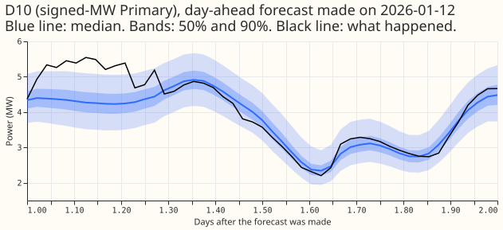
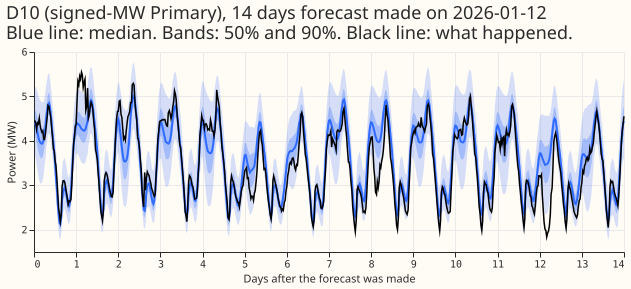
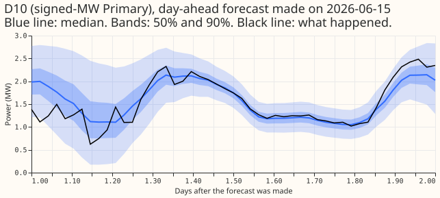
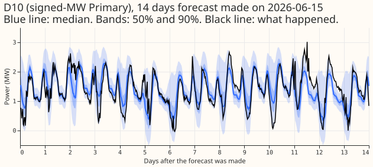
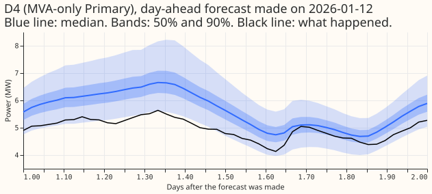
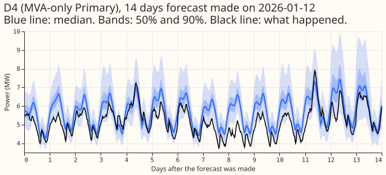
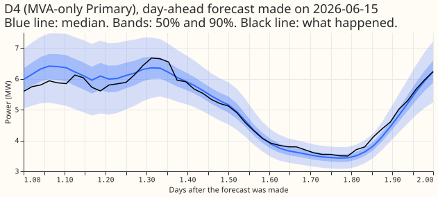
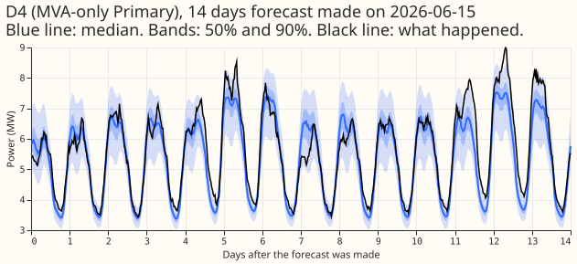

**Take-home message: widening the shared neural network's quantiles by 1.15 is the best of the
fixes tested for its narrow outer bands, and none of the four tail changes beat it.** At the six
signed-MW Primaries (those whose power flows both ways, measured in signed megawatts) the widened
pooled plain neural network (`ctrl_w115`) covers 0.891 of outcomes with its 95% quantile and 0.959
with its 99% quantile. Five mixture components, split-normal components, a widening fitted per lead
band, and a neural network trained directly on quantiles each failed their registered test. No arm
reaches the 0.92 to 0.98 band registered for the per-lead-band widening's q95 coverage. Five
components was best on CRPS (continuous ranked probability score) among the four tail arms, and came
closest to passing T1, but cut the q99 pinball loss by only 1.9% (0.354 against 0.361) against a 3%
bar. The quantile-head neural network, widened, cut the q99 pinball loss by 15.8% (0.304) but raised
the CRPS by 0.066 points of capacity (+0.052 to +0.078), so it fails T4. Two changes are worth
testing next: the quantile-head neural network as a separate tail model, and a widening fitted on
weeks closer to the test period. The verdict is `not supported`. Every number comes from five test
months, so all are interim.

## Coverage and loss at the outer quantiles

**The raw neural networks are too narrow at the signed-MW six, and only the global 1.15 widening
moved the coverage appreciably.** The tables give coverage (Cov, nominal 0.01, 0.05, 0.95, and
0.99) and pinball loss (Pin) at the four outer quantiles, days 1 to 10, mean over the six signed-MW
Primaries. The `_w115` arms are widened by 1.15, and the `_bw` arms by a factor fitted per lead
band. The reference `ctrl_w115` is in bold. Coverage at the 95% level rose from 0.854 (`ctrl`) to
0.891 (`ctrl_w115`); the per-lead-band widening gave 0.856.

All half-hours (429,350 per arm):

| Arm | Cov q01 | Cov q05 | Cov q95 | Cov q99 | Pin q01 | Pin q05 | Pin q95 | Pin q99 |
|---|---|---|---|---|---|---|---|---|
| ctrl | 0.014 | 0.040 | 0.854 | 0.940 | 0.204 | 0.712 | 1.041 | 0.423 |
| **ctrl_w115** | 0.009 | 0.027 | 0.891 | 0.959 | 0.201 | 0.728 | 0.957 | 0.361 |
| ctrl_bw | 0.014 | 0.041 | 0.856 | 0.943 | 0.203 | 0.710 | 1.040 | 0.414 |
| k5 | 0.014 | 0.041 | 0.852 | 0.940 | 0.198 | 0.709 | 1.050 | 0.416 |
| k5_w115 | 0.008 | 0.029 | 0.888 | 0.960 | 0.193 | 0.722 | 0.964 | 0.354 |
| k5_bw | 0.014 | 0.041 | 0.854 | 0.944 | 0.195 | 0.707 | 1.045 | 0.404 |
| skew | 0.014 | 0.040 | 0.856 | 0.940 | 0.204 | 0.711 | 1.052 | 0.431 |
| skew_w115 | 0.009 | 0.027 | 0.892 | 0.959 | 0.201 | 0.728 | 0.972 | 0.369 |
| skew_bw | 0.013 | 0.040 | 0.855 | 0.944 | 0.203 | 0.711 | 1.056 | 0.419 |
| qhead | 0.015 | 0.046 | 0.849 | 0.948 | 0.215 | 0.750 | 1.079 | 0.366 |
| qhead_w115 | 0.009 | 0.032 | 0.886 | 0.966 | 0.208 | 0.760 | 0.978 | 0.304 |
| qhead_bw | 0.016 | 0.044 | 0.854 | 0.954 | 0.215 | 0.747 | 1.064 | 0.344 |
| hl365 | 0.015 | 0.041 | 0.845 | 0.933 | 0.207 | 0.713 | 1.063 | 0.441 |
| hl365_w115 | 0.010 | 0.028 | 0.883 | 0.954 | 0.201 | 0.727 | 0.973 | 0.372 |
| hl91 | 0.013 | 0.041 | 0.861 | 0.946 | 0.199 | 0.717 | 1.033 | 0.393 |
| hl91_w115 | 0.007 | 0.027 | 0.896 | 0.964 | 0.199 | 0.736 | 0.956 | 0.341 |
| a0 | 0.017 | 0.046 | 0.851 | 0.934 | 0.218 | 0.730 | 1.063 | 0.439 |
| uncut_a0 | 0.014 | 0.043 | 0.851 | 0.932 | 0.201 | 0.716 | 1.079 | 0.449 |
| per_primary_cut | 0.014 | 0.040 | 0.844 | 0.930 | 0.230 | 0.761 | 1.144 | 0.463 |
| uncut_pooled_plain | 0.014 | 0.041 | 0.854 | 0.940 | 0.195 | 0.702 | 1.041 | 0.417 |
| pooled_plain_cut_406 | 0.015 | 0.041 | 0.854 | 0.939 | 0.206 | 0.719 | 1.044 | 0.418 |

On sunny low-demand half-hours (15,151 per arm) the raw neural networks already over-cover at the
95% level (0.980 for `ctrl`), so the 1.15 widening raises the q95 pinball loss there (0.871 to
0.953):

| Arm | Cov q01 | Cov q05 | Cov q95 | Cov q99 | Pin q01 | Pin q05 | Pin q95 | Pin q99 |
|---|---|---|---|---|---|---|---|---|
| ctrl | 0.009 | 0.052 | 0.980 | 0.998 | 0.162 | 0.621 | 0.871 | 0.239 |
| **ctrl_w115** | 0.004 | 0.029 | 0.988 | 1.000 | 0.174 | 0.641 | 0.953 | 0.269 |
| ctrl_bw | 0.009 | 0.051 | 0.979 | 0.998 | 0.162 | 0.619 | 0.867 | 0.247 |
| k5 | 0.009 | 0.050 | 0.980 | 0.998 | 0.162 | 0.620 | 0.884 | 0.241 |
| k5_w115 | 0.004 | 0.028 | 0.990 | 0.999 | 0.173 | 0.641 | 0.972 | 0.272 |
| k5_bw | 0.008 | 0.047 | 0.980 | 0.998 | 0.163 | 0.619 | 0.884 | 0.248 |
| skew | 0.008 | 0.051 | 0.980 | 0.997 | 0.161 | 0.623 | 0.880 | 0.242 |
| skew_w115 | 0.003 | 0.027 | 0.990 | 0.999 | 0.174 | 0.645 | 0.962 | 0.272 |
| skew_bw | 0.006 | 0.048 | 0.979 | 0.998 | 0.163 | 0.625 | 0.873 | 0.249 |
| qhead | 0.011 | 0.063 | 0.975 | 0.998 | 0.168 | 0.651 | 0.864 | 0.235 |
| qhead_w115 | 0.003 | 0.033 | 0.986 | 1.000 | 0.178 | 0.662 | 0.929 | 0.263 |
| qhead_bw | 0.012 | 0.059 | 0.975 | 0.998 | 0.169 | 0.648 | 0.861 | 0.239 |
| hl365 | 0.009 | 0.050 | 0.980 | 0.997 | 0.161 | 0.608 | 0.888 | 0.241 |
| hl365_w115 | 0.003 | 0.027 | 0.990 | 0.999 | 0.173 | 0.630 | 0.973 | 0.271 |
| hl91 | 0.010 | 0.061 | 0.973 | 0.998 | 0.171 | 0.662 | 0.936 | 0.254 |
| hl91_w115 | 0.004 | 0.031 | 0.984 | 1.000 | 0.182 | 0.675 | 1.017 | 0.287 |
| a0 | 0.008 | 0.049 | 0.978 | 0.997 | 0.162 | 0.615 | 0.892 | 0.247 |
| uncut_a0 | 0.010 | 0.055 | 0.979 | 0.997 | 0.162 | 0.625 | 0.903 | 0.251 |
| per_primary_cut | 0.010 | 0.062 | 0.977 | 0.997 | 0.161 | 0.630 | 0.973 | 0.266 |
| uncut_pooled_plain | 0.009 | 0.051 | 0.977 | 0.997 | 0.161 | 0.608 | 0.871 | 0.237 |
| pooled_plain_cut_406 | 0.009 | 0.048 | 0.980 | 0.997 | 0.164 | 0.625 | 0.876 | 0.238 |

- **MVA-only eight and D15 and D18** show a smaller (MVA-only eight) or similar (D15 and D18) shortfall; their tables
  are in the logs `rescore_a.log`, `rescore_b.log`, and `rescore_c.log` of the private data folder.
  For example,
  `ctrl_w115` covers 0.944 at q95 and 0.988 at q99 across the MVA-only eight.
- **The quantile head trades the central forecast for the tails.** Raw `qhead` covers 0.948 at q99
  at the signed-MW six against 0.940 for `ctrl`, but its q95 coverage is 0.849 against 0.854 and its
  q05 pinball loss is higher (0.750 against 0.712).
- **The shorter half-life gave the lowest q99 pinball loss among the non-quantile arms.**
  `hl91_w115` scored 0.341 (5.5% below the reference) at the signed-MW six, at a CRPS of 3.350
  against 3.277.

## Results

Continuous ranked probability score (CRPS) at days 1 to 10, mean over Primaries with equal weight,
in points of capacity (smaller is better). The signed-MW six are the Primaries whose power is
measured in signed megawatts, and the MVA-only eight are those measured only in megavolt-amperes.
The last five rows are references and the group-attention
neural network (`a0`). The start cut applies to every arm except those marked uncut.

| Arm | Signed-MW six | MVA-only eight | D15 and D18 (report-only) |
|---|---|---|---|
| ctrl | 3.302 | 3.860 | 8.699 |
| **ctrl_w115** | 3.277 | 3.858 | 8.653 |
| ctrl_bw | 3.299 | 3.860 | 8.687 |
| k5 | 3.310 | 3.861 | 8.648 |
| k5_w115 | 3.285 | 3.860 | 8.588 |
| k5_bw | 3.306 | 3.860 | 8.635 |
| skew | 3.322 | 3.852 | 8.679 |
| skew_w115 | 3.298 | 3.851 | 8.630 |
| skew_bw | 3.320 | 3.852 | 8.673 |
| qhead | 3.372 | 3.909 | 8.971 |
| qhead_w115 | 3.343 | 3.901 | 8.906 |
| qhead_bw | 3.365 | 3.907 | 8.955 |
| hl365 | 3.314 | 3.888 | 8.894 |
| hl365_w115 | 3.287 | 3.884 | 8.848 |
| hl91 | 3.370 | 3.881 | 8.500 |
| hl91_w115 | 3.350 | 3.883 | 8.471 |
| a0 | 3.334 | 3.812 | 10.121 |
| uncut_a0 | 3.351 | 3.784 | 10.443 |
| per_primary_cut | 3.538 | 3.945 | 9.825 |
| uncut_pooled_plain | 3.295 | 3.875 | 8.894 |
| pooled_plain_cut_406 | 3.322 | 3.829 | 8.703 |

**Contrasts against the reference `ctrl_w115`** (treatment minus reference, month-block bootstrap,
95% interval, interim), signed-MW six / MVA-only eight / D15 and D18:

| Contrast | Signed-MW six | MVA-only eight | D15 and D18 |
|---|---|---|---|
| T1: 5 components, widened 1.15 | +0.008 (-0.017 to +0.032) | +0.002 (-0.020 to +0.015) | -0.065 (-0.184 to +0.120) |
| T2: split-normal, raw | +0.044 (-0.002 to +0.103) | -0.006 (-0.023 to +0.018) | +0.026 (-0.069 to +0.124) |
| T2: split-normal, widened 1.15 | +0.021 (-0.006 to +0.053) | -0.007 (-0.022 to +0.015) | -0.023 (-0.182 to +0.117) |
| T3: per-lead-band widening of `ctrl` | +0.022 (-0.003 to +0.050) | +0.002 (-0.004 to +0.008) | +0.034 (-0.048 to +0.127) |
| T4: quantile head, raw | +0.095 (+0.054 to +0.135) | +0.051 (-0.015 to +0.111) | +0.319 (-0.075 to +0.715) |
| T4: quantile head, widened 1.15 | +0.066 (+0.052 to +0.078) | +0.043 (-0.019 to +0.099) | +0.254 (-0.101 to +0.585) |
| H1: half-life 1 year, widened | +0.009 (-0.015 to +0.033) | +0.026 (-0.031 to +0.100) | +0.196 (-0.084 to +0.545) |
| H2: half-life 0.25 years, widened | +0.073 (-0.003 to +0.140) | +0.025 (-0.075 to +0.131) | -0.183 (-0.658 to +0.309) |
| C6: `a0` with the cut minus `a0` without, raw | -0.017 (-0.067 to +0.017) | +0.028 (+0.010 to +0.047) | -0.324 (-0.638 to -0.028) |
| C7: `a0` minus per-Primary neural network, both cut, raw | -0.204 (-0.295 to -0.122) | -0.133 (-0.231 to -0.066) | +0.298 (-1.683 to +2.635) |
| Sanity: `ctrl` minus experiment 406's pooled plain network | -0.021 (-0.031 to -0.014) | +0.032 (+0.008 to +0.068) | -0.004 (-0.124 to +0.122) |

- **Only the quantile head's CRPS interval at the signed-MW six lies wholly above zero** among the
  four tail arms (both raw and widened). Every other tail-arm and half-life interval spans zero.
- **The sanity contrast is not zero.** `ctrl` differs from the pooled plain network of experiment
  406 by -0.021 at the signed-MW six and +0.032 at the MVA-only eight, with intervals that exclude
  zero. The known difference is that `ctrl` trained on cleaned rows and experiment 406's neural
  network did not, so the cleaning is the likely cause, but the logs do not test this.
- **Cold nights (report-only, no intervals).** At the signed-MW six the CRPS on cold nights was
  5.376 for `ctrl_w115`, 5.227 for `qhead_w115`, and 5.214 for `hl91_w115`.

## Example forecasts

The reference's median, 50% band, and 90% band against what happened, for D10 (a signed-MW Primary)
and D4 (an MVA-only Primary): a day-ahead forecast and a full 14-day forecast from one run, made in
winter (2026-01-12) and summer (2026-06-15).

## Predictions

- **T1 failed.** With 5 components and the 1.15 widening, the q99 pinball loss at the signed-MW six
  is 0.354 against 0.361, 1.9% lower and short of the 3% bar. The CRPS is +0.008, inside the 0.02
  limit.
- **T2 failed.** The raw split-normal arm reaches q95 coverage 0.856, not 0.90, and its CRPS is
  +0.044 above the reference, not within 0.02.
- **T3 failed.** The per-lead-band widening gives q95 coverage 0.856 (needed 0.92 to 0.98) and q99
  coverage 0.943 (needed 0.97 or more). Its CRPS is +0.022, just over the 0.02 limit.
- **T4 failed.** The raw quantile head's CRPS is +0.095 above the reference, outside the 0.03 limit
  (widened: +0.066). Its pinball loss on sunny low-demand half-hours is below the reference's at q01
  (0.168 against 0.174) and above it at q05 (0.651 against 0.641). The widened head is above the
  reference at both (0.178 and 0.662).
- **H1 held.** A half-life of 1 year is not better than the control by more than 0.02 at either
  group: +0.009 at the signed-MW six and +0.026 at the MVA-only eight.
- **H2 held.** A half-life of 0.25 years is not better than the control: +0.073 and +0.025. At D15
  and D18 (report-only) it scored -0.183 (-0.658 to +0.309), which spans zero.
- **C6 held.** The start cut lowers the CRPS at D15 and D18 together for `a0` by 0.324 (-0.638 to
  -0.028), and moves the signed-MW six by -0.017 and the MVA-only eight by +0.028, both under 0.03.
  The MVA-only eight interval (+0.010 to +0.047) lies above zero.
- **C7 held.** With the cut, `a0` minus the per-Primary plain neural network is -0.204 (-0.295 to
  -0.122) at the signed-MW six, below the -0.10 bar (experiment 403 found -0.185 without the cut).

## Decision

**The hypothesis is not supported, by the decision rule as written.** All four of T1 to T4 failed,
so no arm is carried forward. H1, H2, C6, and C7 do not count towards the decision. The smallest
change worth carrying forward was a 3% lower q99 pinball loss at no CRPS loss; no arm met it.

## Components adopted or not adopted

- **Adopted, unchanged.** The global 1.15 widening, the 0.5-year half-life, 3 Gaussian components,
  and the D15 and D18 start cut.
- **Not adopted.** 5 components, split-normal components, the per-lead-band widening fitted on
  held-out weeks, the quantile head, and half-lives of 1 year and 0.25 years. The quantile head is
  worth testing as a tail model.
- **Attention over input groups** (`a0`) is not adopted. `a0` beats the per-Primary neural network
  (C7) but scores 3.334 at the signed-MW six against 3.302 for `ctrl`; the logs print no interval
  for that contrast.

## Limits

- **Interim.** Five test months give wide intervals, most of all at D15 and D18, and no claim of
  benefit rests on any number here.
- **The widening fitted on held-out weeks barely changed the coverage.** The logs do not print the
  fitted factors. The held-out weeks are rows the neural network never trains on, and they are older
  on average than the test months. The experiment did not test whether that age explains the result.
- **The avoidable-curtailment cost is not reported.** The scorer logs hold no curtailment-cost
  figure.
- **Seed averaging.** The widening was fitted and applied per seed and the three seeds were then
  averaged, so the averaged `_bw` forecast is not exactly calibrated.
- **Unlogged load-shift events.** NGED says load-shift events may be missing from its logs, so the
  training rows and the scoring rows can hold events no label covers.
- **Cleaned data.** Training rows drop every half-hour that the cleaned power table flags as an
  exact zero. The scorer dropped 1,179 flagged half-hours from the actuals of every arm, including
  the references from experiments 397 and 406, which were trained without this cleaning.
- **Departure: the widening is fitted on held-out weeks, not on a validation month**, as the plan
  states. The load-shift event plots are not drawn.

## Problems caused by the move

None.

## Plan as committed before any fit

### Question and design

**We change one thing at a time in the pooled plain network and compare each change with the same
network widened by a global factor.** [Experiment
397](../00397-plain-and-attention-mixture-density-network-for-primary-demand/result.md) found that
the networks cover too few outcomes with their 95% quantile at the six signed-MW Primaries, and
that a widening of 1.15 only lifts the coverage to about 0.89. This experiment tests four ways to
fix the tails and two row-weight half-lives.

- **The networks.** The pooled plain network of experiment 397 (setting `g09`, summary scheme, an
  8-wide Primary embedding) on its five screen folds (test months 2025-10, 2025-12, 2026-01,
  2026-03, and 2026-06), with three seeds averaged in quantile space and the same refits and
  scoring rows.
- **`ctrl`.** 3 Gaussian components, row-weight half-life 0.5 years. Its widened version
  `ctrl_w115` is the reference.
- **`k5`.** 5 Gaussian components.
- **`skew`.** 3 split-normal components. A split-normal component has one standard deviation below
  its mode and another above it, so a component can be skewed. Each component's density and
  distribution function have closed forms, so the quantiles come from the same bisection as the
  Gaussian mixture. A Student-t family is not tested, because the Student-t distribution function
  has no closed form in the neural-network library used.
- **`ctrl_bw`: widening fitted per lead band.** For each of five lead bands (day 1, days 2 to 3,
  days 4 to 7, days 8 to 10, days 11 to 14) and each of q01, q05, q95, and q99, the factor that
  makes the share of held-out rows below the widened quantile equal the nominal level. The held-out
  rows are the one week in every 12 that the network did not train on (the same rows that stop
  its training), so the widening is fitted inside each refit on rows the network has not seen. The
  factor is limited to between 0.5 and 4. Every arm also gets its `_bw` version, and the 1.15
  `_w115` version.
- **`qhead`.** 11 quantiles output directly (a median and cumulative positive steps either side, so
  they cannot cross) and trained with the pinball loss averaged over the 11 levels.
- **`hl365` and `hl91`.** `ctrl` with row weights that halve every 1 year and every 0.25 years
  (the control halves every 0.5 years, as the XGBoost member does).
- **`a0`.** Experiment 397's group-attention network with uniform weights, fitted with the start
  cut, to redo experiment 403's contrast.
- **The start cut.** D15 and D18 lose every training row before 2025-03-01, and every row whose
  weekly lag reaches back before that date (maintainer's rule of 2026-10-30, from [experiment
  399](../00399-xgboost-short-history-start-cut-d15-d18/result.md)). The scoring rows start in
  2025-10, so no scoring actual or inference input is affected.
- **Input ports from XGBoost** (the solar summary column and sunny flag with a 1-year half-life,
  and trailing temperature means) are not in this experiment and follow as a separate experiment.

### Components adopted from earlier results

- **Adopted.** One pooled network with a Primary embedding ([experiment
  403](../00403-pooled-versus-per-primary-mixture-density-network/result.md): it scored lower than
  per-Primary networks); the ensemble mean and spread passed through the network once ([experiment
  397](../00397-plain-and-attention-mixture-density-network-for-primary-demand/result.md): within
  0.05 points of 51 passes; [experiment
  394](../00394-xgboost-ensemble-mean-and-std-columns-separately/result.md) found the mean carries
  most of the gain); the half-life of 0.5 years and monthly refits of the XGBoost member; the
  1.15 widening of experiments 389 and 397; and the D15 and D18 start cut of experiment 399. Every
  arm of this experiment is therefore pooled, one-pass, widened where stated, and cut, and the
  arm names say what changed from that base.
- **Not adopted.** Attention over input groups ([experiment
  397](../00397-plain-and-attention-mixture-density-network-for-primary-demand/result.md): the gate
  stayed within 0.01 of uniform), which survives only as the `a0` arm that redoes experiment 403's
  contrast; and dropping the spread columns, which experiment 394 suggests is harmless but which no
  arm here tests.

### Standing practices followed, and the deviations

**This experiment follows the standing practices of the `ml-experiment` skill and `common.md`, and
departs from two.**

- **Followed.** Monthly refits; the D15 and D18 start cut; every fitted network saved in the
  private data folder; stored forecasts reused as references and never refitted; a few-fold screen
  with every number labelled interim; tails and the avoidable-curtailment cost reported beside the
  CRPS; example forecast charts; a fresh Sonnet code review before the first fit.
- **Cleaned data.** Training rows drop every half-hour that the cleaned power table flags as an
  exact zero (`substation_zero`), and every row whose lag reaches a flagged half-hour. The scorer
  drops flagged half-hours from the actuals of every arm, including the references from experiments
  397 and 406. The number of rows dropped is printed for each fold. A forecast row whose inference
  input reaches a flagged lag half-hour is kept, because the flagged half-hours are rare
  (experiment 398 found 38 in the scored Primary half-hours), and the same rows enter every arm.
  The references from experiments 397 and 406 were trained without this cleaning.
- **Departure: the widening is fitted on held-out weeks, not on a validation month.** The rule asks
  for a validation month inside the refit. A validation month would need a second fit per refit.
  The held-out weeks (one in every 12 across the 24-month window) are rows the network never
  trains on, so they play the same part at no extra fit, but they are older on average than the
  month before the refit.
- **Departure: the load-shift event plots are not drawn**, because this experiment does not score
  performance during or after load-shift events.

### Fit counts, time, and memory

- **Fits.** `ctrl`, `k5`, `skew`, `qhead`, `hl365`, and `hl91`: 6 arms by 5 folds by 3 seeds, so 90
  pooled fits, and 15 more for `a0`. The widenings need no refit.
- **Time.** Experiment 397 fitted a pooled plain network in about 50 s and A0 in about 130 s on the
  GPU, so the experiment is expected to take about 2.5 hours.
- **Memory.** One GPU process with at most 8 GB of host memory and one feeder core. The per-Primary
  raw rows that experiment 397 wrote are read once per fold, a fold's tables are built once per
  half-life and shared by every arm and seed with that half-life, and the held-out rows' widening
  is computed once per fit.

### Checks the write-up reports

- Absolute CRPS of every arm beside experiment 397's uncut networks, per group and per Primary.
- **Tails first.** Coverage and pinball loss at q01, q05, q95, and q99, on all half-hours and on
  sunny low-demand half-hours, which are the sunny half-hours (experiment 381's flag) whose
  reference median is in the lowest quarter for the Primary. The rows are chosen from the
  forecast, never from the outcome.
- **Example forecasts.** For D10 (signed-MW) and D4 (MVA-only), the reference's median, 50% band,
  and 90% band against what happened: one day-ahead forecast and one full 14-day forecast from a
  single run, in winter (made on 2026-01-12) and summer (made on 2026-06-15).
- **Unlogged load-shift events.** NGED says load-shift events may be missing from its logs, so the
  training rows and the scoring rows can hold events no label covers.

### Caveats registered before the scores

- **Widening factors are fitted per seed and applied per seed**, and the scorer then averages the
  widened quantiles over the three seeds, so the averaged `_bw` forecast is not exactly calibrated
  at the nominal level.
- **The widening is fitted on the unweighted held-out weeks across the whole 24-month window.** For
  `hl91`, whose network concentrates on recent rows, the factors reflect older rows that the network
  fits less closely.
- **The sunny low-demand quarter is taken over all leads of the sunny half-hours**, and the tail
  table then uses the days 1 to 10 rows of it.

### Counting towards the demand-v2 stop rule

**This experiment does not count.** It tests changes to the tails of an existing model, not a new
demand model, so no idea's count rises whatever the verdict.
