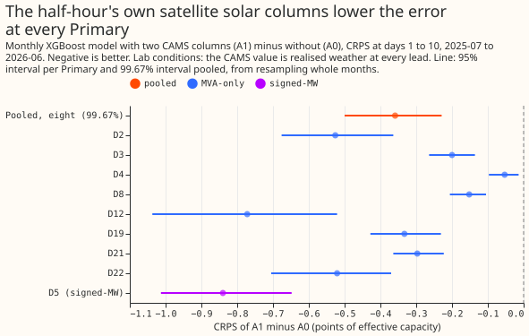
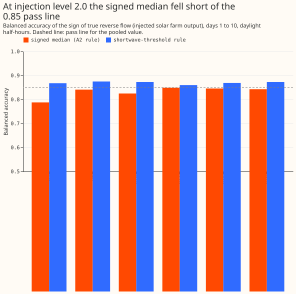
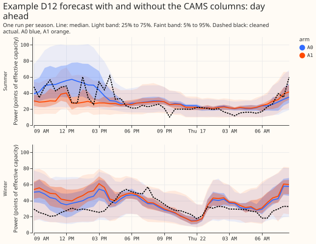
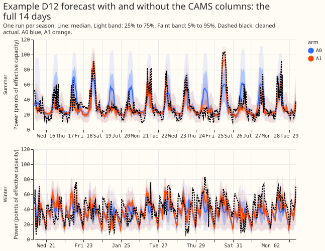

# Can the monthly XGBoost model infer signed MW from MVA readings, in lab conditions?

**Take-home: two satellite solar columns lowered the forecast error at 15 of the 16 Primaries, but
only because the lab gives the model the realised sunshine, and the attempt to recover a signed MW
forecast failed its known-answer test.** At the eight MVA-only Primaries (D2, D3, D4, D8, D12, D19,
D21, and D22) the continuous ranked probability score (CRPS) fell by 0.359 points of effective
capacity (99.67% interval -0.500 to -0.229) when the monthly XGBoost model received the CAMS solar
columns, and by 0.772 (95% interval -1.037 to -0.521) at D12. In production the Copernicus
Atmosphere Monitoring Service (CAMS) value arrives about a day late, so this gain is a ceiling, not
a forecast of what production would see. The registered rule for labelling reverse flow recovered
the sign of injected solar output with pooled balanced accuracy 0.834 against a pass line of 0.85,
so the stop rule applied: the signed-label arms were not run and there is still no trusted signed
forecast at the MVA-only Primaries. Verdict: partly supported.

At the eight MVA-only Primaries the meter records apparent power in megavolt-amperes, which has no
sign, so reverse flow from embedded solar looks like demand. D-codes are anonymised Primary
substations of NGED, the electricity distribution network operator that supplies the data.
Experiments 152, 372, 374, and 387 each tried a different fold treatment and none gave a trusted
signed forecast. This experiment gave the monthly XGBoost model two CAMS columns and labelled
reverse flow by a physics rule before training. It first tested that rule on six Primaries whose
meters record sign, after adding the recorded output of a metered solar farm so that the true
answer is known.

## What changed since the brief was written

- **Experiment 387 merged** (not supported: a folded loss leaves the sign set by the start, and
  its custom objective scored about 0.11 points worse than the built-in quantile loss). This
  experiment therefore uses only the built-in `reg:quantileerror` loss and a label.
- **Standing rules added to `common.md` on 2026-10-30** are applied: monthly refits only, cleaned
  data with the `substation_zero` half-hours dropped, the D15 and D18 rows before 2025-03-01 cut,
  boosters saved as `.ubj`, tails and avoidable-curtailment cost reported, and example forecasts
  plotted.
- **Stored control not reused for A0.** Experiment 381's `monthly/control` was fit on the uncleaned
  cache without the D15 and D18 cut, so A0 is refit here. Experiment 381's stored forecasts serve
  only the code check.

## The known-answer test failed

**The registered rule recovered the sign of injected reverse flow for about three half-hours in
four, which is short of the pass line.** At the six Primaries whose meters record sign, we added a
metered solar farm's output (twice the median sunny-midday reading), discarded the sign, and asked
the rule-labelled model (A2 at tau 0.7) to recover it. The signed median's pooled balanced accuracy
(the mean of the share of reverse-flow half-hours it called and the share of other half-hours it
left alone) was 0.834 against 0.85. Its signed mean absolute error was 9.3 points against 19.5 for
the plain model read as signed. It did not beat a rule that flips the sign whenever realised ERA5
shortwave irradiance exceeds a threshold fitted on the training years: that rule scored 0.86 to
0.88 per Primary, 0.036 above the model, though it wrongly flipped 14% to 19% of the half-hours with
no reverse flow against 2% to 5% for the model.

- **Criteria (pooled over six Primaries, 12 monthly refits, days 1 to 10, daylight half-hours).**
  Pooled balanced accuracy 0.834 (needs 0.85: fail). Lowest Primary 0.788 at D5 (needs 0.70: pass).
  False-reverse rate 3.6% (needs at most 5%: pass). Margin over the shortwave rule -0.036 (needs
  +0.03: fail). Signed mean absolute error 9.3 against 19.5 (pass).
- **Per Primary.** D5 0.788, D9 0.841, D10 0.825, D11 0.849, D14 0.846, D16 0.843, with recall on
  reverse flow 0.60 to 0.75.
- **The shortwave comparison favours that rule.** It reads realised ERA5 shortwave at the valid time,
  which a 10-day forecast does not know. The gate fails on pooled balanced accuracy alone, so
  dropping the margin criterion would not change the verdict.
- **Most of the loss belongs to the rule.** Used alone on the injected data (no model fit), the
  rule's labels reach recall 0.64 to 0.79 with false-reverse 3.8% to 6.1% at level 2.0. A single-fit
  rule scores 0.74 to 0.85 per Primary, so the 0.85 pass line sits at the ceiling the rule's own
  labels allow. D9 is the exception: the model (0.841) beat the single-fit rule (0.737).
- **The miss is small but not noise.** A bootstrap over (Primary, refit) pairs gives a pooled
  balanced accuracy of 0.821 to 0.846 (5th to 95th percentile), so the miss is about 0.016.
- **The rule's gate opens at two real Primaries.** Read as apparent power, real readings open the
  gate only at D10 (a signed-MW Primary with 130 real reverse half-hours) and at D12. There the
  rule labels 97% and 92% of sunny summer-midday training half-hours as reverse flow, because the
  constant `C` is fitted from the same rows that it then labels. The 92% at D12 is therefore not
  evidence that D12 exports on 92% of sunny middays.
- **Stop rule.** The gate failed at level 2.0, so level 1.0 and the A2 arms (tau 0.7, tau 0.5,
  off, shuffled, and forced gate) were not run. This would be the fifth fold treatment after
  experiments 152, 372, 374, and 387, so the next step is the maintainer's decision.

## Scores

**The CAMS columns (A1) lowered CRPS at 15 of 16 Primaries.** Differences are A1 minus A0, days 1 to
10, in points of effective capacity; 95% intervals per Primary from resampling whole months.
Negative is better.

| Primary | A0 | A1 | A1 minus A0 (95% interval) |
|---|---|---|---|
| D12 | 6.800 | 6.027 | -0.772 (-1.037 to -0.521) |
| D8 | 7.639 | 7.487 | -0.152 (-0.206 to -0.105) |
| D22 | 3.828 | 3.307 | -0.521 (-0.705 to -0.370) |
| D19 | 3.284 | 2.951 | -0.333 (-0.428 to -0.231) |
| D4 | 2.501 | 2.447 | -0.053 (-0.097 to -0.014) |
| D21 | 2.360 | 2.063 | -0.297 (-0.364 to -0.223) |
| D2 | 2.335 | 1.809 | -0.526 (-0.676 to -0.364) |
| D3 | 1.749 | 1.549 | -0.200 (-0.264 to -0.136) |
| D5 | 3.888 | 3.048 | -0.840 (-1.013 to -0.648) |
| D9 | 2.540 | 2.170 | -0.371 (-0.452 to -0.288) |
| D10 | 3.610 | 3.099 | -0.511 (-0.661 to -0.360) |
| D11 | 2.598 | 2.257 | -0.341 (-0.424 to -0.254) |
| D14 | 2.644 | 2.276 | -0.368 (-0.446 to -0.282) |
| D16 | 3.384 | 2.962 | -0.422 (-0.531 to -0.318) |
| D15 | 15.424 | 15.473 | +0.048 (-0.314 to +0.341) |
| D18 | 2.643 | 2.014 | -0.628 (-0.770 to -0.507) |

- **Pooled contrast C1.** Eight MVA-only Primaries -0.359 (99.67% interval -0.500 to -0.229); the
  other eight Primaries -0.461 (-0.569 to -0.319); D12 alone -0.772 (-1.183 to -0.416). Widening
  every quantile band by 15% (A0_w115, A1_w115) gives -0.363, -0.464, and -0.793, so the gain does
  not come from the bands.
- **D15 is the only Primary without a gain.** Its +0.048 is just under the +0.05 limit of the
  porting rule and rests on 4 scored months, with an interval of -0.314 to +0.341. D18 rests on 6
  scored months and D8 on 11.
- **Sunny half-hours gain most.** On the `sunny_unit_shape` slice C1 is -0.969 (-1.393 to -0.610)
  pooled over the eight MVA-only Primaries and -2.349 (-3.731 to -0.969) at D12.
- **Cold nights and the Economy 7 step are unchanged.** On cold winter nights C1 is -0.019 (-0.040
  to +0.018) pooled and -0.007 (-0.229 to +0.110) at D12; on the Economy 7 step it is -0.005 (-0.024
  to +0.006) pooled and -0.046 (-0.154 to +0.012) at D12. All four intervals include zero.
- **References on the same rows (CRPS, days 1 to 10).** At D12 BG2 scored 6.747, the GAM stack
  7.512, `manual_heuristic` 7.921, and climatology 8.827, so A1 (6.027) is below all four; A0
  (6.800) is above BG2. At D2 A1 (1.809) is below BG2 (2.297), the stack (2.474), and
  `manual_heuristic` (2.857). The other Primaries' reference scores are in the printed report in
  the private folder.
- **Code check.** A0 reproduces experiment 381's stored control to within 0.002 CRPS (D5 3.887
  against 3.888; D12 6.811 against 6.812).

**The CAMS columns remove the sunny-half-hour under-forecast at D12 and overshoot it slightly.**
The mean error of the median on `sunny_unit_shape` half-hours at D12 was -5.16 points for A0 (-2.06
at day 1, -6.15 at days 8 to 10) and +2.14 for A1 at days 1 to 10 (+1.65 at day 1, +2.65 at days 8
to 10). Experiment 381 found about -5 at D12. The lab's CAMS value is the realised weather at every
lead, so A1's bias does not grow with lead the way A0's does. In production the columns would
describe only past half-hours, so the day-1 to day-10 pattern would look more like A0's.

**Tails move little.** Coverage and pinball loss at the outer quantiles, days 1 to 10:

| Primary | Arm | q01 coverage | q05 coverage | q95 coverage | q99 coverage | q01 pinball | q99 pinball |
|---|---|---|---|---|---|---|---|
| D12 | A0 | 0.0144 | 0.0915 | 0.9374 | 0.9937 | 0.300 | 0.560 |
| D12 | A1 | 0.0124 | 0.0923 | 0.9354 | 0.9939 | 0.280 | 0.541 |
| D2 | A0 | 0.0052 | 0.0397 | 0.9150 | 0.9864 | 0.180 | 0.264 |
| D2 | A1 | 0.0048 | 0.0413 | 0.9178 | 0.9872 | 0.173 | 0.258 |
| D8 | A0 | 0.0213 | 0.0876 | 0.9578 | 0.9945 | 0.375 | 0.430 |
| D8 | A1 | 0.0212 | 0.0923 | 0.9604 | 0.9947 | 0.371 | 0.426 |

At D12 the q05 coverage of 0.09 (nominal 0.05) for both arms is the largest departure from nominal,
and the 15% widening brought it to 0.051 for A0 and 0.055 for A1.

**Avoidable curtailment cost (pounds, limit fraction 0.5) is defined only at the six signed-MW
Primaries, and A1 is below A0 at all six.** The MVA-only meter has no sign, so the cost is null
there by design.

| Primary | A0 | A1 | BG2 | `manual_heuristic` |
|---|---|---|---|---|
| D5 | 1.010e7 | 9.104e6 | 8.991e6 | 9.262e6 |
| D9 | 9.504e6 | 8.203e6 | 9.026e6 | 1.280e7 |
| D10 | 5.520e6 | 5.284e6 | 4.267e6 | 6.581e6 |
| D11 | 1.726e7 | 1.505e7 | 1.626e7 | 2.224e7 |
| D14 | 2.005e7 | 1.802e7 | 1.490e7 | 2.175e7 |
| D16 | 2.550e7 | 2.437e7 | 1.943e7 | 3.221e7 |

At limit fraction 0.9 the cost at D5 is 425,948 (A0), 425,787 (A1), 392,146 (BG2), and 232,138
(`manual_heuristic`), so the manual rule is cheapest there and the columns do not change A0.

## Checks

- **Dropped half-hours.** The cleaning rule dropped 622 half-hours over the cache year, at D12 (4),
  D15 (196), D16 (1), D18 (389), D21 (13), D22 (5), D8 (9), and D9 (5). The 196 for D15 and 389 for
  D18 fall before those Primaries' first scored refits (2026-03-01 and 2026-01-01); within the
  scored windows D15 lost none and D18 lost three.
- **Median minus mean forecast.** Per Primary, in megawatts, between about -0.19 and +0.01 for
  both arms, and A1 is closer to zero at most Primaries (D12 -0.129 for A0, -0.118 for A1).
- **Lead band.** The headline `lead_days_1_10` band is lead above 0 and up to 240 hours.
- **Audit triggers.** Trigger 1 (a known-answer test failed) fired. Trigger 2 (a result contradicts
  a prediction) fired: P3 predicted -0.05 to -0.20 at D12 and the result is -0.772. The explanation
  is oracle weather: the lab columns carry the realised CAMS value at every lead, so the gain grows
  with lead where production's would not.
- **Audit of the numbers.** A fresh Sonnet agent re-derived the CRPS, the contrasts, and the code
  check from the stored forecasts. They match within about 0.2%, except D8 (about 1% in CRPS,
  traced to a difference in the row set), with no leakage and no Primary worse than +0.05.
- **Audit of the gate.** A second fresh Sonnet agent rebuilt the injected truth and the scores from
  the stored files. Every per-Primary and pooled figure matches, the injection uses only data
  before 2025-07-01, and "failed at level 2.0" is a sound reading. It also noted that the reverse
  flow share is 17% to 26% of daylight half-hours, that `Q` is zero by construction (which favours
  the model, so real meters would do no better), and that the 0.85 line was set without knowing the
  rule's ceiling.
- **Prediction outcomes.** P1 failed (0.834). P2 (placebos) was not run. P3 failed on D12 (-0.772
  against -0.05 to -0.20) and failed at the other
  seven (each moved by more than the predicted -0.03 to +0.03; D4's -0.053 is the smallest). P4 and P5 were not run. P6 cannot be tested in the lab,
  because the columns carry realised CAMS values at every lead.
- **Cadence.** Monthly refits only, as the brief required.
- **Saved models and data.** Fitted boosters are `.ubj` files, one per Primary per refit, in the
  experiment's private data folder (`work/full/real/boosters` and `work/full/inj_2.0/boosters`),
  never in git. Injected farm data and per-farm scores stay in the private store, and no farm name
  or series is published here.

## What to try next

- **Test the CAMS gain at production lags.** An arm that gives the model the CAMS value only for
  half-hours at least one day old, or as an anomaly against the forecast weather, would show how
  much of the 0.359 survives. The porting rule for the columns (the pooled interval below zero and
  no Primary worse than +0.05) is met formally, but the lab gain is not a production gain.
- **Whether to continue signed-latent work at the MVA-only Primaries is the maintainer's decision.**
  The stop rule has fired on the fifth treatment. One option the gate audit points to is fitting
  the reverse-flow constant on rows other than those it labels; another is to stop and use a
  structural term (demand minus non-negative generation).

## Design

- **Base recipe (all arms).** Experiment 381's monthly control: 12 refits with origins 2025-07-01
  to 2026-06-01, built-in `reg:quantileerror` with 11 quantiles, 500 rounds, eta 0.05, depth 6,
  seed 0, the default constant `base_score`, `hist`, 3 threads. Fits at 3 threads, no GPU (many
  small per-Primary fits, as experiment 381 found), memory capped at 8 GB.
- **CAMS source and delay.** `cams_demand_points.parquet` (CAMS solar radiation time series,
  hourly global horizontal irradiance at each Primary's coordinates, 2019-09 to 2026-09); each
  hour-ending value is repeated on the two half-hours that end inside the hour
  (`studies.dp_features`). The service publishes with about a 1-day delay, so the columns cannot
  describe the first day of lead in production. Lab conditions use the half-hour's own CAMS value.
  `u_t` is `studies.dp_features.unit_pv_shape`; `k_t` is CAMS GHI over the Haurwitz clear-sky GHI
  (`studies.baselines.haurwitz_w_m2`) at the half-hour's solar zenith.
- **Signed-label rule (A2), refreshed at each refit from the training window only.** The gate is
  open at a Primary when the Spearman correlation of the reading with `u` on summer-midday rows
  with `k` at least 0.7 exceeds +0.3, or the 1st percentile is below 1.0 point of capacity
  (experiment 366's rule, not re-tuned). `D_ref(h)` is the median reading at UTC hour `h` on
  April-to-September training rows with `k` below 0.3. `C` is the median of `(y + D_ref)/u` on
  clear summer-midday training rows. A reading is reverse flow when the gate is open, `k` is at
  least tau, `C u` exceeds `D_ref(h)`, and `C u - y` is at least 2 points. The label is `-y` for
  reverse flow and `+y` otherwise. The lags stay unsigned readings.
- **Shape check (maintainer's rule), pre-registered.** For each Primary, the correlation between
  the inferred reverse-flow magnitude and `C u` on reverse half-hours is reported. A correlation of
  at least 0.8 counts as following the shape; below 0.5 counts as not following it.
- **Fold at serving.** Build a piecewise-linear CDF `F` from the 11 signed quantiles and set
  `H(x) = F(x) - F(-x)` for `x` at least 0. The MVA quantile at level alpha is the inverse of `H`.
  This is the identity whenever q01 is at least 0.
- **Arms.** A0 (control, refit here). A1 (A0 plus `u_t` and `k_t`). A2 (tau = 0.7, registered),
  A2 (tau = 0.5), A2-off (tau infinite; must equal A1 to the last bit, a code check), and A2-shuffle
  (`k` permuted across days within the same month and hour before labelling). A1 is also run at the
  other 8 Primaries as a no-harm check. The A2 arms are run only after the known-answer gate
  passes at level 2.0.
- **Known-answer test, run first.** Sites: D5, D9, D10, D11, D14, D16. Three different metered
  solar farms rotate across the Primaries (the injection frame of experiment 39 that experiment 152
  uses), scaled to 2.0 times, then 1.0 times, the median sunny-midday reading of the training
  window. The farm output never enters the inputs, `C`, or `u`. Reading is
  `y' = sqrt(P'^2 + Q^2)` with `Q = 0`. The farm data stay in the private store and no farm name,
  ID, or series is published. Placebos on the real readings: at most 1% false reverse flow on sunny
  middays at D5, D9, D11, D14, and D16; D10's 130 real reverse half-hours reported; forcing the gate
  open at D5 must leave the MVA score about unchanged and make the signed MAE worse.
- **Scoring.** `demand-v1` at all 16 Primaries on `fold_a_daily_gap_v1`; days 1 to 10 headline and
  by lead band; q01, q05, q95, q99 tails; avoidable-curtailment cost; cold winter nights; sunny
  half-hours shown three ways (realised `sunny_clear_sky_index`, CAMS `k` at least 0.7,
  `sunny_unit_shape`); D12's sunny bias by lead band for A0 and A1. Half-hours dropped as
  `substation_zero` are counted per fold.
- **Reuse.** Stored GAM stack, BG2, `manual_heuristic`, and `climatology` forecasts are read as
  references; 16 Primaries x 12 refits x 3 fit arms are fitted here.
- **Reviews.** (1) Code is written by Sonnet. (2) A fresh Sonnet agent reviews it before the first
  fit (leakage, the `train_end` cut, scoring, matching the copied recipe). (3) A second review if
  the first flags many problems. (4) Run. (5) A fresh Sonnet agent re-derives the headline numbers
  and the audit triggers are run. (6) Write-up. (7) A fresh Sonnet agent reviews the write-up for
  numbers and prose.

## Risks

- D12's reverse flow is inferred, not measured (fitted PV capacity about 148 points, 6.9 MW,
  unverified), and D12's solar response bottoms out at 100 to 200 W/m2, so a "very sunny" gate
  probably mislabels moderate-sun reverse flow there.
- A solar-only gate mislabels reverse flow from other generators; the assumption is unsafe at
  Primaries with other generation (D15 is negative on 78% of its half-hours, 63% of them at night).
- Reactive power is unknown, so every result assumes `Q = 0`, except a power-factor-0.97 check at
  the July, November, and March refits.
- The brief's exploration used ERA5 with Haurwitz, not CAMS, so `k` is recomputed from CAMS here.
