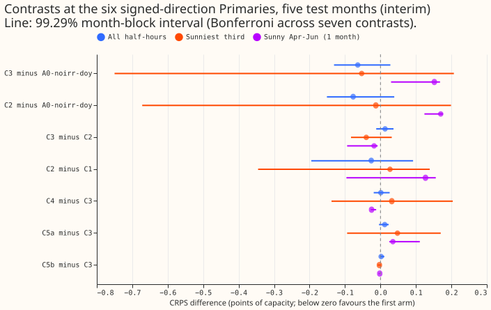
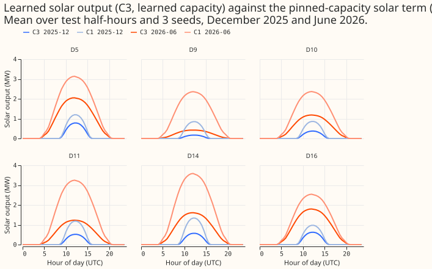
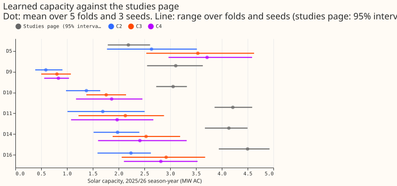
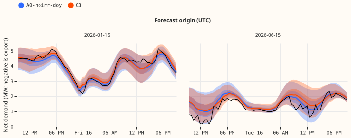
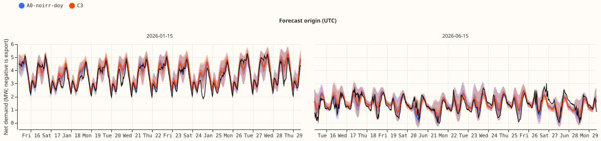

**Status: done. The anomaly gate could not be tested, so the score arms ran ungated.** The sections
below up to "Results" are the plan, written before any fit; the amendment was written after the
noise check and before any score arm. The plan follows the maintainer's request after experiment 405,
whose placebo gate could not be met.

## What is asked

**The question is whether the explicit solar term can be shown to read the sky, and if so whether it
lowers the net-demand error.** Experiment 405's known-answer test failed its placebo gate because a
day-shuffled farm series keeps 79% of the real series' variance through its monthly daylight
profile, and the network had no day-of-year term to hold that profile. The aim behind the series is a
mixture density network that combines the best of the GAM and XGBoost: interpretable, differentiable
physics parts (here an explicit solar term) beside flexible learned parts, so that the fitted network
gives explainable outputs and the best CRPS. This plan therefore also stores and plots the learned
solar contribution, so that the solar term can be read on its own.

## Review of the plan against the latest evidence

- **Experiment 405 and its audit** (merged) set every change below: the profile-only benchmark, the
  day-of-year term, the anomaly injection, and the dropped divisor.
- **Experiment 403** (merged): pooled A0 is the reference network, CRPS 3.351 at the signed-MW six.
  Its stored forecasts are the A0 control if its rows match this experiment's rows (checked before
  scoring; otherwise A0 is refitted).
- **Standing rules added to `common.md` since the brief:** cleaned data, the D15 and D18 start cut,
  monthly refits, saved models, tails, example forecast graphs, the seven-step process. All are
  followed below. No result merged since the brief answers the question.
- **Departures from experiment 405:** the divisor is dropped (finding 4: the three other farms carry
  the same signal, so the ratio sits near 1); the increment-penalty arm is dropped (no effect);
  the placebo limit is set from a measured benchmark instead of copied from experiment 129.

## Terms

- **Net demand, signed-MW six, MVA-only eight, solar term, capacity:** as in experiment 405. The
  solar term is a capacity per Primary and season-year times a fixed physical unit shape, and the
  network subtracts it from the demand mixture.
- **Daylight profile.** The mean of a farm's output at each half-hour of the day within a calendar
  month of a year. **Day-to-day anomaly.** The farm's output minus its daylight profile.
- **Least-squares read-out.** The capacity change that best explains an injected series from the
  ensemble unit shape on the fold's training rows, `dC_LS = eff * sum(f * u) / sum(u^2)`, over
  daylight rows of the last season-year, where `f` is the injected series (a fraction of effective
  capacity `eff`) and `u` the unit shape. It is the benchmark a network that read the shape linearly
  would reach.

## Data and rows

As in experiment 405: experiment 397's raw matrices in the `summary` scheme (ECMWF ENS mean and
spread, one pass), 16 Primaries, pooled network with an 8-wide Primary embedding, 3 Gaussian
components, 2 hidden layers of 64. **Cleaned data:** `substation_zero` half-hours are dropped from
training, lags, inference, and scoring, as experiment 397's matrices do; the dropped count per fold
is reported. **Start cut:** D15 and D18 drop every row, lag input, and scoring actual before
2025-03-01 (applied; D15 and D18 stay report-only). **Cadence:** monthly refits on a 730-day window,
five screen months (2025-10, 2025-12, 2026-01, 2026-03, 2026-06), 3 seeds, each booster saved to
the experiment's private folder. **Weather at lag times:** the lags are the Primary's own power, so
no weather is used at lag times and the ERA5 delay does not apply.

## Architecture

**The solar module is experiment 405's.** The net-demand mixture keeps the demand mixture's weights;
component `k` has mean `mu_k - m` and variance `sigma_k^2 + s^2`, where `m = C[p, y] * u * g` and
`s` follows the ensemble spread. Capacity is learned per Primary and season-year under a Gaussian
prior from the studies page (C2), with the adapter `g` (C3).

**The change is a day-of-year by hour term in the demand module.** The demand module of every C arm
and of A0-noirr-doy gets 20 extra inputs: the sine and cosine of the day of year at one and two
harmonics (4 inputs), and each of the four by the four existing hour-of-day inputs (`sin_hour`,
`cos_hour`, `sin_hour_2`, `cos_hour_2`; 16 inputs). The network can then represent the monthly
daylight shape of the Primary's net demand in the demand module. Irradiance and the three
solar-geometry columns stay removed, as in experiment 405.

## Known-answer test (runs first, gates the score arms)

**The test injects a held-out farm's output into the six signed-MW Primaries and asks whether the
learned capacity rises by the share the ensemble forecast can explain.** It runs on the 2026-06
fold only. Injection follows experiment 405 (farm C, increment 50% of the studies page's 2025/26
capacity, subtracted from the target and the three lags, dropouts removed from every condition).

| Condition | Injected series |
|---|---|
| control | none |
| held_profile | the real farm series (variant a) |
| placebo_profile | the real farm series with its days shuffled within the month (variant a) |
| held_anomaly | the farm's day-to-day anomaly, its daylight profile removed (variant b) |
| placebo_anomaly | the anomaly with its days shuffled within the month (variant b) |
| pos_anomaly | the ensemble's own day-to-day anomaly of the unit shape, scaled to the same increment (positive control: perfectly readable) |
| pos_profile | the ensemble's monthly daylight profile of the unit shape (negative control: should read near 0 once the day-of-year term exists) |

The daylight profile is the farm's mean at each half-hour within each calendar month of each year,
so each month's anomaly has zero mean at every half-hour and the shuffled anomaly keeps no profile.
The two controls use the ensemble unit shape `u` itself, so they say whether the network can read a
perfectly forecastable anomaly, and whether it still puts a pure profile into the solar term.
Arms: C2 (prior) with 5 seeds on every condition, C4 (no prior, neutral 3 MW start) with 3 seeds on
the five farm conditions. That is 7 x 5 + 5 x 3 = 50 fits.

**Recovery, in common units.** Recovery is the seed-mean learned capacity increment (injected minus
control, at the last season-year in the window) divided by `dC_LS(held_anomaly)` for every
anomaly-variant condition, and by `dC_LS(held_profile)` for every profile-variant condition. Dividing
the placebo by its own read-out (near 0) is what produced experiment 405's -1.88. `dC_LS` is
computed on the fit's own rows and weights (all training rows of the as-of season-year with positive
unit shape, with the fold's sample weights), in MW, with a standard error from a bootstrap over
days. The placebo benchmark is the mean of `dC_LS` over 5 different shuffles divided by
`dC_LS(held)`, so it is not one random draw. The lag route is part of the test: the injected series
is subtracted from the three lags too, as in experiment 405. The 20 day-of-year inputs are not lag
features.

**Noise check before any gate is read.** From experiment 405's stored per-seed capacities and the
new `dC_LS`, a script computes the expected seed standard deviation of the recovery ratio. If the
expected standard deviation of the held-anomaly ratio exceeds 0.5 at more than 2 of the 6 Primaries,
the gate is declared uninformative (not failed) and the page says so.

## Pre-registered rules

1. **The test is informative only if both controls behave.** `pos_anomaly` recovery of C2 lies in
   0.8 to 1.2 at 4 of the 6 Primaries, and `pos_profile` recovery (relative to its own read-out)
   is at most 0.30 at 4 of the 6. If not, the page reports the known-answer test as uninformative
   about the real farm, and the score arms do not run.
2. **Gate K1 (recovery, anomaly variant).** C2's recovery on `held_anomaly` lies in 0.5 to 1.5 at 4
   of the 6 Primaries, and exceeds `placebo_anomaly` recovery by more than 2 seed standard errors
   at 4 of the 6. The band is wider than experiment 129's 0.75 to 1.25 because the anomaly is only
   about one fifth of the farm's variance.
3. **Gate K2 (placebo, anomaly variant).** C2's recovery on `placebo_anomaly` is at most the placebo
   benchmark plus 0.20, in median and in maximum over the six.
4. **K3, P1 to P3 and the profile variant are descriptive.** The profile variant (a) reports the
   real-minus-placebo recovery and how much of the profile the day-of-year term absorbs (the
   learned capacity increment on `pos_profile` with and without the term would show it; the
   without-term fit is C2 on experiment 405's inputs, 3 seeds, 6 more fits). C4 is reported beside
   C2.
5. **If the controls, K1, or K2 fail**, the page reports it, with the profile variant and C4 beside
   it, and the score arms do not run.
6. **If all hold**, the score arms run: A0-noirr-doy, C1 (capacity pinned to the experiment 269
   estimate), C2, C3, C4, C5a (monthly capacity path, smoothness penalty, built on C3), and C5b
   (persistence penalty, built on C3), all with the day-of-year term, 3 seeds, 5 folds. A0 (without
   the term, with irradiance) is read from experiment 403. Contrasts at the signed-MW six, CRPS at
   days 1 to 10, month-block bootstrap at 95% with 20,000 resamples, Bonferroni across the seven,
   each changing one factor: C3 minus A0-noirr-doy (solar term with adapter against none), C2 minus
   A0-noirr-doy, C3 minus C2 (adapter), C2 minus C1 (learned against pinned capacity), C4 minus C3
   (prior), C5a minus C3 (time variation), C5b minus C3 (persistence penalty). C3 minus A0 is
   reported as the practical comparison and differs by the day-of-year term and the irradiance
   inputs as well, so it is not a contrast. The MVA-only eight are reported.
7. **A gain** needs both the Bonferroni interval excluding zero and the point estimate beyond the
   minimum detectable effect. Both thresholds must hold.

## Amendment: the anomaly gate cannot be tested, so the score arms run without a gate

**Written after the noise check and the profile test, and before any score arm was fitted or read.**

- **The noise check failed.** The least-squares read-out of the injected anomaly is 0.03 to 0.05 MW
  at the signed-MW six, against an injected increment of about 1 MW and a seed spread of about 0.35
  MW in experiment 405's fits. The expected standard deviation of the recovery ratio is 3.8 to 12.4,
  so the anomaly gate (K0, K1, K2) is uninformative, not failed. Making it testable would take an
  injection of about 20 times the size. The anomaly fits did not run.
- **The profile test ran (descriptive, 24 fits, 3 seeds).** C2 with and without the day-of-year term
  on the control, real-farm, day-shuffled-farm, and pure-profile injections. The results are in
  "Results". The day-of-year term stays in every C arm and in A0-noirr-doy.
- **The maintainer wants the explicit solar term tested on CRPS**, so the score arms run ungated:
  A0-noirr-doy, C1, C2, C3, C4, C5a, and C5b, 5 folds, 3 seeds, with A0 read from experiment 403.
  A pass of the known-answer test therefore no longer licenses a claim about capacity. The page
  reports learned capacities beside the studies page as description only.
- **Dropped:** the cost at the scaled export limit (`studies.node_curtailment`), which needs a node
  and its generators and so cannot be scored per Primary here. The tail report stays.

### Pre-registered no-gate decision rule

The contrasts, all at the signed-MW six, CRPS at days 1 to 10, in points of effective capacity,
with the month-block bootstrap of `studies.eval_protocol` (20,000 resamples) at the
Bonferroni-corrected level (family-wise 95% across the seven one-factor contrasts, so 99.29% per
contrast): C3 minus A0-noirr-doy, C2 minus A0-noirr-doy, C3 minus C2, C2 minus C1, C4 minus C3,
C5a minus C3, and C5b minus C3. C3 minus A0 is reported and not tested. The minimum detectable
effect of a contrast is 2 times the standard deviation over the 5 folds of the seed-to-seed
difference of the contrast.

- **Slices.** The headline band is days 1 to 10 at all signed-MW-six half-hours. The sunny slices
  are `sunny_unit_shape` and `sunny_april_june`, each within days 1 to 10. The minimum detectable
  effect is computed separately for each slice. Each contrast is tested in 3 slices, so the true
  family is 21 tests; with 5 test months the month-block interval excludes zero only when about 4 or
  5 months agree, and the write-up says so.
- **Main question: C3 minus A0-noirr-doy** (the explicit solar term with the adapter, against the
  same network with no solar term). A slice "passes" when the difference is below zero, its
  interval excludes zero, and its magnitude exceeds that slice's minimum detectable effect.
    - *Supported:* the headline band passes and at least one sunny slice passes, and the tail rule
      holds.
    - *Partly supported:* the headline band passes and neither sunny slice passes, or a sunny slice
      passes and the headline band does not, or the headline band has an interval excluding zero
      with a magnitude below the minimum detectable effect; and the tail rule holds.
    - *Not supported:* no slice has an interval excluding zero, or any slice has a positive
      difference with an interval excluding zero (harm), whatever the other slices show.
    - *Tail rule not met:* a result that is otherwise supported or partly supported is downgraded
      one level.
- **The prediction that can fail (P1):** C3 minus A0-noirr-doy lies between -0.15 and 0.00
  points in the headline band. A difference outside that range counts as the prediction failing,
  whatever the verdict word.
- **Tail rule.** In the headline band at the signed-MW six, C3's pinball loss at q95 and at q99 is
  no more than 5% higher (relative) than A0-noirr-doy's, and C3's coverage at q95 and at q99 differs
  from A0-noirr-doy's by at most 0.02 (an arm-to-arm difference). The q01, q05, and threshold-weighted
  CRPS are reported and do not enter the rule.
- **Secondary contrasts** are reported with their intervals and called gains only on the same
  three-part rule (interval, minimum detectable effect, no worse tails). C3 minus A0 is the
  practical comparison and is described at the same level, not judged, because it differs in the
  day-of-year term, the irradiance inputs, and possibly the training rows (experiment 397 may not
  have applied the D15 and D18 start cut, which does not affect the scored rows).
- **Learned capacity** is described against the studies page, with seed intervals. No capacity claim
  rests on a known-answer test.

## Reports

- **Tails and slices.** Coverage and pinball loss at q01, q05, q95, and q99, raw (the 1.15
  widening is not applied to the arms); the sunniest third of daylight half-hours and sunny April
  to June. The curtailment cost is dropped (see the amendment).
- **The solar contribution, readable on its own.** The learned solar output `m` in MW is stored per
  scored row. The page plots, for each of the six, the mean learned output by month and hour beside
  the physical clear-sky shape times the studies-page capacity, the learned capacity path with
  intervals from seeds, and the same Primary's forecast from the network with the solar term beside
  the forecast from A0-noirr-doy (the same network with no solar term).
- **Example forecasts.** A day-ahead and a full 14-day forecast from one run, for one signed-MW and
  one MVA-only Primary, in a winter and a summer month.
- **Checks.** Median minus mean forecast per site, the mean-forecast error beside each contrast, the
  audit triggers that fired, the flagged half-hours dropped per fold, and the saved-booster path.

## Compute and fits

- **Known-answer test:** 56 fits (50 plus 6 for the without-term profile check) at 50 to 200
  seconds each, 1 to 3 hours.
- **Score arms (only if the gate holds):** 7 arms x 5 folds x 3 seeds = 105 fits, 1.5 to 6 hours.
- **Stored predictions reused:** experiment 403's A0 forecasts, the XGBoost, BG2, and GAM-stack
  references. Experiment 405's `extras` and `u99` files are reused, which saves the unit-shape pass.
- **Resources:** one GPU process under 8 GB, one feeder core, `MemoryMax=8G`, `OMP_NUM_THREADS=1`.
  No fit starts until the manager grants the fit slot (idle CPU at least 30%, available memory at
  least 15 GB).

## Earlier advice followed and departed from

- **Followed:** calibrate the placebo gate to the network; give the demand module a day-of-year by
  hour term and inject the anomaly (experiment 405 advice); use an as-of capacity; report absolute
  skill beside contrasts.
- **Departed from:** experiment 129's divisor and five-year drift gate; the former is uninformative
  (experiment 405 audit, finding 4) and the latter does not fit a two-season-year window.

## Results

**Take-home message: the explicit solar term did not reliably lower the net-demand error, and the
known-answer test could not show that the network reads the sky.** All numbers are CRPS in points of
effective capacity at the signed-MW six (D5, D9, D10, D11, D14, D16), days 1 to 10, five test months
(2025-10, 2025-12, 2026-01, 2026-03, 2026-06), monthly refits on a 730-day window, 3 seeds, so every
interval is interim. Weather inputs are the ECMWF ensemble mean and spread, one pass; cleaned data;
D15 and D18 cut before 2025-03-01 (report-only).

- **Verdict by the pre-registered rule: not supported.** C3 minus A0-noirr-doy is -0.064 (interval
  -0.131 to +0.028; minimum detectable effect 0.397) in days 1 to 10, -0.053 (-0.750 to +0.207) in
  the sunniest third, and +0.152 (+0.030 to +0.168) in sunny April to June. The rule reads the last
  slice as harm. That slice holds only 2 test months (2026-03 and 2026-06), so its interval is the
  range of two monthly values and is not a test. The verdict stands without it, because no other
  slice has an interval that excludes zero. P1 held on the point estimate (-0.064 is in -0.15 to
  0.00).
- **Absolute CRPS, signed-MW six / MVA-only eight.** Pooled A0 (experiment 403) 3.351 / 3.791;
  A0-noirr-doy 3.457 / 3.996; C1 3.406 / 4.062; C2 3.380 / 4.059; C3 3.393 / 4.052; C4 3.393 / 4.051;
  C5a 3.404 / 4.051; C5b 3.395 / 4.053. The MVA-only eight have no solar term and lose 0.2 to 0.3
  points against A0 because their irradiance inputs are removed (not contrasted).
- **Other contrasts (days 1 to 10, none beyond its minimum detectable effect).** C2 minus
  A0-noirr-doy -0.077 (-0.151 to +0.039); C3 minus C2 +0.013 (-0.012 to +0.037); C2 minus C1 -0.026
  (-0.195 to +0.092); C4 minus C3 +0.001 (-0.019 to +0.026); C5a minus C3 +0.012 (-0.004 to +0.023);
  C5b minus C3 +0.002 (-0.001 to +0.011). C3 minus A0, described only, is +0.041 (-0.080 to +0.154).
  The adapter, the prior, and the capacity-path penalties made no measurable difference.
- **Tails (days 1 to 10, signed-MW six, mean over Primaries; A0-noirr-doy / C3).** Pinball q95
  1.127 / 1.096; pinball q99 0.461 / 0.427; coverage q95 0.835 / 0.840; coverage q99 0.924 / 0.931;
  coverage q01 0.018 / 0.018; coverage q05 0.051 / 0.057; threshold-weighted CRPS 0.631 / 0.627.
  The tail rule holds, and C2 has the lowest q99 pinball among the solar arms (0.415), but the
  differences have no intervals here.
- **Learned capacity (2025/26 season-year, mean over folds and seeds, MW) against the studies page.**
  C2 is 1.38, 1.69, 1.98, 2.24 at D10, D11, D14, D16 against 3.06, 4.21, 4.14, 4.50, and is
  2.64 at D5 against 2.19; C3 and C4 are similar, C4 (no prior) higher. The seed ranges are wide
  (for example D5 1.8 to 3.5 for C2). The capacity is therefore weakly identified, as the profile
  test below shows.
- **Profile test (descriptive; 24 fits, 3 seeds).** Learned capacity increment as a multiple of the
  least-squares read-out of the real farm series. With the day-of-year term, the real farm recovers
  0.16 to 0.87 (median 0.47), the day-shuffled farm 0.11 to 0.48 (median 0.25), and a pure
  ensemble profile 0.19 to 0.43. Without the term, the real farm recovers 0.45 to 1.09 (median
  0.62), the shuffled farm 0.34 to 0.63 (median 0.47), and the pure profile 0.28 to 0.40. The
  benchmark for the shuffled farm is 0.95 to 0.96, so no arm reads the profile fully. The
  day-of-year term lowers the profile reading by about 0.2 and lowers the real recovery by about
  the same, and the seed standard errors (0.03 to 0.42) are as large as these gaps.
- **Anomaly gate: not testable.** The least-squares read-out of the injected anomaly is 0.03 to 0.05
  MW at the signed-MW six, against an injected increment of about 1 MW and a seed spread of about
  0.35 MW in capacity, so the expected standard deviation of the recovery ratio is 3.8 to 12.4
  (limit 0.5). The gate is uninformative, not failed. The anomaly fits did not run.
- **Compute and data.** 24 profile-test fits and 105 score fits, about 10 to 60 seconds each on one
  GPU process; the flagged zero half-hours were dropped by experiment 397's matrices (count per
  fold not recomputed here). Fitted networks are saved as `.pt` files in the experiment's
  `work/seed_preds/<arm>/` folder; the solar outputs per half-hour are in the matching
  `.solar.parquet` files.

## Audit

A fresh Sonnet agent re-derived the headline from the stored forecasts for all five months. The
pooled absolute scores match the printed 3.457 and 3.393, and the mean of the monthly differences
(-0.063) matches the printed -0.064. Triggers that fired:

- **A slice with fewer than 3 test months.** Sunny April to June holds 2 months, so its bootstrap
  interval is degenerate (the endpoints equal the two monthly differences).
- **A month that is not April to June inside that slice.** The slice includes 2026-03 forecasts.
  The slice is defined by the protocol's `sunny_april_june` flag, which this page does not
  redefine; it is reported as defined, and the slice's membership is flagged for the protocol
  owner.
- **Every headline contrast is below its minimum detectable effect**, so none counts as a gain.
- **Seed disagreement in the learned capacities** (above).
- **Not run:** median minus mean forecast per site, and a comparison of the capacity seed ranges
  with the studies page intervals.

## What to try next

- **Test the solar term on a target it can read.** Inject a signal about 20 times larger, or add the
  solar term where the weather forecast has more skill (short leads), before asking about CRPS.
- **Keep the free irradiance input** in the pooled network until an explicit term beats it.
- **Look at the tails:** the lower q95 and q99 pinball loss of the solar arms is worth a calibration
  experiment with intervals from more test months.

## Problems caused by the move

None, apart from needing seven experiment folders on `PYTHONPATH` to run the scripts.

## Reviews

- **Design review (fresh Sonnet) found nine points.** Accepted 1 to 8: the noise check,
  common-unit recovery, positive and negative controls, the profile-absorption report, the read-out
  on the fit's rows, the lag route stated, one-factor contrasts, and descriptive rules. Point 9 is
  noted: the profile comes from the test period, which gives the network no information it could
  not learn.
- **Code review before the first fit (fresh Sonnet).** Found two high, two medium, four low points.
  Fixed: the noise check read the wrong file names; the control fold kept raw lags while every
  other condition had gap lags set to missing (the control now goes through the injection path);
  the read-out included the early-stopping weeks (now excluded); the placebo benchmark now drops
  gap rows as the real placebo does; the `pos_profile` rule uses the absolute value; each fold is
  freed after use. Noted, not changed: the `pos_anomaly` control averages the ensemble unit shape
  over origins, so its recovery at long lead may miss for reasons unrelated to the network (the
  read-out uses the row's own shape, which partly corrects it); the score stage and its
  day-of-year inference inputs are added only if the gate holds.
- **Code review of the score stage and the decision rule (fresh Sonnet, before any score arm).**
  Found no crash and no leakage; five medium or low points on the rule and script. Fixed: the
  script asserts every seed file exists; the minimum detectable effect is computed per slice; the
  sunny slices are within days 1 to 10; the rule now has a fallback for a passing headline band with
  no sunny pass, defines harm, defines the tail rule (slice, relative tolerance, arm-to-arm
  coverage difference), names P1's slice, and states the 21-test family. The training-rows caveat for
  C3 minus A0 is added.
- **Results review and audit (fresh Sonnet).** Re-derived the headline from stored forecasts and
  found the printed numbers consistent; the triggers that fired are listed under "Audit".
- **To be filled in:** write-up review.
