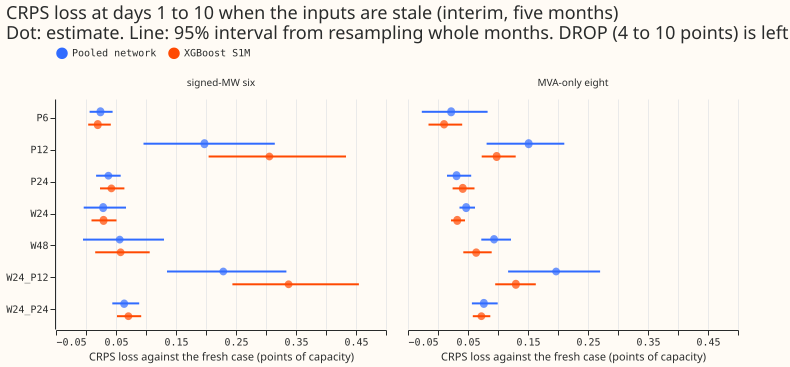
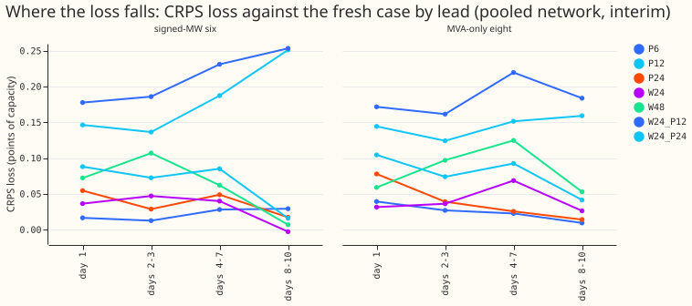
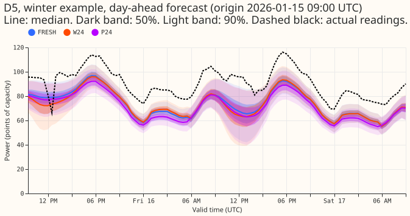
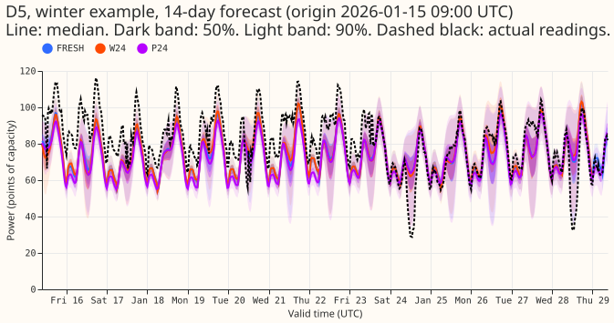
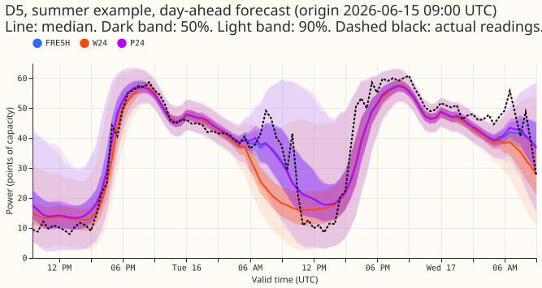
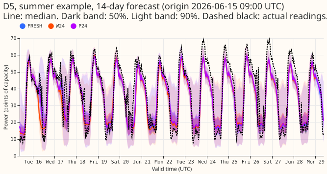

**Take-home message: a one-run-old weather forecast and readings 6 or 24 hours late change the
forecast little, but readings 12 hours late and missing readings change it a lot.** The pooled
plain mixture density network (a neural network, experiment 397) loses 0.03 points of CRPS (days 1
to 10, points of effective capacity) at the six substations with signed readings when the weather
forecast is one run (24 hours) older, 0.02 when the readings are 6 hours later, and 0.04 when they
are 24 hours later. The same network loses 0.20 points when the readings are 12 hours later and 9.7
points when the three newest-reading lags are missing. The monthly XGBoost model with mean and
spread columns (S1M, experiment 389) loses 0.03, 0.02, 0.04, 0.31, and 4.5 points in the same
arms. **The pre-registered rule calls for a second experiment**, because the 12-hour arms fail
their limits. Tail coverage holds: the q95 and q99 coverage of each model falls by under 0.02 in
every arm except the missing-lag arm.

## Question and answer

**We re-scored the stored neural networks of experiment 397, and the stored XGBoost boosters of
experiment 389, with stale inputs and fitted nothing.** The live service ingests one ECMWF run a
day and receives power readings every 6 hours. A forecast can therefore pair recent readings with
an old weather forecast, or the reverse. A day-old weather forecast changes the forecast little,
and the time of day of the newest reading matters more than its age.

The decision rule says no second experiment is needed only if every limit holds. The limits are
0.05 points of loss for P6 and P12 and 0.10 for the other four arms in the key below, together with
a coverage fall under 0.02. The Discuss session for the neural network proposed them without
evidence, and the manager and the maintainer may change them. P12 and W24+P12 fail the rule. The
plan for the second experiment (training with random staleness and two age inputs) is a separate
brief.

**Key to the arms** (the arm table under "Design, data, and caveats" gives the details):

- FRESH: the weather forecast of the forecast's own run and the newest power reading 3.5 hours
  before the forecast origin (the training pairing).
- W24 and W48: the weather forecast from the run one day or two days earlier.
- P6, P12, and P24: the power readings delayed by 6, 12, or 24 hours.
- W24+P12 and W24+P24: both at once.
- DROP: the three lags that depend on the forecast origin (newest reading, same time yesterday, same
  time last week) are missing.
- S1M: the XGBoost model with the ensemble mean and standard deviation of temperature and shortwave
  radiation as extra columns.
- MVA-only eight: the eight Primaries whose meters record apparent power only.

## Results

CRPS loss against the fresh case at days 1 to 10 (points of effective capacity; positive is worse),
five screen months, with the 95% month-block interval in brackets. W48 has no limit. The pooled
network's P6 interval at the MVA-only eight reaches 0.083, above the limit of 0.05, although its
estimate passes.

| Arm | Pooled network, signed six | Pooled network, MVA-only eight | XGBoost S1M, signed six | XGBoost S1M, MVA-only eight |
|---|---|---|---|---|
| Fresh CRPS | 3.270 | 3.873 | 3.525 | 3.995 |
| W24 | 0.029 (-0.004 to 0.067) | 0.047 (0.036 to 0.062) | 0.029 (0.009 to 0.051) | 0.032 (0.022 to 0.045) |
| W48 | 0.056 (-0.005 to 0.130) | 0.093 (0.072 to 0.122) | 0.058 (0.015 to 0.106) | 0.064 (0.042 to 0.089) |
| P6 | 0.024 (0.006 to 0.044) | 0.022 (-0.027 to 0.083) | 0.020 (0.004 to 0.041) | 0.010 (-0.016 to 0.040) |
| P12 | **0.197 (0.096 to 0.315)** | **0.151 (0.081 to 0.210)** | **0.306 (0.204 to 0.433)** | **0.098 (0.073 to 0.129)** |
| P24 | 0.037 (0.017 to 0.058) | 0.031 (0.015 to 0.055) | 0.042 (0.023 to 0.064) | 0.041 (0.024 to 0.061) |
| W24+P12 | **0.229 (0.135 to 0.334)** | **0.197 (0.117 to 0.270)** | **0.338 (0.244 to 0.455)** | **0.130 (0.095 to 0.163)** |
| W24+P24 | 0.064 (0.044 to 0.089) | 0.076 (0.057 to 0.099) | 0.071 (0.052 to 0.092) | 0.072 (0.058 to 0.087) |
| DROP | 9.73 (4.29 to 14.85) | 6.50 (2.86 to 9.87) | 4.53 (2.94 to 5.70) | 3.68 (3.35 to 4.00) |

**The XGBoost model loses about as much as the neural network in most arms.** The XGBoost model
loses more at the signed six when the readings are 12 hours late (0.31 against 0.20 at P12) and
less when the lags are missing (4.5 against 9.7). At the MVA-only eight it loses less than the
neural network at P12 (0.10 against 0.15) and in DROP (3.7 against 6.5).

## Tails and widening

- **Coverage barely moves.** At the signed six and the MVA-only eight, q95 coverage falls by at most
  0.011 and q99 coverage by at most 0.004 in every arm except DROP, for both models. The limit is
  0.02, so those arms need no widening rule.
- **DROP breaks the neural network's tails.** Its q95 coverage falls from 0.891 to 0.560 at the
  signed six and from 0.942 to 0.674 at the MVA-only eight, and its q99 coverage from 0.959 to 0.845
  and from 0.988 to 0.853. Its 90% interval is 1.79 and 1.32 times as wide as with fresh inputs,
  which does not make up for the missing lags. The XGBoost 90% interval is 1.10 and 1.02 times as
  wide, and its q95 coverage falls by 0.115 and 0.017.
- **Interval width is unchanged elsewhere.** The 90% interval is within 3.1% of fresh in every other
  arm.

## Design, data, and caveats

- **Arms.** FRESH; W24 and W48 (the weather forecast from the run one and two days earlier, matched
  on valid time; the lead and calendar inputs stay those of the fresh origin); P6, P12, and P24 (the
  origin of the three lags moved back, with the lag-age inputs recomputed; the lead is unchanged);
  DROP (the three origin lags missing, through the neural network's missing-flag inputs and the
  XGBoost model's native missing value); W24+P12 and W24+P24.
- **What the stored runs allow.** Only the 00:00 UTC run is stored, one per day, so no 6-hour or
  12-hour stale-weather arm could be built. W24 and W48 are the stale-weather arms the stored runs
  allow.
- **Models.** The pooled plain neural network, summary scheme, three seeds averaged in quantile
  space, from experiment 397; the S1M boosters of experiment 389 (monthly refits, one booster per
  Primary and refit). The per-Primary neural network was not re-scored. The 1.15 widening of
  experiment 397 is applied to every arm. Both models read the five screen months of experiment 397
  (2025-10, 2025-12, 2026-01, 2026-03, and 2026-06).
- **Reproduction gates.** FRESH on unfiltered power reproduces experiment 397's stored forecasts to
  6e-7 and experiment 389's stored S1M forecasts exactly.
- **Rows.** Older runs do not reach the last day of the horizon, so W24 and W48 score fewer rows
  (1,538,592 and 1,430,473 half-hours against 1,645,943). Each stale arm and FRESH are compared on
  their shared rows.
- **Cleaned data.** The stored power arrays already hold the flagged `substation_zero` half-hours
  as missing, so cleaning the lag inputs changes nothing. The scorer drops flagged half-hours from
  the actuals: 153, 11, 0, 3, and 0 in the five months. The D15 and D18 start cut at 2025-03-01
  changes nothing here, because every screen month starts after 2025-03.
- **Why P12 fails (not tested directly).** In training the forecast origin was always 09:00 UTC, so
  the newest reading was always the 05:30 overnight trough. P12 makes it the 17:30 reading of the
  previous day, the evening peak. The mean absolute change of the newest-reading lag against FRESH
  is 0.30 to 0.45 of capacity at P12, against 0.02 to 0.07 at P6 and 0.00 to 0.07 at P24. The loss
  at P12 rises with lead (0.15 at day 1 to 0.25 at days 8 to 10 at the signed six) and is largest at
  valid times 00 to 03 UTC. Both models appear to use the newest lag as a level tied to a fixed time
  of day. P6 (newest reading at 23:30) and P24 (05:30) are tolerated; P12 (17:30) is not. Because
  the origin is always 09:00, the arm grid confounds delay with time of day.
- **Checks.** A fresh Sonnet reviewer re-derived the results on its own. The W24, P12, and P24
  losses agree to within 0.005 points at both groups. The reviewer's FRESH CRPS at the signed six is
  3.252 against the scorer's 3.270, and its DROP loss is 9.45 against 9.73. The gap is unexplained,
  and this page reports the scorer's numbers. Audit triggers 2 (a result contradicts its
  prediction) and 7 (a later design depends on the result) fired. Median-minus-mean checks were not
  run, because the experiment compares the same forecasts under different inputs.
- **Prediction outcomes.** P1 held for W24, P6, P24, and W24+P24 and failed for P12 and W24+P12.
  P2 failed: the loss does not grow with delay (P6 0.024, P12 0.197, P24 0.037 at the signed six),
  and it falls with lead in P24 but not in P12 or W24. P3 held, by a wide margin. P4 held for W24
  and P6 to P12 (every coverage fall is under 0.012) and failed for P24, whose coverage fall is
  0.002; the coverage collapse in DROP was not predicted. P5 failed: the XGBoost model lost more
  than the neural network at P12 and W24+P12 at the signed six (by 0.11), and by 0.005 to 0.012 at
  W48, P24, and W24+P24 at the signed six and P24 at the MVA-only eight. It lost less in DROP and, at
  the MVA-only eight, in the other arms.
- **Caveats.** Five test months give wide intervals, so every number is interim. One run per day
  confounds the arm grid with the time of day. Only two models were tested.
- **What to try next.** Step 2, a separate brief: train with the newest reading at random times of
  day, a random weather-forecast age, and the origin lags sometimes missing, with the age of each
  input as an input.
