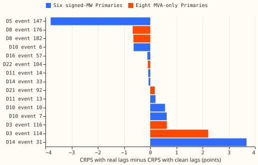

**Status: done. The scored sample is too small to settle batch 0.** The sections from "Question"
onward are the plan, written before any score existed. This experiment is batch 0 of the [experiment
404 plan](https://github.com/openclimatefix/nged-ml-research/pull/58), run as its own
experiment so that the experiment 404 session is not blocked. This experiment needs no neural
network, no GPU, and no fit.

## Results

**Real lags scored better than clean lags at the six signed-MW Primaries, but 9 events carry the
result.** The gain is the mean CRPS with real lags minus the mean with clean lags, in points of
effective capacity, so a positive gain would mean that cleaning the lags helps. Intervals are 95%
event-cluster bootstraps (2,000 resamples).

| Group | Harm rows | Events | CRPS real lags | CRPS clean lags | Gain | 95% interval |
|---|---|---|---|---|---|---|
| Six signed-MW | 5,354 | 9 | 5.061 | 5.897 | -0.836 | -2.578 to +1.226 |
| Eight MVA-only | 3,241 | 6 | 6.514 | 6.489 | +0.024 | -0.574 to +1.529 |
| All 14 | 8,595 | 15 | 5.609 | 6.120 | -0.512 | -1.804 to +0.909 |

- **By lead band at the six:** days 1 to 2 -0.773, days 3 to 5 -1.333, days 6 to 10 -0.463. Every
  interval includes zero.
- **By Primary at the six:** D5 -3.800 (1,629 rows, one event), D10 +0.190, D11 -0.031, D14 +1.957,
  D16 -0.109. D9 has no scored event.
- **Without D5's one event** the six give 3,725 rows, 8 events, a gain of +0.460, and an interval
  of -0.102 to +1.631. The range over every leave-one-event-out gain at the six is -1.278 to +0.460,
  and only dropping that event flips the sign.
- **Clean lags win on fewer rows:** at the six, 2,284 rows score better with clean lags, 3,046
  worse, and 24 tie; at the eight, the counts are 1,633 and 1,608.

**The decision rule in the experiment 404 plan says to skip batches 1 and 2, and the data does not
support relying on it.** The point estimate at the six, -0.836, is under the 0.1 threshold. The
interval runs from -2.578 to +1.226, so it includes the threshold, and one event decides the sign.
The prediction for the six (a gain of 0.02 to 0.15) is not met. The prediction for the eight (under
0.05) is met, with a gain of +0.024 and an interval of -0.574 to +1.529.

## Why the sample is small

**The harness scores 15 of the 184 corrected events.** Of the 78 events at the six, 9 are scored,
and of the 88 at the eight, 6 are. The audit repeated the harness's filters for every event and
refit month without predicting. The first filter that failed, over the 736 event and refit pairs,
was:

- **Gaps:** 396 pairs, because the stage-1 median or the observed power has a gap inside the event.
  Counted by event rather than by pair, 99 events are never scored for this reason.
- **No usable run:** 118 pairs, because no sampled run has lags inside the event and a target
  outside every event.
- **Sign:** 83 pairs, because the measured step has the opposite sign to the label.
- **Share:** 72 pairs, because the measured step is under 25% of the labelled depth.
- **Bias:** 47 pairs, because the pre-event bias exceeds half the step.
- **Refit month inside the event:** 3 pairs.
- **Scored:** 17 pairs (the 15 scored events, plus one event each at D15 and D18).

The other 18 corrected events belong to D15 (6) and D18 (12), which are in neither group; one event
at each is scored in the 17 scored pairs below. Five Primaries (D9, D2, D4, D12, D19) have no scored
event.

## Checks

- **Median minus mean forecast per site:** not computed. The boosters' mean forecast is not stored,
  and this experiment scores the mixture quantiles only.
- **Error of the mean or median forecast beside the quantile contrast:** not computed, for the same
  reason.
- **Triggers fired:** three of the seven.
    - **Trigger 2 (the result contradicts its prediction):** the prediction was a gain of 0.02 to
      0.15 and the gain is -0.836. No explanation was tested, so the page offers an explanation as a
      caveat only: the clean replacement may be a worse input than the observed reading at D5.
    - **Trigger 4 (leaving one out flips the sign):** dropping D5's one event flips the six-Primary
      gain from -0.836 to +0.460.
    - **Trigger 7 (a later design depends on the headline):** the experiment 404 plan skips
      batches 1 and 2 on this number.
- **Audit:** a fresh Sonnet agent re-derived every number in the results table from the per-row
  scores and agreed. It found no duplicated rows and no missing scores, ran the leave-one-out
  checks, and counted the events lost to each filter. Its bootstrap, with a different seed, gave
  intervals within 0.2 of the ones reported, a spread that is unsurprising with 9 and 6 clusters.
  All its findings are in the sections above, none rejected.

## Caveats

- **The booster, not the bundle.** The gain is for experiment 392's R1 lagged boosters. Experiment
  402's stored tables use experiment 381's weekly-refit XGBoost bundle, which scores 5.119 with lags
  on its harm rows at the six. This experiment's 5.061 is on a different, much smaller row set.
- **The replacement is an estimate.** Clean lags are the stage-1 median plus a pre-event bias, so
  they are not the true demand without the event. Two explanations for the negative gain at D5 are
  untested. The replacement may be a poor estimate, or the boosters, which were fit on real lags,
  may score worse on inputs they never saw in training.
- **Single seed and four refit months.** Every number is interim.

## Question

**This experiment sets out to measure the most any lag-trust method can gain on harm rows.** A
lag-trust method down-weights the lagged power readings that sit inside a load-shift event. If the
readings inside the event were replaced by clean values, the forecast could not be misled by them,
so the score gain from that replacement is an upper bound on the gain of any method that changes no
other input to the forecast. If the upper bound is under 0.1 points, a learned trust weight cannot
be worth building.

## Stored forecasts versus re-prediction

**The stored forecasts cannot be re-scored with replaced lags, so the script re-predicts with the
boosters.** Experiment 402 step 1 read experiment 400's stored forecast files (experiment 381's
weekly bundle, with and without lags). Those files hold forecasts made from the observed lags only.
Replacing the lags means predicting again, which needs the XGBoost boosters. Experiment 402's step 2
already re-predicts with experiment 392's R1 lagged boosters, which are on disk, so this experiment
uses those. This experiment reuses that harness and adds a score. The
consequence is that the gain is measured on the R1 boosters, not on the weekly bundle that
experiment 402's other tables use. The report states this, and also states the R1 boosters' own
CRPS with real lags, so that a reader can compare it with the bundle's 5.119.

## Method

- **Events and clean values.** Experiment 400's corrected events per Primary. Inside each event, the
  reading is replaced by experiment 391's stage-1 median plus the mean of (reading minus median)
  over the 7 days before the event. Events whose measured step is under 25% of the labelled depth,
  whose sign disagrees with the label, or whose pre-event bias exceeds half the step are skipped, as
  in experiment 402 step 2.
- **Runs.** For each event and each of the four refit months (2025-10, 2026-01, 2026-03, 2026-06),
  up to 6 daily forecast runs, spread evenly over the runs whose lags touch the event. Each run is
  predicted twice by the refit's booster for that Primary: with the observed series, and with the
  clean series. The actual power is the observed series in both cases.
- **Harm rows.** Rows with at least one of the three lags inside the event, a target time outside
  every event of that Primary, a finite actual, and a lead of up to 240 hours.
- **Scores and contrast.** Row CRPS for both forecasts. The gain is the mean CRPS with observed lags
  minus the mean with clean lags, over all harm rows. The interval resamples whole events.
- **Groups.** The six signed-MW Primaries (D5, D9, D10, D11, D14, D16) carry the decision. The eight
  MVA-only Primaries (D2, D3, D4, D8, D12, D19, D21, D22) are reported beside them. Gain by lead
  band (days 1 to 2, 3 to 5, 6 to 10) and per Primary are reported.

## Caveats written before the run

- **The sample of runs is not the full harm-row set.** At most 6 runs per event and refit month are
  scored, so events with many runs are under-weighted against the full set. Row counts are smaller
  (8,595 against experiment 402's 43,024).
- **A row can appear under two events.** Each event is scored on its own, with only that event's
  lags replaced, so a row whose lags touch two events is scored twice, once per event.
- **The replacement is itself an estimate.** The stage-1 median plus a bias is not the true clean
  load, so the gain is an estimate of the upper bound, not the bound.
- **Four refit months, one seed.** The R1 boosters are single-seed, so every number is interim.

## Problems caused by the move

None so far. Experiment 402's modules sit on an unmerged branch, so this experiment copies the files
it needs.
