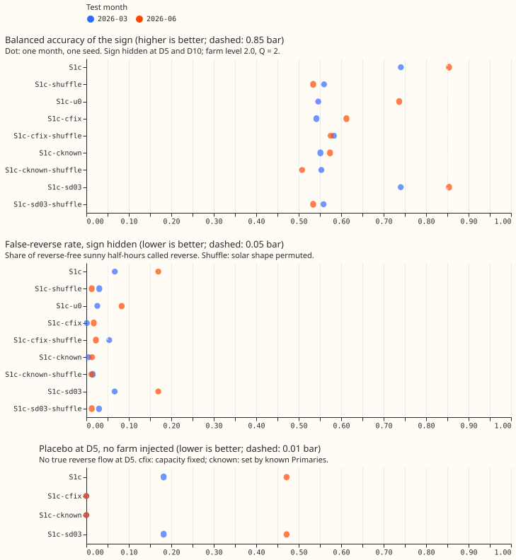

**Status: done. The registered first test and five post hoc capacity variants all failed; the take-
home message above summarises why.** The plan sections below were written before any fit, and the
results sections follow them.

## Evidence the plan follows

- **Experiment 405 merged as inconclusive.** Its placebo gate, a day-shuffled farm, could not be
  passed, because a shuffled series keeps the monthly daylight profile, which carries 79% of its
  variance. The same limit applies to S1c-shuffle here, so P3 asks for a margin over the shuffle
  (0.1 balanced accuracy) and over an hour-and-month baseline (0.05) and does not assume the shuffle
  scores near chance. The write-up also reports the capacity learned under the shuffle and with `u`
  forced to zero, as the design's identifiability check asks. Experiment 409 (planned) tests the
  day-of-year repair; this plan does not wait for it.
- **Experiment 408 is planned (draft PR 64) and has not reported.** Its injection is copied here:
  three farms rotate across the six signed-MW Primaries (D5 and D11 farm A, D9 and D14 farm B, D10
  and D16 farm C), scaled to level times the median absolute sunny-midday reading (CAMS clear-sky
  index at least 0.7, April to September, 10:00 to 14:00 UTC) before 2025-07-01. Its pass
  thresholds (0.85, 0.70, 0.03, 5%, 1%) are copied and not otherwise justified, as the design says.
  Per the manager, no scored fit runs until the neural Discuss session has read 408's page.
- **Experiment 387 merged (not supported).** It found Q0 of 0, 2, and 4 points within 0.01 of each
  other, and a sign set by the start. Here Q0 = 2 points is fixed and the sign comes from the CAMS
  term, not from a start.
- **Standing rules added on 2026-10-30 are applied.** Monthly refits only; cleaned data (the rows of
  experiment 397, which drops flagged exact-zero half-hours) with the dropped count per fold
  reported; D15 and D18 cut before 2025-03-01; one pass on the ensemble summary; every fitted
  network saved as a state file; tails, curtailment cost, and example forecast charts in the score
  run; draft pull request; the seven-step review order.
- **Two small departures from the design, stated so a reviewer can overrule them.** (1) The
  threshold rule uses the CAMS unit shape in place of "M0c's median", because the rule needs no
  reading forecast and the first test has no M0c arm. (2) In S1c-shuffle only the solar term's input
  is permuted. The gate (`u >= 0.3`) keeps the real unit shape, so the shuffle arm is not handed a
  different set of folded half-hours, which would make the comparison easier to win.

## Scoring rules from experiment 408's interim gate (design section 8)

- **Matched false-reverse rate replaces the 0.03 margin.** The XGBoost experiment's threshold rule
  scored 0.86 to 0.88 per Primary but called reverse flow on 14 to 19% of half-hours with none, and it
  reads realised ERA5 shortwave. The write-up reports S1c's recall at the rule's false-reverse rate
  and the rule's recall at S1c's false-reverse rate, on the same half-hours, and states that the rule
  is a laboratory reference. The pooled 0.85, per-Primary 0.70, and 5% false-reverse bars stay.
- **Capacity is not read from the rows it labels.** The shared log-normal prior stays. The learned
  `C_p` is reported at each Primary against the prior centre, and D12's share of negative signed
  medians is reported only beside the shuffle arm and the prior, never as evidence that D12 exports.
- **D10's real reverse flow is a small sample** (130 half-hours). Every recall is reported with the
  count of half-hours behind it, and the D10 recall is descriptive.
- **Lab conditions.** S1c reads realised CAMS at every lead, so the sign's day-ahead behaviour is
  untested until S1e.

## Design

- **Neural network.** Experiment 397's pooled plain mixture density network with the Primary
  embedding is `D`, fed the ECMWF ENS mean and spread once (the `summary` scheme). The irradiance
  columns and solar geometry are removed from its inputs, as in experiment 405's C arms, so `D`
  cannot rebuild the solar bell. Signed power is `X = D - C_p u` in points of effective capacity
  (percent). The CAMS unit shape `u` is `studies.pv_physics.plant_power_mw` of the fleet plant
  driven by CAMS hourly irradiance (the quantity `studies.dp_features.unit_pv_shape` computes),
  divided by one constant, its 99th percentile over daylight half-hours pooled over the 16 Primaries
  (the shape is clipped at the plant's inverter limit, so the constant is 1.0 and a capacity is in
  points at plant clipping). `C_p >= 0` is learned per Primary under a log-normal prior centred on
  the median studies-page capacity of the six signed-MW Primaries (33.5 points at the 2026-06
  refit), with a log standard deviation of 0.7.
- **Likelihood, in physical units.** Signed Primaries use the mixture density `f(x)`. A folded
  Primary reads `r = sqrt(P^2 + Q^2)`. Where `u >= 0.3` the likelihood is `f(y') + f(-y')` with `y' =
  sqrt(max(r^2 - Q0^2, 0))` and `Q0 = 2` points, and the censored probability `P(|X| <= Q0)` when
  `r <= Q0` (a reading at or below `Q0` bounds `|P|` by `Q0`). Where `u < 0.3` the likelihood is `f(r)`
  truncated to `x > 0` and renormalised. The Jacobian of the transform is left out, so
  log-likelihoods are never compared across arms. The reading forecast is `sqrt(q^2 + Q0^2)` for each
  quantile `q` of `|X|`.
- **Cadence, rows, and data.** Monthly refits on a 730-day window, experiment 397's validation
  weeks, a recency weight, three seeds in the full run and one in the first test. Test months are
  2026-03 and 2026-06. Rows are experiment 397's raw matrices (`work/raw/summary`), CAMS comes from
  `cams_demand_points.parquet` and describes the half-hour itself, which is realised weather
  available about a day late, so this is lab conditions.
- **Known-answer test.** A rotation hides the sign at two signed-MW Primaries (r1: D5 and D10; r2: D9
  and D14; r3: D11 and D16) by replacing the reading with `sqrt(P'^2 + Q^2)`, where `P'` is the
  signed power minus the injected farm. The other four stay signed. Lags at the hidden pair are
  folded the same way. A half-hour where any of the three rotation farms has a gap leaves training
  at the hidden pair in every setting, so the settings train on identical rows, and the dropped count
  is reported. The farm series stay in the private store, and no farm name, ID, or series is
  published.
- **Scoring.** Gate-open half-hours (`u >= 0.3`) with CAMS clear-sky index at least 0.7 form the
  headline slice. A predicted reverse flow is `P(X < 0) > 0.5`. True reverse flow is `P' < 0`.
  Balanced accuracy is the mean of recall on reverse half-hours and specificity on the rest. The
  false-reverse rate has as its denominator the sunny summer-midday half-hours with neither
  injected nor real reverse flow. Test rows are the runs whose origin falls in the test month, at
  leads up to 240 hours. Intervals come from a paired month bootstrap (20,000 resamples) once the
  full run exists; the first test has two months and reports point estimates only, labelled interim.

## Arms and settings

| Arm | What it is |
|---|---|
| S1c | The structural neural network with CAMS `u` |
| S1c-shuffle | S1c with `u` in the solar term permuted across days within year, month, and half-hour |
| S1c-u0 | S1c with `C_p` fixed at 0 (the identifiability check; the loss gap to S1c is reported) |
| S1c-start-low, S1c-start-high | S1c with `C_p` started at 0.1 and at 3 times the prior centre |
| S1e | S1c with `u` from the ENS mean shortwave, as in experiment 405 (the version that could serve; runs only if P1 passes) |
| M0, M0c | Score run only: the plain neural network (stored experiment 397 forecasts) and the plain neural network with CAMS `u` and clear-sky index as inputs |

Settings at the hidden pair: level 2.0 with Q = 2 points and with Q = 4 points (main), level 2.0 at
power factor 0.97 (reported only), level 1.0 (P2), and no injection (the placebo of P4, with
D10's real reverse flow: 130 half-hours in the registered count, 140 in the scored slice).

## First test and fit counts

**The first test is 12 fits and answers the maintainer's aim before anything larger runs.**
Rotation r1 (D5 and D10), level 2.0, one seed, test months 2026-03 and 2026-06: S1c at (level 2.0,
Q = 2), (2.0, Q = 4), and no injection (6 fits); S1c-shuffle at (2.0, 2) and (2.0, 4) (4 fits);
S1c-u0 at (2.0, 2) (2 fits).

If P1, P3, and P4 pass, the full run adds S1c over three rotations, four settings, two folds, and
three seeds (72 fits, including the first test), S1c-shuffle at level 2.0 (18), the start check
(12), S1c-u0 (6), S1e (36), and the score run of four refitted arms over five folds and three seeds
(60), about 204 fits. At 50 to 200 seconds per fit on one GPU process under 8 GB with one feeder
core, that is 3 to 11 hours. A timed S1c fit on the 2026-06 fold took 29 s for 15 epochs (45 s with
the fold build, 1.4 GB of GPU memory), so 204 fits take about 2.5 hours.

## Decision rules

- **After the first test.** Continue only if S1c at (2.0, Q = 2) has balanced accuracy at least 0.85
  at each of D5 and D10 and pooled, with a false-reverse rate at most 5% (P1); S1c exceeds
  S1c-shuffle by at least 0.1 and the hour-and-month baseline by at least 0.05
  (P3); and the no-injection placebo has at most 1% false reverse flow at D5 and recalls at least
  half of D10's real reverse half-hours (P4). Otherwise stop and write up.
- **After the full run.** P1 to P5 are read pooled over the three rotations with month-bootstrap
  intervals. If P1 passes and P2 holds, label signed output "inferred, heavy reverse flow only". If P2
  fails because the method passes at level 1.0, that is a positive result.
- **XGBoost result.** Experiment 408's gate and `tau` set the interpretation. If 408 passes level 2.0
  and S1c fails, the decomposition is at fault; if both fail, the readings lack the information.

## Risks

- **The open-gate likelihood is not normalised.** The folded density already covers all `|X|`, and the
  censored band for `r <= Q0` counts the band `|X| <= Q0` again. The extra term fires only on the rare
  readings at or below `Q0`, and the design prescribes it. Reading Q = 4 as "floor exactly right" is
  wrong: every reading is then at least 4 points, so the fit leans towards `|X| >= 3.5` on gate-open
  rows. Only Q = 2 matches `Q0`.
- **The prior centre uses all six signed-MW Primaries**, including the hidden pair, so their known
  capacity enters slightly (a median of six, log standard deviation 0.7).
- **The shuffle keeps the daylight profile**, so S1c-shuffle may score well above chance (experiment
  405). P3 is a margin, and the capacity learned under the shuffle is reported.
- **`D` can absorb the PV shape** from hour of day, month, temperature, and the Primary embedding. If
  S1c-u0 loses little against S1c, the Primary embedding is removed from `D` and kept in the head and
  in `C_p`.
- **Moderate reverse flow may stay invisible**, as in experiment 366, and non-solar reverse flow
  breaks the physics assumption, as at D15.
- **A real farm's shape differs from the CAMS unit shape**, which is why the test cannot pass by
  construction, unlike experiment 387's.
- **Lab conditions.** CAMS is realised weather available about a day late, so S1c describes a
  laboratory result; S1e is the version that could serve.

## Reviews

Sonnet writes the code. A fresh Sonnet agent reviews the code before the first scored fit, and a
second review follows if the first flags many problems. The timed fit is not scored. Results get a
fresh Sonnet re-derivation of the headline numbers and the audit triggers, and the write-up gets a
Sonnet review of the numbers and of the prose.

## Post hoc capacity variants (fixed before any variant score was read)

**The maintainer's ruling of 2026-10-30 allows three labelled post hoc variants after the first test
failed P1 and P4, then stops the experiment.** The registered first test stays reported as a failure.
The variants test whether the placebo's invented reverse flow comes from fitting the capacity `C_p`
on the rows it labels. All three use rotation r1, level 2.0 with Q = 2 points, one seed, and the
two test months, and the P1 and P4 bars and the matched false-reverse comparison are unchanged.

- **Variant (a), `cfix`.** Every `C_p` is held at the prior centre (33.5 points at the 2026-06
  refit) and is not trained.
- **Variant (b), `cknown`.** Only Primaries whose target is not folded set `C_p`. A folded Primary (the
  MVA-only eight and the hidden pair) uses the geometric mean of the learned `C_p` of D9, D11, D14,
  D15, D16, and D18, and the folded rows send no gradient to that mean. The prior applies to the six.
- **Variant (c), `sd03`.** As S1c with the prior's log standard deviation cut from 0.7 to 0.3.
- **Fits per variant.** The real-sky arm at (level 2.0, Q = 2) and with no injection, and the
  shuffled-sky arm at (level 2.0, Q = 2), each on both test months: 6 fits, 18 in all.
- **Decision.** If a variant passes P1 and P4, the result is labelled post hoc and reported beside
  the failed registered test. If none passes, the page is written up as the sixth failed treatment of
  the MVA problem, and S1e and the full run do not run.

## Second post hoc round: the capacity prior at full weight (fixed before any score was read)

**The neural Discuss session asked for one more labelled rerun after `sd03` showed the registered
prior to be inert.** The registered loss adds the prior's negative log density to the mean loss
divided by the effective row count (5.6 million rows with weights). That is the posterior over the
summed log-likelihood, so the prior weighs as little as one row in 5.6 million. The rows are not
independent, because each valid time appears once for every run that forecasts it, which is why the
request is reasonable. The two new arms add the prior to the mean loss undivided, so its weight is
the effective row count times larger.

- **`p07`.** Undivided prior, log standard deviation 0.7 (the registered width).
- **`p03`.** Undivided prior, log standard deviation 0.3.
- **Fits.** As the first post hoc round: the real-sky arm at level 2.0 with Q = 2 and with no
  injection, and the shuffled-sky arm at level 2.0 with Q = 2, on both test months, 6 fits per arm
  and 12 in all. Rotation r1 and seed 0.
- **Reported.** The capacity reached at D5 against the prior centre of 33.5 points, and the prior's
  share of the gradient on the log capacities (all Primaries, and D5 alone) at the start of training
  and at the best state, measured on one fixed batch of 16,384 training rows.
- **Decision.** The P1 and P4 bars and the matched false-reverse comparison are unchanged. If neither
  arm passes, the page is written up as the seventh failed treatment and the maintainer decides what
  follows.

## Variant results (post hoc, one seed, two test months, interim)

**No variant passed.** Holding the capacity down removed the false reverse-flow calls and the skill with
them, and narrowing the divided prior changed nothing. Figure 1 shows every arm.

- **`cfix` (capacity held at 33.5 points).** Pooled balanced accuracy 0.542 (March) and 0.612 (June),
  false-reverse rate 0.1% and 1.7%, no false reverse flow at D5 with no injection. Its shuffled-sky
  arm scores 0.583 and 0.575, so the real sky beats the shuffle by -0.04 and +0.04. The held capacity
  is below the injected farm's size, so the neural network cannot explain the dip.
- **`cknown` (capacity set by the six Primaries whose target is not folded; the hidden pair uses their
  geometric mean, 27.6 to 29.5 points).** Balanced accuracy 0.551 and 0.574, false-reverse rate 0.5%
  and 1.4%, no false reverse flow at D5 with no injection. The shuffled-sky arm scores 0.553 and
  0.508. The pair's true capacity need not equal the six's mean, so part of the miss is a capacity
  mismatch.
- **`sd03` (prior log standard deviation 0.3, divided by the row count).** Within 0.001 of S1c in
  balanced accuracy, with the same learned capacities (71 to 78 points at D5). The prior is added to
  the loss divided by the effective row count of 5.6 million rows. At the fitted capacities it is
  worth 13 nats (S1c) or 70 nats (`sd03`) in the summed loss, which moved the capacities by under
  0.2 points. The registered prior therefore did not constrain the capacity.
- **Matched false-reverse rate.** At the threshold rule's false-reverse rate, `cfix` and `cknown`
  recall 0.98 to 1.00 of the reverse half-hours. At their own near-zero false-reverse rate the rule
  recalls 0.0 in March and 0.33 to 0.46 in June.
- **Not produced.** The example forecast charts and event plots the standing rules ask for are not
  drawn. The truth series of the hidden pair is the signed power minus a metered farm's output, and
  publishing it would reveal that farm's series.
- **Reviews.** The code review (fresh Sonnet) found no must-fix; a second fresh Sonnet review of the
  variant code found no must-fix and one labelling fix (applied: the score output calls the
  capacities "used"). A fresh Sonnet agent recomputed the first-test numbers, which matched. The
  variant numbers come from the same scoring code, and the write-up review follows.

## Second post hoc round: the prior at full weight (interim, same rotation and seed)

**Giving the prior full weight held the capacity at the prior centre and reproduced `cfix`.** With
the prior added to the mean loss undivided, the capacity at D5 reached 33.5 to 33.7 points (against
71 to 78 without it), and the sign skill fell with it. The two arms scored within 0.003 of each other
and of `cfix`.

- **`p07` (log standard deviation 0.7) and `p03` (0.3).** Pooled balanced accuracy 0.543 and 0.541
  (March), 0.611 and 0.613 (June). False-reverse rate 0.1% (March) and 1.7% to 1.8% (June). With no
  injection, no false reverse flow at D5. The shuffled-sky arms score 0.583 and 0.586 (March) and
  0.574 and 0.575 (June), so the real sky beats the shuffle by -0.04 and +0.04. P1 and P3 fail.
- **Prior's share of the gradient on the log capacities.** The share is the norm of the prior's
  gradient over the norm of the total gradient on one fixed batch of 16,384 training rows. It is 0
  at the start, by construction, because the capacity starts at the prior centre. After the first
  epoch it is 1.3 to 2.4 over all Primaries and 1.1 to 17.8 at D5, and at the best state it is 0.8 to
  2.5 over all Primaries and 0.4 to 40 at D5. A share above 1 means the likelihood's gradient opposes
  the prior's: the two nearly cancel at the capacity the fit reaches, so the likelihood pulls
  upwards about as hard as the prior pulls down. The D5 share varies widely because the total
  gradient there is close to zero.
- **Reading.** The likelihood prefers a capacity of 70 to 80 points and the sign skill needs it. A
  prior strong enough to keep the capacity near the 33.5-point centre of the six signed Primaries
  removes the skill, so the capacity that reads the injected farm is also the capacity that reads a
  real midday dip as reverse flow. Gradient clipping at a global norm of 1 includes the log
  capacities, so the large prior gradient also rescales the demand module's gradients; Adam
  absorbs most of that.
- **Reviews.** A fresh Sonnet review of the changed loss found no must-fix. It noted that the extra
  random draw for the gradient-share batch shifts the batch order, so the earlier arms would not
  bit-reproduce on a rerun (the draw now uses its own generator).

## First test result (interim: two test months, one seed, no intervals)

**The first test failed P1 and P4, so the full run was not started.** S1c reaches pooled balanced
accuracy 0.854 in 2026-06 but 0.741 in 2026-03, and its false-reverse rate on gate-open sunny
half-hours is 16.9% (June) and 6.7% (March), against a 5% bar. The no-injection placebo invents
reverse flow at D5 on 18% (March) and 47% (June) of those half-hours. The learned capacity at D5
rises to 74 to 78 points without any injected farm, against a prior centre of 33.5, so the capacity
is fitted from the rows it labels.

- **P1 (level 2.0, Q = 2).** Fails. Pooled balanced accuracy 0.741 (March, 1,416 reverse
  half-hours) and 0.854 (June, 3,460); D5 0.736 and 0.834, D10 0.757 and 0.872. False-reverse
  rate 6.7% and 16.9%. Q = 4 gives the same numbers to within 0.003.
- **Matched false-reverse rate.** At S1c's false-reverse rate the threshold rule's recall is 0.47 to
  0.49 in March (S1c: 0.53 to 0.59) and 0.86 in June (S1c: 0.87 to 0.89). At the rule's false-reverse
  rate (57% to 64% in March, 40% to 42% in June) S1c's recall is 0.98 to 1.00. The rule is a
  laboratory reference that reads realised CAMS here.
- **P3.** Passes. S1c exceeds S1c-shuffle by 0.18 (March) and 0.32 (June) balanced accuracy, and the
  hour-and-month baseline by 0.20 and 0.09. The shuffle scores 0.53 to 0.56, near chance, so the
  daylight profile alone does not carry the sign here.
- **P4.** Fails. With no injection, D5 has no real reverse flow, yet S1c calls it on 18% (March) and
  47% (June) of gate-open sunny half-hours. D10's recall of its real reverse flow is 0.06 on 140
  half-hours in June (none are in the March slice); that recall is descriptive.
- **Identifiability check.** S1c with `C_p` fixed at zero scores 0.55 (March) and 0.74 (June)
  pooled, against 0.74 and 0.85 for S1c, so the demand module absorbs part of the sign from hour,
  month, temperature, and the Primary embedding, and the CAMS term adds about 0.1 to 0.2.
- **Sunny summer middays.** On sunny summer-midday half-hours (UTC 10:00 to 14:00, April to
  September) with no reverse flow, S1c calls reverse flow on 85% of them in June (245 half-hours) and
  14% in March (147 half-hours; the March subset is small).
- **Re-derivation.** A fresh Sonnet agent recomputed every number above, including the matched
  false-reverse comparison and the learned capacities, from the forecast files with its own code.
  All matched within 0.005, and the files have no duplicate rows, no origins outside the month, and
  a median sign that agrees with `P(X < 0)` on every row.
- **Lab caveat.** S1c reads realised CAMS at every lead, so the day-ahead behaviour of the sign is
  untested until S1e.

Per the stop rule, the work ends here as the seventh failed treatment of the MVA problem; the
maintainer decides what follows. Fits: 12 in the first test, 18 in the first post hoc round, and 12
in the second, each taking 29 to 83 s. A fresh Sonnet agent recomputed the numbers and reviewed the
write-up; its findings are applied.
