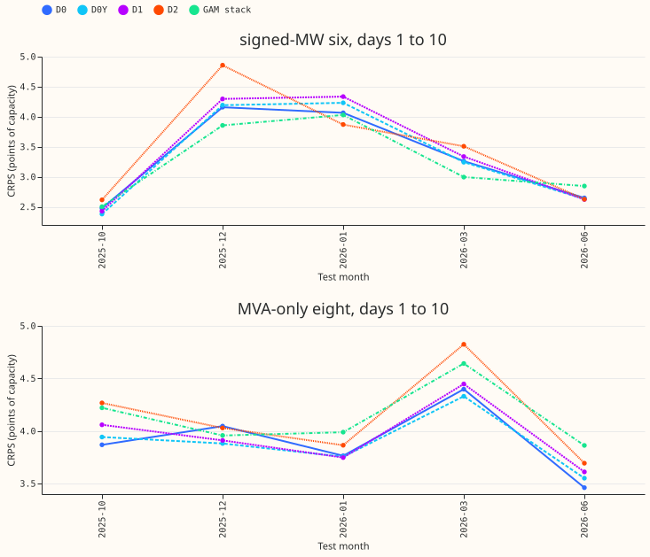
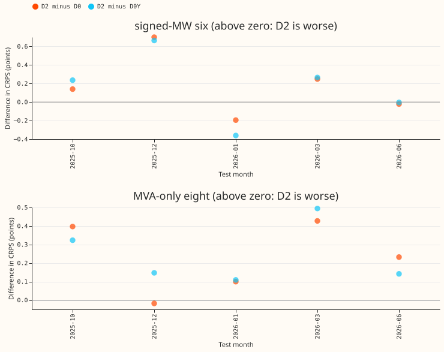
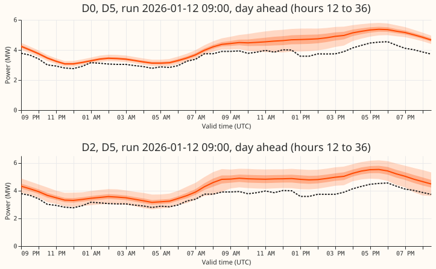
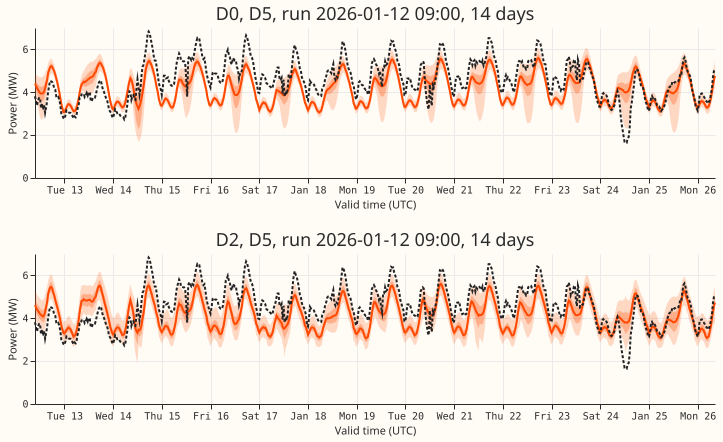
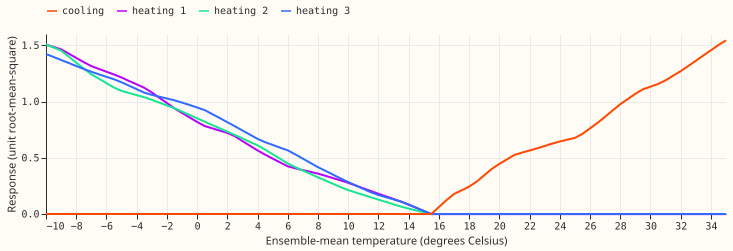

**Take-home message: a neural network built from shared, readable parts forecast substation demand
less accurately than the plain neural network.** We asked whether a neural network that writes each
substation's demand as a mix of shared learned daily shapes and shared learned temperature responses
can forecast as accurately as the plain pooled neural network of [experiment
397](../00397-plain-and-attention-mixture-density-network-for-primary-demand/result.md). Both
predict a full range of outcomes, and we tested both on five held-out months, with three training
runs (seeds) each. The error score is the continuous ranked probability score (CRPS) at 1 to 10 days
ahead, in points of the substation's capacity. The library network scored 0.174 points worse at the
6 substations that record the direction of flow (the signed-MW six) and 0.228 points worse at the
other 8 (the MVA-only eight). It beat the plain network in 2 of 5 months at the six and in 1 of 5 at
the eight.

**The first month we scored was misleading.** In 2026-01 alone, with one seed, the library network
scored 0.379 points better at the six. A fresh audit found no code error. It traced the gain to the
library network's own yearly (day-of-year) coefficients, which had learned the level of the one
earlier January in the training data. Over the five months the mean difference reversed, and the
verdict is `not supported`. All numbers are interim: five test months, no interval.

## Results

CRPS at days 1 to 10, mean over the five test months (2025-10, 2025-12, 2026-01, 2026-03, 2026-06),
equal weight per Primary substation, in points of capacity (smaller is better). Arms D0 to D2 use 3
seeds averaged in quantile space. D0 is the plain pooled network, D0Y is D0 plus the yearly columns,
D1 adds the shape library, and D2 has the shape and response libraries.

| Arm | Signed-MW six | MVA-only eight |
|---|---|---|
| D0, pooled plain network | 3.322 | 3.908 |
| D0Y, D0 plus the yearly columns | 3.336 | 3.893 |
| D1, shape library, head reads all inputs | 3.405 | 3.956 |
| D2, shape and response libraries, Primary mix | 3.496 | 4.136 |
| Generalised additive model (GAM) stack (experiment 377, stored) | 3.247 | 4.135 |
| Monthly XGBoost (experiment 389, stored) | 3.544 | 4.019 |
| Pooled plain network of experiment 397 (stored, no D15 and D18 cut) | 3.270 | 3.866 |

- **The library network scored worse than the plain network at both groups (C1, D2 minus D0).** The
  difference is +0.174 at the six and +0.228 at the eight. The monthly values at the six are in the
  second figure.
- **The libraries did not help one at a time either.** D1 minus D0 is +0.082 and +0.048 (C2), and D2
  minus D1 is +0.092 and +0.180 (C3).
- **The yearly columns alone do not explain the loss.** D2 minus D0Y is +0.160 and +0.243 (C5), and
  D0Y minus D0 is +0.014 and -0.015 (C6).
- **Under the pre-registered rule D2 does not advance.** The five-month mean of D2 minus D0 exceeds
  +0.03 at both groups. It lies between +0.03 and +0.30, so the stop rule did not fire on the mean,
  and the choice to continue or stop is the maintainer's. D2 minus D0 reached +0.699 at the six in
  2025-12.
- **Arm D3 (one fleet-wide mix) was fitted on 2026-01 only,** with one seed. It scored 4.745 at the
  six and 4.503 at the eight, so D3 minus D2 was +0.883 and +0.565.
- **The median error of D2 was larger at both groups.** The mean absolute error of the median
  forecast, in MW at the six and the eight, is 5.69 and 7.08 for D0, 5.76 and 7.04 for D0Y, 5.82 and
  7.13 for D1, and 6.02 and 7.23 for D2.
- **D2 covered the upper tail better than D0 at the six and worse at the eight.** The table gives
  coverage (nominal 0.95 and 0.99) and pinball loss in points, mean over months.

| Arm, group | q95 coverage | q99 coverage | pinball q01 | pinball q05 | pinball q95 | pinball q99 |
|---|---|---|---|---|---|---|
| D0, six | 0.829 | 0.926 | 0.216 | 0.712 | 1.091 | 0.436 |
| D2, six | 0.880 | 0.975 | 0.323 | 0.954 | 0.932 | 0.243 |
| D0, eight | 0.899 | 0.969 | 0.224 | 0.851 | 1.011 | 0.281 |
| D2, eight | 0.889 | 0.966 | 0.292 | 0.998 | 1.164 | 0.372 |

- **At the six, D2's upper quantiles have the lower pinball loss and its lower quantiles the
  higher.** For example, the q99 loss is 0.243 against 0.436. At the eight, both tails are worse.
  The curtailment-cost measure was not computed for this screen.
- **Per Primary (C1, mean of five months),** D2 is better at D5 (-0.276), D16 (-0.094), D14
  (-0.068), and D21 (-0.053). It is worse at D11 (+1.161), D8 (+0.657), D12 (+0.401), D3 (+0.262),
  and D10 (+0.249). D15 and D18 are report-only.

- **Learned curves (D2, 2026-01 fold, seed 0).** The three heating curves are nearly identical, so
  the library did not learn three different responses. The eight learned shapes are smooth and mix
  freely, and this page does not claim that any one of them is a physical daily profile. The
  comparison with the GAM's fitted curves and the three-seed stability check were not run, because
  D2 did not advance.

## Predictions

The predictions were written for the 2026-01 fold with one seed. We judge them here on the
five-month means, and note the one-fold outcome where it differs.

- **P1 (D2 minus D0 between -0.05 and +0.25 at both groups):** held on the five-month means (+0.174
  and +0.228). It failed on 2026-01 with seed 0 at the six (-0.379).
- **P2 (D1 minus D0 between -0.05 and +0.10):** held on the means (+0.082 and +0.048). It failed at
  the six on 2026-01 (+0.269 with three seeds).
- **P3 (D3 minus D2 between 0 and +0.30):** failed on 2026-01, the only fold with D3 (+0.883 at the
  six, +0.565 at the eight).
- **P4 (q95 coverage at the six between 0.82 and 0.90):** held on the means for D0 (0.829), D1
  (0.827), and D2 (0.880). It failed for D0 and D1 on 2026-01 with seed 0 (0.757 and 0.698).
- **P5 (mixed temperature response monotone at 14 of 16 Primaries):** all 16 were monotone, which
  holds by construction.

## Checks

- **The median forecast and the mean forecast agree.** Median minus the weighted mean of the 11
  quantiles (MW) is -0.028 for D0, -0.026 for D0Y, -0.033 for D1, and -0.026 for D2, so no arm's
  spread shifts its forecast.
- **The median error points the same way as the CRPS.** The error figures are in Results.
- **Two audit triggers fired.** D2 minus D0 on 2026-01 with seed 0 was -0.379, outside the predicted
  -0.05 to +0.25. D1, which contains D0's inputs, scored worse than D0 on 2026-01.
- **A fresh Sonnet audit found no bug.** It re-derived the per-Primary scores, found no leakage, and
  traced the 2026-01 gap to D2's yearly coefficients: zeroing them at inference, without a refit,
  moved D2's seed-0 score at the six from 3.861 to 5.298. The audit could not say why seed-0 D0 sat
  0.1 to 0.25 above the stored seeds of experiment 397 on 2026-01. On five months the gap is 0.05 at
  the six and 0.04 at the eight.
- **The five months show the 2026-01 gain was specific to that month,** because D2 minus D0 is
  positive in four of the five months at the eight and in three at the six.
- **Not tested:** the screen has no intervals and no leave-one-Primary-out check, so the audit
  triggers for those were not run.

## Caveats

- **The advance threshold of 0.03 points is the manager's default,** and the maintainer has not
  confirmed it. The five months have no interval, so every number is interim.
- **The headline range is 1 to 10 days ahead,** the range NGED care about.
- **Yearly harmonics sit in D1, D2, and D0Y but not in D0.** The data start in April 2024, so the
  yearly terms were fitted on at most two years.
- **D0 is not a copy of the network of experiment 397.** It uses the D15 and D18 cut, its own
  standardiser, and its own seed stream, and it scores 0.05 worse than the stored 3-seed pooled
  network at the six.
- **No rows with a missing target were found.** The raw matrices from experiment 397 omit the
  flagged half-hours already, so this experiment did not count them.
- **Shapes and the gate are normalised on 4,096 sampled training rows,** not on a grid of ordinary
  days.
- **Unlogged load-shift events.** NGED says load-shift events may be missing from their logs, so the
  rows may hold events that no label covers.
- **Resources.** The fits ran on the GPU. A D2 fit took 51 to 257 s, peak GPU memory was 1.6 GB, and
  peak host memory was 8.3 GB on the largest fold. Fitted networks are in the experiment's private
  folder under `work/models/`, and the scripts are in
  `ml-experiments/00413-differentiable-physics-demand-network-part-1/`.

## Plan as committed before any fit

**Status: planned. Nothing has been fitted.** The plan follows the Design session's note
(`differentiable_physics_demand_design_answer.md`, Opus-reviewed and approved by the maintainer on
2026-10-30) and the manager's programme brief for experiment 7.

## What is asked

**The question is whether a neural network built from shared, readable parts can forecast Primary
demand as well as a plain neural network.** The aim behind the series is a forecaster that keeps the
GAM's (generalised additive model's) readable shapes and temperature curves and gains the
adaptability of the networks. Experiment 397's page gave its pooled plain network 3.264 points of CRPS
(days 1 to 10) at the signed-MW six, close to the GAM stack's 3.239. The first fit checks, on one
winter month, whether the library design loses much against that plain network. It is a screen to
stop a poor design early, not a ranking.

## Review of the plan against the latest evidence

- **Experiment 397** (merged): the pooled plain network is the control. Its inputs, rows, folds,
  early-stopping rule and training loop are copied. The attention gate was inert, so the design has
  none.
- **Experiment 403** (merged): pooling beat one network per Primary by 0.185 at the signed-MW six
  and 0.161 at the MVA-only eight, so the libraries are shared across all 16 Primaries.
- **Experiment 405** (merged, inconclusive) and the open plan for **experiment 409** ([PR
  66](https://github.com/openclimatefix/nged-ml-research/pull/66)): a network with no day-of-year
  term had no other home for the monthly daylight profile, so a solar term could not be separated
  from it. The design note already keeps fixed yearly harmonics with Primary-specific coefficients,
  and this plan adds them to the physics output of arms D1 to D3 and flags that difference from D0
  (see "Caveats").
- **Experiment 394** (merged): the ensemble mean carries the XGBoost gain, the spread adds little.
  The network reads the mean for the responses and the spread only in the residual head.
- **Experiment 398** (merged) and the standing rule of 2026-10-30: scoring actuals and lags are
  cleaned (flagged `substation_zero` half-hours are nulls in experiment 87's `observed.parquet`),
  D15 and D18 are cut before 2025-03-01 in training, lags, inference and scoring, and retraining is
  monthly. All three are applied; the fold counts of dropped half-hours are printed.
- **Experiments 404, 406, 407, 410, 412** are still open. None changes this plan. Their results may
  change the control (a lagless module, no embedding), and the manager decides whether D0 is then
  replaced before the five folds.
- **Nothing in the design note changed**, except two points the note left open and this plan fixes
  below: which inputs the residual head reads in D1, and how arms are compared across the two
  groups.

## Architecture

**Every arm predicts the Primary's power as a fraction of its effective capacity, standardised per
Primary on the fold's training rows, as a 3-component Gaussian mixture (the head of experiment 397's
`PlainMdn`).** The arms differ in what produces the mixture's means.

- **D0, control.** The pooled plain network of experiment 397: all `summary` inputs, an 8-wide
  Primary embedding, 2 hidden layers of 64 (setting `g01`).
- **Shape library.** 8 learned curves (`K_s = 8`) from a small network (2 hidden layers of 32) that
  reads the calendar and holiday columns of experiment 397 (the hour of day as sine and cosine of
  one and two cycles, the day of the week, the COVID indicator, and the Christmas and bank-holiday
  columns). Each curve is normalised on a fixed grid of ordinary days (48 half-hours by 7 days of
  the week): zero mean and unit root-mean-square over the grid.
- **Response library.** 6 learned monotone curves (`K_r = 6`): 3 heating curves that fall with the
  ensemble-mean temperature below the reference of 15.5 °C and are zero above it, 1 cooling curve
  that rises above the reference and is zero below it, 1 curve of the ensemble-mean shortwave
  radiation (zero at no sunshine), and 1 curve of the cosine of the solar zenith angle (zero when
  the sun is down). Each curve is a piecewise-linear function with 16 knots, whose slopes are
  non-negative or non-positive by a softplus, so monotonicity holds by construction, and each is
  normalised to unit root-mean-square over the training range.
- **Primary mix.** An 8-wide Primary embedding feeds linear layers with softmax outputs, which give
  mixing weights over the shapes and over the responses, one non-negative amplitude per library, and
  a Primary-specific level. A third softmax-free layer gives the gate: the response part is
  multiplied by `gate(t) = exp(c · shape(t))`, divided by its mean over the grid, so the gate has a
  daily mean of 1. This is the interaction between the temperature response and the part of the day.
  The mean physics output is `mu = level + A_s * sum_i a_i shape_i(t) + A_r * sum_j b_j response_j *
  gate(t) + yearly`, where `yearly` is the sine and cosine of the day of the year at 1 and 2 cycles
  with Primary-specific coefficients (the GAM's fixed low-order harmonics).
- **Residual mixture.** The mixture's component means are `mu` plus learned offsets, and its weights
  and widths are learned. In D2 and D3 the mixture reads only the three origin lags and their
  missing flags and ages, the lead, the ensemble spread columns, and `mu`. It does not read the
  weather means or the calendar, because it could then learn the demand itself and leave the library
  curves unidentified.
- **D1, shape library only.** `mu = level + A_s * sum_i a_i shape_i(t) + yearly`. The design note
  says "plain MDN residual" and does not say what it reads. Without a response library the residual
  has no other route to temperature, so in D1 the mixture reads all of D0's inputs, the Primary
  embedding, and `mu`. D1 is therefore D0 plus a shape-library mean, not a restricted network.
- **D2, shape and response libraries with the Primary mix** (the main arm), as above.
- **D3, D2 with one fleet-wide mix.** The Primary embedding is removed everywhere: one set of mixing
  weights, amplitudes, gate, and level for all 16 Primaries.

**Identifiability constraints.** Shapes are zero-mean and unit-RMS on the grid, responses are zero
at the reference and unit-RMS, mixing weights are softmax, and the gate has a daily mean of 1. The
yearly term and the temperature response stay collinear, and so do the solar-zenith response and the
daily shapes in daylight. The first fit does not test whether those pairs separate; the stability
check in the five-fold stage does.

## Folds, rows, and compute

- **Fold and seed.** The 2026-01 fold of experiment 397 (the test month 2026-01, trained on the 24
  months before 2026-01-01), seed 0, 4 arms. Selection of rows, early stopping (one week in 12 held
  out with purging), recency weights, widths and training loop are experiment 397's.
- **Hyperparameters.** `K_s`, `K_r`, the knot count, and the embedding width are fixed above from
  the design note, and are not tuned on any scored month.
- **Cleaning and cuts.** Rows, lags, and scoring actuals from experiment 87's cleaned `observed`
  data; D15 and D18 are cut before 2025-03-01 (training, lags, inference, and scoring); the number
  of dropped half-hours is printed for the fold.
- **Cadence.** One fit per fold, equivalent to a monthly refit.
- **Compute.** One GPU process under 8 GB of GPU memory, 1 feeder core, `MemoryMax=8G`. The timed
  fit is D2 on the fold, on the GPU, plus one epoch on 1 CPU thread for comparison, as the GPU rule
  requires. Reused stored forecasts: none for D0 (its stored forecasts predate the D15 and D18 cut,
  so D0 is refitted); the GAM stack and XGBoost forecasts are references only.
- **Fitted networks** are saved as `.pt` files under the experiment's private `work/models/`.

## Scoring

- **Contrasts**, each on CRPS at days 1 to 10 per group (signed-MW six, MVA-only eight, D15 and D18
  report-only): C1 D2 minus D0, C2 D1 minus D0, C3 D2 minus D1, C4 D3 minus D2. One fold and one
  seed give no interval, and every number is interim.
- **Per-Primary table** of C1, so a gap concentrated at one Primary is visible.
- **Tails**: coverage at q95 and q99 and pinball loss at q01, q05, q95, and q99, per group, with and
  without the 1.15 widening of experiment 87.
- **Interpretation outputs**: the 8 shape curves, the 6 response curves, a table of each Primary's
  mixing weights and amplitudes, and the monotonicity check of the mixed temperature response at
  each Primary. The comparison with the GAM's fitted curves and the three-seed stability check wait
  for the five-fold stage.
- **Example forecasts**: a day-ahead forecast and a 14-day forecast from one run at a Primary, for
  D0 and D2, with median, 50% and 90% bands, and actuals.
- **Checks** (the skill's audit triggers): the median minus the mean forecast per group, the mean
  forecast's error beside the quantile score, and which of the seven triggers fired.

## Code review

**A fresh Sonnet reviewer read the code before any fit.** It found no leakage and no blocker. Six
findings were triaged: D1's mixture now reads the Primary embedding as D0's does (so D1 is D0 plus a
shape-library mean); the gate exponent is clamped to plus or minus 3; D0's initial weights are
seeded; the scorer's mean check is labelled in MW and uses the stored quantile weights; a guard
rejects a reference temperature outside the input clip range. The sixth finding is accepted as a
caveat below.

## Plan caveats

- **The monotonicity check cannot fail.** Each curve is monotone by construction, so P5 and its stop
  rule test the code, not the design.
- **Shapes and the gate are normalised on 4,096 sampled training rows**, not on a grid of ordinary
  days.

- **Yearly harmonics are in D1 to D3 and not in D0.** A gain or loss of D2 against D0 therefore
  mixes the effect of the library design with the effect of the yearly harmonics. If D2 advances,
  the five-fold stage adds D0 with the yearly harmonics as an input.
- **Lead range.** The headline band is 1 to 10 days, the horizon NGED cares about.
- **One winter month, one seed.** No claim of benefit, and cold winter nights are not scored
  separately until the five-fold stage.
- **Unlogged load-shift events.** NGED says load-shift events may be missing from their logs, so the
  rows may hold events that no label covers.
