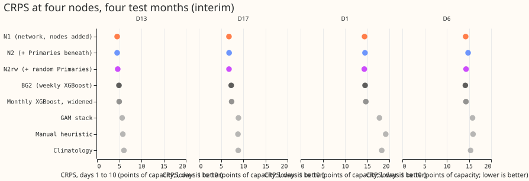
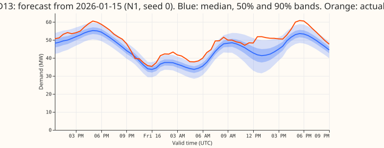
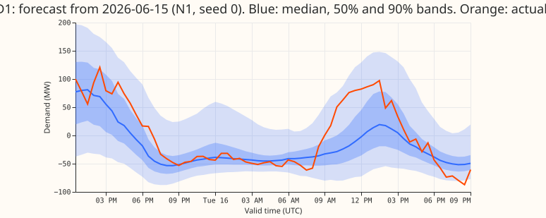
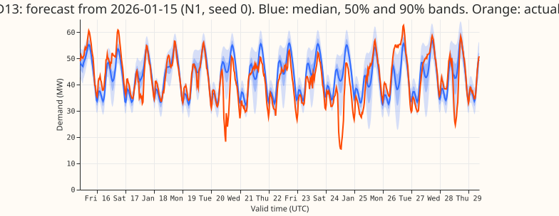
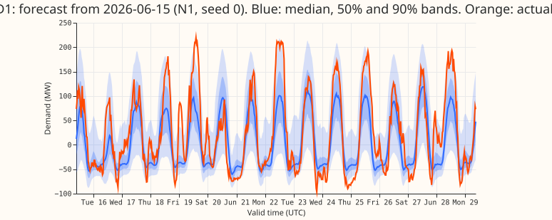

**Take-home message: one pooled network, trained on the Primaries and on the four supply points
themselves, forecasts the bulk supply points better than the weekly XGBoost model and the grid supply
points about as well, but at the grid supply points only with very wide bands; the Primaries beneath
a node do not help as inputs.** We asked whether
the pooled plain mixture density network of [experiment
403](../00403-pooled-versus-per-primary-mixture-density-network/result.md) works at two bulk supply
points (BSPs: D13, D17) and two grid supply points (GSPs: D1, D6), the nodes of
[experiment 386](../00386-bsp-gsp-demand-v1-top-down-bg2-gam-simple-xgboost/result.md). A BSP
connects the 132 kV electricity network to the 33 kV network, and a GSP connects the transmission
network to the 132 kV network. We trained the network on four test months, each time on the 24
months before, and compared it with a copy fitted at the Primaries only and with the stored
forecasts of experiment 386. The verdict is `supported (interim)`, because four test months give
wide intervals.

## Arms and results

CRPS is the continuous ranked probability score estimated from 11 quantiles, in points of effective
capacity, at days 1 to 10, over four test months (2025-10, 2026-01, 2026-03, and 2026-06) and 3
seeds, averaged in quantile space.

- **P0:** the pooled network fitted at the 16 Primaries only, applied to a node with the mean of
  the 16 Primary embeddings and the node's own target statistics.
- **N1:** fitted at the 16 Primaries and the 4 nodes, with a node-type input.
- **N2:** N1 plus the mean of the three origin lags of the Primaries beneath the node (7 beneath
  D13 and D1, 9 beneath D17 and D6; NGED's hierarchy file) and the share of those Primaries with a
  reading.
- **N2rw:** N2 with a random set of the same size in place of the true Primaries (overlap with the
  true set: 0 of 7 and 2 of 9).
- **CRPS (D13, D17, D1, D6):** P0 6.65, 12.93, 33.09, 25.92; N1 4.52, 6.80, 14.41, 14.26; N2 4.52,
  6.82, 14.51, 14.81; N2rw 4.66, 6.80, 14.35, 14.35; BG2 4.94, 7.31, 14.52, 14.19; monthly XGBoost
  control widened by 1.15 4.99, 7.39, 14.70, 14.33; GAM stack 5.66, 8.93, 17.77, 15.81;
  `manual_heuristic` 5.80, 8.82, 19.18, 15.92; `climatology` 6.06, 8.89, 18.29, 15.37.
- **C1, N1 minus P0 (95%, month blocks):** BSPs -4.13 (-5.66 to -3.09); GSPs -15.17 (-23.16 to
  -10.55). P0 is not a fair transfer: its lag inputs are scaled by the Primaries' statistics, and a
  grid supply point's lags (net flow near zero, often negative) lie far outside them. At D1 P0's
  median has a bias of +33 points and a correlation of -0.06 with the actual; its q95 coverage is
  0.56 to 0.80. Treat -4.1 as the better bound on the benefit of node training and -15.2 as
  inflated by an unknown share.
- **C2, N1 minus the widened monthly XGBoost control:** BSPs -0.53 (-0.76 to -0.28); GSPs -0.18
  (-0.68 to +0.23). N1 minus BG2: BSPs -0.47 (-0.67 to -0.23); GSPs -0.02 (-0.15 to +0.13). N1 is a
  3-seed average and BG2 and the control are single fits. Single-seed N1 minus BG2 averages -0.39 at
  the BSPs and +0.21 at the GSPs, so the BSP gain survives and the GSP parity does not depend on
  more than the averaging. BG2 refits weekly and N1 refits once per test month, so the BG2
  contrast depends on cadence. The BSP gain keeps its sign when either BSP is left out and in
  each test month; the GSP contrast changes sign with the node left out (D6 +0.08, D1 -0.11).
- **C3, N2 minus N1:** BSPs +0.01 (-0.26 to +0.33); GSPs +0.32 (+0.19 to +0.44). The interval
  resamples test months only. Per seed the GSP difference is -0.04, +0.44, and +0.61 (standard
  error about 0.20), and it rests on D6 (+0.54; D1 +0.09). A harm of about 0.3 at the GSPs is not
  established. A likely reason for no gain is that the Primaries' lags barely track a grid supply
  point (correlation -0.26 to +0.03 at D1 and D6, +0.59 to +0.87 at the BSPs).
- **C4, N2 minus N2rw:** BSPs -0.06 (-0.22 to +0.09); GSPs +0.31 (+0.21 to +0.38). N2rw minus N1 is
  +0.07 (BSPs) and +0.02 (GSPs).
- **C5, N1 minus P0 at the 14 countable Primaries:** -0.022 (-0.048 to +0.005); at D15 and D18 -0.46
  (-1.43 to +0.31). Adding the nodes to the training rows does not hurt the Primaries.
- **C6, against the simple references:** N1 minus `manual_heuristic` is -1.65 (BSPs) and -3.21
  (GSPs); N1 minus `climatology` is -1.82 and -2.49; all intervals exclude zero.
- **Tails (N1, days 1 to 10; D13, D17, D1, D6).** q95 coverage 0.88, 0.92, 0.95, 0.91; q99 coverage
  0.97, 0.98, 0.99, 0.98; q05 coverage 0.04, 0.05, 0.09, 0.04; q01 coverage 0.006, 0.011, 0.014,
  0.006. BG2's q95 coverage is 0.93 to 0.94 at three nodes. The upper tail at D13 is too narrow.
- **Predictions.** P1 failed in size (a gap of 4 to 15 points was predicted at 0.3 to 1.5). P2 failed
  towards better (N1 beat the control by 0.53 at the BSPs where 0.1 better to 0.6 worse was
  predicted). P3 held at the BSPs and failed at the GSPs. P4 held in part: q95 coverage 0.88 to
  0.95, q05 coverage 0.04 to 0.09. P5 held.

## Checks

- **Median minus mean.** Not computed: the network stores quantiles, not a mean.
- **Mean-forecast error.** Not computed. CRPS and the median's pinball loss agree in direction at q95
  and q99 for N1 against BG2 at three of four nodes.
- **Triggers fired.** Trigger 2 (a result contradicts a prediction: P1, P2, and P3 at the GSPs) and
  trigger 5 (N2 contains N1's inputs yet scores worse at the GSPs). A fresh Sonnet audit re-derived
  every headline contrast to within 0.01 and found no leakage or missing-value fault in the
  neighbour columns; its seven findings are triaged in the PR, and the first, second, third, fifth,
  and sixth changed the wording above. The audit also found that N1 at the GSPs ties BG2 only with
  bands about 100 points of capacity wide, and its median correlates 0.29 (D6) and 0.65 (D1) with
  the actual, against 0.82 and 0.87 at the BSPs. A separate Sonnet audit of the stage
  1 numbers reproduced the printed CRPS and coverage to within 0.31 points and found the stored
  actuals equal to the cleaned readings.

## Setup and caveats

- **Recipe.** Experiment 397's `plain_pooled` network with its chosen setting (width 64, two layers,
  three components, dropout 0.1), the ensemble mean and standard deviation of seven weather columns
  as inputs, the three origin lags, one fit per test month on the 24 months before, monthly
  refitting, as the standing rules ask. Code: `ml-experiments/00415-*/` imports experiment 397 and
  experiment 87's rows.
- **Cleaned data and the cut.** All actuals and lags come from experiment 87's cleaned panel. The
  scorer drops 1,236 half-hours per node that lack a cleaned actual or a forecast in some arm. Rows of
  D15 and D18 before 2025-03-01 are dropped everywhere.
- **Weather at lag times.** The lags are power, not weather. The weather inputs are the ensemble
  forecast for the valid time, available at forecast time.
- **Not scored.** The curtailment cost (the metric needs generator tables that experiment 386 also
  lacked), load-shift event plots (no label is used), and a weekly-refit check.
- **Missing run.** The 2026-06-30 run is absent from the 2026-06 test month, because the stored rows
  end at the 2026-06-29 run.
- **Interim.** Four test months give four-way month blocks, which is why the intervals are wide. No
  claim of benefit rests on them.
- **Stored.** Weights and forecasts are in this experiment's private folder under `work/models` and
  `work/seed_preds`.

## What to try next

- A fair transfer arm, with the node's lags scaled by its own statistics, before quoting the value
  of training on the nodes.
- More seeds of N1 and N2 at D1 and D6, to settle whether the neighbour columns harm the GSPs.
- A weekly-refit check of N1 at the GSPs, where it only ties BG2.
- Widening or recalibrating the upper tail at D13.
- Embedded generation and storage under each node as explicit inputs, which experiment 386 named
  and this experiment did not test.

## Problems caused by the move

None.
