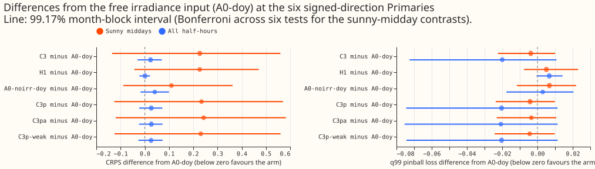
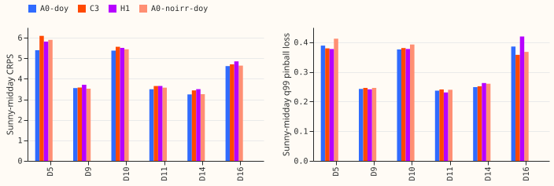
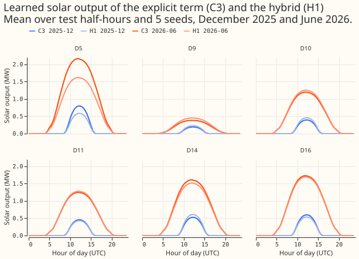
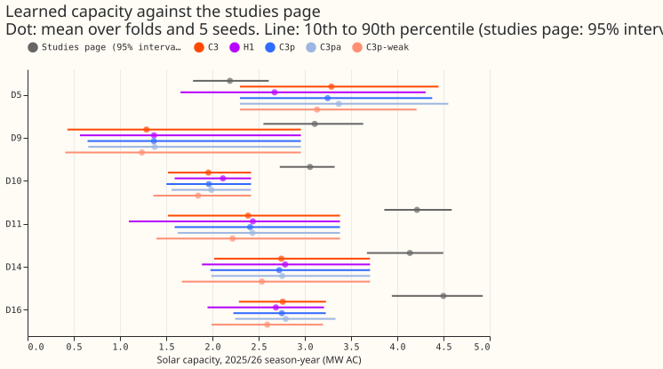
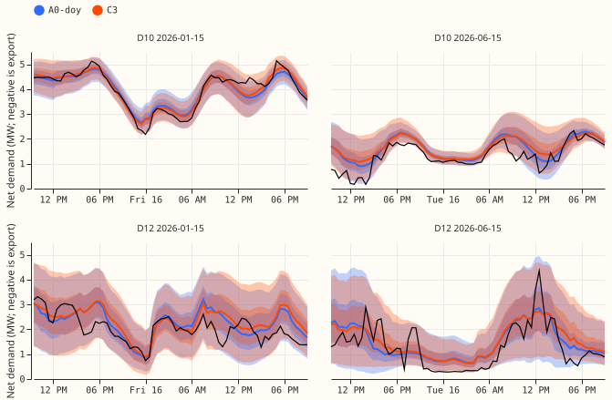
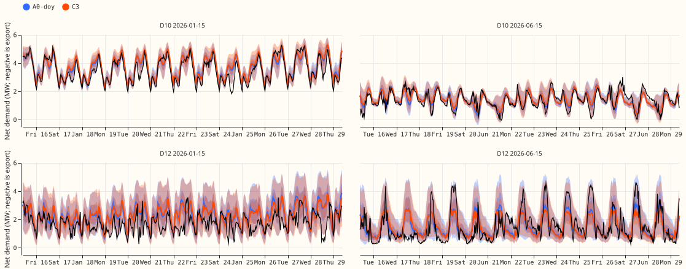

**Status: done. The sections up to "Reports" are the plan, written before any fit; the amendments
were written before the fits they concern.** The brief is
`briefs/mdn_explicit_solar_followup2_brief.md`,
which supersedes `briefs/mdn_explicit_solar_powered_brief.md` where they differ. The sections up to
"Pre-registered rules" are the plan.

## What is asked

**The question is whether the explicit solar term can replace the free irradiance input without
losing skill, and whether it improves the tails.** [Experiment
409](../00409-mdn-solar-term-day-of-year-and-anomaly-known-answer/result.md)
found the explicit solar term (C3) 0.064 CRPS points better than the same network with no
irradiance (interval -0.131 to +0.028), but its minimum detectable effect was 0.397, so the test
could not tell. The network with a free irradiance input (A0) still scored best, and C3 had a 7%
lower q99 pinball loss. This experiment adds the hybrid H1, uses 5 seeds instead of 3, and
measures where a solar term can show an effect: sunny middays.

## Review of the plan against the latest evidence

- **Merged since the brief was written:** experiment 409 (the predecessor; the adapter, the prior,
  and the capacity penalties changed nothing, so their arms are dropped). Experiments 388, 392,
  394, and 411 concern XGBoost lags and counterfactual re-scores and do not bear on this question.
  Experiment 413 (open, plan only) asks about shared learned shapes and keeps its own arms, so the
  solar question stays here.
- **Standing rules in `common.md` followed:** cleaned data with flagged `substation_zero`
  half-hours dropped and the count reported per fold, the D15 and D18 start cut at 2025-03-01
  (applied), monthly refits, saved models, tails per Primary, example forecast graphs, the
  seven-step review process, Sonnet reviews, draft pull request.
- **Departure from the brief:** the brief names A0 as arm of "the same network ... day-of-year term
  as in experiment 409". Experiment 403's stored A0 has no day-of-year term, so A0 is refitted
  here with the term (A0-doy). That gives a matched reference at the cost of 25 fits.
- **No change of scope.**

## Arms

All arms are experiment 409's pooled plain network: 8-wide Primary embedding, 3 Gaussian
components, 2 hidden layers of 64, ECMWF ensemble mean and spread through one pass, and the 20
day-of-year by hour inputs.

| Arm | Solar term | Irradiance and geometry inputs | Source |
|---|---|---|---|
| A0-doy | none | kept | refit (new) |
| C3 | explicit, adapter, prior | removed | seeds 0 to 2 from experiment 409, seeds 3 and 4 refit |
| H1 | explicit, adapter, prior | kept | refit (new) |
| A0-noirr-doy | none | removed | seeds 0 to 2 from experiment 409, seeds 3 and 4 refit |

**H1 is C3's solar module added to A0-doy's demand module.** The network can correct the explicit
term through the free irradiance input.

## Rows, folds, and cadence

- **Folds.** The five screen months of experiments 397 and 409: 2025-10, 2025-12, 2026-01,
  2026-03, 2026-06. Monthly refits on a 730-day window.
- **Seeds.** 5 (0 to 4).
- **Rows.** Cleaned data, flagged `substation_zero` half-hours dropped (count per fold reported),
  D15 and D18 cut before 2025-03-01 and report-only, 16 Primaries trained pooled, the six
  signed-direction Primaries (D5, D9, D10, D11, D14, D16) scored in the primary contrasts, the
  MVA-only eight reported.
- **Weather at lag times.** The lags are the Primary's own power, so no weather is used at lag
  times.

## Reuse of stored forecasts

- **Reused:** experiment 409's `seed_preds` for C3 and A0-noirr-doy, seeds 0 to 2. The folds, the
  window, the cleaning, the start cut, the code, and the seeds are the same, because this
  experiment imports experiment 409's modules. A check before scoring confirms that the stored
  rows' keys match the keys of the new arms. The 1.15 widening is not applied (raw).
- **Fitted:** C3 and A0-noirr-doy seeds 3 and 4 (20 fits), A0-doy (25 fits), H1 (25 fits). Total
  70 fits instead of 100, a saving of 30 fits (about 40 minutes).

## Pre-registered rules

1. **Primary slice.** Sunny-midday half-hours: realised CAMS clear-sky index of 0.7 or more, local
   time 10:00 to 15:00, within days 1 to 10, at the signed-MW six. The clear-sky index is the
   ratio of CAMS global horizontal irradiance to CAMS clear-sky irradiance from experiment 39's
   frame (a realised value, used only to select scored rows, never as an input). The slice is
   defined by realised weather, so every arm sees the same rows.
2. **Primary family (six tests).** The paired difference of each of C3, H1, and A0-noirr-doy from
   A0-doy, on (a) sunny-midday CRPS and (b) q99 pinball loss (co-primary), month-block bootstrap
   with 20,000 resamples, Bonferroni-corrected across the six (99.17% per interval).
3. **Minimum detectable effect.** For each contrast and metric, twice the standard deviation over
   the 5 folds of the seed-to-seed difference of the contrast. It is computed from the seed spread
   of experiment 409's stored seeds 0 to 2 for C3 and A0-noirr-doy before any new fit, and again
   from the 5 seeds after the fits. The pre-fit values are committed in an amendment to this page
   before the fits start. The page says plainly if the design is still underpowered.
4. **A gain** needs the interval to exclude zero in the predicted direction and the point estimate
   to exceed the minimum detectable effect. **Non-inferior** means the interval's upper bound is
   below the margin: +0.10 CRPS points (about 3% of A0's 3.35) and +5% of A0's q99 pinball loss. The
   margin is the loss the maintainer would accept for an interpretable physical term; it is a
   judgement and is stated before any score.
5. **Verdict.**
    - *Supported:* C3 or H1 is a gain on sunny-midday CRPS or on q99 pinball loss, and neither
      metric shows a harm (interval above zero beyond the margin).
    - *Partly supported:* C3 or H1 is non-inferior on both metrics and is a gain on neither, or is a
      gain on one metric and not non-inferior on the other.
    - *Not supported:* neither C3 nor H1 is non-inferior on sunny-midday CRPS.
    - *Inconclusive:* a minimum detectable effect exceeds the margin, so non-inferiority cannot be
      shown.
6. **Secondary contrasts (reported, same three-part rule):** C3 minus A0-noirr-doy, H1 minus C3,
   and all contrasts on headline-band CRPS (days 1 to 10, all half-hours) and the sunniest third
   slice of experiment 409.
7. **Tails.** q95 and q99 coverage and pinball loss per Primary and per metering group, with
   intervals from the same bootstrap; the q01 and q05 and threshold-weighted CRPS are reported.
8. **Capacity.** The learned capacity of C3 and H1 per Primary and season-year, with the seed
   range, beside the studies page. The prior resists falls and allows rises (the maintainer's
   rule). The 0.4 to 0.5 shortfall seen at 5 of 6 Primaries in experiment 409 is checked.
9. **Dropped from experiment 409:** the known-answer anomaly variant (untestable: injection about
   1 MW against seed spread about 0.35 MW), the adapter-free arm, the no-prior arm, and the
   capacity-path penalties.

## Amendment 1: pre-fit minimum detectable effect (written before any new fit)

Computed by `e00416_score.py --pre-fit` from experiment 409's stored seeds 0 to 2 of C3 and
A0-noirr-doy (twice the standard deviation over the 5 folds of the seed-to-seed difference of the
contrast, signed-MW six, days 1 to 10):

| Contrast, C3 minus A0-noirr-doy | CRPS (points) | q99 pinball loss |
|---|---|---|
| Sunny-midday slice (138,776 shared half-hours) | 0.969 | 0.110 |
| All half-hours | 0.397 (matches experiment 409) | 0.294 |

- **The design is expected to be underpowered for non-inferiority on CRPS.** The single-seed
  minimum detectable effect on sunny middays (0.97) is nearly 10 times the +0.10 margin. Scoring the
  seed-average of 5 seeds shrinks the seed noise by roughly a factor of 2, which leaves about 0.4,
  still about 4 times the margin. The page reports the post-fit value from the 5 seeds and applies
  the "Inconclusive" verdict if it exceeds the margin.
- **Only the month-to-month spread within a slice of 5 test months limits the interval.** More
  seeds do not fix that, and more test months would.

## Amendment 2: pre-registered second stage, more test months (manager, 2026-10-30)

The first stage runs as planned (5 test months, 70 fits) with the margin unchanged. **If the
post-fit minimum detectable effect exceeds the margin, the verdict is "inconclusive" until the
extension below runs.** The extension does not start without the manager's word.

- **Months available.** The ECMWF ensemble archive starts on 2024-04-01 and no valid time on or
  after 2026-07-01 may be scored. With at least 12 months of training history, the test months run
  from 2025-04 to 2026-06, 15 months. Ten are unused: 2025-04 to 2025-09, 2025-11, 2026-02,
  2026-04, and 2026-05. Months before 2026-04 have a training window shorter than 730 days (12 to
  23 months), which the page states as a caveat.
- **Size.** 8 to 12 test months means adding 3 to 7 months. Each added month needs all 4 arms at 5
  seeds, 20 fits, because experiment 409 stored no seeds there. That is 60 to 140 fits, about 1.7
  to 4 hours at the first stage's rate.
- **Priority order of added months.** 2025-07, 2025-08, 2025-05 (the sunny months, where the
  sunny-midday slice has most rows), then 2025-09, 2026-04, 2026-05, 2025-06.
- **Decision rule.** Unchanged, with the margin of +0.10 CRPS points and +5% q99 pinball loss, the
  Bonferroni level for six tests, and the post-fit minimum detectable effect recomputed on all
  months.

## Amendment 3: the capacity prior is nearly inert (checked during the first fits)

`e00416_prior_share.py` computes the gradient of the prior and of the likelihood with respect to
the learned log-capacities of C3 on the 2026-06 fold (10 random batches of 16,384 training rows,
seed 0). The training loss divides the prior by the effective number of training rows (1.76
million), as experiment 412's loss did.

- **At the start** (capacity at the prior centre) the prior's share of the gradient norm is
  1.2e-9, because the prior's gradient is zero at its own centre.
- **At the end** (experiment 409's stored C3, same fold and seed) the share is 2.5%, and the
  learned capacities lie on average 4.1 prior standard deviations from the prior centre.
- **Consequence.** C3 and H1 behave as the explicit solar term with a free capacity. The page says
  so, and does not describe the capacity as "regularised towards the studies page".

## Amendment 4: two log-scale prior arms, added after the inert-prior finding (manager, 2026-10-30)

Written before either arm is fitted. **C3 and H1, as run in the first stage, are effectively an
explicit solar term with a free capacity** (amendment 3). The two arms below are post hoc additions;
they sit outside the family of six primary tests and are reported as secondary contrasts.

- **C3p:** C3 with a Gaussian prior on the natural logarithm of the capacity, centred on the
  studies page's capacity (the same centre as C3), with standard deviation 0.7 in log units
  (a factor of 2 either way). The prior is set against one batch's summed log-likelihood rather
  than the whole training set's: the penalty is divided by the batch size (16,384 rows) instead of
  the effective row count (about 1.8 million), which makes it about 100 times stronger than in C3.
- **C3pa:** C3p's penalty applied only when the capacity falls below the prior centre, so the
  capacity is free to rise and penalised for falling (the maintainer's asymmetric form), same
  scale.
- **Label.** The prior is about 100 times stronger than C3's, not the Bayesian per-row scale. At the
  start of training C3pa's penalty gradient is zero, because the capacity starts at the prior
  centre and the penalty acts only below it.
- **Everything else** is C3: same inputs, adapter, folds, seeds (all 5 fitted new), and scoring.
- **Reports.** For each arm, the prior's share of the log-capacity gradient at the end of training,
  and at the start with the capacity shifted one prior standard deviation (0.7 log units) below the
  prior centre, because the penalty's gradient is exactly zero at the centre where every arm starts
  (`e00416_prior_share.py --arm`), and the learned capacity beside the studies page per
  Primary. Contrasts: C3p minus C3, C3pa minus C3, and each minus A0-doy, on sunny-midday and
  headline-band CRPS and q99 pinball loss, with the same intervals.
- **Cost.** 2 arms x 5 seeds = 10 fits per test month: 50 fits on the first 5 months, and 10 on each
  extension month (30 to 70 for 3 to 7 added months), 80 to 120 fits in total, about 1.5 to 2.3
  hours at about 70 seconds per fit.
- **Code review.** A fresh Sonnet reviewer reads `e00416_models.py` (the changed loss) before the
  first fit of these arms.

## Amendment 5: a weaker strength for C3p (manager, 2026-10-30)

Written before any of the arms in amendment 4 is fitted. The strength of the log-scale prior is a
choice, not a Bayesian scale.

- **C3p-weak:** C3p with the penalty 10 times weaker, so about 10 times stronger than C3's. C3p
  and C3pa keep the 100-times strength. The gradient shares at the start and end of training decide
  whether any strength is still too weak.
- **Cost, replacing amendment 4's.** 3 arms x 5 seeds = 15 fits per test month: 75 fits on the first
  5 months and 15 on each extension month (45 to 105 for 3 to 7 added months), 120 to 180 fits in
  total, about 2.3 to 3.5 hours at about 70 seconds per fit.

## Amendment 6: only 12 test months exist, from 2025-07 (found when the extension ran)

The extension's first plan named 15 available months from 2025-04, but the stored forecast inputs
(the ensemble demand frames and summaries) start with the scored period of 2025-07-01, so the runs
for 2025-05 and 2025-06 had no inputs and stopped before writing any file. The available test
months are the 12 from 2025-07 to 2026-06. The extension therefore adds 2025-07, 2025-08, 2025-09,
2025-11, 2026-02, 2026-04, and 2026-05 to the first five, 12 in total, each with a training window
of 730 days or the history since 2024-04-01 (at least 15 months). The decision rule is unchanged.

## Reports

- **Figures.** Contrasts with intervals first; sunny-midday CRPS and q99 pinball loss per Primary;
  the learned solar contribution by hour and month beside the clear-sky shape; learned capacity
  beside the studies page; a day-ahead and a 14-day example forecast (a winter and a summer
  month, one signed-MW Primary and one MVA-only Primary).
- **Checks.** Median minus mean forecast per Primary, the mean-forecast error beside each contrast,
  the flagged half-hours dropped per fold, the audit triggers that fired, and the saved-network
  path.

## Compute

- **Fits.** 70 fits at about 1.5 minutes each on the GPU, about 2 hours with feeder overhead. One
  fit
  is timed first.
- **Resources.** One GPU process under 8 GB, one feeder core, `MemoryMax=8G`,
  `OMP_NUM_THREADS=1`. No fit starts until the manager grants the fit slot.

## Earlier advice followed and departed from

- **Followed:** test the solar term on CRPS directly; compare on at least 3 test months per slice
  (the sunny-midday slice holds all 5 test months); report absolute skill beside contrasts.
- **Departed from:** none.

## Results

**Take-home message: the explicit solar term did not beat the free irradiance input, and this design
could not tell how much worse it is on sunny middays.** All numbers are the continuous ranked
probability score (CRPS) in points of effective capacity at the six signed-direction Primaries (D5,
D9, D10, D11, D14, D16), days 1 to 10, 12 monthly test months (2025-07 to 2026-06), monthly refits
on a 730-day window, 5 seeds, ECMWF ensemble mean and spread in one pass. The 4,012,330 half-hours
scored are the half-hours all seven arms share. The 12 months are the five of experiment 409 plus
seven more; the earlier five give the same direction as the later seven.

- **Verdict by the pre-registered rule: inconclusive.** The 5-seed minimum detectable effect on
  sunny-midday CRPS is 0.37 for C3 minus A0-doy, 0.28 for H1 minus A0-doy, and 0.37 for A0-noirr-doy
  minus A0-doy, against the +0.10 margin. For q99 pinball loss it is 0.039 and 0.026 against a
  margin of 0.016 (5% of A0-doy's sunny-midday value). The single-seed definition of the plan gives
  0.90 to 1.18 (CRPS) and 0.08 to 0.12 (q99). No contrast is a gain or non-inferior on CRPS. The
  five experiment 409 months alone gave a 5-seed minimum detectable effect of 0.26 to 0.33, so seven
  more months did not lower it.
- **Absolute CRPS, signed-MW six / MVA-only eight (days 1 to 10).** A0-doy 2.966 / 3.844; C3 2.990 /
  3.936; H1 2.967 / 3.876; A0-noirr-doy 3.008 / 3.892; C3p 2.993 / 3.932; C3pa 2.993 / 3.935;
  C3p-weak 2.992 / 3.930. The MVA-only eight have no solar term and differ between arms only through
  their inputs and training noise (0.05 to 0.09 points), the noise floor for networks that differ in
  nothing relevant to them.
- **Sunny-midday slice (CAMS clear-sky index at least 0.7, 10:00 to 15:00 local time, 88,924
  half-hours).** Mean CRPS: A0-doy 4.288; C3 4.515; H1 4.515; A0-noirr-doy 4.398. Mean q99 pinball
  loss: A0-doy 0.314; C3 0.310; H1 0.319; A0-noirr-doy 0.321.
- **Primary contrasts against A0-doy on sunny middays (99.17% month-block intervals, six tests).**
  CRPS: C3 +0.227 (-0.135 to +0.560); H1 +0.227 (-0.043 to +0.471); A0-noirr-doy +0.110 (-0.089 to
  +0.363). q99 pinball loss: C3 -0.004 (-0.022 to +0.010); H1 +0.005 (-0.008 to +0.023);
  A0-noirr-doy +0.007 (-0.012 to +0.022). The predictions failed: P1 (H1 minus A0-doy between -0.10
  and 0.00) and P2 (C3 minus A0-doy between -0.05 and +0.15) both missed on the point estimate
  (+0.227), and P3 (C3 minus A0-doy q99 pinball loss lower by 3% to 12%) is a 1% reduction on sunny
  middays (-0.004 of 0.314) and a 6.6% reduction over all half-hours (-0.020 of 0.304, interval
  -0.073 to +0.011).
- **All half-hours (secondary), against A0-doy.** CRPS: C3 +0.024 (-0.029 to +0.070); H1 +0.001
  (-0.023 to +0.022); A0-noirr-doy +0.041 (-0.018 to +0.100). q99 pinball loss: C3 -0.020 (-0.073 to
  +0.011); H1 +0.007 (-0.001 to +0.014); A0-noirr-doy +0.003 (-0.018 to +0.020). C3 minus
  A0-noirr-doy: CRPS -0.018 (-0.067 to +0.036), sunny-midday +0.117 (-0.376 to +0.580),
  all-half-hour q99 pinball loss -0.023 (-0.070 to +0.005). H1 minus C3: CRPS -0.023 (-0.064 to
  +0.024), q99 pinball loss +0.027 (-0.008 to +0.084). The hybrid shows no gain over the explicit
  term alone.
- **Tails (days 1 to 10, signed-MW six, mean over Primaries; A0-doy / C3 / H1 / A0-noirr-doy).**
  Pinball q95 0.866 / 0.853 / 0.871 / 0.873; pinball q99 0.304 / 0.284 / 0.310 / 0.307; coverage q95
  0.884 / 0.893 / 0.887 / 0.888; coverage q99 0.960 / 0.966 / 0.960 / 0.960; coverage q01 0.014 /
  0.013 / 0.015 / 0.014; coverage q05 0.051 / 0.051 / 0.054 / 0.050; threshold-weighted CRPS 0.349 /
  0.347 / 0.353 / 0.348. C3 has the lowest upper-tail loss and the highest q95 and q99 coverage, by
  small margins whose intervals include zero.
- **Log-scale prior arms (added after the inert-prior finding; post hoc).** C3p, C3pa, and C3p-weak
  score 2.993, 2.993, and 2.992 against C3's 2.990 overall, and 4.522, 4.531, and 4.519 against C3's
  4.515 on sunny middays. C3p minus C3 is +0.003 (-0.004 to +0.010) overall and +0.007 (-0.018 to
  +0.032) on sunny middays; C3pa minus C3 is +0.003 (-0.001 to +0.008) and +0.016 (-0.005 to
  +0.035); C3p-weak minus C3 is +0.002 (-0.003 to +0.009) and +0.004 (-0.018 to +0.038). Their q99
  pinball losses are within 0.001 of C3's.
- **Prior share of the log-capacity gradient (2026-06 fold, seed 0).** C3: 1.2e-9 at the start (the
  penalty's gradient is zero at its own centre, where every arm starts), 2.5% at the end. With the
  capacity shifted 0.7 log units below the centre, the share is 4.4% for C3p and C3pa and 0.46% for
  C3p-weak. At the end it is 5.0% for C3p, 4.4% for C3pa, and 0.64% for C3p-weak. The prior is about
  100 times stronger than C3's per-row scale for C3p and C3pa, and the per-Primary learned
  capacities are within 0.1 MW of C3's in the first five months.
- **Learned capacity against the studies page (2025/26 season-year, mean over 12 folds and 5 seeds,
  MW).** For C3 the capacities are 1.96 (D10), 2.39 (D11), 2.74 (D14), 2.76 (D16), 3.29 (D5), and
  1.29 (D9), against 3.06, 4.21, 4.14, 4.50, 2.19, and 3.11 on the studies page. That is 0.4 to 0.7
  of the studies page at five of six Primaries (0.64, 0.57, 0.66, 0.61, 0.41) and 1.5 times it at
  D5, the same shortfall as in experiment 409. The log-prior arms give capacities within 0.1 MW of
  C3's at each Primary except C3p-weak (0.1 to 0.2 MW lower), and H1 differs from C3 by 0.1 to 0.6
  MW (D5 2.67). The seed ranges are wide (Figure 3).
- **C3 and H1, as run, are effectively an explicit solar term with a free capacity** (amendment 3),
  so these results do not test a regularised capacity.
- **Cleaned data.** Flagged `substation_zero` half-hours are dropped from training, lags, inference,
  and scoring by experiment 397's matrices, as in experiment 409, and D15 and D18 are cut before
  2025-03-01. The count of flagged half-hours dropped per fold was not tallied separately for this
  experiment.
- **Fits and cadence.** Monthly refits, 5 seeds, 12 months. Reused: C3 and A0-noirr-doy seeds 0 to 2
  for the five experiment 409 months (a refit of C3, seed 0, 2026-06 reproduced experiment 409's
  stored forecast to 4e-6). Fitted here: 390 fits (70 in the first stage, 75 log-prior fits on the
  first five months, and 245 in the extension); 30 fits were reused. Saved networks:
  `data/ml-experiments/00416-mdn-explicit-solar-term-better-powered-follow-up/work/seed_preds/<arm>/<month>_s<seed>.pt`.

## Checks

- **Median minus mean of the 11 quantiles, per Primary (fraction of capacity).** All arms have a
  median below the mean-of-quantiles by the same amount: for A0-doy -0.076 (D10), -0.003 (D11),
  -0.023 (D14), -0.044 (D16), -0.035 (D5), -0.027 (D9). C3 is within 0.02 of A0-doy at each Primary,
  and the spread does not shift the arms differently.
- **Error of the median forecast beside the quantile-score contrasts (fraction of capacity, signed
  six, mean absolute error).** All half-hours: A0-doy 0.439, C3 0.442, H1 0.436, A0-noirr-doy 0.441.
  Sunny middays: A0-doy 0.628, C3 0.670, H1 0.671, A0-noirr-doy 0.638. The median error points the
  same way as sunny-midday CRPS (A0-doy best) and the other way from the all-half-hour q99 pinball
  loss (C3 best).
- **Leave-one-Primary-out, sunny-midday CRPS, C3 minus A0-doy.** All six +0.225; without D5 +0.129;
  without D9 +0.265; without D10 +0.232; without D11 +0.238; without D14 +0.231; without D16 +0.252.
  Per Primary: D5 +0.702, D14 +0.192, D10 +0.186, D11 +0.158, D16 +0.086, D9 +0.024. The sign never
  flips.
- **Audit triggers.** Trigger 3 fired in a weak form: the q99 pinball contrast favours C3 (-0.020
  over all half-hours), while the error of the median forecast favours A0-doy (0.442 against 0.439
  overall, 0.670 against 0.628 on sunny middays), and both intervals include zero. No Opus audit was
  run, because the result is already inconclusive and no later experiment's design depends on its
  sign. Trigger 4 did not fire (no sign flip). Trigger 5 did not fire (the log-prior arms, which
  should change nothing, moved the score by at most 0.016 on sunny middays, inside the half-width of
  0.02 of the paired interval of C3pa minus C3). Trigger 1 does not apply (no known-answer test).
  Triggers 2, 6, and 7 did not fire.
- **Data-use caveats.** The twCRPS thresholds use history before 2025-07-01, which is the start of
  the 12 months, so no scored month overlaps them. Half-hours with no CAMS row, or with zero
  clear-sky irradiance, are outside the sunny-midday slice, for every arm alike.

## What to try next

- **Keep the free irradiance input** in the pooled network. The explicit term would need either more
  test months (the unused months are before 2025-07, for which no inputs are stored) or a design
  that gives its sunny-midday contrast a smaller seed spread, before a non-inferiority claim becomes
  possible.
- **Investigate D5**, where C3 is +0.70 worse on sunny middays and the learned capacity is 1.5 times
  the studies page.
- **If an interpretable solar term is still wanted,** fix the capacity from the studies page (arm C1
  of experiment 409) and test the shape, not the capacity.

## Reviews

- **Plan review.** The plan was written and amended before any fit; each amendment is dated and
  precedes the fits it concerns.
- **Code review (before the first fit).** A fresh Sonnet reviewer read the fit and score scripts; 8
  findings, all accepted (a 5-seed-average minimum detectable effect added beside the single-seed
  definition, a key-count check, verdict inputs printed, arm order sorted by input set, a finite
  check on the clear-sky index, a note that experiment 409 seeds are reused only for its own months,
  a per-Primary row count, and a memoised per-seed scoring pass). A second fresh Sonnet reviewer
  read the changed loss (`e00416_models.py`); 4 findings, all accepted (the start-of-training
  gradient share is zero for every prior arm, so the shifted-start share is reported; the strength
  claim is worded as relative to C3; a comment on `prior=False`; the run recipe names the log-prior
  arms).
- **Results check and write-up review.** To be recorded below when they have run.

## Problems caused by the move

None so far.
