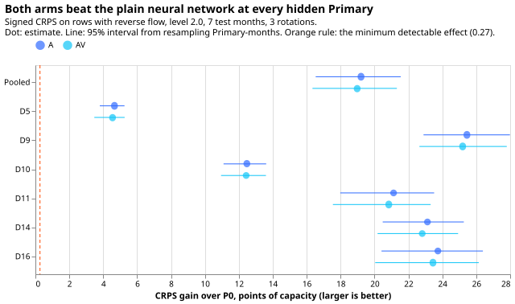
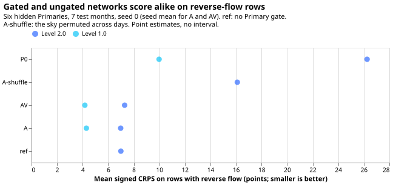
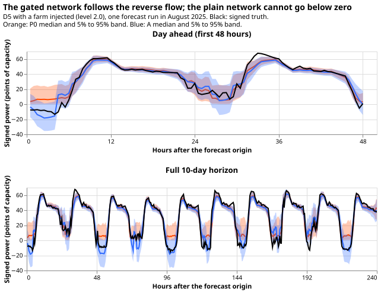

**A neural network with a gate that decides, once per Primary substation, whether the Primary
exports power forecast the signed power far better than the same network with the gate shut, on the
half-hours when power flowed back up the electricity network.** Signed power is positive for demand
and negative for reverse flow, where solar or wind generation exports power up the network. The
score is the continuous ranked probability score (CRPS), which is lower when a probabilistic
forecast is better: 7.1 points of effective capacity with the gate against 26.3 with the gate shut.
The test was a laboratory test. We took six Primaries whose meters do show the sign, added a real
farm's recorded output to each Primary's demand, hid the sign from the network, and scored its
forecast on 7 test months, with 2 Primaries hidden at a time over 3 rotations. The gate did no harm
beyond the registered tolerance at the Primaries with no added farm (+0.03 points at D5). A second
change, a forecast spread that grows with the network's estimate of solar output, made the forecast
worse by 0.23 points. The plan below was written before any fit and follows the Opus audit and
design note of 2026-10-30 (private folder: `briefs/neural_mva_final_audit_answer.md`).

## Question and plan in plain words

**Eight Primary substations report only the size of the power flowing (megavolt-amperes, MVA), not
its direction, so a forecast cannot say whether a half-hour is demand or solar generation pushing
power back up the electricity network.** Experiments 412 and 417 hid the direction at two Primaries
where it is known, by adding a real solar farm's recorded output to the Primary's demand, and asked
a neural network to recover the direction from the sunshine. The earlier pass criteria asked for a
correct sign. Codes such as D5 and D10 are anonymised Primary labels. This experiment asks the
question the maintainer cares about: **is the signed forecast better than the forecast of the same
neural network with its gate shut (P0), at the Primaries with reverse flow, with no harm
elsewhere?** It runs the neural network of experiment 417's arm A and a new arm AV on all three
rotations of the hidden pair, seven test months, and scores signed CRPS on the half-hours with
reverse flow. The weather inputs are realised CAMS irradiance and ERA5 temperature, so every result
is a laboratory result.

## Evidence the plan follows

- **The audit found no defect whose correction turns a failed arm into a pass.** The audit did find
  11 findings (table below), of which four change how earlier numbers read, and it moved the pass
  bars from the sign of the flow to the signed CRPS. The audit's recomputed figures come from stored
  forecasts of experiments 412 and 417 and are approximate (CRPS as twice the mean pinball loss over
  11 levels).
- **Experiment 417 (merged, pull request 74) stopped the signed-MW work on sign bars.** The export
  gate fixed the no-injection placebo by construction and kept 12.0% false reverse flow at the
  injected pair. On the new bar, the audit recomputed arm A's reverse-row CRPS as 5.10 points
  against 15.38 for A's own distribution folded to `|X|`, with the D5 placebo CRPS unchanged (2.74).
- **Experiment 412 (merged, pull request 69) found the capacity prior inert.** This plan adds no
  capacity prior.
- **Experiment 408 (merged, pull request 64) failed its known-answer test for a signed XGBoost
  label.** Its registered rule reached a pooled balanced accuracy of 0.834 against the 0.85 bar. The
  audit read a signed mean absolute error of 9.3 against 19.5 for the plain XGBoost model read as
  signed from the page's earlier draft, with no reverse-flow CRPS, so the new bar cannot be read for
  it.
- **Earlier advice followed.** Leave the eight MVA-only Primaries out of a capacity estimate: the
  capacity here is fitted at the six signed-MW Primaries and transferred. Do not read the lack of an
  interval in [experiment 56](../00056-mva-only-primaries-skill-against-mw-primaries/result.md) as
  proof that no special handling is needed. Advice departed from: none.
- **Standing practices (`ml-experiment` skill) applied.** Monthly refits; cleaned data, with the
  dropped count per fold stored; D15 and D18 cut before 2025-03-01 (experiment 417's inputs do
  this); every network saved as a state file; tails and a day-ahead example reported; draft pull
  request. Departures are listed below.

## Audit findings applied

| Audit finding | What this experiment does |
|---|---|
| 1. The 5% false-reverse bar used every non-reverse half-hour of the headline slice, not the registered sunny summer-midday denominator | The sign bars become descriptive. `e00420_score.py` prints the false-reverse rate on both denominators and labels each (`false_reverse_slice`, `false_reverse_sunny_midday`). |
| 2. One label covered two events (the no-injection D5 placebo and the hidden-pair crossing) | The false-reverse rate is scored per setting and per Primary, so the no-injection D5 summer-midday rate is its own line; the placebo signed CRPS (B4) carries the no-harm bar. |
| 3. No dead band at the reactive floor | A 2-point dead band is reported beside the plain rate (`false_reverse_dead_band_2pt`). |
| 4. The decision rule `P(X < 0) > 0.5` scores calibration with ranking | The ROC area and the recall at a matched 5% false-reverse rate are reported. |
| 5. Gate H divides a hidden Primary's median in its own points by a different Primary's capacity in that Primary's points | Gate H is not used, and `e00417_gates.high_irradiance_thresholds` is not imported. No corrected H is built, because the audit shows that any `u` gate stays open at the false calls. |
| 6. The broken-cloud threshold classes clear days as broken cloud | Step 0 reruns design I's diagnostic with a threshold of 0.0742, below. |
| 7. Design I's placebo pool includes D10, which has real reverse flow | Not corrected (the audit found no effect on a pass or fail). Step 0 inherits the pool and says so. |
| 8. Rows are not independent half-hours | Every count states rows or unique half-hours; every interval resamples whole Primary-months. |
| 9. 408's 0.834 and 417's 0.832 are on different slices | This plan quotes no cross-experiment balanced accuracy as a comparison. |
| 10, 11. Open-density bias in quadrature; capacity prior centred on all six Primaries | Not corrected (no effect on a pass or fail; the prior is inert); stated as caveats. |

## Step 0: design I's diagnostic with a corrected threshold

**The corrected broken-cloud threshold is fixed at 0.0742 before any diagnostic score is read.** The
threshold is the 75th percentile of the mean absolute second difference of hourly `u` over the clear
days of the six signed-MW Primaries, hidden pair included (a clear day has hourly `k` of at least
0.8 in every daylight hour and a daily maximum `u` of at least 0.6; 153 days in all, 23 to 29 per
Primary). Between 83% and 97% of those clear days exceeded the old threshold of 0.05, which confirms
the audit's finding. `u` and `k` come from CAMS and do not depend on the injection, so no signed
truth enters the threshold. The note asks for the visible Primaries; the pool here is wider because
the quantity read is a property of the sky, which the injection does not touch, and the wider pool
gives more days. The step reruns experiment 417's `run` with the new threshold and writes its tables
to this experiment's own folder, so experiment 417's stored files are not changed. Step 0 has no
pass bar and needs no fits.

## Arms, settings, and rotations

| Arm | What it is | Role |
|---|---|---|
| P0 | Experiment 417's network with every folded Primary's gate forced shut (`X >= 0` at every row) | Reference 1: the plain neural network on the reading, read as signed, with the same inputs |
| A | Experiment 417's arm A, unchanged | Reference 2: the best earlier arm on the new bar |
| AV | A plus the shared PV-proportional variance, `std^2 + (s * C_p * u)^2`, one `s >= 0` for all 16 trial-area Primaries (starting value 0.1) | The candidate |
| A-shuffle | A with `u` permuted across days within year, month, and half-hour (the gate keeps the real `u`) | Control: the gain must come from the CAMS sky |
| ref | Experiment 417's reference, with no Primary gate | Reported only: the harm the gate prevents |

**Settings at the hidden pair:** level 2.0 with the reactive floor Q = 2 points (main), level 1.0
with Q = 2 (the moderate-export check), and no injection (the placebo). All settings use power
factor 1. Rotations r1 (D5, D10 hidden), r2 (D9, D14), and r3 (D11, D16). Test months 2025-07,
2025-08, 2025-09, 2026-03, 2026-04, 2026-05, and 2026-06, all after the 2025-07-01 end of the window
that sets the injection level. Training windows are 730 days, so the 2025-07 refit trains on 15
months (from 2024-04-01, the first run) instead of 24.

## Scoring and pass bars

**The primary contrast is signed CRPS, in points of effective capacity, days 1 to 10, on the
hidden-sign rows with reverse flow** (signed truth below zero, injected or real, so D10's real
reverse rows count), pooled over the six hidden Primaries. CRPS is twice the mean pinball loss over
the 11 stored quantile levels. Intervals come from a paired month-block bootstrap (resample whole
Primary-months, 20,000 resamples), because each half-hour repeats in about 15 runs.

**The minimum detectable effect is written down before any arm-against-arm score is read.** It is
2.8 times the month-block bootstrap standard deviation of the null difference between A's two seeds
on the reverse-flow slice (80% power at 5% two-sided). Stage 1 fits A's second seed on rotation r1
at level 2.0 so the figure exists before stage 1 is scored; the stage-2 figure uses all three
rotations. The same figure is applied at each Primary. The minimum detectable effect measures seed
noise, which is a floor for the sampling noise of an arm-against-arm contrast. The minimum
detectable effect also rests on few blocks (14 Primary-months on r1, 7 per Primary), so the figure
is itself noisy. Each figure is committed to this page before the matching contrast is run. If the
figure exceeds 0.5 points (about 10% of A's 5.10 on r1), the AV against A contrast is reported as
underpowered.

- **B1 (gain over P0, the gate-shut network).** AV's reverse-row CRPS is below P0's by at least the
  minimum detectable effect, with the interval excluding zero, pooled and at each of the six hidden
  Primaries at level 2.0. The same test is read for A. On rotation r1 (stage 1) the hidden pair is
  D5 (injected) and D10 (real reverse flow, no injection), so stage-1 B1 is pooled over D5 and D10
  and at each of the two, and a failure at either stops the run.
- **B2 (gain over the best earlier arm).** AV's reverse-row CRPS is below A's by at least the
  minimum detectable effect, pooled at level 2.0.
- **B3 (the sky carries the gain).** A beats A-shuffle on the same slice by at least the minimum
  detectable effect.
- **B4 (no harm where there is no export).** In the placebo setting, signed CRPS on all rows of each
  of D5, D9, D11, D14, and D16 is within +0.05 points of P0 pooled, with no single Primary above
  +0.20. The signed CRPS carries this guard, because the reading CRPS cannot: a folded reading
  forecast does not change when the sign is wrong. D10 is left out because it has real reverse flow.
- **B5 (the MVA-only eight).** Reading CRPS at the eight, from the same fits, is within +0.05 of P0
  pooled. No extra fits are needed, because each fit trains all 16 trial-area Primaries (the six
  signed-MW Primaries, the eight MVA-only Primaries, and the report-only D15 and D18).

**Descriptive, with no bar:** q01 and q99 pinball loss and coverage on reverse-flow rows; sign
balanced accuracy, recall, and false-reverse rate at `P(X < 0) > 0.5` on both denominators; the ROC
area and recall at a matched 5% false-reverse rate; the false-reverse rate with a 2-point dead band;
each Primary-level gate decision with its Spearman statistic and 1st percentile; and the learned `s`
and `C_p`. Every count states whether it counts rows or unique half-hours. Level 1.0 is scored by
the same rules and reported with no bar.

## Minimum detectable effect, stage 1 (written before any arm-against-arm score)

**On rotation r1, the minimum detectable effect is 0.404 points of effective capacity.** The null
difference between A's two seeds on reverse-flow rows at level 2.0 is a mean of 0.197 (95% interval
-0.057 to 0.504, 14 Primary-month blocks, 22,443 rows), with a bootstrap standard deviation of
0.144; 2.8 times 0.144 is 0.404. The minimum detectable effect of 0.404 points is below the
0.5-point limit, so the AV against A contrast is not flagged as underpowered at stage 1. The figure
is computed by `e00420_score.py mde-stage1` and stored in `work/mde_stage1.json`, which the script
refuses to overwrite. The stage-1 bars are scored after this commit.

## Stage 1 result (interim: rotation r1, seed 0, seven test months, no multiple-comparison correction)

**A passes the stage-1 stop rule, so stage 2 follows.** Values are points of effective capacity,
with 95% month-block intervals. The stage-1 scores are in `work/scores_stage1.json`.

- **B1, A against P0 on reverse-flow rows:** a gain of 8.29 (5.98 to 10.63), 4.66 at D5 and 12.26 at
  D10, far above the 0.404 minimum detectable effect. A scores 4.98 on those rows against 13.27 for
  P0.
- **B3, A against A-shuffle:** a gain of 4.20 (2.74 to 5.81).
- **B2, AV against A:** AV is worse by 0.12 (-0.33 to +0.06), so B2 fails at stage 1. AV's own gain
  over P0 is 8.17.
- **B4 at D5, no injection:** A's signed CRPS is 0.021 above P0 (0.003 to 0.043) and AV's 0.024
  (0.014 to 0.033), inside the +0.05 limit. The untested placebo Primaries of rotations r2 and r3
  are the open risk.
- **B5, reading CRPS at the eight, against P0:** A is 0.058 worse (-0.030 to 0.200), just above the
  +0.05 limit, and AV is 0.009 worse (-0.021 to 0.044), inside it.

## Minimum detectable effect, full run (written before the full scoring)

**Over all three rotations the minimum detectable effect is 0.272 points of effective capacity.**
The null difference between A's two seeds on reverse-flow rows at level 2.0 has a mean of -0.152
(95% interval -0.341 to 0.040; 42 Primary-month blocks, 79,399 rows) and a bootstrap standard
deviation of 0.097, and 2.8 times 0.097 is 0.272. The minimum detectable effect of 0.272 points is
below the 0.5-point limit, so the AV against A contrast is not underpowered. The figure is stored in
`work/mde_full.json`. All 378 fits finished before it was computed.

## Fits and stop rule

| Batch | Fits |
|---|---|
| A and AV, 3 rotations × 7 months × 3 settings × 2 seeds each | 252 |
| P0, 1 seed | 63 |
| A-shuffle, level 2.0 only, 1 seed | 21 |
| ref, level 2.0 and placebo, 1 seed | 42 |
| Step 0 (zero fits) | 0 |
| Total | 378 |

**Stage 1 runs rotation r1 only: P0, A, and AV at level 2.0 and the placebo, plus A-shuffle, one
seed, all seven months (49 fits), and A's second seed at level 2.0 (7 fits that belong to the 252,
56 in all).** The second seed is the one change from the manager's 49-fit count, and it exists so
the minimum detectable effect is on the page before stage 1 is scored. If A fails B1 against P0 on
r1, stop: the stored r1 result did not survive more months. Otherwise tell the manager and run stage
2 (r2, r3, the second seed of AV, level 1.0, and ref).

**Compute.** Experiment 412 timed a fit at 29 to 83 seconds including the fold build (a smoke test
of this code took 26 to 36 seconds per fit on the 2025-07 fold). Each fold is built once per
rotation, setting, and test month and shared across the arms and seeds. Stage 1 (56 fits) takes
about 45 to 95 minutes and the whole experiment 5 to 10.5 hours, on one GPU process using about 1.4
GB of GPU memory, one feeder core, `systemd-run --user --scope -p MemoryMax=8G -p
OOMPolicy=continue`, with `OMP_NUM_THREADS=1`. The fit script reads `MemAvailable` before every fold
and every fit and stops if it falls below 12 GiB (the `available` column of `free -g`). A fit is
skipped when its JSON file exists, so a stopped run resumes. Stage 1 and the full run write to
`work/fits/<arm>/`, state files to `work/models/<arm>/`.

## Code

All code is in `ml-experiments/00420-neural-mva-export-gated-signed-final/`, modelled on experiment
417 (`ml-experiments/00417-hidden-sign-mva-export-gate-zero-crossing-labels/`), which supplies the
folds (`e00417_inputs`), the Primary gate (`e00417_gates.primary_gates` and `open_mask`), the
likelihood (`e00417_models.nll`), and the training loop (`e00417_fit.train`).

- `e00420_models.py` adds `SignedMdnAv` (the shared variance scale `s`, a softplus of a learned
  scalar) and a reading forecast with a per-row open mask for the MVA-only eight.
- `e00420_fit.py` defines the arms and the stage job lists, shares a fold across fits, and writes
  the hidden pair's signed forecast and the eight's reading forecast. P0 forces every folded
  Primary's open mask to false.
- `e00420_score.py` scores B1 to B5 and the descriptive tables.
- `e00420_day_flip.py` runs step 0 with the corrected threshold.

## Departures

- **Avoidable-curtailment cost is not computed.** `studies.eval_protocol` needs real node and
  generator tables (the function takes a series table and metered flows), and the injected series
  have none. The q01 coverage and pinball loss on reverse-flow rows stand in as the descriptive
  measure of under-forecast export.
- **Stage 1 has 56 fits, not 49** (A's second seed, above).
- **Seed asymmetry.** A and AV have two seeds and the other arms one, which lowers the noise of A
  and AV against the single-seed arms without biasing the contrasts.
- **Seed averaging.** For the pooled bars A and AV are scored as the mean of the per-row CRPS of
  their two seeds; P0, A-shuffle, and ref have one seed. Stage 1 uses seed 0 for every arm. The
  minimum detectable effect comes from single seeds, so it is conservative for the two-seed means.
- **The example plot shows one day-ahead and one 10-day forecast at D5 only,** not at all six hidden
  Primaries.

## Risks

- **The shuffled sky keeps the daylight profile**, so A-shuffle may score above chance; B3 asks for
  a margin of the minimum detectable effect, not for chance.
- **A Primary-level gate decides once, so a wrong decision makes the whole Primary's forecast
  wrong.** The gate decisions are stored for every fit and reported.
- **P0 is not a separately tuned plain neural network.** It is the same network with its gates shut,
  so the gain over P0 is the gain from the gate, not from a differently fitted baseline.
- **Weather is realised** (ERA5 about 5 days late, CAMS about 1 day late), so every result is a
  laboratory result.
- **Unlogged load-shift events** may sit in the readings, as NGED says its logs are incomplete.

## Results

**B1, B3, B4, and B5 pass for A, and B1, B4, and B5 pass for AV, whose B2 against A fails.** All 378
fits finished. Values are points of effective capacity, level 2.0 unless stated, with 95%
Primary-month block intervals. The minimum detectable effect, written before scoring, was 0.272. A
and AV are means over two seeds, and the other arms use one seed. All scores are in
`work/scores_full.json`.

| Bar | A | AV | Passes? |
|---|---|---|---|
| B1, gain over P0 on reverse-flow rows | 19.20 (16.53 to 21.55) | 18.98 (16.34 to 21.32) | A and AV: yes at all 6 Primaries |
| B2, AV against A | not applicable | worse by 0.225 (0.155 to 0.300) | No |
| B3, A against A-shuffle | 9.13 (7.34 to 10.92) | not run | Yes |
| B4, harm at the no-injection Primaries, pooled | -0.010 (-0.027 to 0.006) | -0.013 (-0.030 to 0.002) | A and AV: yes (limits +0.05 pooled and +0.20 single) |
| B5, reading harm at the MVA-only eight | 0.021 (-0.009 to 0.059) | 0.009 (-0.024 to 0.043) | A and AV: yes (limit +0.05) |

- **B1 by Primary (A):** D5 4.66, D9 25.45, D10 12.47, D11 21.12, D14 23.12, D16 23.74. Every
  interval excludes zero and clears 0.272. AV's gains are within 0.31 of these.
- **B4 by Primary (A, harm against P0 at no injection):** D5 +0.031, D9 -0.040, D11 +0.001, D14
  -0.007, D16 -0.036. The r1 gate had been the open risk at stage 1. At rotations r2 and r3 the gate
  did not open wrongly: no placebo Primary was harmed by more than 0.04.
- **B5 is a marginal pass.** At stage 1 (rotation r1) A's harm at the eight was +0.058, just above
  the +0.05 limit. Over three rotations the pooled estimate is +0.021, but the upper end of the
  interval (0.059) is still above the limit.
- **Mean reverse-flow CRPS, level 2.0 (seed 0):** P0 26.26, A-shuffle 16.10, AV 7.29, A 6.98, ref
  6.99.

**The ungated reference scores the same as A on reverse-flow rows, so the gain over P0 measures how
much it helps to let the forecast go below zero.** A against ref is -0.061 (-0.149 to 0.024): A is
worse by 0.06, and the interval includes zero (ref has one seed and A two; at seed 0 alone A is
slightly better, 6.98 against 6.99). The gate matters where there is no export: with no farm
injected, the ungated reference is worse than P0 at D5 by 1.21 points (+0.23 pooled over the five
placebo Primaries, interval 0.07 to 0.42), and A is worse by 0.03.

**The sign is still often wrong, and the lower tail is too narrow.** The numbers below are
descriptive, at level 2.0 and seed 0, for A, on the half-hours with the CAMS unit shape at least 0.3
and clear-sky index at least 0.7 (115,040 rows, 12,526 unique half-hours).

| Measure | Value |
|---|---|
| Balanced accuracy at `P(X < 0) > 0.5` | 0.852 (AV 0.851, A-shuffle 0.582) |
| Recall of reverse flow | 0.859 |
| False-reverse rate, every non-reverse half-hour of the slice (rows) | 15.5% |
| False-reverse rate, non-reverse sunny summer-midday half-hours (the registered denominator, rows) | 66.8% |
| False-reverse rate with a 2-point dead band | 12.9% |
| Area under the receiver operating characteristic curve | 0.930 |
| Recall at a matched 5% false-reverse rate | 0.623 |
| q01 coverage on reverse-flow rows (nominal 0.01) | 0.062 |
| q99 coverage on reverse-flow rows (nominal 0.99) | 0.998 |

- **In every fit with an injected farm, the Primary-level gate opened at the six hidden Primaries
  and at D8 and D12, and stayed shut at D2, D3, D4, D19, D21, and D22.** This is why A and ref score
  alike at level 2.0.
- **Level 1.0 (moderate export):** A's gain over P0 is 5.64 (4.61 to 6.41) and AV's 5.69 (4.60 to
  6.52). AV against A is +0.05 (-0.06 to 0.16). A's balanced accuracy at level 1.0 is 0.716, with
  recall 0.524.
- **The shared variance scale `s` learned 0.071 on average at level 2.0 (range 0.027 to 0.145), from
  a start of 0.1.** The tails did not improve: AV's q01 coverage was 0.060 against A's 0.062.

## Checks

- **Reference check against the plain network.** The plain neural network (P0) cannot forecast below
  zero, so B1 is a low bar. The ungated reference scores the same as A on reverse-flow rows, as the
  results section reports.
- **Median forecast against the mean forecast.** Not computed, because the stored forecasts hold
  quantiles and no mean. The error of the median forecast on reverse-flow rows (seed 0) points the
  same way as the CRPS: P0 31.98, A 12.19, AV 12.79 points. Audit trigger 3 did not fire.
- **Audit triggers** (the numbered conditions in the `ml-experiment` skill's "Audit before merge"
  section)**.** Trigger 5 (a nested arm beats the arm that contains it) fired: AV contains A (its
  added variance can shrink to zero) and scored 0.225 worse (interval 0.155 to 0.300), beyond the
  null difference between A's two seeds (-0.341 to 0.040). The cause is not settled; AV is not
  carried forward, so no audit was requested. Trigger 7 (a later design depends on an unreplicated
  headline) applies: the planned serving test with ENS inputs depends on A's gain, which this
  experiment has replicated over three rotations and seven months but only in the laboratory. The
  controls passed: the shuffled sky is 9.13 worse than A, and no placebo Primary was harmed by more
  than 0.04. Leaving one Primary out cannot flip B1, because the gain is positive at every Primary.
  No Opus audit was run, because the Opus design note of 2026-10-30 already audited the gates.
- **Step 0, design I's diagnostic with the corrected threshold (0.0742), reported with no bar.** The
  corrected threshold did not rescue the diagnostic. At level 2.0 the area under the curve is 0.702
  (0.73 in experiment 417), the paired area 0.676, and recall 0.20 of 822 positive days (0.22). The
  false-flag rate is 5.9% at D5 and 7.0% at D10 (5.5% and 8.2%). The broken-cloud class still holds
  97% to 99% of the injected days (for example 151 of 153 at D5), because the threshold was fixed on
  clear days only and the other days are rougher. Only 17 positive days fall in the smooth class, so
  the smooth-day area is undefined, as in experiment 417. The result is in
  `work/day_flip/day_flip.json`, and the placebo pool still includes D10 (audit finding 7).
- **Not done.** Avoidable-curtailment cost (see Departures), and a serving test with ENS inputs.
- **Caveats.** The inputs are realised CAMS irradiance and ERA5 temperature, so every result is a
  laboratory result. The scored range is lead 0 to 240 hours (days 1 to 10), as the families'
  horizon of 1 to 10 days requires. The 2025-07 refit trains on 15 months, not 24.

## Review log

**Plan review (fresh Sonnet agent, before any fit).** 10 findings, all triaged.

- **Accepted:** the decision rule had no outcome for a failure of B1, B3, or B5 alone (a final
  clause now says "not shown"; B4 is judged per arm; B3 is measured on A); the stage-1 stop rule
  needed a definition for D5 and D10 only; the prediction for B2 contradicted the hypothesis; the
  threshold pool for step 0 is a departure from the note and is now listed; the descriptive list had
  no separate no-injection D5 line; the stage-1 time estimate was stale; the seed asymmetry is now a
  departure; prose slips ("plain network", sentences opening with "It", 5.1 against 5.10).
- **Kept as written:** the minimum detectable effect still uses A's two-seed null, because the audit
  note specifies it. The page now says it is a noise floor resting on few blocks.
- **Not changed:** the avoidable-curtailment cost stays out (the page states why).

**Code review (fresh Sonnet agent, before any fit).** No blockers and no leakage. One important
finding and seven minor ones, all accepted: B4 always failed because D10 returned a missing value
(now only the five placebo Primaries are scored); the B4 interval ends were not swapped with the
sign; the two minimum-detectable-effect figures now go to separate files that cannot be overwritten
(stage 1 and full); `threshold.json` cannot be overwritten; P0's stored fit information says the
gates were forced shut; the CRPS docstring says it approximates the CRPS; `read_arm` refuses a
partial seed set. The seed-weight-decay note needs no change.

**Write-up review (fresh Sonnet agent, against the stored scores).** No high or medium findings, and
nine low findings, all accepted: four interval ends rounded wrongly, a "within 0.3" that should read
0.31, the sign and tail tables and the median-error line labelled seed 0, "rows" named in the lesson
about false-reverse rates, the direction and seed difference of A against ref stated, and "no harm"
qualified as "beyond the registered tolerance".

**Prose review (fresh Sonnet agent).** 35 findings. Accepted: the opening paragraph now defines
"signed", "reverse flow", the CRPS, the gate, and the rotations, and gives units and direction; MVA,
the anonymised Primary codes, and the 16 trial-area Primaries are defined once; the contradiction
between the Departures and the example figure is fixed; the gate-opening claim is scoped to fits
with an injected farm; the lead about the lower tail now matches the coverage table; the audit
triggers are named; money metaphors, bare pronouns, and the count slip ("Ten") are fixed. Not
changed: the pre-registered hypothesis and prediction wording, which keeps the arm names P0, A, and
AV that the plan defines, and the title.

## Problems caused by the move

- **The docstrings of experiments 412 and 417 tell the reader to source an `env.sh`, which does not
  exist in this repository.** This experiment's scripts need `PYTHONPATH` to list the folders of
  experiments 87, 397, 405, 412, 417, and 420, and `DATA_PATH_INTERNAL`. I assembled both by hand.
  Command that showed it: `ls env.sh` in the worktree root.
- **`python -I`, which the repository's guidance suggests for untrusted data, ignores `PYTHONPATH`
  and so cannot import an experiment's modules.** Command: `uv run --no-sync python -I -c "import
  e00417_inputs"`.
