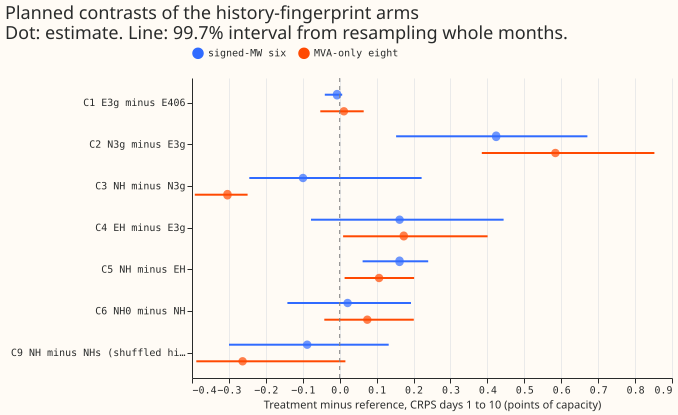
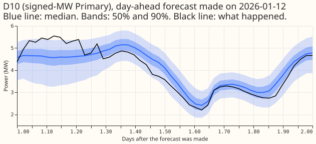
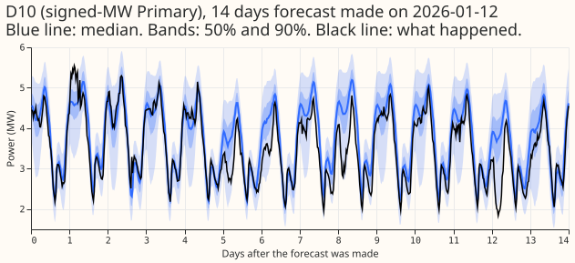
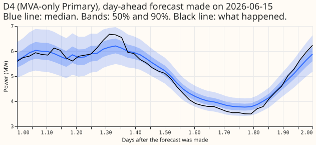
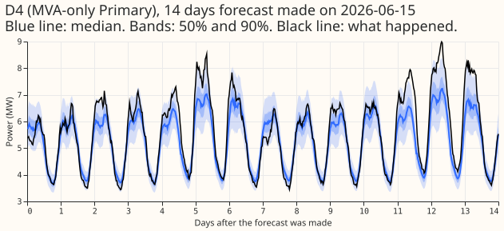

**Take-home message: the last 7 days of power identify the Primary, but a learned label still
forecasts better, and the encoder adds nothing the raw readings lack.** We asked whether a neural
network that is told the last 7 days of a substation's power can work out which substation it is
forecasting, so that the learned substation label (the Primary embedding) becomes optional. We
trained the pooled network of [experiment
406](../00406-pooled-mixture-density-network-without-embedding-and-with-short-history/result.md)
with and without the label, with and without a convolutional encoder of the 7 days, on the same
five test months and 16 substations. A linear classifier finds the substation from the encoder's
output 87% of the time (chance is 6%), but it finds the substation 90% of the time from the raw
readings with no learning. The network with the label and the three recent readings scores 3.315
points of capacity at the six signed-direction substations. The same network with no label scores
3.739, and adding the encoder narrows that to 3.640 (a gain of 0.099 whose interval spans zero). The
verdict is `not supported`. For a substation left out of training, the network with no label and no
encoder scored best (4.318), and a placeholder label scored much worse (5.527). Every number comes
from five test months, so all are interim.

## Results

CRPS at days 1 to 10, mean over Primaries with equal weight, in points of capacity (smaller is
better). Three seeds averaged in quantile space (two for the left-out tables). All arms use the D15
and D18 start cut.

| Arm | Label | Encoder | Origin lags | Signed-MW six | MVA-only eight | D15 and D18 |
|---|---|---|---|---|---|---|
| E406 (stored, per-Primary target scale) | yes | no | yes | 3.322 | 3.829 | 8.703 |
| E3g | yes | no | yes | 3.315 | 3.840 | 8.143 |
| N3g | no | no | yes | 3.739 | 4.424 | 8.634 |
| NH | no | yes | yes | 3.640 | 4.120 | 8.835 |
| NHs (shuffled history) | no | yes | yes | 3.728 | 4.383 | 9.332 |
| EH | yes | yes | yes | 3.477 | 4.014 | 8.687 |
| NH0 | no | yes | no | 3.661 | 4.195 | 8.892 |
| Experiment 406, no label (per-Primary scale) | no | no | yes | 4.112 | 4.638 | 11.968 |

- **Contrasts (signed-MW six / MVA-only eight, 99.72% month-block intervals).**
    - C1 E3g minus E406: -0.007 (-0.040 to +0.007) / +0.011 (-0.053 to +0.065).
    - C2 N3g minus E3g: +0.424 (+0.153 to +0.671) / +0.584 (+0.385 to +0.852).
    - C3 NH minus N3g: -0.099 (-0.245 to +0.222) / -0.304 (-0.392 to -0.249).
    - C4 EH minus E3g: +0.162 (-0.078 to +0.444) / +0.173 (+0.009 to +0.401).
    - C5 NH minus EH: +0.162 (+0.062 to +0.240) / +0.107 (+0.013 to +0.202).
    - C6 NH0 minus NH: +0.021 (-0.142 to +0.193) / +0.075 (-0.042 to +0.201).
    - C9 NH minus NHs: -0.088 (-0.300 to +0.133) / -0.263 (-0.388 to +0.015).
- **The encoder helps clearly only at the MVA-only eight.** At the six, the interval of C3 spans
  zero, and C3 is positive (+0.317) in the 2025-12 fold.
- **The shuffled history (NHs) is a partial control.** NHs reads the next Primary's history, which
  identifies that Primary as well as its own history does, so C9 measures what the Primary's own
  recent state adds beyond identity. NHs minus N3g, which measures identity taken from history, is
  -0.011 at the six and -0.041 at the eight, about zero.
- **The probe.** Accuracy of a linear classifier on held-out weeks (chance 0.0625 for the Primary;
  0.25 for the month within one month):

| Input to the classifier | Primary, NH | Primary, EH | Primary, NH0 | Month within one, NH |
|---|---|---|---|---|
| Trained encoder output (32 values) | 0.871 | 0.853 | 0.899 | 0.719 |
| Raw 336 readings | 0.898 | 0.898 | 0.898 | 0.748 |
| Untrained encoder, same shape | 0.678 | 0.678 | 0.678 | 0.600 |
| Three origin lags | 0.280 | 0.280 | not run | 0.452 |

- **Primaries left out of training** (each Primary is left out once, in four quarters of four
  Primaries; two seeds; CRPS at days 1 to 10; signed-MW six / MVA-only eight / D15 and D18):

| Arm | Signed-MW six | MVA-only eight | D15 and D18 |
|---|---|---|---|
| N3g (no label, no encoder) | 4.318 | 5.317 | 14.327 |
| NH (no label, encoder) | 4.792 | 5.399 | 16.698 |
| E3g, mean label of the trained Primaries | 5.527 | 7.781 | 22.629 |
| E3g, mean label within the metering group | 6.015 | 7.559 | 37.419 |
| EH, mean label of the trained Primaries | 5.139 | 6.077 | 19.857 |
| EH, mean label within the metering group | 5.206 | 6.068 | 20.057 |

- **Held-out contrasts (99.72% intervals).** C7 NH minus E3g with the mean label: -0.735 (-2.695 to
  +0.562) at the six, -2.382 (-3.115 to -1.844) at the eight. C8 NH minus N3g: +0.474 (-0.095 to
  +1.099) at the six, +0.081 (-0.084 to +0.220) at the eight, +2.382 at D15 and D18 (+0.863 to
  +3.865). Leaving a Primary out costs N3g 0.58 points at the six (3.739 with three seeds to 4.318
  with two) and 0.89 at the eight (4.424 to 5.317).
- **Tails (all leads; raw / widened by 1.15).** At the six, q95 coverage is 0.859 / 0.895 for E3g,
  0.903 / 0.931 for N3g, 0.885 / 0.913 for NH, and 0.866 / 0.900 for EH; q99 coverage is 0.941 /
  0.960, 0.972 / 0.982, 0.953 / 0.969, and 0.947 / 0.965. The encoder arms put too many outcomes
  below q01 (0.020 to 0.028 raw across NH, EH, NH0, and NHs against 0.015 for E3g, nominal 0.010).
  The pinball losses are in `report_main.log` in the private folder. The lower tail at sunny,
  low-demand half-hours and the avoidable-curtailment cost were not computed in this experiment.

## Example forecasts

NH's median, 50% band, and 90% band against what happened, for D10 (a signed-MW Primary) in winter
and D4 (an MVA-only Primary) in summer.

## Predictions

- **P1 held.** E3g minus E406 is -0.007 and +0.011.
- **P2 failed.** N3g minus E3g is +0.424 (limit +0.39) at the six and +0.584 (limit +0.40) at the
  eight. Rescaling the target recovered 46% of experiment 406's loss at the six and 28% at the
  eight.
- **P3 failed.** NH minus N3g is -0.099 at the six (needed -0.15 or lower, and the interval spans
  zero).
- **P4 failed.** NH minus EH is +0.162 at the six and +0.107 at the eight (limit +0.10).
- **P5 held on its wording and failed on its intent.** The prediction said EH is no more than 0.05
  below E3g. EH is 0.162 and 0.173 above E3g (worse), so the wording holds, but the intent was that
  the 7 days add little, and they made the score worse.
- **P6 failed narrowly.** The Primary probe on NH reaches 0.871 (needed 0.90; EH 0.853, NH0 0.899).
  The three-lag probe stays at 0.280, which meets the limit of 0.50. The month probe reaches 0.719
  within one month (needed 0.60), but the untrained encoder already reaches 0.600.
- **P7 held at the six and failed at the eight.** NH0 minus NH is +0.021 and +0.075 (limit 0.05).
- **P8 held on the point estimate, with an interval that spans zero.** NH minus E3g with the mean
  label is -0.735 at the six (needed -0.20 or lower; interval -2.695 to +0.562). The prediction
  named only the six. At the eight the contrast is -2.382 (-3.115 to -1.844).

## Checks

- **Median minus the mean of the 11 quantiles, per Primary.** Within 0.05 MW at 12 of 16 Primaries
  for E3g and 13 of 16 for NH and EH. D15 (-0.15 to -0.20 MW), D12 (-0.12 to -0.145), and D8 (-0.065
  to -0.131; it is unproven whether the generator explains the steps and the gap) are exceptions for
  all three arms, and D4 (-0.094) for E3g. The mean of the stored quantiles stands in for the mean
  forecast, which the networks do not store.
- **Error of the median beside CRPS (mean absolute error, points of capacity, six / eight).** E3g
  5.760 / 6.594, EH 6.175 / 6.762, NH 6.493 / 6.935, N3g 6.609 / 7.364. The order matches the CRPS
  order, so trigger 3 did not fire.
- **Audit triggers.** Trigger 5 fired: EH, which contains E3g's inputs, scores 0.162 worse. Trigger
  2 fired: P2, P3, P4, and P6 missed, P5 missed in intent, and P7 missed at the eight. A fresh
  Sonnet audit (`briefs/e421_audit_main.md`, private) re-derived every printed score and contrast
  point estimate to three decimals and found no leakage. EH minus E3g has the same sign in each of
  the three seeds (+0.155 to +0.206 at the six), so the effect is not seed noise, but it flips sign
  in two of five folds. The encoder arms stop after about 15 epochs against 33 for E3g, and EH has
  the worse validation loss too. The audit did not test whether the encoder opens a channel for
  memorising each Primary's unique history. Leaving out any one Primary flips no sign among C3, C4,
  C5, and C9, and C9 at the six drops to -0.003 without D11.
- **Triage of the audit.** The audit found that the alignment check failed for D15 and D18 on 957
  rows whose history lies before the start cut. I fixed the check to compare flags only after the
  cut, and the check now passes for all 16 Primaries. The training and scores are unaffected, since
  those rows are cut from training. N3g hit the 40-epoch limit in 7 of 15 fits and E3g in 4 of 15,
  so the contrasts against N3g (C2, C3) may flatter the encoder arms.

## Caveats

- **Interim.** Five test months; no claim of benefit rests on the intervals.
- **D8** caveat: it is unproven whether the generator explains the steps and the gap.
- **Unlogged load-shift events.** NGED says load-shift events may be missing from its logs, so the
  history of an origin can sit inside an unlogged event, and the encoder may read such an event as
  a property of the Primary.
- **Lead range.** The headline band is days 1 to 10, the range NGED cares about.
- **Training rows keep flagged exact zeros** as in experiment 406; the scorer drops 1,179
  flagged half-hours from the actuals.
- **Held-out stage.** Two seeds, quarters of four Primaries that mix metering groups, and D15 and
  D18 are report-only. The placeholder labels are a weak stand-in for a fitted label.

## Departures from the plan

- **Not reported.** The lower tail on sunny, low-demand half-hours, the avoidable-curtailment
  cost, absolute scores beside BG2, `manual_heuristic`, and `climatology`, a per-Primary score
  table, left-out Primaries scored against `climatology` and `manual_heuristic`, example forecasts
  from E3g, and the share of origins whose history has a gap. The scoring scripts do not compute
  them, and the verdict does not depend on them.
- **Added after the plan.** The held-out stage also scored the mean embedding within the metering
  group, and the plan's shuffled-history arm NHs was added after the plan review.

## What the next experiment should answer

**Whether a label fitted from a few weeks of a new Primary's history beats the label-free network
for onboarding.** The label-free network with three lags loses 0.58 points at the six when a
Primary is left out, against 2.21 points for E3g given the mean-label placeholder (5.527 against
3.315). An experiment that fits only
the new Primary's label on its first 4 to 12 weeks, with the rest of the network frozen, would
settle that. The maintainer has ranked onboarding low, so this is a proposal only.

**The plan as committed before any fit.**

### Question and design

**We test whether recent power plays the part of a language model's context.** The maintainer's
idea is that the 7 days before the forecast origin tell a pooled network which Primary it is
looking at, and where in the seasonal cycle that Primary sits, without a learned Primary embedding.
The maintainer does not propose dropping the embedding. The experiment asks whether the history
could replace it, which matters for the 1,300-substation case, where a new substation has no
embedding of its own.

- **The base network.** Experiment 397's pooled plain mixture density network (setting `g09`,
  3 Gaussian components, ECMWF ENS mean and spread passed through once), on the five screen folds
  of experiment 397 (test months 2025-10, 2025-12, 2026-01, 2026-03, and 2026-06), monthly refits,
  with the D15 and D18 start cut of experiment 399, as in [experiment
  406](../00406-pooled-mixture-density-network-without-embedding-and-with-short-history/result.md).
- **The history.** For each origin, the 336 half-hours (7 days) of power over effective capacity
  that end at the newest usable reading (grid index `origin - NEWEST_AGE`, the same reading as
  `lag_origin`). Every run is daily at 00:00 UTC, so every history ends at the same time of day. The
  history comes from the same cleaned grid as the three origin lags (`observed.parquet` of
  experiment 87, with the flagged `substation_zero` half-hours as nulls), so the lags and the
  history agree. Values are standardised with the fold's training rows and clipped at 5 standard
  deviations. A missing half-hour is set to 0 and flagged in a second channel, so the encoder sees
  a gap and not a zero. A check before any fit asserts that the last history value equals
  `lag_origin` on every row, and that no history index is later than the newest usable reading.
- **The encoder.** Two 1D convolution layers (kernel 5, 16 channels, stride 2, GELU) over the two
  channels (value and missing flag), then the flattened output (84 steps by 16 channels) through one
  linear layer to 32 values with a LayerNorm. The flattened output keeps the time of day, which a
  global pooling would lose. The 32 values join the network's other inputs.
- **The target scale.** Experiment 406's targets were standardised per Primary, so a network with
  no Primary input could not invert the scale, and its 0.789-point loss mixes "no identity" with
  "no scale". All new arms therefore use one global target mean and standard deviation, fitted on
  the fold's training rows, and the arms with a letter `g` in the name carry that change.
- **Experiment 404 does not make any arm redundant.** Experiment 404 (plan on [PR #58 (Experiment
  404: a lagless module and a calibration module with continuous trust weights for the lagged power
  inputs)](https://github.com/openclimatefix/nged-ml-research/pull/58), no fit run yet) attends over
  three lag tokens and a lagless-forecast token (arm B3). Its arm B7 adds a 7-day CNN, but only on
  top of the trust head and the cross-fitted lagless forecast, and it is the lowest priority. The
  arms below ask the narrower question of identity, so they run now.

### Arms

Names say which components each arm carries: `g` is the global target scale, `3` is the three
origin lags (`lag_origin`, `lag_same_time_latest_day`, `lag_same_time_latest_week`, each with its
age and missing flag), `H` is the 7-day encoder, `E` is the 8-wide Primary embedding, and `N` is no
embedding.

- **E406 (stored).** Experiment 406's pooled network with the embedding and per-Primary targets
  (`pooled_emb`). Zero fits; read with `experiment_store.read_predictions`.
- **E3g.** Embedding, three origin lags, global target. The control for everything below.
- **N3g.** No embedding, three origin lags, global target. Experiment 406's `pooled_noemb` made
  scale-fair.
- **NH.** No embedding, three origin lags, and the 7-day encoder. The arm the hypothesis names.
- **EH.** Embedding, three origin lags, and the 7-day encoder.
- **NHs.** As NH, but each origin's history is that of a different Primary on the same run day (a
  fixed derangement of the Primaries, the same for training and scoring). It has the encoder's
  capacity without the Primary's own history, so NH minus NHs separates information from capacity.
- **NH0.** No embedding, the 7-day encoder, and no origin lags. Tests whether the history makes the
  lags redundant, as experiment 388's arm E suggests.
- **Held-out stage (advance rule above).** Arms N3g, NH, E3g, and EH, each fitted four times per
  fold and seed with one quarter of the Primaries (every fourth, by index) left out of training
  entirely, and scored only on that quarter. E3g and EH have no embedding for an unseen Primary and
  receive the mean embedding of the Primaries they trained on (a placeholder), and a second
  forecast from the same network uses the mean embedding within the left-out Primary's metering
  group (a stronger placeholder). Both are named in the tables. The code prints which Primaries
  fall in each quarter, and the tables say how many signed-MW and MVA-only Primaries each holds.
  Left-out Primaries are also scored against `climatology` and `manual_heuristic`.

**The probe.** After each fit of NH, EH, and NH0, a linear softmax classifier is trained on the
frozen 32-wide encoder output of every training origin to predict the Primary (16 classes) and the
month of the year (12 classes), and scored on the held-out early-stopping weeks (purged exactly as
in experiment 397, so no probe row sits within 14 days before or 7 days after a held-out week).
Reference probes use (a) the
three origin lags with their missing flags, (b) the raw 336-value history, and (c) the encoder at
random initialisation. A chance level is printed beside each accuracy.

### What the held-out result would change

- **Held-out stage gate (maintainer's rank).** The held-out arm is a test of onboarding a new
  Primary, which the maintainer has ranked low, so it adds no arm beyond N3g, NH, E3g, and EH.
  Only two seeds are fitted, and a contrast is read as undecided if its interval spans zero.
- **If NH beats both placeholders in C7 (point estimate at least 0.20 below at the signed-MW six).**
  The history encoder becomes the first candidate route for onboarding a substation with no
  embedding, and a later experiment can compare it with static covariates (experiment 1c).
- **If NH does not beat the placeholders.** The embedding-free route is closed for now, and a new
  Primary would need a fitted embedding from a short history, as experiment 406 suggested.

### Components adopted from earlier results, and not adopted

- **Adopted.** Pooled network with an 8-wide embedding and the ensemble mean and spread passed
  through once ([experiment
  397](../00397-plain-and-attention-mixture-density-network-for-primary-demand/result.md) and
  [experiment 403](../00403-pooled-versus-per-primary-mixture-density-network/result.md)); the
  three origin lags, with no extra weekly analogues ([experiment
  388](../00388-xgboost-lagged-power-column-sets-weekly-demand/result.md): six weekly analogues
  raised the CRPS by 0.137 points);
  the D15 and D18 start cut ([experiment
  399](../00399-xgboost-short-history-start-cut-d15-d18/result.md)); the Primary embedding in every
  arm that can use one ([experiment
  406](../00406-pooled-mixture-density-network-without-embedding-and-with-short-history/result.md):
  dropping it cost 0.789 points); the 1.15 widening is reported beside the raw scores, and the
  Gaussian 3-component head is kept ([experiment
  407](../00407-pooled-mixture-density-network-tail-arms-and-recency-weights/result.md): no tail arm
  beat the widened pooled network).
- **Missing-lag handling.** [Experiment
  410](../00410-mdn-stale-weather-and-delayed-power-rescore/result.md) found that the pooled network
  loses 4 to 10 points when the three newest-reading lags are missing, so the encoder's missing
  channel matters. Each write-up table of the encoder arms includes the share of origins whose
  history has any gap.
- **Not adopted.** Attention over input groups (experiment 397: the gate stayed within 0.01 of
  uniform). The lag-trust architecture, the explicit PV term, ERA5 and CAMS pretraining, and the
  input ports (experiments 404, 405, 418, and 419, none merged), because
  adopting an unmerged component would tie this experiment to a result that may not hold.
  Combining a winner of this experiment with those components belongs to the best-architecture
  assembly.

### Standing practices

- **Followed.** Monthly refits; cleaned data (see "The history"; the training rows are experiment
  397's rows, so flagged exact-zero targets stay in training as in experiment 406, and the scorer
  drops them from the actuals and prints how many); the D15 and D18 start cut in the training rows,
  lags, history, and scoring actuals; every fitted network saved in the private folder; stored
  forecasts reused as references and never refitted; a screen of five folds with every number
  labelled interim; tails (coverage and pinball loss at q01, q05, q95, and q99, raw and widened by
  1.15) and the avoidable-curtailment cost beside CRPS; example forecast charts (a day-ahead
  forecast and a 14-day forecast, for one signed-MW Primary and one MVA-only Primary); a fresh
  Sonnet plan review and a fresh Sonnet code review before the first fit.
- **Lower-tail check.** The tables report the lower tail (q01 and q05) on sunny, low-demand
  half-hours too, because curtailment depends on it.
- **Departure.** The training rows are experiment 397's rows, as in experiment 406, so the fits stay
  paired with the stored controls. Experiment 398 found that dropping flagged half-hours moved the
  CRPS by at most 0.008 points in four earlier experiments.
- **D8.** Any D8 figure carries the caveat "it is unproven whether the generator explains the steps
  and the gap".

### Fit counts, time, and memory

- **Main stage.** 6 new arms (E3g, N3g, NH, NHs, EH, NH0) by 5 folds by 3 seeds is 90 pooled fits,
and
  E406 adds none.
- **Held-out stage.** 4 arms by 4 quarters by 5 folds by 2 seeds is 160 pooled fits (seeds 0 and 1
  only, because each fit trains on 12 Primaries). It runs only if the advance rule holds.
- **Probes.** 45 probe sets (3 encoder arms by 5 folds by 3 seeds), each a few seconds on the GPU.
- **Time.** Experiment 406 fitted one pooled plain network in about 50 s on the GPU. The encoder
  adds convolutions over 336 steps for every row, so the estimate is 60 to 120 s per fit, and the
  whole experiment is expected to take 4 to 8 hours. The first task after the fit slot is granted
  is to time one fit of each arm and replace this estimate.
- **Memory.** One GPU process under 8 GB of GPU memory, one feeder core, `OMP_NUM_THREADS=1`, and
  `systemd-run --user --scope -p MemoryMax=8G -p OOMPolicy=continue`. The history table is
  16 Primaries by about 820 origin days by 336 half-hours in float16 (about 9 MB) plus a missing
  mask, gathered per batch by (Primary, origin day). The fit script logs the peak GPU memory.
- **Stop line.** The fit script reads `MemAvailable` from `/proc/meminfo` before each fit and exits
  cleanly, leaving finished fits in place, when it falls to 12 GB or below. Every fit writes its own
  file atomically, so a stopped run resumes where it stopped.

### Checks the write-up reports

- Absolute CRPS of every arm beside E406, experiment 406's per-Primary network, BG2,
  `manual_heuristic`, and `climatology`, per group and per Primary.
- The median forecast minus the mean forecast per Primary, the error of the mean forecast beside
  every quantile-score contrast, and which audit triggers fired.
- The probe accuracies with chance levels (1 in 16 for the Primary, 3 in 12 for a month within
  one), run for NH, EH, and NH0 only.
- Example forecasts: one day-ahead forecast and one 14-day forecast for one signed-MW Primary and
  one MVA-only Primary, from NH and from E3g.
- **Unlogged load-shift events.** NGED says load-shift events may be missing from its logs. The
  history of an origin can sit inside an unlogged event, so the encoder may read an event as a
  property of the Primary. The write-up states that the training and scoring rows can hold events no
  label covers.

### Counting towards the demand-v2 stop rule

**This experiment does not count.** It tests where a pooled network gets its sense of identity, not
a new demand model, so no idea's count rises whatever the verdict.
