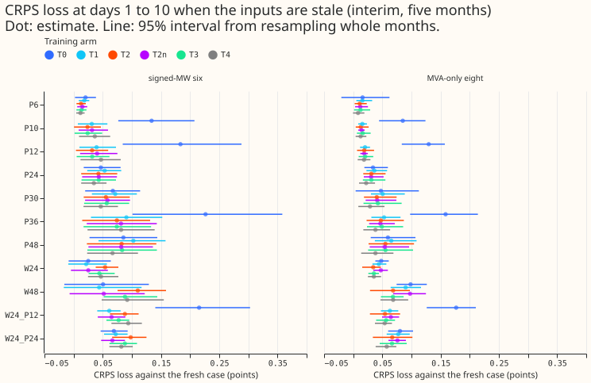
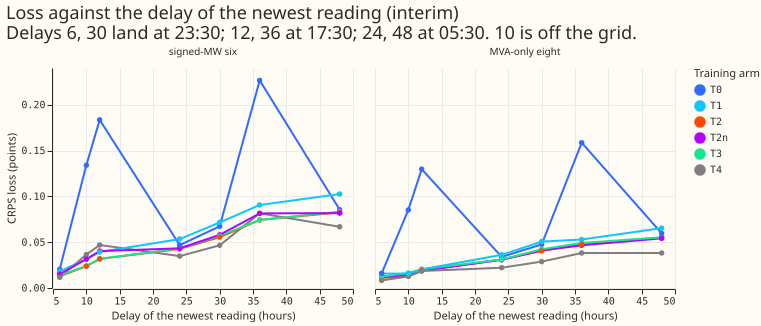
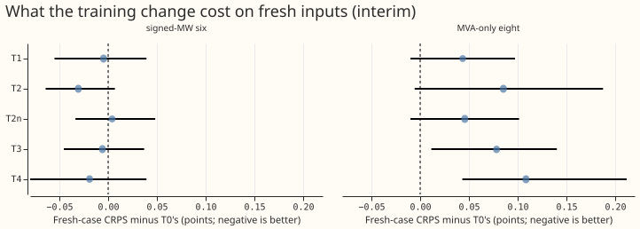
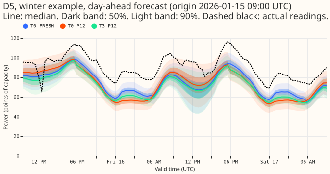
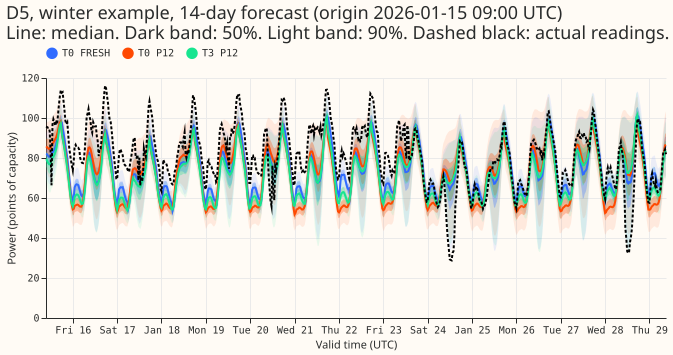
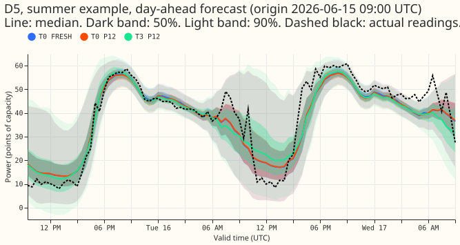
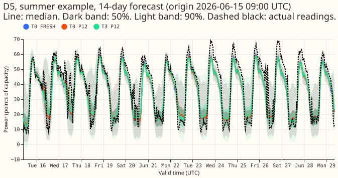

**Take-home message: the pooled network's loss from stale readings was a time-of-day mismatch, and
training with the forecast origin at many hours of the day removes it.** We asked whether the pooled
mixture density network (one neural network for all substations, from experiment 397) can be trained
to cope with a weather forecast that is a day old and with power readings that arrive late. Each
change to the inputs is an "arm" (keys below). Experiment 410 found that readings 12 hours late
raised the continuous ranked probability score (CRPS, days 1 to 10, points of effective capacity,
where one point is 1% of capacity) by 0.18 points at the six primary substations with signed meters
(the signed six) and by 0.13 at the eight with apparent-power meters (the MVA-only eight). When the
network is trained with the origin at eight hours of the day, those losses fall to 0.04 and 0.02
points (arm T1). **The pre-registered rule gives "partly supported".** Every experiment 410 limit
holds at both groups for the primary arm T3, but T3's score on fresh inputs is 0.078 points worse at
the MVA-only eight, above the +0.03 the rule allows. The age inputs add nothing: T2n, the same
training without them, does as well as T2.

**Key to the arms.** Training arms (offsets in hours after the 00:00 UTC run start; draws are made
once per training row and seed):

| Arm | Origin offset h | Reading delay d | Previous weather run | Origin lags missing | Age inputs |
|---|---|---|---|---|---|
| T0 | 9 | 0 | never | as in the data | no |
| T1 | 9, 12, 15, 18, 21, 24, 27, 30 | 0 | never | as in the data | no |
| T2 | as T1 | 0, 3, 6, 9, 12, 15, 18, 21, 24 | never | as in the data | yes |
| T2n | as T1 | as T2 | never | as in the data | no |
| T3 | as T1 | as T2 | probability 0.25 | as in the data | yes |
| T4 | as T1 | as T2 | probability 0.25 | all three, probability 0.10 | yes |

- **Test arms** are experiment 410's: FRESH, W24 and W48 (the weather forecast from the run one or
  two days earlier), P*n* (readings delayed by *n* hours: P6, P12, P24), both at once (W24_P12,
  W24_P24), and DROP (the three origin lags missing). New are P30, P36, and P48, which put the newest
  reading at the same hour of day as P6, P12, and P24 a day further back (23:30, 17:30, 05:30), and
  P10, which lies off the 3-hour training grid.
- **Reference columns.** S397 is experiment 410's stored pooled network (trained at 09:00 on power
  with no cleaning rules). S1M is experiment 410's XGBoost model, which is not refitted.
- **The age inputs** are the hours since the weather run and the hours since the newest reading
  (3.5 plus *d*), each over 48. The reading age is a linear function of two existing inputs (the lag
  ages and the lead), so it is redundant by construction; arm T2n tests that.

## Results

CRPS loss against each network's own fresh case, days 1 to 10 (points; positive is worse), five
screen months, so every number is interim. The "Fresh CRPS" row is the absolute score. The 95%
month-block intervals are in `contrasts_*.parquet` and Figure 1. Experiment 410's limits are 0.05
for P6 and P12 and 0.10 for W24, P24, W24_P12, and W24_P24.

Signed-MW six:

| Arm | S397 | T0 | T1 | T2 | T2n | T3 | T4 | S1M |
|---|---|---|---|---|---|---|---|---|
| Fresh CRPS | 3.270 | 3.324 | 3.319 | 3.293 | 3.328 | 3.318 | 3.305 | 3.525 |
| P6 | 0.024 | 0.020 | 0.018 | 0.013 | 0.015 | 0.014 | 0.012 | 0.020 |
| P10 | n/a | 0.134 | 0.031 | 0.024 | 0.032 | 0.024 | 0.036 | n/a |
| P12 | 0.197 | 0.183 | 0.039 | 0.032 | 0.040 | 0.032 | 0.047 | 0.306 |
| P24 | 0.037 | 0.047 | 0.053 | 0.043 | 0.043 | 0.043 | 0.035 | 0.042 |
| P30 | n/a | 0.067 | 0.072 | 0.055 | 0.058 | 0.057 | 0.047 | n/a |
| P36 | n/a | 0.226 | 0.091 | 0.074 | 0.081 | 0.074 | 0.082 | n/a |
| P48 | n/a | 0.085 | 0.103 | 0.082 | 0.082 | 0.083 | 0.067 | n/a |
| W24 | 0.029 | 0.025 | 0.022 | 0.054 | 0.025 | 0.044 | 0.047 | 0.029 |
| W48 | 0.056 | 0.051 | 0.044 | 0.110 | 0.052 | 0.088 | 0.092 | 0.058 |
| W24_P12 | 0.229 | 0.215 | 0.061 | 0.088 | 0.065 | 0.077 | 0.094 | 0.338 |
| W24_P24 | 0.064 | 0.069 | 0.072 | 0.098 | 0.066 | 0.088 | 0.082 | 0.071 |
| DROP | 9.728 | 2.443 | 1.743 | 2.053 | 1.728 | 2.097 | 0.296 | 4.532 |

MVA-only eight:

| Arm | S397 | T0 | T1 | T2 | T2n | T3 | T4 | S1M |
|---|---|---|---|---|---|---|---|---|
| Fresh CRPS | 3.873 | 3.832 | 3.876 | 3.918 | 3.878 | 3.911 | 3.941 | 3.995 |
| P6 | 0.022 | 0.016 | 0.016 | 0.011 | 0.012 | 0.013 | 0.008 | 0.010 |
| P10 | n/a | 0.085 | 0.016 | 0.013 | 0.014 | 0.016 | 0.013 | n/a |
| P12 | 0.151 | 0.130 | 0.020 | 0.019 | 0.019 | 0.021 | 0.019 | 0.098 |
| P24 | 0.031 | 0.034 | 0.036 | 0.031 | 0.031 | 0.031 | 0.022 | 0.041 |
| P30 | n/a | 0.048 | 0.051 | 0.040 | 0.041 | 0.042 | 0.029 | n/a |
| P36 | n/a | 0.159 | 0.053 | 0.047 | 0.047 | 0.049 | 0.038 | n/a |
| P48 | n/a | 0.060 | 0.065 | 0.055 | 0.054 | 0.055 | 0.038 | n/a |
| W24 | 0.047 | 0.048 | 0.044 | 0.034 | 0.047 | 0.036 | 0.035 | 0.032 |
| W48 | 0.093 | 0.098 | 0.090 | 0.068 | 0.098 | 0.068 | 0.069 | 0.064 |
| W24_P12 | 0.197 | 0.177 | 0.063 | 0.054 | 0.065 | 0.056 | 0.054 | 0.130 |
| W24_P24 | 0.076 | 0.080 | 0.077 | 0.067 | 0.076 | 0.067 | 0.058 | 0.072 |
| DROP | 6.504 | 1.899 | 1.700 | 1.822 | 1.667 | 1.831 | 0.318 | 3.684 |

- **Time of day explains the loss.** P12 falls from 0.183 (T0) to 0.039 (T1) at the signed six
  (T1 minus T0: -0.149, interval -0.233 to -0.072) and from 0.130 to 0.020 at the MVA-only eight
  (-0.066, interval -0.120 to -0.007). P36, which hits the same 17:30 hour, falls from 0.226 to
  0.091.
- **The delay itself costs little where the network was trained.** In T2 and T3 the loss grows by
  0.04 points from P6 to P30, P12 to P36, and P24 to P48 at the signed six, so each day of extra
  delay at a constant hour of day costs about 0.04 points. P10, off the training grid, loses 0.024,
  between P6 (0.013) and P12 (0.032).
- **The age inputs do not help.** T2 and T2n agree at P6, P12, and P24 (within 0.008 at the signed
  six). T2 loses more than T2n at W24 (0.054 against 0.025) and W24_P24 (0.098 against 0.066) at
  the signed six, and less at the MVA-only eight. In absolute terms the two networks score alike
  at W24 (3.347 against 3.353); T2 only gains 0.035 on fresh inputs, and the gain does not carry to
  W24. Feeding T2 a weather age of 9 hours reproduces T2n; clipping the age to 30 hours changes
  nothing (audit).
- **Missing readings.** T4 loses 0.30 (signed six) and 0.32 (MVA-only eight) points in DROP, against
  1.7 to 2.4 and 1.7 to 1.9 for T0 to T3. Its 90% interval is 1.07 and 1.09 times as wide as for
  fresh inputs, and its q95 coverage falls by 0.015 and 0.008 (T3: 0.163 and 0.124).
- **Against the XGBoost S1M model.** T3 loses less than S1M at P12 (0.032 against 0.306) and
  W24_P12 (0.077 against 0.338) at the signed six, and at the MVA-only eight (0.021 and 0.056
  against 0.098 and 0.130).

## Tails and cost on fresh inputs

- **Tail coverage holds.** At both groups, q95 and q99 coverage fall by at most 0.006 and 0.002 in
  every arm except DROP, P30, P36, P48, and W48, for every training arm. Fresh-case q95 coverage
  is 0.892 to 0.896 at the signed six and 0.945 to 0.949 at the MVA-only eight, q99 coverage
  0.960 to 0.962 and 0.988 to 0.990.
- **Cost on fresh inputs.** At the signed six, T1 to T4 score within 0.031 of T0 (T3 minus T0:
  -0.006, interval -0.045 to +0.037). At the MVA-only eight they score worse by +0.044 (T1),
  +0.085 (T2), +0.046 (T2n), +0.078 (T3), and +0.109 (T4); only T3 (interval +0.011 to +0.140) and
  T4 (+0.043 to +0.212) exclude zero. Per-seed fresh means agree (T0 3.905, T2n 3.959, T3 3.989,
  T4 4.047). The q95 and q99 pinball losses rise by under 0.03 and 0.01 at the MVA-only eight.
- **Seed spread.** The standard deviation across the three seeds of one arm's fresh CRPS is 0.01
  to 0.05 points. A contrast of two three-seed averages therefore carries a seed noise of about
  0.03 to 0.04, which the month-block intervals do not include, so a minimum detectable effect on
  a fresh-case contrast is about 0.07 points.

## Design, data, and caveats

- **Recipe.** Experiment 397's pooled plain network (setting `g09`, 3 Gaussian components, Primary
  embedding, ensemble mean and standard deviation of seven weather variables) with its training
  loop, early stopping on every twelfth week, and 1.15 widening; monthly refits on the 24 months
  before the refit; the five screen months and three seeds per arm; 90 fits at 15 to 45 seconds each
  on the GPU. Code reused from experiments 87, 397, and 410 is imported, not copied.
- **Cleaned data.** Flagged `substation_zero` half-hours are missing in lags and dropped from
  targets and scoring actuals: 153, 11, 0, 3, and 0 in the five test months, and about 52,000 to
  53,000 half-hours per fold from training (flagged, D15 and D18 before 2025-03-01, unobserved).
- **Rows.** Held-out weeks purge 15 days before and 9 days after, because a delay of 24 hours moves
  a lag a day back. Draws are once per row and seed, not per epoch.
- **Reproduction gate.** T0's fresh CRPS is 3.324 (signed six) and 3.832 (MVA-only eight) against
  the stored network's 3.270 and 3.873. The audit could not explain the 0.054 gap at the signed six
  (1.5 standard errors of a three-seed difference; the MVA-only eight shows the opposite sign).
  Every contrast here uses T0 and so does not depend on it.
- **Checks.** The median forecast minus the mean forecast is -0.23 to -0.27 points at the signed six
  and -0.39 to -0.47 at the MVA-only eight in every training arm. The error of the median
  forecast moves with the quantile score: T0 P12 raises the median's mean absolute error by 0.33
  points at the signed six (5.81 to 6.14), against 0.05 for T3. Triggers fired: a nested arm beats
  the arm that contains it (T2 against T2n at W24), a control moves more than expected (T0's DROP
  loss is 2.4 points against 9.7 for the stored network), and the results contradict predictions P2,
  P3, and P5. A fresh Sonnet audit re-derived the CRPS of T0, T2, T2n, and T3 in four arms by its own
  code (largest difference 0.0002), found no leakage, and explained the two anomalies.
- **Audit finding on DROP.** The D15 and D18 start cut leaves 9 times as many training rows with
  all three lags missing in T0 (0.20%) as in experiment 397's rows (0.022%). A refit of T0 without
  the cut loses 9.1 and 6.4 points in DROP, like the stored network. T0's DROP loss is therefore
  an accidental result of the start cut, and T4's 0.30 should be read against 2.4 (with the cut)
  and 9.1 (without).
- **Prediction outcomes.** P1 held for P12 (0.039 and 0.020) and P6, and failed for P24 at the signed
  six (0.053 against 0.05). P2 failed at W24 (T2's loss is 0.029 above T0's) and held for the delay
  arms, W24_P12 (0.088), and W24_P24 (0.098). P2n failed at W24, W24_P12, and W24_P24 at the signed
  six. P3 held for W24 (0.044) and W48 above W24, and failed for W24_P12 (0.077) and W24_P24
  (0.088). P4 held at the signed six (0.042, 0.042, 0.040 in T2) and failed at the MVA-only eight
  (0.034, 0.028, 0.016). P5 held at the signed six and failed at the MVA-only eight. P6 held. P7
  held. P8 held. P9 held (P10 within 0.002 of the interpolation).
- **Decision rule.** T3 meets every experiment 410 limit at both groups on point estimates; its
  W24_P24 upper bound at the signed six is 0.109, above 0.10. The fresh-case cost at the MVA-only
  eight (+0.078) exceeds +0.03, so the verdict is "partly supported". T1, T2n, T2, and T4 also meet
  the limits. The experiment 410 limits were proposed without evidence, and the numbers are given
  beside them for the maintainer to judge.
- **Caveats.** Five test months give wide intervals; the audit's mechanism for T2's W24 result
  (age and origin hour are tied in training and decoupled at test) is inferred, not tested. The
  lead range is days 1 to 10 for substations; NGED's horizon is 1 to 10 days. No XGBoost model was
  refitted, and P30, P36, P48, and P10 were scored for the neural networks only.
- **What to try next.** Test T1 with the full scored year, and check the fresh-case score at the
  MVA-only eight with more seeds. Train with the three lags sometimes missing (T4) before the
  network faces absent readings. Decouple the weather age from the origin hour in training before
  using the age input again. Fits and forecasts: `data/ml-experiments/00422-*/work/` (not in git).
