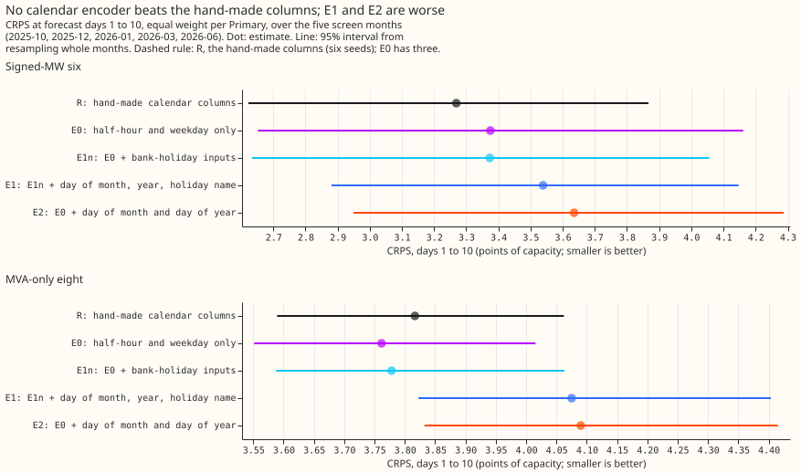
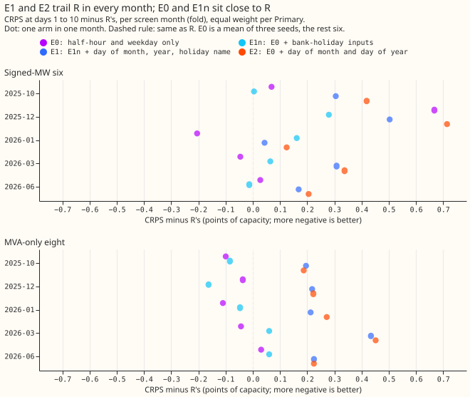
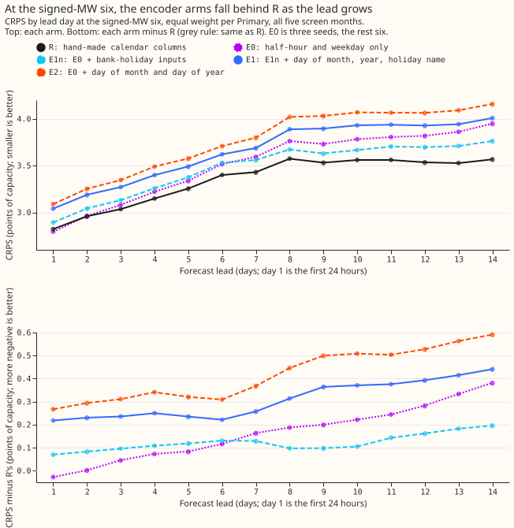
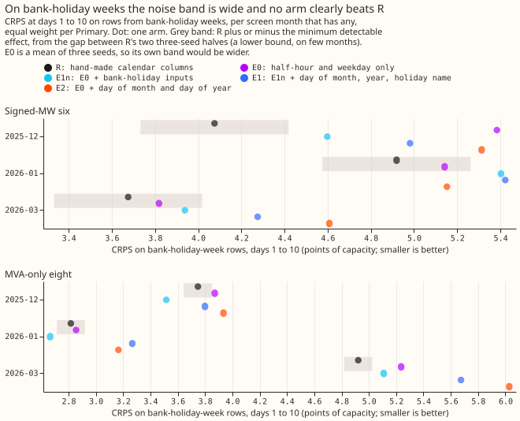
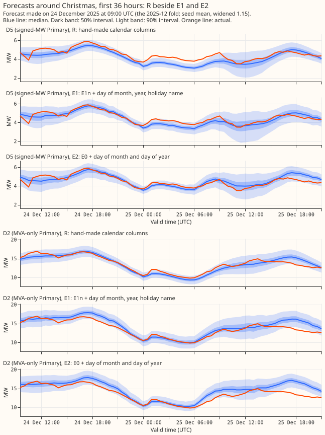
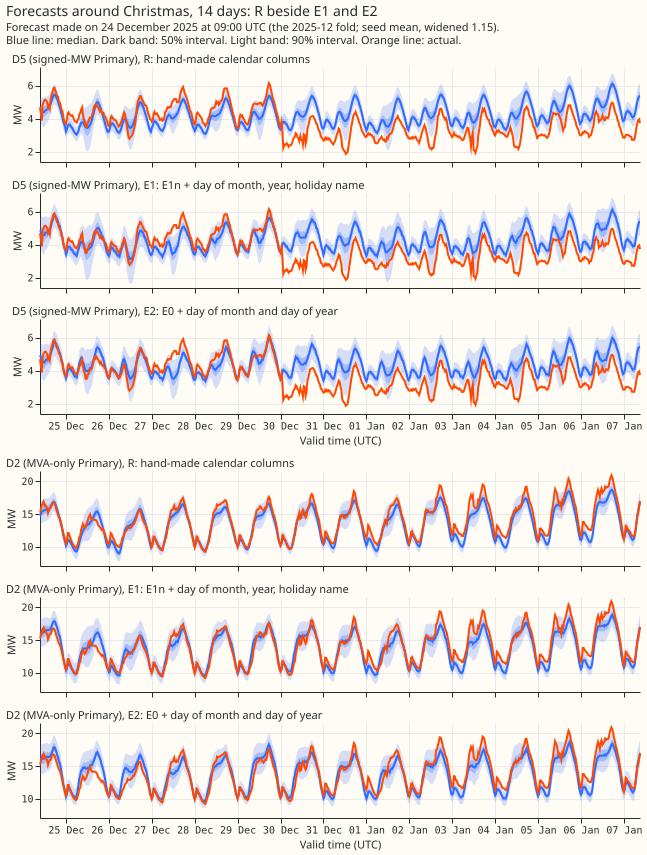

**Plan: can the pooled network learn how people use the calendar, instead of being handed it?**

> **Caveat that governs the verdict.** The bank-holiday-week rows are 14 days of one Christmas and
> New Year week and 2 days of Easter week, in three test months. The seed noise on those rows (the
> minimum detectable effect for six-seed means at the signed-MW six) is 0.343 points of capacity,
> against the 0.10 that prediction P1 needs. By the plan's own rule P1 is therefore untestable at
> the five screen folds, and the page will report it as untestable whatever the point estimate.
> The tested all-rows contrasts (C1, C2, C4) and the descriptive Christmas and Easter scores are
> what this experiment can answer; the 2026-04 event fold adds 6 Easter days.

## Design note (Sonnet read of the docs sketches and experiment 396's holiday arms)

- **The only encoder sketch is `TimeEncoder` in the production docs'
  [encoders page](https://openclimatefix.github.io/nged-substation-forecast/techniques/encoders/).**
  It names time of day, day of week, month, bank holidays, Christmas, and Easter, and gives no
  sizes or training recipe.
- **The pooled plain network gets 18 hand-made calendar columns today** (experiment 397,
  `e00397_prep.feature_names`): sine and cosine of the hour at 1 and 2 cycles, a one-hot weekday,
  `covid`, three Christmas columns, `bank_holiday`, and two distance columns, from
  `holidays.country_holidays("GB", subdiv="ENG")`. It never sees a holiday name, a day of month, or
  a day of year.
- **Experiment 396 (XGBoost)** adds a bank-holiday flag, a signed distance clipped at 7 days,
  day-before and day-after flags, and a holiday-type code (bank holiday, Easter, Christmas period,
  New Year, other).
- **Each named holiday has only one or two days in a training window.** The window is the 24 months
  before the refit, clipped at 2024-04-01.

| Holiday | 2025-10 | 2025-12 | 2026-01 | 2026-03 | 2026-06 |
|---|---|---|---|---|---|
| Christmas Day | 1 | 1 | 2 | 2 | 2 |
| Boxing Day | 1 | 1 | 2 | 2 | 2 |
| New Year's Day | 1 | 1 | 1 | 2 | 2 |
| Good Friday | 1 | 1 | 1 | 1 | 2 |
| Easter Monday | 2 | 2 | 2 | 2 | 2 |
| Early May, spring, summer | 2 | 2 | 2 | 2 | 2 |
| All bank holidays | 12 | 12 | 14 | 15 | 16 |

- **What that limits.** An embedding for "Christmas Day" is fitted on one or two days, so it can
  memorise them and not generalise. A holiday-name encoder can help only by tying holidays
  together: the five Monday bank holidays share one type with 8 to 10 days. A dates-only encoder
  cannot follow Easter between years. Any Easter result rests on two days, so the expected gain is
  small and sits in E1 against E2, and in shared against per-Primary encoders.

- **Experiment 396's holiday columns helped one metering group only.** In January they lowered
  the XGBoost CRPS by 0.046 points at the signed-MW group (interim, unaudited) and raised it at the
  MVA-only group. The plan therefore scores E1 and E2 separately for the signed-MW six and the
  MVA-only eight in every contrast, and does not expect the holiday-aware encoder to help the
  eight.

## Arms

All arms keep the weather, solar, lag, and `covid` inputs, the 8-wide Primary embedding, the
standardiser (fitted on the training rows; the encoder's integer indices bypass it), the trunk
width and depth, the optimiser, the held-out-weeks early stopping grouped by origin day
(experiment 397's `held_out_weeks`), and the row drops of experiments 407 and 419
(`e00419_fit.build_train`). Only the 18 calendar columns change.

- **R (reference).** The 18 hand-made calendar columns; stored forecasts of experiments 407 and
  419, not refitted on the five screen folds. R0 is a check: R refitted through the new code path
  (seed 0, fold 2025-12, and on 2026-04), which must reproduce the stored R within seed noise.
- **E0 (memorisation control).** Local half-hour (8-wide embedding) and weekday (4-wide) only; then
  Linear 32, GELU, Linear 16. Seeds 0 to 2.
- **E1n.** E0 plus the two distance columns (`nearest_days`, `nearest_inside`) and a bank-holiday
  flag, with no holiday name.
- **E1.** E1n plus the holiday name (12 categories: none, New Year's Day, Good Friday, Easter
  Monday, early May, spring, summer, Christmas Day, Boxing Day, other bank holiday, substitute
  day, 24 to 31 December non-holiday; the code lists them from the `holidays` package) as a
  4-wide embedding, and day of month (4-wide) and day of year (366 buckets, 4-wide).
- **E2.** The dates only: E0 plus day of month and day of year, with no holiday information of any
  kind. E2 minus E0 isolates the date columns, and E1 minus E1n isolates the holiday name.
- **E3 (conditional).** One E1 per Primary.

Each encoder outputs 16 wide and trains end to end on the same loss. The hour index is the local
half-hour, so the clock changes land on the same index.

## Row sets and folds

Row sets use the local calendar date of the valid time, as in `e00396_arms.add_calendar`: bank
holiday day; bank-holiday week (Monday to Sunday); Christmas set (24 December to 1 January); Easter
set (Monday of Holy Week to Easter Monday).

| Row set (days in the test month) | 2025-10 | 2025-12 | 2026-01 | 2026-03 | 2026-06 |
|---|---|---|---|---|---|
| Bank-holiday days | 0 | 2 | 1 | 0 | 0 |
| Bank-holiday-week days | 0 | 10 | 4 | 2 | 0 |
| Christmas set | 0 | 8 | 1 | 0 | 0 |
| Easter set | 0 | 0 | 0 | 2 | 0 |

- **The five screen folds hold one Christmas and a two-day sliver of Easter week.** The plan adds
  the event fold 2026-04 (Good Friday 2026-04-03, Easter Monday 2026-04-06), which gives the Easter
  set 8 days, if the fold's weather inputs exist for the pooled network. Otherwise Christmas and
  Easter appear only as example charts.

## Standing practices followed

- **Monthly refits** on the 24-month window of experiment 397's folds; **cleaned data** (flagged
  exact-zero half-hours dropped, counts printed per fold); **D15 and D18 cut before 2025-03-01**;
  **ENS mean and spread passed once**; **fitted networks saved** under this experiment's private
  folder; **stored forecasts reused** (R), which saves 30 fits.
- **Cost.** E1, E1n, and E2 times 5 folds times 6 seeds is 90 fits and E0 adds 15, each of 50 to
  200 seconds. The 2026-04 event fold adds 21 and R0 adds 6; E3 adds 30 if it runs. One GPU
  process under 8 GB, one feeder core, `MemoryMax=8G`, `OMP_NUM_THREADS=1`. The encoder indices
  are integers, precomputed once per refit.
- **Earlier experiments adopted.** Experiment 419: none of its input changes won, so the reference
  stays `ctrl`. Experiment 410: training at other origin hours is experiment 422's subject and is
  not adopted here. Experiments 406 and 403: the Primary embedding and pooling are kept.
- **Plan reviewed against the latest evidence** (`origin/main`, 2026-10-31): experiment 419 showed
  that seed noise moves the six by about 0.011 and the MVA-only eight by 0.047, so the plan uses
  six seeds and prints the minimum detectable effect; the planned experiments 418, 421, and 422
  change the training data or inputs of the same network. Their plans do not mention the calendar
  columns, except one calendar term in 422's. This experiment's code is merged with theirs after
  they land.
- **Changes after the Sonnet plan review.** Added E0 (a control for calendar memorisation) and E1n
  (so that E1 minus E1n isolates the holiday name); required the minimum detectable effect on the
  bank-holiday-week rows; stated that a verdict on P1 is a one-Christmas result; dropped the
  "no worse" claim in favour of "inside the noise"; added R0, a refit of R through the new code
  path, to prove the reference matches; kept the descriptive contrasts outside the correction.

## Results

**Take-home.** The calendar encoder did not help. The hand-made columns (R) beat every encoder
arm at the signed-MW six, and the encoder with dates (E1 and E2) was worse by 0.2 to 0.4 points of
capacity in every fold. The arm with no dates (E0 and E1n) was within the noise of R at the
MVA-only eight and 0.10 worse at the six. The prediction about bank-holiday weeks could not be
tested.

We asked whether the pooled neural network forecasts better if it learns how people use the
calendar, instead of being given 18 hand-made calendar columns. We replaced the 18 columns by a
small learned encoder, shared by all 16 substations, and compared four versions with the
columns on five test months. This builds on experiments
[397](../00397-plain-and-attention-mixture-density-network-for-primary-demand/result.md),
[407](../00407-pooled-mixture-density-network-tail-arms-and-recency-weights/result.md), and
[419](../00419-pooled-mixture-density-network-solar-summary-sunny-flag-and-half-life-input-ports/result.md),
whose code and stored forecasts are reused, and on the encoder sketch in the production docs'
[encoders page](https://openclimatefix.github.io/nged-substation-forecast/techniques/encoders/).

**Verdict: not supported.** The hypothesis needed the encoder to help in holiday weeks and to be
no worse elsewhere. It was clearly worse elsewhere.

The example forecasts start on 2025-12-24 and cover D5 (signed-MW) and D2 (MVA-only), both
Primaries. At D5 the actuals fall below every arm's median from 30 December, which looks like a
level shift in the actuals and not an effect of any arm.

## Numbers

- **Arms and row set.** R is the stored `ctrl` network (experiment 407, seeds 0 to 2; experiment
  419, seeds 3 to 5). E0, E1n, E1, and E2 are as in the plan above; E0 has three seeds and the others
  six. Five screen folds, monthly refits, cleaned data (flagged exact-zero training rows dropped
  per fold: 2,155, 2,846, 2,886, 2,899, 2,925; 1,179 scoring half-hours dropped), D15 and D18 cut
  before 2025-03-01 (report-only). Widened by 1.15. Fitted networks are in this experiment's
  private `work/models` folder.
- **CRPS, days 1 to 10 (points of capacity), all rows, signed-MW six / MVA-only eight / D15 and
  D18:** R 3.269 / 3.817 / 8.565; E0 3.375 / 3.762 / 8.744; E1n 3.373 / 3.778 / 8.971; E1 3.539 /
  4.075 / 9.026; E2 3.635 / 4.090 / 9.002.
- **Seed noise.** The minimum detectable effect for six-seed means (twice the standard deviation
  over folds of `ctrl` against `ctrl_s3`, divided by the square root of two) is 0.052 at the six and
  0.047 at the eight; for three-seed means 0.074 and 0.066. On the bank-holiday-week rows it is
  0.343 at the six (three folds, two degrees of freedom) and 0.103 at the eight.
- **Tested contrasts** (treatment minus reference, interval at 98.75%, month-block bootstrap over
  3 to 5 blocks, so read as a range): C1 E1 minus R, all rows: +0.270 (+0.096 to +0.425) at the
  six, +0.258 (+0.202 to +0.387) at the eight. C2 E2 minus R: +0.366 (+0.167 to +0.596) and +0.273
  (+0.200 to +0.399). C3 E1 minus E1n on bank-holiday weeks: +0.353 (+0.020 to +0.384) at the six,
  +0.390 at the eight; positive in all three folds (+0.384, +0.020, +0.337). C4 E2 minus E0, seeds
  0 to 2 both: +0.303 (+0.159 to +0.429) and +0.384 (+0.282 to +0.537).
- **P1 (holiday names help on bank-holiday weeks by 0.10):** untestable, the detectable effect is
  0.343; the point estimate went the other way (+0.353).
- **P2:** failed for E1 and E2, which are outside the noise at both groups; E0 and E1n are 0.10
  worse at the six (outside the six-seed noise of 0.052) and about the size of the noise at
  the eight, where they are better (-0.055 and -0.039 against 0.047).
- **P3 (E2 no better than E0):** held, E2 is 0.26 to 0.30 worse.
- **P4 (does not help the eight):** held, no arm beats R at the eight by more than the noise.
- **Christmas set, signed-MW six (one Christmas, descriptive):** R 3.676, E0 5.316, E1n 4.238, E1
  4.724, E2 5.336. **Easter set, signed-MW six (2 days in March):** R 3.781, E0 3.935, E1n 4.089,
  E1 4.437, E2 4.765.
- **Event fold 2026-04 (one-seed R0 against encoder seed means; point estimates only):** signed-MW
  six: R0 2.687, E0 2.652, E1n 2.613, E1 3.042, E2 2.932. MVA-only eight: R0 4.161, E0 4.244,
  E1n 4.102, E1 4.605, E2 4.569. Easter set, signed-MW six: R0 2.937, E1n 2.887, E1 3.284, E2
  3.967. The same ordering as the screen folds.
- **Tails (widened by 1.15), coverage at q95 and q99 and pinball loss at q99, signed-MW six:** R
  0.894, 0.961, 0.350; E1n 0.885, 0.953, 0.371; E1 0.907, 0.971, 0.314; E2 0.905, 0.973, 0.295.
  MVA-only eight: R 0.947, 0.989, 0.255; E1 0.945, 0.987, 0.315; E2 0.946, 0.987, 0.317. The
  encoders with dates (E1, E2) have a lower q99 pinball loss at the six and a higher one at the
  eight. Lower-tail coverage at q01 and q05 and the sunny low-demand check are in the scorer's
  printed report.

## Checks

- **Median minus mean forecast, per site (MAE of the median minus MAE of the mean):** within
  +/-0.17 points at every Primary for every arm except D8 (-0.68 to -0.93) and D15 (+0.82 to
  +1.66). R shows the same two exceptions (D8 -0.68, D15 +0.82), so the encoder does not introduce
  a shift of the forecast.
- **Error of the mean or median forecast beside the quantile contrast:** this run did not print the
  MAE of the median or of the mean on its own, only their difference above, so trigger 3 was not
  checked directly. The audit's re-derivation of the CRPS contrasts agrees in sign with the
  scorer's.
- **Audit.** Two triggers fired: a result contradicting its prediction (E1 and E2 worse than R) and a
  nested arm doing worse than the arm it contains (E1 against E1n, E2 against E0). A fresh
  Sonnet audit re-derived the contrasts from the stored forecasts with its own CRPS code and agreed
  within 0.01 (E1 minus R +0.266, E2 minus R +0.360 at the six). It looked for a bug and found none:
  training and inference build the calendar indices the same way, the encoder weights train, and the
  row drops are identical across arms. The held-out validation loss agrees with the test CRPS: E1
  and E2 end 0.12 to 0.17 nats worse than E1n and stop after about 10 epochs, against 25 to 35 for
  the other arms.
- **Triage.** The memorisation explanation is consistent with these numbers but untested: the
  366-row day-of-year table stays close to its random start, so the encoder may be passing noise
  into the network, and a zero-initialised or shuffled-bucket placebo would separate the two
  readings. Accepted, and worded as "consistent with" here. The day-of-year index is the
  per-year ordinal, so dates after February 2024 sit one bucket later than in 2025 and 2026; this
  touches only folds 2025-10 and 2025-12 and does not explain the other three folds. Accepted as a
  caveat. `dropped_rows.json` holds one value per fold and not per arm; the fit log holds the
  per-arm counts. No finding changed a number.

## Caveats

- **The training window holds one or two examples of each named holiday** (design note above), so the
  question of whether names can tie holidays together was tested on little data.
- **Five screen folds are interim.** The month-block intervals rest on three to five blocks.
- **Experiment 396's holiday columns helped only the signed-MW group** (XGBoost, January,
  unaudited); here no encoder arm helps either group on all rows.
- **Not run:** the per-Primary encoder (E3), because its condition (C1 below zero or C3 at most
  -0.05) did not hold; a placebo for the memorisation explanation; and the lead-hours bands 11 to 14.

## What to try next

- **Keep the hand-made calendar columns.** The question the experiment leaves open is whether a
  pooled network with a longer history (the pretraining of experiment 418) can use date embeddings,
  and a placebo (zero-initialised or shuffled day-of-year) would show whether the dates carry any
  signal at all.
